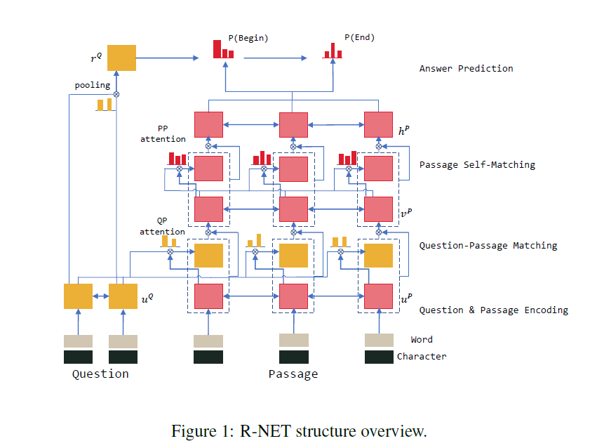

## 简介

机器阅读理解（Machine Reading Comprehension）是指让计算机阅读一段文本，并据此回答与文中内容相关的问题。斯坦福大学发布的 SQuAD 数据集是该领域最具影响力的基准数据集之一。微软亚洲研究院提出的 R-Net 模型是首个在部分指标上接近人类水平的深度学习模型，本文将对 R-Net 的原理进行详细解读。

## 问题定义

机器阅读理解的每个样本由一个三元组构成：**文章**（Passage, $P$）、**问题**（Query, $Q$）和**答案**（Answer, $A$），记作 $(P, Q, A)$。模型的输入是文章和问题，输出是从文章中抽取的答案片段的起始和终止位置。

## R-Net 模型结构

R-Net 模型整体结构如下图所示：

模型由四个核心模块组成：

1. **Question and Passage Encoder**：问题和文章的编码层
2. **Gated Attention-Based Recurrent Networks**：基于门控注意力的循环网络
3. **Self-Matching Attention**：自匹配注意力网络
4. **Output Layer**：基于 Pointer Network 的输出层

## 原理详解

### Question and Passage Encoder

编码层将文章 $P$ 和问题 $Q$ 中的每个词映射为低维向量。R-Net 采用 **GloVe 词向量 + 字符级嵌入（Char Embedding）** 的双重表示：

- GloVe 词向量：$P=\{e_{t}^{P}\}_{t=1}^{n}$，$Q=\{e_{t}^{Q}\}_{t=1}^{m}$
- 字符级嵌入：$P_{c}=\{c_{t}^{P}\}_{t=1}^{n}$，$Q_{c}=\{c_{t}^{Q}\}_{t=1}^{m}$

将两者拼接后输入双向 GRU（BiGRU）网络，得到上下文感知的编码表示：

$$u_{t}^{Q}=\text{BiRNN}_{Q}(u_{t-1}^{Q},[e_{t}^{Q},c_{t}^{Q}])$$

$$u_{t}^{P}=\text{BiRNN}_{P}(u_{t-1}^{P},[e_{t}^{P},c_{t}^{P}])$$

其中 $u_{t}^{P}$ 和 $u_{t}^{Q}$ 分别表示文章和问题中第 $t$ 个词的编码向量。

### Gated Attention-Based Recurrent Networks

这一层将问题信息以注意力的方式融入文章表示中。具体而言，对于文章中的第 $t$ 个词，模型计算其对问题 $Q$ 中所有词的注意力权重：

$$s_{j}^{t}=v^{T}\tanh(W_{u}^{Q}u_{j}^{Q}+W_{u}^{P}u_{t}^{P}+W_{v}^{P}v_{t-1}^{P})$$

$$a_{i}^{t}=\exp(s_{i}^{t})/\sum\limits_{j=1}^{m}\exp(s_{j}^{t})$$

$$c_{t}=\sum\limits_{i=1}^{m}a_{i}^{t}u_{i}^{Q}$$

其中 $c_{t}$ 是问题 $Q$ 在当前文章位置的注意力池化向量，$v_{t-1}^{P}$ 是上一时刻的隐状态。

R-Net 在 Match-LSTM 的基础上做了两点改进：

**第一，将注意力向量与当前词编码拼接**，一起输入 RNN：

$$v_{t}^{P}=\text{RNN}(v_{t-1}^{P},[c_{t},u_{t}^{P}])$$

**第二，引入门控机制**，通过门控单元自适应地筛选与当前文章位置相关的问题信息：

$$g_{t}=\sigma(W_{g}[u_{t}^{P},c_{t}])$$

$$[u_{t}^{P},c_{t}]^{*}=g_{t}\odot[u_{t}^{P},c_{t}]$$

门控值 $g_{t} \in (0,1)$ 控制了信息流入的比例，使模型能够更好地抽取与文章相关的问题信息。

### Self-Matching Attention

自匹配注意力借鉴了 *Attention Is All You Need* 中的自注意力思想，让文章中的每个词直接与文章中的所有词进行交互，从而捕获段落内部的语义关联：

$$h_{t}^{P}=\text{BiRNN}(h_{t-1}^{P},[c_{t},v_{t}^{P}])$$

其中 $c_{t}=\text{att}(v^{P},v_{t}^{P})$ 是基于当前词对整篇文章的注意力池化，具体计算为：

$$s_{j}^{t}=v^{T}\tanh(W_{v}^{P}v_{j}^{P}+W_{v}^{\hat{P}}v_{t}^{P})$$

$$a_{i}^{t}=\exp(s_{i}^{t})/\sum\limits_{j=1}^{n}\exp(s_{j}^{t})$$

$$c_{t}=\sum\limits_{i=1}^{n}a_{i}^{t}v_{i}^{P}$$

自匹配注意力使每个词的最终表示 $h_{t}^{P}$ 同时包含局部匹配信息和全局上下文信息，这是 R-Net 性能提升的关键因素之一。

### Output Layer

输出层借鉴了 Pointer Network 的思想，直接在文章中定位答案的起始和终止位置。

模型首先将问题 $Q$ 通过注意力池化压缩为一个向量 $r^{Q}$：

$$s_{j}=v^{T}\tanh(W_{u}^{Q}u_{j}^{Q}+W_{v}^{Q}v_{r}^{Q})$$

$$a_{i}^{t}=\exp(s_{i}^{t})/\sum\limits_{j=1}^{n}\exp(s_{j}^{t})$$

$$r^{Q}=\sum\limits_{i=1}^{n}a_{i}u_{i}^{Q}$$

然后以 $r^{Q}$ 作为初始状态，通过一个 RNN 循环两次，依次预测起始位置和终止位置：

$$h_{t}^{a}=\text{RNN}(h_{t-1}^{a},c_{t})$$

其中每一步的 $c_{t}$ 是对文章编码的注意力池化：

$$s_{j}=v^{T}\tanh(W_{u}^{P}u_{j}^{P}+W_{h}^{a}h_{t-1}^{a})$$

$$a_{i}^{t}=\exp(s_{i}^{t})/\sum\limits_{j=1}^{n}\exp(s_{j}^{t})$$

$$c_{t}=\sum\limits_{i=1}^{n}a_{i}^{t}h_{i}^{P}$$

每次循环通过 argmax 得到一个位置：

$$p^{t}=\arg\max\{a_{1}^{t},\dots,a_{n}^{t}\}$$

两次循环分别得到 $p_{1}$（起始位置）和 $p_{2}$（终止位置）。由于起始位置必须位于终止位置之前，且答案长度有一定范围限制，最终的有效预测区域是位置-位置矩阵的**上三角部分**。
