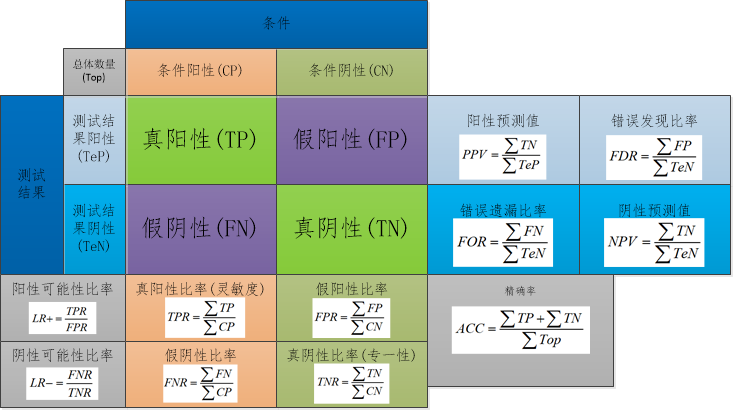
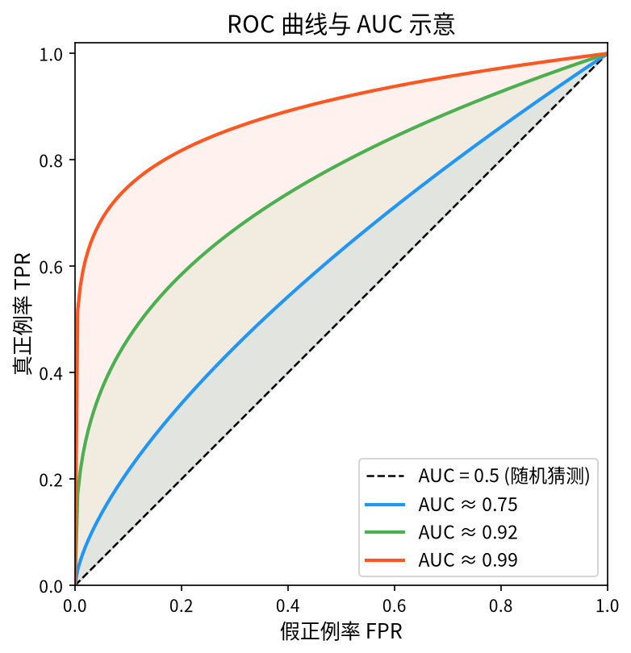
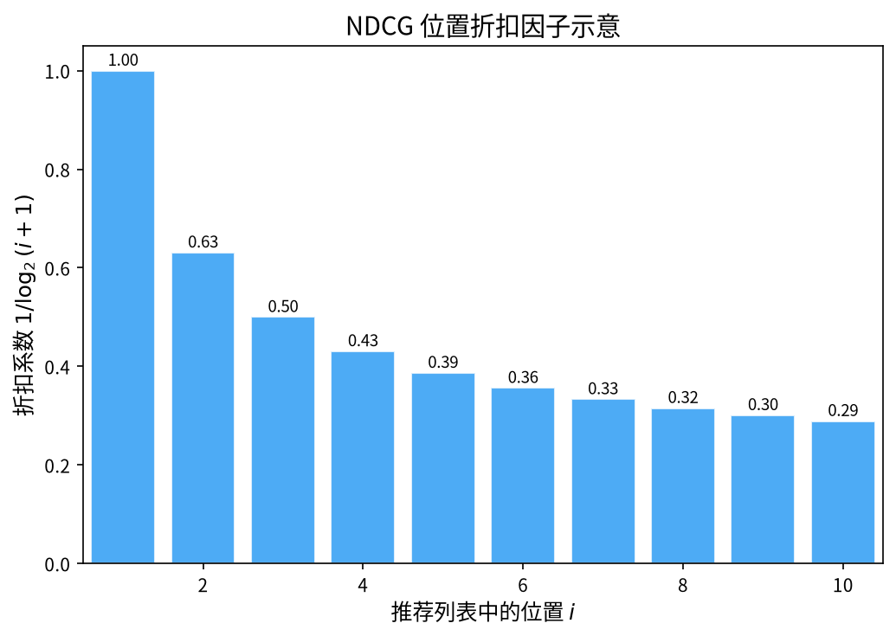

在机器学习与深度学习的研究中，如何科学地评估模型性能是一个核心问题。本文整理了论文中常见的几类评价指标：**混淆矩阵相关指标**（Accuracy、Precision、Recall、Fβ-Score 等）、**ROC 曲线与 AUC**、以及推荐系统中广泛使用的 **HR@K、MAP、NDCG、MRR** 等。

## 混淆矩阵

混淆矩阵是分类模型评估中最基础的工具，它以 $n \times n$ 矩阵的形式直观地呈现模型预测结果与真实标签之间的关系。在二分类问题中，混淆矩阵的结构如下：

基于混淆矩阵的四个基本量（TP、TN、FP、FN），可以派生出多个评价指标：

### 准确率（Accuracy）

准确率衡量预测正确的样本占全部样本的比例，适用于类别分布均衡的场景。

$$Acc=\dfrac{TP+TN}{TP+TN+FP+FN}$$

### 精确率（Precision）

精确率表示在所有被模型预测为正类的样本中，真实为正类的比例。它关注的是预测的可靠性。

$$Precision=\dfrac{TP}{TP+FP}$$

### 召回率（Recall）

召回率表示在所有真实为正类的样本中，被模型正确预测出来的比例。它关注的是对正类的覆盖能力。

$$Recall=\dfrac{TP}{TP+FN}$$

### Fβ-Score

Precision 和 Recall 之间存在天然的权衡关系。Fβ-Score 通过参数 $\beta$ 调节两者的相对重要性：$\beta < 1$ 偏重 Precision，$\beta > 1$ 偏重 Recall。通常取 $\beta = 1$，称为 F1-Score，即两者的调和平均。

$$F_{\beta}=(1+\beta^{2})\cdot\dfrac{Precision\cdot{Recall}}{(\beta^{2}\cdot{Precision})+Recall}$$

### ROC 曲线与 AUC

ROC 曲线以假正例率（FPR）为横轴、真正例率（TPR）为纵轴，通过改变分类阈值绘制出一系列 $(FPR, TPR)$ 点，从而展现模型在不同阈值下的整体表现。AUC 即 ROC 曲线下的面积：

AUC 的取值范围及其含义如下：

| AUC 范围 | 含义 |
|:---|:---|
| $AUC=1$ | 完美分类器，实际应用中极为罕见 |
| $0.5<AUC<1$ | 优于随机猜测，具有预测价值 |
| $AUC=0.5$ | 与随机猜测无异 |
| $0<AUC<0.5$ | 劣于随机猜测（反向使用可优于随机） |

## Hit Ratio（HR）

HR 是推荐系统中常用的召回指标，衡量在 Top-K 推荐列表中命中测试集物品的比例：

$$HR@K=\dfrac{Num@K}{GT}$$

其中 $Num@K$ 为所有用户的 Top-K 推荐列表中命中 Ground-Truth 物品的总数，$GT$ 为测试集中所有 Ground-Truth 物品的总数。

## Mean Average Precision（MAP）

AP（Average Precision）用于评估排序质量。以搜索引擎为例：给定一个查询，系统返回 10 个结果，若只有 5 个相关，那么这 5 个结果排得越靠前，AP 越高；反之，若相关结果排在列表末尾，AP 就会很低。AP 本质上是一种**对顺序敏感的召回率**。

对于用户 $u$，其平均准确率为：

$$AP_{u}=\dfrac{1}{\Omega_{u}}\sum\limits_{i\in{\Omega_{u}}}\dfrac{\sum\limits_{j\in{\Omega_{u}}}h(p_{uj}<p_{ui})+1}{p_{ui}}$$

其中 $\Omega_{u}$ 表示用户 $u$ 的 Ground-Truth 集合，$p_{ui}$ 表示物品 $i$ 在推荐列表中的位置，$p_{uj}<p_{ui}$ 表示物品 $j$ 排在物品 $i$ 之前。

MAP 是所有用户 AP 的算术平均：

$$MAP=\dfrac{\sum\limits_{u\in{U}}AP_{u}}{|U|}$$

## Normalized Discounted Cumulative Gain（NDCG）

NDCG 是排序质量评估中最常用的指标之一，它依次建立在 CG、DCG 的概念之上。

### 累积增益（CG）

CG 直接将推荐列表中每个位置的相关性分数累加：

$$CG_{k}=\sum\limits_{i=1}^{k}rel_{i}$$

其中 $rel_i$ 表示位置 $i$ 推荐结果的相关性，$k$ 为推荐列表长度。CG 的缺点在于**不考虑位置因素**——无论相关结果排在前面还是后面，累加值相同。

### 折损累积增益（DCG）

DCG 在 CG 的基础上引入位置折扣，位置越靠后，对总分的贡献越小：

$$DCG_{k}=\sum\limits_{i=1}^{k}\dfrac{2^{rel_{i}}-1}{\log_{2}(i+1)}$$

下表展示了折扣因子 $1/\log_2(i+1)$ 随位置的变化，可以直观地看到位置越靠后衰减越快：

### 归一化折损累积增益（NDCG）

不同用户的推荐列表长度和相关性分布不同，直接比较 DCG 没有意义。NDCG 通过除以理想情况下的 DCG（即 IDCG）进行归一化：

$$NDCG_{u}@K=\dfrac{DCG_{u}@K}{IDCG_{u}}$$

其中 IDCG 为将 Ground-Truth 按相关性降序排列后计算的 DCG。NDCG@K 的取值范围为 $(0, 1]$，值越大表示排序越接近理想排序。

对所有用户取平均得到整体的 NDCG@K：

$$NDCG@K=\dfrac{\sum\limits_{u\in{U}}NDCG_{u}@K}{|U|}$$

## Mean Reciprocal Rank（MRR）

MRR 关注**第一个正确结果**在推荐列表中的排名，适用于只需要找到一个正确答案的场景（如问答系统、知识图谱链接预测）：

$$MRR=\dfrac{1}{|Q|}\sum\limits_{i=1}^{|Q|}\dfrac{1}{rank_{i}}$$

其中 $|Q|$ 为查询（用户）的数量，$rank_i$ 为第 $i$ 个用户的推荐列表中第一个命中 Ground-Truth 的物品所在的位置。

## 指标对比总结

| 指标 | 关注点 | 是否顺序敏感 | 典型场景 |
|:---|:---|:---:|:---|
| Accuracy | 分类正确比例 | — | 均衡分类任务 |
| Precision | 预测正类的可靠性 | — | 搜索结果去噪 |
| Recall | 正类的覆盖程度 | — | 医疗筛查、信息召回 |
| F1-Score | Precision 与 Recall 的调和 | — | 类别不平衡 |
| AUC | 阈值无关的排序能力 | ✓ | 二分类整体评估 |
| HR@K | Top-K 命中率 | 部分敏感 | 推荐召回 |
| MAP | 相关结果的整体排序 | ✓ | 推荐排序 |
| NDCG@K | 考虑位置折损的排序 | ✓ | 推荐排序、检索排序 |
| MRR | 首个正确结果的排名 | ✓ | 问答、知识图谱补全 |
