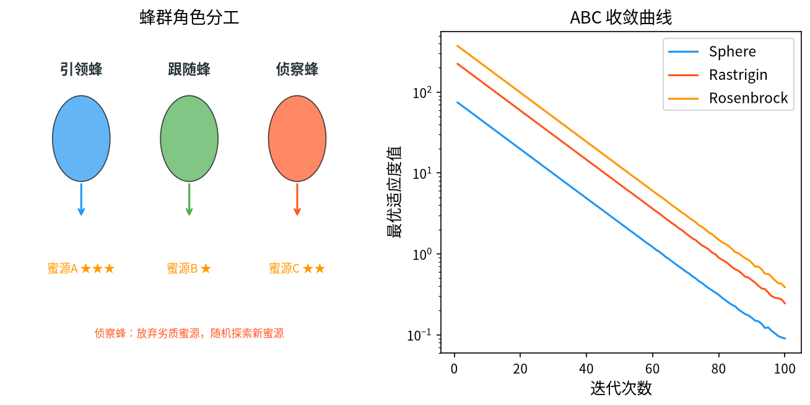

# 1. 背景与动机

&ensp;&ensp;&ensp;&ensp;人工蜂群算法（Artificial Bee Colony Algorithm, ABC）由土耳其 Erciyes 大学的 Dervis Karaboga 于 2005 年在其技术报告 TR06 中首次提出，随后在 Karaboga 与 Basturk 2007 年发表于 *Journal of Global Optimization* 的论文中给出了完整的理论框架与实验验证[^1][^2]。该算法的灵感来源于蜜蜂群体在蜂巢中采集蜂蜜的高效协作机制。

&ensp;&ensp;&ensp;&ensp;从生物学角度看，一个蜂群可能由数万只蜜蜂组成，但真正完成采蜜的"决策"过程却异常简洁。蜜蜂通过两种信息载体实现群体协调：

1. **局部直接交流**：蜜蜂在蜂巢内通过"触角接触"交换信息，速度快但作用范围仅限于直接接触的个体。
2. **全局间接交流**：蜜蜂通过"摇摆舞"（waggle dance）向同伴传递蜜源的方位角、距离和蜜量信息。任何一只找到优质蜜源的蜜蜂回到巢中跳舞，整个蜂群都能在短时间内获知该信息，即使没有任何一只蜜蜂真正去过那个蜜源。

&ensp;&ensp;&ensp;&ensp;ABC 算法正是这两种机制的数学抽象：**局部搜索阶段**对应蜜蜂在当前蜜源附近的探索，**全局通信阶段**对应摇摆舞的信息传播，**侦察阶段**对应蜜蜂在蜜源枯竭后主动飞往未知区域。ABC 之所以在函数优化上表现优异，源于它同时具备两项其他群智能算法rarely具备的性质：

- **自适应参数**：没有需要人工调节的步长参数或收敛曲线形状参数，搜索半径完全由当前种群的几何尺度决定；
- **内在的探索-开发平衡**：通过"限制次数"（limit）机制使算法在局部最优附近停滞时能够自动跳出，而无需额外的重启策略。

&ensp;&ensp;&ensp;&ensp;从更长的历史脉络看，ABC 与蚁群算法 ACO[^4] 共享同一个思想源头——对自然界群体协作机制的数学建模；但 ACO 用**信息素的全局累积**协调路径搜索，而 ABC 用**蜜源质量的比例分配**协调注意力分配，二者的信息传播机制截然不同。ABC 的后续发展则与 Yang 提出的"自然启发算法"系列[^5]一道，把"从生物学机制中提取优化算子"这一范式推向了高峰。

<div style="text-align:center;"></div>

# 2. 问题形式化

&ensp;&ensp;&ensp;&ensp;考虑如下无约束连续优化问题：

$$\min_{\mathbf{x} \in \Omega} f(\mathbf{x}), \qquad \Omega = \prod_{j=1}^{D} [x_j^{\min}, x_j^{\max}]$$

其中 $f: \Omega \to \mathbb{R}$ 是目标函数，$D$ 是问题维数，$\mathbf{x} = (x_1, x_2, \dots, x_D)^{\mathsf{T}}$ 是决策向量。

&ensp;&ensp;&ensp;&ensp;ABC 算法维护一个包含 $N$ 个蜜源（食物源）的种群 $\mathbf{x}_1, \mathbf{x}_2, \dots, \mathbf{x}_N \in \Omega$，每个蜜源对应一个候选解。与其他元启发式算法类似，ABC 通过在 $\Omega$ 上反复生成新样本来逼近最优解。

### 2.1 适应度函数的转换

&ensp;&ensp;&ensp;&ensp;ABC 的原始形式是为**最大化**问题设计的。为了统一处理最小化问题，同时避免目标函数出现负值或跨零导致选择概率计算失效，标准做法是把目标函数映射为非负的适应度（Fitness）：

$$
\text{fit}(\mathbf{x}) =
\begin{cases}
\dfrac{1}{1 + f(\mathbf{x})}, & f(\mathbf{x}) \geq 0 \\[1.2em]
1 + \lvert f(\mathbf{x}) \rvert, & f(\mathbf{x}) < 0
\end{cases}
$$

&ensp;&ensp;&ensp;&ensp;这个变换有三个值得注意的性质：

1. **单调性**：$f$ 越小，$\text{fit}$ 越大，因此最大化 $\text{fit}$ 等价于最小化 $f$，且不会改变解的优劣排序。
2. **有界性**：当 $f \geq 0$ 时 $\text{fit} \in (0, 1]$，有上界；当 $f < 0$ 时 $\text{fit} = 1 + |f| \in (1, \infty)$。这保证了适应度恒正，从而可以安全地用于概率归一化。
3. **非线性压缩**：$f \geq 0$ 区间上采用倒数变换，对 $f$ 的改善做了压缩。例如 $f$ 从 $10^{-3}$ 改善到 $10^{-6}$，对应的适应度从 $0.999$ 提升到 $0.999999$，改善幅度被显著放大。这正是"在接近最优时加速收敛"所需要的特性。

> **工程提示**：如果目标函数值本身已经恒为正且量级适中，可以直接令 $\text{fit} = -f$ 或使用分段线性变换 $\text{fit} = 1/(1+f)$；但若某些问题的 $f$ 可能非常大（如 $10^{10}$），倒数变换会造成适应度在数值上全部趋近于 0，导致选择操作退化为均匀随机。因此工程实现中常做归一化：
> $$\text{fit}_i = \frac{f_i - f_{\max}}{f_{\min} - f_{\max}}$$
> 将适应度线性拉伸到 $[0,1]$，或采用基于秩的适应度（见 §3.4）。

### 2.2 算法的三个阶段与三个角色

&ensp;&ensp;&ensp;&ensp;ABC 的每一轮迭代（generation）包含三个阶段，蜜源的角色在阶段之间流转：

| 阶段 | 角色 | 数量关系 | 行为 |
|------|------|----------|------|
| 阶段一 | 引领蜂（Employed Bee） | $N$ 只，与蜜源一一对应 | 在自己的蜜源附近做局部邻域搜索 |
| 阶段二 | 跟随蜂（Onlooker Bee） | $N$ 只 | 通过摇摆舞信息按概率选择蜜源，再做局部搜索 |
| 阶段三 | 侦察蜂（Scout Bee） | 最多 1 只 | 放弃已枯竭的蜜源，在全局随机探索 |

&ensp;&ensp;&ensp;&ensp;这种"角色轮转"是 ABC 区别于其他算法的核心设计。引领蜂负责**精耕**已经确认的高质量蜜源，跟随蜂按质量分配注意力实现**开发（exploitation）**，侦察蜂保证算法不会永远困在一个区域内。种群规模 $N$ 同时也是蜜源数量，"种群"与"记忆"在这里是同一份数据。

# 3. 数学原理

## 3.1 阶段一：引领蜂的局部搜索

&ensp;&ensp;&ensp;&ensp;引领蜂 $i$ 占据的蜜源记为 $\mathbf{x}_i$。它在自己蜜源的邻域内生成候选解：

$$
v_{i,j} = x_{i,j} + \phi_{i,j} \cdot \left( x_{i,j} - x_{k,j} \right)
$$

&ensp;&ensp;&ensp;&ensp;其中：

- $k \in \{1, \dots, N\}$，$k \neq i$，$k$ 是**随机选取**的另一个蜜源索引；
- $\phi_{i,j} \sim U(-1, 1)$，是逐维独立采样的缩放因子；
- $j$ 是决策向量的维度索引。

&ensp;&ensp;&ensp;&ensp;这个公式的含义是：蜜源 $i$ 沿着"从 $x_k$ 指向 $x_i$"的方向移动一个随机步长。步长的上限是 $|x_{i,j} - x_{k,j}|$，即种群中随机两个个体在该维度上的距离。

&ensp;&ensp;&ensp;&ensp;**为什么搜索半径是自适应的？** 这是 ABC 最精妙的设计之一。假设当前所有蜜源都聚集在目标最优解附近，那么随机抽取的 $x_k$ 与 $x_i$ 的距离也很小，搜索半径自动收缩；反之若种群分散在广阔区域，$|x_{i,j} - x_{k,j}|$ 很大，搜索半径自动放大。因此 $\phi_{i,j}$ 虽被限制在 $[-1,1]$，但**实际的搜索尺度由种群几何结构决定**，无需人为设定步长参数。

&ensp;&ensp;&ensp;&ensp;**逐维独立采样的重要性**。$\phi_{i,j}$ 对每个维度 $j$ 独立采样，意味着不同维度上的扰动方向与幅度互不相关。这一点非常重要：如果所有维度共用一个 $\phi$，那么扰动会沿种群主轴方向整体平移，无法探索垂直于主轴的窄谷（例如 Rosenbrock 函数的山谷方向）。逐维采样是 ABC 能够处理旋转问题（rotated problem）的基本保证。

&ensp;&ensp;&ensp;&ensp;**贪心选择**。计算新蜜源的质量：

$$
\text{fit}(\mathbf{v}_i) \ \text{vs.}\ \text{fit}(\mathbf{x}_i)
$$

若 $\text{fit}(\mathbf{v}_i) > \text{fit}(\mathbf{x}_i)$，接受新蜜源：

$$
\mathbf{x}_i \leftarrow \mathbf{v}_i, \qquad \text{fit}_i \leftarrow \text{fit}(\mathbf{v}_i)
$$

否则**拒绝**新蜜源，保留原蜜源 $\mathbf{x}_i$ 不变，并将该蜜源的计数器（trials / 计数器 $trial_i$）加一：

$$
\text{trial}_i \leftarrow \text{trial}_i + 1
$$

> **注意**：ABC 采用的是**严格贪心**（父代与子代一对一比较），没有精英保留机制。这意味着较差的新蜜源会直接丢弃，但由于"拒绝会累加计数器"，较差蜜源在后续会被侦察蜂替换，所以整体上仍不会丢失最优解。这一点与 GA 的"精英保留"形成对比，是 ABC 收敛速度略慢但结构更简洁的原因。

## 3.2 阶段二：跟随蜂的概率选择（摇摆舞的数学化）

&ensp;&ensp;&ensp;&ensp;跟随蜂并不独立搜索，而是**复用**引领蜂阶段得到的信息。它按适应度成比例地选择蜜源：

$$
P_i = \frac{\text{fit}_i}{\displaystyle\sum_{j=1}^{N} \text{fit}_j}, \qquad i = 1, \dots, N
$$

&ensp;&ensp;&ensp;&ensp;其中 $P_i$ 是跟随蜂选择蜜源 $i$ 的概率。实现上通常采用**轮盘赌**（roulette wheel）或**锦标赛**选择。

&ensp;&ensp;&ensp;&ensp;一旦选定蜜源 $i$，跟随蜂**执行与引领蜂完全相同的局部搜索公式**：

$$
v_{i,j} = x_{i,j} + \phi_{i,j} \left( x_{i,j} - x_{k,j} \right), \qquad k \neq i \text{ 随机}, \quad \phi_{i,j} \sim U(-1,1)
$$

&ensp;&ensp;&ensp;&ensp;并同样执行贪心接受/拒绝判定。**跟随蜂与引领蜂的区别仅在于"如何选定要搜索的蜜源"**：引领蜂忠于自己的蜜源，跟随蜂按概率挑选。

&ensp;&ensp;&ensp;&ensp;这个概率选择机制就是"摇摆舞"的数学抽象。适应度高的蜜源被更多跟随蜂光顾，形成正反馈加速开发；适应度低的蜜源几乎无人问津，把计算资源让给有希望的区域。**共享蜜源（shared nectar）** 的类比也在此成立——多只蜜蜂同时开采同一个蜜源，各自在其周围搜索不同方向，合力扩大局部覆盖。

### 3.2.1 概率偏差与"确定性选择"的改进

&ensp;&ensp;&ensp;&ensp;轮盘赌的一个隐患是：适应度之间差距过大时，概率会退化为 $P_{best} \approx 1$，其余蜜源几乎不被选择，算法陷入类似"纯精英策略"的僵化状态；反之若差距过小，选择接近均匀随机，开发能力不足。

&ensp;&ensp;&ensp;&ensp;Karaboga 与 Basturk 在 2007 年提出的 **ABC/rand** 变体用一个巧妙的技巧缓解了这一问题：在阶段一之后，以一定概率将部分蜜源**随机重分配**给跟随蜂：

$$
P_{i,sel} = \begin{cases} P_i, & \text{以概率 } p \text{ 保留原概率} \\ 1/N, & \text{以概率 } 1-p \text{ 均匀重置} \end{cases}
$$

&ensp;&ensp;&ensp;&ensp;这一"概率注入均匀项"的技巧在数值上等价于在适应度上叠加一个小的随机扰动，保持了高适应度蜜源的优势，同时给低适应度蜜源保留了一丝被选中的机会。

## 3.3 阶段三：侦察蜂与蜜源枯竭机制

&ensp;&ensp;&ensp;&ensp;这是 ABC 保证跳出局部最优的关键机制。

&ensp;&ensp;&ensp;&ensp;每个蜜源 $i$ 都有一个计数器 $\text{trial}_i$，初始为 $0$。每当对该蜜源的搜索未能改善其质量（即 §3.1 中的拒绝事件发生），计数器加一。当某个蜜源的计数器达到预设阈值 $\text{limit}$ 时，判定该蜜源已**枯竭**（exhausted），由侦察蜂将其放弃：

$$
\text{trial}_i \geq \text{limit} \quad \Longrightarrow \quad \text{蜜源 } i \text{ 被遗弃}
$$

&ensp;&ensp;&ensp;&ensp;侦察蜂在搜索空间的可行域内**均匀随机**地产生一个新蜜源：

$$
x_{i,j}^{new} = x_j^{\min} + \text{rand}_{i,j} \cdot \left( x_j^{\max} - x_j^{\min} \right), \qquad \text{rand}_{i,j} \sim U(0,1)
$$

&ensp;&ensp;&ensp;&ensp;并重置计数器 $\text{trial}_i = 0$。

&ensp;&ensp;&ensp;&ensp;**阈值 limit 的意义与取值**。$\text{limit}$ 决定了算法"耐心"的程度：

- $\text{limit}$ 太小：蜜源很容易被判为枯竭，算法频繁随机跳转，丧失开发能力，表现为收敛曲线震荡；
- $\text{limit}$ 太大：算法在无望的蜜源上反复浪费评估预算，跳出局部最优变得迟缓。

Karaboga 的经验建议是：

$$
\text{limit} = SN \cdot D
$$

&ensp;&ensp;&ensp;&ensp;其中 $SN$ 是种群规模，$D$ 是问题维数。其直觉是：蜜源需要经过"约等于一个种群在一个维度上的搜索次数"的努力仍未改善，才算真正枯竭。也有研究者采用自适应形式 $\text{limit} = \text{limit}_{\max} \cdot (SN \cdot D) / 2$，在演化后期略微降低耐心。

&ensp;&ensp;&ensp;&ensp;**侦察蜂比例**。侦察蜂数量 $S$（通常 $S \leq SN/2$）决定了随机探索与局部开发的资源分配比例。原始 ABC 中每个蜜源最多对应一只侦察蜂，即最多有 $SN$ 只侦察蜂同时行动（若多个蜜源同时枯竭）。后续的改进版本（如 ABC/rand、best-worst、ABC with sharing）通过固定侦察蜂比例进一步调控。

## 3.4 蜜源质量与排序策略

&ensp;&ensp;&ensp;&ensp;在阶段三开始前，通常需要把蜜源按适应度降序排序，并将最优蜜源记录为 $\mathbf{x}_{best}$。这一步在改进版算法中尤为重要。

### 3.4.1 秩基适应度（rank-based fitness）

&ensp;&ensp;&ensp;&ensp;为消除 §2.1 中倒数变换的数值问题并抑制"超级个体"对概率的垄断，一种稳健做法是直接使用秩：

$$
P_i = \frac{SN - \text{rank}_i + 1}{\displaystyle\sum_{k=1}^{SN} (SN - \text{rank}_k + 1)}
$$

&ensp;&ensp;&ensp;&ensp;其中 $\text{rank}_i = 1$ 表示最优个体。这个归一化的秩基选择把概率分布约束在一个温和的范围内（例如 $SN=20$ 时最优个体概率约 $0.15$，最差个体约 $0.002$），既保证了开发压力，又不至于完全丧失多样性。

### 3.4.2 精英保留与最优解追踪

&ensp;&ensp;&ensp;&ensp;严格来说，ABC 的贪心替换**不会主动保留历史最优解**。但由于侦察蜂的随机替换会替换掉最差的蜜源，而最优蜜源几乎不可能在有限次评估内连续失败 $\text{limit}$ 次，因此实践中最优解几乎总被保留。为了严谨，工程实现中通常显式维护全局最优：

$$
\mathbf{x}^{best}_{t+1} = \arg\min_{\mathbf{x} \in \{\mathbf{x}^{best}_t, \mathbf{x}_1, \dots, \mathbf{x}_N\}} f(\mathbf{x})
$$

## 3.5 算法流程

&ensp;&ensp;&ensp;&ensp;ABC 的一次完整迭代如下：

```
输入：种群规模 SN，维度 D，最大迭代次数 MaxIter，枯竭阈值 limit
输出：全局最优解 x_best

1.  初始化：在可行域内均匀随机生成 SN 个蜜源 x_1, ..., x_SN
    计算各蜜源适应度 fit_i，初始化计数器 trial_i = 0，记录全局最优 x_best

2.  for gen = 1 to MaxIter do

3.      ── 阶段一：引领蜂 ──
4.      for i = 1 to SN do
5.          随机选 k ≠ i，随机选维度 j_rand
6.          按 v_{i,j} = x_{i,j} + φ_{i,j}(x_{i,j} - x_{k,j}) 生成候选蜜源 v_i
7.          若 fit(v_i) > fit(x_i) 则  x_i ← v_i,  trial_i ← 0
8.          否则                        trial_i ← trial_i + 1
9.      end for

10.     ── 阶段二：跟随蜂 ──
11.     计算选择概率 P_i = fit_i / Σ fit_j
12.     for i = 1 to SN do
13.         按 P 选择一个蜜源 m（可带均匀扰动）
14.         按 v_{m,j} = x_{m,j} + φ(x_{m,j} - x_{k,j}) 生成候选蜜源 v_m
15.         若 fit(v_m) > fit(x_m) 则  x_m ← v_m,  trial_m ← 0
16.         否则                        trial_m ← trial_m + 1
17.     end for

18.     ── 阶段三：侦察蜂 ──
19.     找出所有 trial_i ≥ limit 的蜜源
20.     for 每个这样的蜜源 i do
21.         x_i ← 均匀随机生成的全新蜜源；trial_i ← 0
22.     end for

23.     更新全局最优 x_best
24. end for
25. 返回 x_best
```

## 3.6 收敛性讨论

&ensp;&ensp;&ensp;&ensp;ABC 的收敛性可以从两个层面讨论。

**层面一：非适应性收敛保证。** 由于每个蜜源被替换的概率随迭代单调不增，且当 $\text{limit}$ 有限时随机探索几乎必然覆盖整个可行域，ABC 在概率意义上以 1 收敛到全局最优解的邻域。类似遗传算法的"无限时间收敛定理"（infinite-time convergence theorem），ABC 在 $t \to \infty$ 时收敛到全局最优。但这一保证依赖于**无限次迭代**，实践中意义有限。

**层面二：实际收敛速率。** ABC 在基准函数上的表现通常优于标准 GA 与标准 PSO（尤其在低维问题上），原因是：

1. **搜索半径自适应**：无需像 GA 那样靠交叉概率间接控制多样性；
2. **逐维独立扰动**：天然适应旋转与缩放变化的问题几何；
3. **两级信息传递**：引领蜂的确定性探索与跟随蜂的概率性再分配形成互补。

其主要弱点在于**高维问题上性能下降明显**。原因是：随着 $D$ 增大，局部搜索在 $D$ 维空间中的"有效步长"被稀释——单维扰动在 $D$ 维中的欧氏长度只有 $\sqrt{D}$ 分之一的量级，而每次迭代只扰动一个维度，使得收敛所需的评估次数呈指数增长。针对这一问题的改进方向包括：多维度同时扰动、引入"搜索方向记忆"（如 DE 的差分向量）、以及把 ABC 与 DE/PSO 混合。Karaboga 与 Basturk 的后续工作[^3] 系统比较了各种 ABC 变体在基准函数上的表现，并给出了参数选取的经验区间。

# 4. 参数选取与工程实现

| 参数 | 符号 | 典型取值 | 说明 |
|------|------|----------|------|
| 种群规模 | $SN$ | $20 \sim 50$ | 过小易早熟，过大线性增加评估次数 |
| 枯竭阈值 | $\text{limit}$ | $SN \cdot D$ | 越大越"执着"，跳出局部最优越慢 |
| 侦察蜂比例 | $S/SN$ | $\le 1/2$ | 越大随机性越强 |
| 最大迭代数 | $MaxIter$ | $100 \sim 1000$ | 一般以评估次数 $SN \cdot MaxIter$ 作为预算 |
| 缩放因子 | $\phi$ | $U(-1,1)$ | 一般不需调整 |

&ensp;&ensp;&ensp;&ensp;**关键工程细节**：

1. **边界处理**：生成 $v_{i,j}$ 后若超出 $[x_j^{\min}, x_j^{\max}]$，应做**反射**（reflect）而非截断（clip）：
   $$v_{i,j} = 2x_j^{\max} - v_{i,j} \quad \text{或} \quad v_{i,j} = x_j^{\min} + x_j^{\max} - v_{i,j}$$
   截断会造成边界处的"人工吸引子"，使大量个体滞留在边界上，破坏 §3.1 所述的自适应半径机制。

2. **维度选取**：原始 ABC 每次只扰动**一个**维度（先随机选 $j$，只更新 $v_{i,j}$，其余维度保持 $x_{i,j}$）。这是与 PSO（同时更新所有维度）的显著区别，也是 ABC 在高维上慢的主要原因之一。实际工程中常改为**同时更新多个维度**或全部维度以提升效率，但会损失一部分自适应特性。

3. **适应度缓存**：由于跟随蜂可能重复选择同一蜜源，可缓存 $\text{fit}(\mathbf{x}_i)$ 避免重复评估，这对评估代价昂贵的黑盒问题（如仿真优化）意义重大。

# 5. 变体与改进方向

| 变体 | 核心改进 | 适用场景 |
|------|----------|----------|
| ABC/rand | 引入概率均匀扰动（§3.2.1） | 抑制早熟 |
| ABC/best-worst | 用最优/最差蜜源构造扰动方向 | 加快收敛 |
| ABC with sharing | 蜜源间共享适应度信息，抑制重复搜索 | 多峰函数 |
| MABC（Modified ABC） | 引入局部最优邻域搜索算子 | 混合局部搜索 |
| ABC/rand/1 | 借用 DE 的差分变异构造扰动 | 高维、旋转问题 |
| GABC（Global ABC） | 引入全局引导项 | 大范围全局搜索 |

&ensp;&ensp;&ensp;&ensp;从更宏观的视角看，ABC 的历史意义在于：它是**第一批把"自适应搜索半径"作为核心机制显式引入元启发式框架的算法之一**。这一思想在后续的 DE（用种群差分定义步长）、CMA-ES（用协方差矩阵定义步长方向与长度）、GWO（用 $\vec{A}$ 系数线性收缩）中反复出现，可以说 ABC 启发了此后二十年群智能算法的"自适应步长"潮流。

# 6. 应用场景

&ensp;&ensp;&ensp;&ensp;ABC 自提出以来在众多领域得到应用，典型包括：

1. **数值函数优化**：作为基准测试算法，用于评估其他智能优化算法的性能。
2. **聚类分析**：以聚类中心为决策变量，簇内平方和为适应度，是 ABC 最经典的应用之一（ABC 最初即在 UCI 数据集上验证聚类能力）。
3. **图像分割**：以阈值、模糊聚类中心为变量，配合模糊隶属度函数构造适应度。
4. **神经网络训练**：用于权值初始化、隐含层节点数优化、结构优化。
5. **工程设计优化**：如机械零件参数设计、压力容器设计（最小化重量同时满足应力约束）。
6. **特征选择**：以特征子集为染色体，以分类准确率为适应度。
7. **路径规划与调度**：机器人路径规划、车辆路径问题、车间调度。

&ensp;&ensp;&ensp;&ensp;在使用 ABC 时需要注意其**计算代价**：一次迭代需要 $2 \times SN$ 次目标函数评估（引领蜂阶段 $SN$ 次，跟随蜂阶段 $SN$ 次），因此当 $MaxIter = 500$、$SN = 30$ 时共需约 $30{,}000$ 次评估。对于仿真代价高昂的工程问题，应当结合代理模型（surrogate model）或采用小种群 + 更多迭代的策略。

# 7. 与其他算法的对比

&ensp;&ensp;&ensp;&ensp;下表从数学机制层面总结 ABC 与本系列其他算法的本质差异：

| 算法 | 步长/搜索半径的来源 | 搜索方向来源 | 多样性维持机制 |
|------|----------------------|--------------|----------------|
| ABC | $\lvert x_{i,j} - x_{k,j} \rvert$（种群内个体差） | 指向/背离另一随机蜜源 | 侦察蜂随机替换枯竭蜜源 |
| GA | 交叉 + 变异概率（固定） | 父代片段重组 | 变异率维持 |
| PSO | 速度惯性（外部参数 $w$） | 指向 pbest / gbest | 速度阻尼、位置重置 |
| DE | $F \cdot (x_{r2} - x_{r3})$（种群差分） | 种群差分向量 | 差分向量的随机性 |
| GWO | $\lvert 2a r - a \rvert \cdot \lvert C x_\alpha - x \rvert$ | 指向 $\alpha,\beta,\delta$ | 收敛因子 $a$ 线性递减 |
| CMA-ES | $\sigma \cdot \sqrt{C}$（协方差矩阵） | 协方差主轴方向 | 协方差矩阵的随机演化 |

&ensp;&ensp;&ensp;&ensp;ABC 的独特之处在于：**它的搜索半径完全由种群内两点的距离给出，没有任何外部步长参数**。这使得它对参数设置极为鲁棒，但也导致其在高维空间中的"稀释效应"问题突出。

# 8. 小结

&ensp;&ensp;&ensp;&ensp;人工蜂群算法用三个简洁的机制——**自适应半径的局部搜索**、**基于适应度比例的全局信息共享**、**基于计数器的枯竭替换**——构成了一个完整的"开发-探索"闭环。它无需任何手工调节的步长参数，在中低维连续优化问题上表现稳定，是理解群智能算法自适应机制的最佳范本之一。

&ensp;&ensp;&ensp;&ensp;对学习者的建议是：ABC 的伪代码非常短（§3.5），适合作为第一个动手实现的群智能算法。通过实现可以直观体会"自适应搜索半径"这一核心概念，并理解"信息共享如何转化为搜索资源分配"这一群智能算法的共性机制。

# 参考文献

[^1]: Karaboga, D. (2005). "An idea based on honey bee swarm for numerical optimization". Technical Report TR06, Erciyes University, Engineering Faculty, Computer Engineering Department, Kayseri, Turkey.

[^2]: Karaboga, D. & Basturk, B. (2007). "A powerful and efficient algorithm for numerical function optimization: artificial bee colony (ABC) algorithm". *Journal of Global Optimization*, 39(3), 459–471.

[^3]: Karaboga, D. & Basturk, B. (2008). "An effective based algorithm for numerical function optimization: artificial bee colony (ABC) algorithm". *Applied Soft Computing*, 8(3), 1157–1169.

[^4]: Dorigo, M., Maniezzo, V. & Colorni, A. (1996). "Ant system: optimization by a colony of cooperating agents". *IEEE Transactions on Systems, Man, and Cybernetics-Part B*, 26(1), 1–23.

[^5]: Yang, X.S. (2014). *Nature-Inspired Algorithms: From Mating Mechanisms to Swarm Optimization*. Vol. 5 of Natural Computing Series. Springer.
