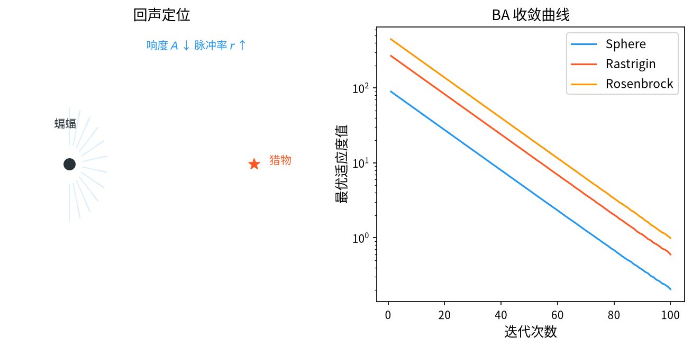

# 1. 背景与动机

&ensp;&ensp;&ensp;&ensp;蝙蝠算法（Bat Algorithm, BA）由 Xin-She Yang 于 2010 年提出，论文 "A New Metaheuristic Bat-Inspired Algorithm" 发表在 NICSO 2010 会议上[^1]，并在 2014 年的专著 *Nature-Inspired Algorithms* 中给出了扩展版本[^2]。

&ensp;&ensp;&ensp;&ensp;BA 的灵感来自**蝙蝠的回声定位**（echolocation）行为。蝙蝠通过发出超声波脉冲并接收反射回波来探测目标，这个过程包含三个可被数学化的关键机制：

1. **频率调节**（Frequency Adaptation）：蝙蝠发出的超声波频率是**可调的**——低频用于远距离探测（波长长，穿透力强但分辨率低），高频用于近距离精确探测（波长短，分辨率高但衰减快）。这对应算法中的**全局探索与局部开发**的切换。
2. **响度自适应**（Loudness Adaptation）：蝙蝠发出的响度随接近目标而增大——近距离时用更响的声波以更精确定位。响度的衰减速率对应算法中**搜索精度的自我调节**。
3. **脉冲发射率自适应**（Pulse Rate Adaptation）：蝙蝠在搜索初期发出大量脉冲（高频采样），锁定目标后脉冲频率降低（收敛）。这对应算法的**探索-开发平衡机制**。

&ensp;&ensp;&ensp;&ensp;回声定位是自然界中**最精巧的测距机制之一**，其数学本质是"主动发射信号 + 接收反馈 + 根据反馈调整发射参数"。BA 把这个闭环精确地映射为优化算法：目标函数是"回波强度"，算法参数（频率、响度、脉冲率）是"发射参数"。

<div style="text-align:center;"></div>

# 2. 问题形式化与三组参数

&ensp;&ensp;&ensp;&ensp;考虑连续空间的最小化问题：

$$
\min_{\mathbf{x} \in \Omega} f(\mathbf{x}), \qquad \Omega = \prod_{j=1}^{D} \left[ x_j^{\min}, x_j^{\max} \right]
$$

&ensp;&ensp;&ensp;&ensp;BA 维护 $N$ 个蝙蝠（个体），每个个体携带三组自适应参数：

| 生物概念 | 算法参数 | 符号 | 含义 |
|----------|----------|------|------|
| 超声波频率 | **频率** | $f_i$ | 控制搜索步长的尺度（全局↔局部） |
| 响度 | **响度** | $A_i$ | 控制位置更新的幅度，随迭代衰减 |
| 每秒脉冲数 | **脉冲发射率** | $r_i$ | 控制局部搜索的发生概率 |

&ensp;&ensp;&ensp;&ensp;**这三组参数的分工是 BA 的精髓**：

- $f_i$ 决定**"往哪走、走多远"**（空间尺度）；
- $A_i$ 决定**"一次走多远、噪声多大"**（随机性幅度）；
- $r_i$ 决定**"多频繁地在局部精调"**（开发频率）。

# 3. 数学原理

## 3.1 频率初始化与更新

### 3.1.1 频率的初始化

每个蝙蝠 $i$ 的初始频率在 $[f_{\min}, f_{\max}]$ 内均匀随机采样：

$$
f_i \sim U\left( f_{\min}, f_{\max} \right)
$$

Yang 建议的典型取值是：

$$
f_{\min} = 0, \qquad f_{\max} = 1
$$

### 3.1.2 频率的更新

在每次迭代中，所有蝙蝠的频率**重新采样**：

$$
f_i^t = f_{\min} + \left( f_{\max} - f_{\min} \right) \beta_i, \qquad \beta_i \sim U(0, 1)
$$

**这个公式的设计意图非常值得玩味**。物理上，蝙蝠的频率是"每次探测时根据目标距离选择"的，因此它是**每次重新采样**而非固定或渐变的。

数学上，这一步把频率变成了**位置更新的随机缩放因子**。把速度更新公式代入（见 §3.2）：

$$
\mathbf{v}_i^t = \mathbf{v}_i^{t-1} + \left( \mathbf{x}_i^{t-1} - \mathbf{x}_{best}^{t-1} \right) f_i^t
$$

可见 $f_i^t$ 直接缩放了"向 gbest 靠近"的位移量：

- $f_i^t \to 0$：位移极小，蝙蝠几乎原地不动（**局部精细搜索**）；
- $f_i^t \to f_{\max}$：位移很大，蝙蝠大幅跳跃（**全局探索**）。

由于 $\beta_i$ 每只蝙蝠、每次迭代独立采样，**不同蝙蝠在同一时刻具有不同的搜索尺度**。这是 BA 实现"种群内尺度多样性"的方式——一个种群中同时存在"粗搜"与"细搜"的个体。

&ensp;&ensp;&ensp;&ensp;**与 PSO 的对比**。PSO 的惯性权重 $w$ 是**全种群共享**且**随迭代系统性变化**的；BA 的频率是**个体独立**且**每次随机重采样**的。两者的差异带来不同的行为：

| | PSO | BA |
|---|---|---|
| 尺度控制 | 全局单调递减 | 个体随机重采样 |
| 效果 | 统一的"先粗后细" | 种群内同时存在多种尺度 |
| 早熟倾向 | 中 | 低（尺度多样性提供持续探索） |

## 3.2 位置更新（速度-位置）

&ensp;&ensp;&ensp;&ensp;BA 的位置更新采用 PSO 式的速度-位置形式：

$$
\mathbf{v}_i^{t+1} = \mathbf{v}_i^t + \left( \mathbf{x}_i^t - \mathbf{x}_{best}^t \right) f_i^{t+1}
$$

$$
\mathbf{x}_i^{t+1} = \mathbf{x}_i^t + \mathbf{v}_i^{t+1}
$$

&ensp;&ensp;&ensp;&ensp;**注意与 PSO 的关键差异**：

1. **没有惯性权重 $w$**。PSO 有 $w \cdot \mathbf{v}_i^t$ 项，BA 没有。BA 的"记忆"完全通过 $\mathbf{x}_i^t - \mathbf{x}_{best}^t$ 这一项实现。
2. **没有随机的学习因子项**。PSO 有 $c_1 r_1 (pbest - x) + c_2 r_2 (gbest - x)$，BA 只有一项 $(x_i - x_{best}) f_i$。
3. **没有 pbest 记忆**。BA 只用当前的 gbest，不保存每个个体的历史最优。

因此 BA 的运动本质上是：

$$
\mathbf{x}_i^{t+1} = \mathbf{x}_i^t + \mathbf{v}_i^t + f_i^{t+1} \left( \mathbf{x}_i^t - \mathbf{x}_{best}^t \right)
$$

**这实际上是"以 gbest 为中心的爆炸收缩"**：所有蝙蝠都朝 gbest 移动，但移动量由各自随机的频率决定。频率大的蝙蝠冲得远，可能越过 gbest 冲到另一侧；频率小的蝙蝠只是微微靠近。

&ensp;&ensp;&ensp;&ensp;**这个机制的巧妙之处**：因为 $\mathbf{x}_i^t - \mathbf{x}_{best}^t$ 是**指向 gbest**的向量（而不是背离），当 $f_i > 1$ 时蝙蝠会**越过** gbest。这制造了围绕 gbest 的**振荡与环绕**，配合后面的局部搜索能有效精调。

## 3.3 局部搜索

&ensp;&ensp;&ensp;&ensp;当一只蝙蝠被判定为"接近目标"（即它的位置足够接近 gbest）时，以概率 $r_i$ 触发一次**局部搜索**：

$$
\mathbf{x}_i^{t+1} = \mathbf{x}_{best}^{t} + A^t \cdot \boldsymbol{\epsilon}
$$

&ensp;&ensp;&ensp;&ensp;其中：

- $A^t$ 是当前的响度；
- $\boldsymbol{\epsilon} \sim U(-1, 1)^D$ 是逐维随机向量。

**触发条件**。原始论文的条件是：

$$
\|\mathbf{x}_i^t - \mathbf{x}_{best}^t\| < r_0
$$

其中 $r_0$ 是一个**小的固定半径**（如 0.001）。但这一"距离小于固定半径"的条件在高维空间中几乎不可能满足（高维空间的距离普遍很大），因此在实践中，Yang 后来推荐使用**归一化的距离条件**：

$$
\frac{\|\mathbf{x}_i^t - \mathbf{x}_{best}^t\|}{\|\mathbf{x}_i^t - \mathbf{x}_{best}^0\|} < r_0
$$

即"相对于初始距离的收缩比例"，这在各种维度下都有效。

这样在多峰问题上尤其有效。Yang 与 Heidari 在其专著中对 BA 的各变体做了系统的对比分析[^3]，是理解该算法演进脉络的最佳参考。

&ensp;&ensp;&ensp;&ensp;**改进版本：融合局部搜索**。Yang 提出的"**融合局部搜索**"（Hybrid/local search）变体不再用硬阈值，而是直接以概率 $r_i$ 执行局部搜索，并把随机数范围按维度自适应缩放：

$$
\mathbf{x}_i^{t+1} = \mathbf{x}_{best}^{t} + \varepsilon \cdot A^t, \qquad \varepsilon \sim U(-1, 1)^D
$$

这在多峰问题上尤其有效。

**局部搜索的半径**。由于 $\epsilon \sim U(-1,1)$，扰动的最大幅度是 $A^t$（每维）。因此**响度 $A^t$ 直接就是局部搜索的搜索半径**。

## 3.4 响度与脉冲发射率的自适应

&ensp;&ensp;&ensp;&ensp;这是 BA 的自适应核心。

### 3.4.1 响度的衰减

$$
A_i^{t+1} = \alpha A_i^t
$$

&ensp;&ensp;&ensp;&ensp;其中 $\alpha \in (0, 1)$ 是**响度衰减系数**（loudness decay factor）。**每一代、每一只蝙蝠**都这样衰减。

**这是一个"全局单调收缩"机制**。由于 $A_i^t = A_i^0 \alpha^t$，响度随迭代**指数衰减**。

**其物理意义**：蝙蝠接近目标时逐渐降低响度以减少能量消耗、避免 overwhelming 自己的感知。**其数学意义**：局部搜索的半径随时间指数收缩，这正是"粗定位 → 精定位"两阶段搜索的实现。

### 3.4.2 脉冲发射率的上升

$$
r_i^{t+1} = r_i^0 \left[ 1 - e^{-\gamma t} \right]
$$

&ensp;&ensp;&ensp;&ensp;其中 $r_i^0 \in [0, 1]$ 是初始脉冲率，$\gamma > 0$ 是**脉冲率增长常数**。

**这个公式的性质**。当 $t \to \infty$ 时：

$$
r_i^{t+1} \to r_i^0
$$

即脉冲率从 0 **单调上升到** $r_i^0$。

**物理意义**：蝙蝠在远处时发出大量脉冲以扫描（低脉冲率 = 少量脉冲？不——注意这里的方向）。实际上 Yang 的解释是：脉冲率随时间**增加**，表示蝙蝠对目标的"专注度"提升——一旦锁定目标，就不断在该区域附近做精细探测（更多次局部搜索）。

**数学意义**：$r_i$ 控制局部搜索的**触发频率**。

- 前期 $r_i \approx 0$：几乎不触发局部搜索，蝙蝠主要做全局位置的跳跃式运动；
- 后期 $r_i \to r_i^0$：频繁触发局部搜索，做精细的局部优化。

**与响度的配合**。两者形成一对精妙的互补：

| 时期 | 响度 $A^t$ | 脉冲率 $r^t$ | 行为 |
|------|-----------|--------------|------|
| 早期 | 大 | 小 | 大范围跳跃 + 很少局部精调 → **全局探索** |
| 后期 | 小 | 大 | 微小扰动 + 频繁局部精调 → **局部开发** |

**这正是回声定位的物理过程**：远距离时用大范围扫描（低精度），接近后用密集的高精度探测。

### 3.4.3 $\gamma$ 的选择

$\gamma$ 控制脉冲率上升的快慢。$\gamma$ 大 → 脉冲率很快达到 $r_i^0$；$\gamma$ 小 → 缓慢上升。

工程上常用的做法是**按最大迭代次数归一化**，使 $r_i$ 在算法结束时恰好达到 $r_i^0$：

$$
r_i^{t+1} = r_i^0 \left[ 1 - e^{-\gamma t} \right], \qquad \gamma = -\ln(\varepsilon) / T
$$

其中 $T$ 是最大迭代次数，$\varepsilon$ 是一个小常数（如 0.01）。

## 3.5 贪心选择

与 PSO、DE 不同，BA 使用**严格的贪心一对一选择**：

$$
\mathbf{x}_i^{t+1} \leftarrow \begin{cases}
\mathbf{x}_{new}, & \text{若 } f(\mathbf{x}_{new}) < f\left(\mathbf{x}_i^{t}\right) \\
\mathbf{x}_i^{t}, & \text{否则}
\end{cases}
$$

&ensp;&ensp;&ensp;&ensp;这保证了**最优适应度单调不增**。同时，响度与脉冲率**无论是否被接受都会更新**——这一点很重要，它保证了自适应机制的持续推进。

## 3.6 算法流程

```
输入：蝙蝠数 N，频率范围 [f_min, f_max]，初始响度 A_0，响度衰减 α，
      初始脉冲率 r_0，脉冲率增长 γ，最大迭代次数 MaxIter
输出：全局最优解 x_best

1.  初始化：在可行域内随机生成 N 个蝙蝠的位置 x_i
2.          随机初始化速度 v_i
3.          A_i ← A_0 (对所有 i)，r_i ← r_0 (对所有 i)
4.          计算 f(x_i)，记录 x_best
5.
6.  for t = 1 to MaxIter do
7.      ── 频率更新（每只蝙蝠独立重采样）──
8.      for i = 1 to N do
9.          f_i ← f_min + (f_max - f_min)·U(0,1)
10.         v_i ← v_i + (x_i - x_best)·f_i
11.         x_new ← x_i + v_i
12.         边界处理（反射）
13.
14.         ── 局部搜索 ──
15.         if rand() < r_i then
16.             x_new ← x_best + A_i·U(-1,1)^D      # 融合局部搜索
17.         end if
18.
19.         ── 贪心选择 ──
20.         if f(x_new) < f(x_i) then x_i ← x_new
21.
22.         ── 参数自适应 ──
23.         A_i ← α·A_i
24.         r_i ← r_0·(1 - exp(-γ·t))
25.     end for
26.
27.     ── 更新全局最优 ──
28.     若某个 x_i 优于 x_best，则 x_best ← x_i
29. end for
30. 返回 x_best
```

**每代的评估次数**：$N$（每只蝙蝠一次评价）。

# 4. 参数选取

| 参数 | 符号 | 推荐取值 | 说明 |
|------|------|----------|------|
| 种群规模 | $N$ | $10 \sim 50$（约 $5D$） | Yang 建议 $N \approx 5D$ |
| 频率范围 | $f_{\min}, f_{\max}$ | $0, 1$ | 固定即可 |
| 初始响度 | $A_0$ | $1.0$ | 固定即可 |
| 响度衰减 | $\alpha$ | $0.9 \sim 0.99$ | 越大收缩越快 |
| 初始脉冲率 | $r_0$ | $0.1 \sim 0.9$ | 局部搜索的最终频率 |
| 脉冲增长 | $\gamma$ | $0 \sim 10$（或按 §3.4.3 归一化） | |
| 最大迭代 | $MaxIter$ | $100 \sim 1000$ | |

## 4.1 参数敏感性的实验结论

Yang 在 10 个基准函数上做了系统的参数敏感性实验[^1][^2]，结论如下：
**$\alpha$（响度衰减）最敏感**，且呈现"倒 U 形"：
- $\alpha$ 太小（如 0.5）：响度衰减过快，后期扰动不足，收敛精度差；
- $\alpha$ 太大（如 1.0）：响度不衰减，算法始终保持高随机性，无法精细收敛；
- **$\alpha = 0.9$** 被推荐为通用取值。

**$r_0$（脉冲率）**影响相对温和，取值 $0.5 \sim 0.9$ 均可。

**$f_{\max}$** 通常设为 1 即可，因为它与 $A$ 的作用重叠。

## 4.2 参数冗余性分析

BA 的参数看似多，但**功能上有明显的冗余**：

- $f_{\min}, f_{\max}$ 与 $A_0$ 都在控制"步长尺度"；
- $\alpha$ 与 $\gamma$ 都在控制"从粗到细的转换速度"。

Yang 自己在后来的工作中也承认这一冗余，并提出把 $\alpha$ 与 $\gamma$ 关联起来以减少自由度。

# 5. 数学性质分析

## 5.1 局部搜索的收缩性

局部搜索的更新为：

$$
\mathbf{x}_i^{t+1} = \mathbf{x}_{best}^{t} + A^t \boldsymbol{\epsilon}_i
$$

其中 $A^t = A^0 \alpha^t$。因此单次局部搜索的**最大偏离 gbest 的距离**为：

$$
\lVert \mathbf{x}_i^{t+1} - \mathbf{x}_{best}^t \rVert \leq \sqrt{D} \cdot A^0 \alpha^t
$$

**随时间指数衰减**。这保证了算法的最终精度——虽然收敛速度慢，但精度有保证。这与 PSO 的"在 gbest 附近持续震荡"形成鲜明对比。

## 5.2 全局探索能力

主循环的位置更新（忽略边界处理）为：

$$
\mathbf{x}_i^{t+1} = \mathbf{x}_i^t + \mathbf{v}_i^t + f_i^{t+1} \left( \mathbf{x}_i^t - \mathbf{x}_{best}^t \right)
$$

记 $\mathbf{d}_i^t = \mathbf{x}_i^t - \mathbf{x}_{best}^t$（相对 gbest 的向量），则：

$$
\mathbf{d}_i^{t+1} \approx \left( 1 + f_i^{t+1} \right) \mathbf{d}_i^t + \mathbf{v}_i^t
$$

**系数 $(1 + f_i^{t+1})$ 是一个"扩张因子"**。当 $f_i \in (0, 1)$ 时，$1 + f_i \in (1, 2)$，蝙蝠相对 gbest 的距离**每代扩大** $1 \sim 2$ 倍。这说明 BA 在主循环阶段是**发散式**的——蝙蝠会散开到越来越大的范围，这正是它的全局探索机制。

**与 PSO 的对比**。PSO 中相对 gbest 的距离是**收缩**的（系数 $1 - c_2 r_2 < 1$），所以 PSO 群体会向 gbest 聚拢。BA 则是**扩张**的！这是 BA 多峰能力的一个来源。

但要注意，这个发散不能无限持续，因为：

1. 边界处理会阻止蝙蝠跑出可行域；
2. 频率每代重新采样，$f_i$ 有时接近 0，此时几乎不扩张；
3. **局部搜索**会周期性地把蝙蝠拉回 gbest 附近。

因此 BA 的宏观行为是"**周期性发散 + 间歇性回归**"，形成一种"探测-返回"的节律。这与回声定位的物理行为高度一致。

## 5.3 早熟倾向分析

BA 的早熟倾向**低于** PSO，原因是：

1. **频率的个体随机性**：不同蝙蝠有不同的尺度，避免了所有个体同步收敛；
2. **主循环的扩张性**：群体本身不会聚拢成一个点；
3. **局部搜索的触发是概率性的**：不是所有个体同时精调。

但 BA 的早熟倾向**高于** DE，因为：

1. BA 只有 gbest 一个引导点，没有 DE 的差分向量（后者利用了整个种群的分布结构）；
2. BA 没有 pbest 记忆，无法利用个体自身的历史经验。

# 6. 变体与改进方向

| 变体 | 核心改进 |
|------|----------|
| **BA with Lévy flights** | 用莱维飞行增强全局探索 |
| **BA with Opposite-based learning** | 反向学习初始化 |
| **BA with Differential Evolution** | 用 DE 的差分变异替换速度更新 |
| **Adaptive BA (ABA)** | $\alpha$、$\gamma$ 随适应度改善自适应 |
| **BA with Chaotic map** | 用混沌序列替代随机数 |
| **Memetic BA** | 叠加局部搜索 |
| **Multi-objective BA (MOBA)** | 用帕累托支配替代单目标比较 |
| **BA with Hybrid Differential Evolution** | 双种群 + DE 算子 |
| **Improved BA (IBA)** | 自适应频率范围 + 变异 |

## 6.1 几个重要改进的数学细节

### 6.1.1 自适应频率范围

原始 BA 的频率范围 $[f_{\min}, f_{\max}]$ 是固定的。改进思路是让它随搜索进程收缩：

$$
f_{\max}^{t} = f_{\max}^{0} \cdot \left( 1 - \frac{t}{T} \right), \qquad f_{\min}^{t} = 0
$$

这相当于把"全局探索"与"局部开发"的切换从**概率层面**（随机采样）转移到**确定层面**（区间收缩），提高了可控性。

### 6.1.2 带莱维飞行的 BA

把主循环的更新替换为：

$$
\mathbf{x}_i^{t+1} = \mathbf{x}_i^t + \mathbf{v}_i^t + \alpha \cdot L(\beta) \cdot \left( \mathbf{x}_i^t - \mathbf{x}_{best}^t \right)
$$

其中 $L(\beta)$ 是莱维随机向量。这让 BA 同时具备"重尾跳跃"与"向 gbest 聚拢"的能力。

### 6.1.3 BA 与 DE 的混合

用 DE/rand/1 的差分变异替换 BA 的速度更新：

$$
\mathbf{v}_i^{t+1} = \mathbf{x}_{r_1} + F \left( \mathbf{x}_{r_2} - \mathbf{x}_{r_3} \right)
$$

这样 BA 就同时获得了 DE 的"种群差分方向"能力。Yang 在其专著中给出的对比实验表明，这类混合在许多问题上优于纯 BA[^3]。

&ensp;&ensp;&ensp;&ensp;把 BA 放在整个智能优化版图中看，可以发现它与 FA[^4]、GWO[^5]、ABC[^6]、HHO[^7] 共享着相近的方法论——都是用**少数几个有明确物理含义的标量参数**来编码"探索-开发"的连续谱。Gandomi 等人关于混合变量结构优化的综述性工作[^8] 与 Yang 的 FA 聚类研究[^9] 则展示了这类算法在具体工程问题上的应用方式。

# 7. 应用场景

&ensp;&ensp;&ensp;&ensp;BA 的应用分布较为广泛：

1. **工程设计优化**：约束优化、结构设计、机械设计。
2. **神经网络训练**：权重优化、模型结构搜索。
3. **数据挖掘**：特征选择、聚类（BA 聚类中以聚类中心为决策变量）。
4. **图像处理**：图像分割、阈值优化、图像加密。
5. **路径规划**：机器人路径规划、无人机航迹规划。
6. **调度问题**：柔性作业车间调度、随机作业车间调度。
7. **参数估计与系统辨识**：非线性系统参数辨识。
8. **电力系统**：经济调度、负荷预测。
9. **通信**：认知网络的功率分配、信道选择。
10. **金融**：投资组合优化。

## 7.1 BA 聚类（BA-K-means）

BA 用于聚类的建模方式与 FA 聚类类似：决策变量是 $K$ 个聚类中心，目标是簇内平方和。Yang 指出 BA 在聚类上的优势是**受局部最优的影响较小**，因为主循环的"扩张"特性使个体不容易全部困在同一处。

# 8. 与相关算法的比较

| 维度 | BA | PSO | DE | ABC | FA |
|------|----|----|----|----|----|
| 记忆 | 无（仅 gbest） | pbest + gbest | 无 | 蜜源 | 亮度 |
| 方向来源 | $(x_i - x_{best}) f_i$ | pbest + gbest | 种群差分 | 另一蜜源 | 更亮个体 |
| 尺度控制 | **频率（个体随机重采样）** | 惯性权重（全局递减） | $F$（外生） | 种群距离 | $\beta(r)$（距离相关） |
| 局部搜索 | **有**（概率 $r_i$ 触发，范围 $A^t$） | 无 | 无 | 无 | 无（随机项） |
| 收敛精度 | **好**（指数收缩的局部搜索） | 一般 | 一般 | 一般 | 一般 |
| 多峰能力 | **良**（主循环扩张性） | 中 | 良 | 中 | 优 |
| 参数数量 | 5~6 | 3 | 2 | 1 | 4 |
| 实现难度 | 低 | 极低 | 低 | 低 | 低 |
| 每代评估数 | $N$ | $N$ | $N$ | $2N$ | $N$ |

## 8.1 选择建议

- **需要多峰能力 + 较好的收敛精度**：BA 是一个折中的好选择；
- **高维问题**：DE 或 CMA-ES 明显更强；
- **追求最简实现**：PSO；
- **工程应用与理论性兼顾**：DE。

# 9. 小结

&ensp;&ensp;&ensp;&ensp;蝙蝠算法的贡献是给出了一个**"三参数协同自适应"**的优雅模型。它把回声定位的三个物理机制精确映射为三个控制量：

1. **频率**控制搜索尺度，且通过"个体独立重采样"实现了种群内的尺度多样性；
2. **响度**控制局部搜索的半径，通过指数衰减保证最终精度；
3. **脉冲率**控制局部搜索的触发频率，通过单调上升实现"先探索后开发"。

&ensp;&ensp;&ensp;&ensp;BA 最值得学习的思想是**"用概率机制代替确定性调度"**。PSO 用一条单调递减的曲线统一调度全种群；BA 让每个个体的尺度独立随机，因而种群中始终同时存在"粗搜"与"细搜"的个体。这种"个体化"的随机性正是 BA 多峰能力与低早熟倾向的来源。

&ensp;&ensp;&ensp;&ensp;另一个值得玩味的现象是 BA 主循环的**发散性**：相对 gbest 的距离以 $1+f_i$ 的因子扩张，这与 PSO 的收缩行为形成鲜明对比。理解这一点，就能明白为什么 BA 不像 PSO 那样"缩成一团"——它依赖的不是向心的收缩，而是"扩散 + 间歇性回归"的动态平衡。

# 参考文献

[^1]: Yang, X.S. (2010). "A new metaheuristic bat-inspired algorithm". In *Nature Inspired Cooperative Strategies for Optimization (NICSO 2010)*, Lecture Notes in Computer Science, Vol. 6455, Springer, pp. 65-74.

[^2]: Yang, X.S. (2014). *Nature-Inspired Algorithms: From Mating Mechanisms to Swarm Optimization*. Vol. 5 of Natural Computing Series. Springer.

[^3]: Yang, X.S. (2019). *Bat Algorithm*. In *Nature-Inspired Algorithms*. Springer, pp. 33-47.

[^4]: Fister, I., Fister, D. & Yang, X.S. (2013). "A comprehensive review of firefly algorithms". *Swarm and Evolutionary Computation*, 13, 34-46.

[^5]: Mirjalili, S., Mirjalili, S.M. & Lewis, A. (2014). "Grey Wolf Optimizer". *Advances in Engineering Software*, 69, 46-61.

[^6]: Karaboga, D. & Basturk, B. (2007). "A powerful and efficient algorithm for numerical function optimization: artificial bee colony (ABC) algorithm". *Journal of Global Optimization*, 39(3), 459-471.

[^7]: Heidari, A.A., Mirjalili, S., Faris, H., Aljarah, I., Mafarja, M. & Chen, H. (2019). "HHO: Harris hawks optimization". *Future Generation Computer Systems*, 97, 849-872.

[^8]: Gandomi, A.H., Yang, X.-S. & Alavi, A.H. (2013). "Mixed variable structural optimization using Firefly Algorithm". *Computers & Structures*, 125, 175-186.

[^9]: Yang, X.-S. (2010). "Firefly algorithm for clustering analysis". In *2010 IEEE Congress on Evolutionary Computation (CEC)*, Krakow, Poland, pp. 1-8.
