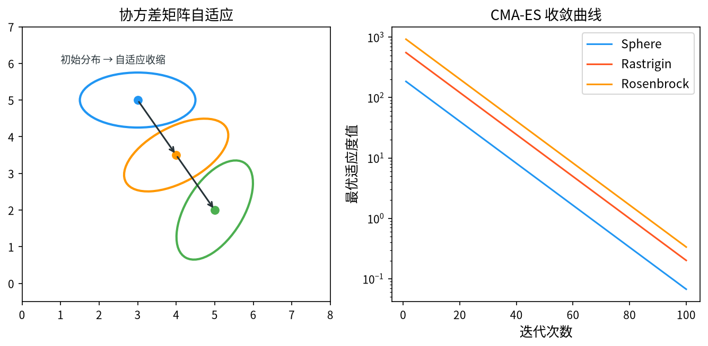

# 1. 背景与动机

&ensp;&ensp;&ensp;&ensp;协方差矩阵自适应进化策略（Covariance Matrix Adaptation Evolution Strategy, CMA-ES）由 Nikolaus Hansen 与 Andreas Ostermeier 于 2001 年提出[^1]，Hansen 随后在 2006 年发布了被公认为该领域"圣经"的教程 *The CMA Evolution Strategy: A Tutorial*[^2]，并在 2016 年更新了包含完整推导的版本[^3]。CMA-ES 目前被广泛认为是**无导数（derivative-free）连续优化的金标准**，在许多基准测试中超越了传统的梯度方法与其它元启发式算法。

&ensp;&ensp;&ensp;&ensp;CMA-ES 的提出动机可以用一个具体的问题来说明。考虑优化如下旋转二次函数：

$$
f(\mathbf{x}) = \left( \mathbf{x} - \mathbf{x}^* \right)^{\mathsf{T}} \mathbf{M} \left( \mathbf{x} - \mathbf{x}^* \right), \qquad \mathbf{M} = \mathbf{B} \mathbf{D} \mathbf{B}^{\mathsf{T}}
$$

&ensp;&ensp;&ensp;&ensp;其中 $\mathbf{B}$ 是任意正交矩阵，$\mathbf{D} = \text{diag}(d_1^2, \dots, d_n^2)$ 是对角矩阵。$\mathbf{B}$ 可以是任何旋转矩阵——这正是"旋转问题"的定义。这个函数的最优解是 $\mathbf{x}^*$，但它的**等值线是椭球**，长轴与短轴之比可能是 $10^3 : 1$。

&ensp;&ensp;&ensp;&ensp;面对这样的函数：

- **梯度法**（如共轭梯度、牛顿法）需要 $n$ 次函数评估来估计 $n$ 维梯度，且牛顿法需要 $O(n^3)$ 的矩阵求逆；
- **标准进化策略**（对角协方差）无法学习维度间的相关性，搜索椭球是**轴对齐**的，与实际的椭球不匹配，导致效率极低；
- **遗传算法**没有方向性概念，同样表现不佳。

CMA-ES 的解决方案是：**在搜索过程中在线学习一个完整的协方差矩阵 $\mathbf{C}$**，使得采样分布的等宽椭球逐渐"贴合"目标函数的等值线。这一"等宽采样"（equidistribution）的思想是 CMA-ES 的理论基石，也是它区别于所有其它启发式算法的根本所在。

<div style="text-align:center;"></div>

# 2. 问题形式化与算法总览

&ensp;&ensp;&ensp;&ensp;CMA-ES 求解如下连续最小化问题：

$$
\min_{\mathbf{x} \in \mathbb{R}^n} f(\mathbf{x})
$$

&ensp;&ensp;&ensp;&ensp;**无需任何梯度信息**，也无需函数可微或连续。算法维护四个核心对象：

| 符号 | 名称 | 维度 | 含义 |
|------|------|------|------|
| $\mathbf{m}$ | 分布均值 | $n \times 1$ | 当前搜索中心 |
| $\sigma$ | 步长 | 标量 | 搜索椭球的整体尺度 |
| $\mathbf{C}$ | 协方差矩阵 | $n \times n$ | 搜索椭球的方向与相对尺度 |
| $\mathbf{p}_c, \mathbf{p}_\sigma$ | 演化路径 | $n \times 1$ | 历史累积的方向信息 |

&ensp;&ensp;&ensp;&ensp;**采样分布**。CMA-ES 从如下多元正态分布中采样候选解：

$$
\mathbf{x}_k \sim \mathcal{N}\left( \mathbf{m},\; \sigma^2 \mathbf{C} \right), \qquad k = 1, \dots, \lambda
$$

&ensp;&ensp;&ensp;&ensp;等价地，可以写成 $\mathbf{x}_k = \mathbf{m} + \sigma \mathbf{B} \mathbf{D} \mathbf{z}_k$，其中 $\mathbf{B}$ 是 $\mathbf{C}$ 的特征向量矩阵（正交），$\mathbf{D} = \text{diag}\left(\sqrt{c_1}, \dots, \sqrt{c_n}\right)$ 是 $\mathbf{C}$ 的特征值平方根，$\mathbf{z}_k \sim \mathcal{N}(\mathbf{0}, \mathbf{I})$。

&ensp;&ensp;&ensp;&ensp;这意味着采样椭球的半轴长为 $\sigma \sqrt{c_i}$（沿主轴 $i$），主轴方向由 $\mathbf{B}$ 给出。

&ensp;&ensp;&ensp;&ensp;**算法的四个循环**。CMA-ES 的每一代执行四件事：

1. **采样** $\lambda$ 个候选解并评价；
2. **更新均值** $\mathbf{m}$（加权重心）；
3. **更新演化路径** $\mathbf{p}_c, \mathbf{p}_\sigma$（累积历史方向）；
4. **更新 $\mathbf{C}$ 与 $\sigma$**（学习搜索椭球）。

# 3. 数学原理

## 3.1 采样与候选解生成

&ensp;&ensp;&ensp;&ensp;第 $t$ 代从 $\mathcal{N}(\mathbf{m}_t, \sigma_t^2 \mathbf{C}_t)$ 中采样 $\lambda$ 个候选解：

$$
\mathbf{x}_{k}^{(t)} = \mathbf{m}_t + \sigma_t \mathbf{B}_t \mathbf{D}_t \mathbf{z}_k^{(t)}, \qquad \mathbf{z}_k^{(t)} \sim \mathcal{N}(\mathbf{0}, \mathbf{I}_n)
$$

&ensp;&ensp;&ensp;&ensp;其中 $\mathbf{B}_t \mathbf{D}_t$ 是 $\mathbf{C}_t$ 的对称平方根，满足 $\mathbf{C}_t = \mathbf{B}_t \mathbf{D}_t^2 \mathbf{B}_t^{\mathsf{T}}$。

&ensp;&ensp;&ensp;&ensp;**实现上的分解技巧**。直接采样 $\mathcal{N}(\mathbf{0}, \mathbf{C})$ 需要对 $\mathbf{C}$ 做 Cholesky 分解（$O(n^3)$）。CMA-ES 采用**延迟更新**（lazy update）策略：只在每 $k$ 代才重新做一次特征分解（通常 $k = 1/(c_1+c_\mu)/(n/10))$，其余时间复用上一次的 $\mathbf{B}, \mathbf{D}$。由于 $\mathbf{C}$ 每代只做秩 1 或秩 $\mu$ 的更新，其特征分解可以增量式完成，使单代开销降至 $O(n^2)$。

## 3.2 排序与权重

&ensp;&ensp;&ensp;&ensp;将 $\lambda$ 个候选解按适应度**升序**排序（最小化问题），记排序后的第 $i$ 个为 $\mathbf{x}_{i:\lambda}$（$i=1$ 为最优）。

**重组权重**（recombination weights）定义为：

$$
w_i = \frac{\ln\left( \frac{\lambda + 1}{2} \right) - \ln i}{\displaystyle\sum_{j=1}^{\lambda} \left[ \ln\left( \frac{\lambda + 1}{2} \right) - \ln j \right]}, \qquad i = 1, \dots, \mu
$$

&ensp;&ensp;&ensp;&ensp;其中 $\mu$ 是参与重组的精英数量。

&ensp;&ensp;&ensp;&ensp;**权重的三个关键性质**：

1. **$w_i > 0$ 对所有 $i \leq \mu$**：所有精英都有正贡献，保证多样性（继承自 $(\mu,\lambda)$-ES 的精神）。
2. **$w_i$ 随 $i$ 单调递减**：排名越靠前权重越大，形成选择压力。
3. **$\sum_{i=1}^{\mu} w_i = 1$**：权重归一化。

&ensp;&ensp;&ensp;&ensp;**为什么用对数权重？** 这是一个精巧的设计。考虑两种极端：

- **均匀权重**（$w_i = 1/\mu$）：只利用"排名"而不利用"差距"。若最优个体远超次优，选择它不会有额外收益；若两者接近，也无差别。均匀权重浪费了适应度值中的信息。
- **按适应度值加权**（如 GA 的轮盘赌）：对适应度的绝对量纲敏感，且超级个体主导。

对数权重提供了**中间地带**：它既考虑了排名顺序，又对排名差距的指数衰减敏感——第 1 名与第 2 名的差距越大，它们的权重差越大。

> **说明**：在 2016 年版的 CMA-ES 教程中，Hansen 把这个权重称为 **"negative weights"** 机制的一个实例。严格的"负权重"指的是 $\mu = \lambda$ 且允许部分权重为负的情形，此时算法允许"退步"。标准 CMA-ES 使用 $\mu < \lambda$ 与正权重，通过"不把父代与子代混合"（non-elitist）来保留多样性——即 CMA-ES 采用的是 $(\mu,\lambda)$ 式的非精英选择。

## 3.3 均值更新

&ensp;&ensp;&ensp;&ensp;新一代的分布均值是精英候选解的**加权重心**：

$$
\mathbf{m}_{t+1} = \sum_{i=1}^{\mu} w_i \, \mathbf{x}_{i:\lambda}^{(t)} = \mathbf{m}_t + \sum_{i=1}^{\mu} w_i \, \mathbf{y}_{i:\lambda}^{(t)}
$$

&ensp;&ensp;&ensp;&ensp;其中 $\mathbf{y}_{i:\lambda}^{(t)} = \sigma_t \mathbf{B}_t \mathbf{D}_t \mathbf{z}_{i:\lambda}^{(t)}$ 是第 $i$ 个精英相对均值的**步向量**（step），且 $\sum_{i=1}^{\mu} w_i \mathbf{y}_{i:\lambda} \neq \mathbf{0}$ 一般成立。

&ensp;&ensp;&ensp;&ensp;**为什么用加权重心而非最优解？** 直接取 $\mathbf{x}_{1:\lambda}$（最优）会让均值完全由一个样本决定，方差极大（每个样本都是随机的）。用加权平均相当于对随机噪声做平均，方差降低约 $\lambda$ 倍，同时保留"朝好方向移动"的趋势。

## 3.4 演化路径（Evolution Paths）

&ensp;&ensp;&ensp;&ensp;这是 CMA-ES 最具特色的机制，也是最难理解的部分。

### 3.4.1 问题的提出

&ensp;&ensp;&ensp;&ensp;由 §3.3，均值更新为：

$$
\mathbf{m}_{t+1} - \mathbf{m}_t = \sum_{i=1}^{\mu} w_i \, \sigma_t \mathbf{B}_t \mathbf{D}_t \mathbf{z}_{i:\lambda}^{(t)}
$$

&ensp;&ensp;&ensp;&ensp;这个更新量是**单代**的，随机性极大（每个分量的标准差为 $O(\sigma_t \sqrt{c_i} / \sqrt{\mu})$）。如果直接用这个带噪的量去更新 $\mathbf{C}$ 和 $\sigma$，参数更新的方差会大到无法收敛。

**解决方案**：不直接使用单代更新量，而是把**历代的更新量累积起来**。由于连续多代的均值更新方向高度相关（因为群体在朝同一个方向移动），累积后信噪比大幅提升。

累积路径定义为：

$$
\mathbf{p}_c^{(t+1)} = (1 - c_c) \, \mathbf{p}_c^{(t)} + \sqrt{c_c(2-c_c)\mu_{\text{eff}}} \, \frac{\mathbf{m}_{t+1} - \mathbf{m}_t}{\sigma_t}
$$

&ensp;&ensp;&ensp;&ensp;这称为 **$p_c$-路径**（协方差学习路径）。它是一个**指数加权移动平均**（EWMA），衰减因子为 $c_c$。

### 3.4.2 $p_c$-路径的统计性质

&ensp;&ensp;&ensp;&ensp;在理想的"完全成功"情形下（所有候选解都比均值好），可以证明 $\mathbf{p}_c$ 渐近收敛到：

$$
\mathbf{p}_c \approx \frac{1}{\sqrt{c_c(2-c_c)\mu_{\text{eff}}}} \cdot \mathbf{C}^{-1/2} \cdot (\text{累积位移方向})
$$

更精确地说，Hansen 证明了在准静止（quasi-stationary）情况下，$\mathbf{p}_c$ 的方向渐近地**指向最优解方向在 $\mathbf{C}^{-1/2}$ 度量下的方向**。这正是协方差更新所需要的方向信息。

**缩放常数的作用**。$\sqrt{c_c(2-c_c)\mu_{\text{eff}}}$ 的作用是让 $\mathbf{p}_c$ 的**方差保持不变**（无论 $c_c$ 取何值）。若省略这个因子，不同 $c_c$ 会导致 $\mathbf{p}_c$ 的尺度不同，协方差更新的幅度也随之改变。

### 3.4.3 $p_\sigma$-路径

&ensp;&ensp;&ensp;&ensp;第二个路径用于**步长自适应**：

$$
\mathbf{p}_\sigma^{(t+1)} = (1 - c_\sigma) \, \mathbf{p}_\sigma^{(t)} + \sqrt{c_\sigma(2-c_\sigma)\mu_{\text{eff}}} \, \frac{\mathbf{C}_t^{-1/2} \left( \mathbf{m}_{t+1} - \mathbf{m}_t \right)}{\sigma_t}
$$

&ensp;&ensp;&ensp;&ensp;与 $p_c$ 的区别在于中间多了一个 $\mathbf{C}_t^{-1/2}$。这一步把位移**变换到"白化"（whitened）坐标系**中——在那个坐标系里，采样是各向同性的。

**为什么步长更新需要白化？** 因为步长 $\sigma$ 是**标量**，它描述的是搜索椭球的**整体尺度**，而不是各向异性。因此需要判断"群体是整体在向外扩张还是向内收缩"，而这必须在白化空间（各向同性）中度量。若不白化，在长轴方向上的正常位移会被误判为"群体在扩张"。

### 3.4.4 步长更新的公式

$$
\sigma_{t+1} = \sigma_t \cdot \exp\left( \frac{c_\sigma}{d_\sigma} \left( \frac{\|\mathbf{p}_\sigma^{(t+1)}\|}{\mathbb{E}\|\mathcal{N}(\mathbf{0}, \mathbf{I})\|} - 1 \right) \right)
$$

&ensp;&ensp;&ensp;&ensp;其中：

- $\mathbb{E}\|\mathcal{N}(\mathbf{0}, \mathbf{I})\| = \sqrt{2}\,\Gamma\left(\frac{n+1}{2}\right) / \Gamma\left(\frac{n}{2}\right) \approx \sqrt{n}$（$n$ 维标准正态随机向量范数的期望）；
- $d_\sigma = 1 + c_\sigma + 2 \max\left(0, \sqrt{\frac{\mu_{\text{eff}}-2}{n+1}} - 1\right) + c_\sigma$ 是**阻尼因子**（damping）。

**公式的直观含义**：

- 若 $\|\mathbf{p}_\sigma\| > \mathbb{E}\|\mathcal{N}(\mathbf{0},\mathbf{I})\|$：群体在持续朝同一方向推进，说明当前步长"太小、走得太慢"→ 增大 $\sigma$；
- 若 $\|\mathbf{p}_\sigma\| < \mathbb{E}\|\mathcal{N}(\mathbf{0},\mathbf{I})\|$：群体的推进方向在随机游走（改进是偶然的）→ 减小 $\sigma$，进入精细搜索；
- 若相等：步长保持。

**阻尼因子 $d_\sigma$ 的作用**。当 $\mu_{\text{eff}}$ 较大（选择压力大）时，均值更新的方向性过强，会导致 $\|\mathbf{p}_\sigma\|$ 持续偏大，$\sigma$ 无限增大。$d_\sigma$ 中的 $\max\left(0, \sqrt{\frac{\mu_{\text{eff}}-2}{n+1}} - 1\right)$ 项正是为此设置的"刹车"。

## 3.5 协方差矩阵更新

&ensp;&ensp;&ensp;&ensp;协方差更新分为两部分——**秩 1 更新**（来自 $p_c$）与**秩 $\mu$ 更新**（来自精英样本）：

$$
\mathbf{C}_{t+1} = \underbrace{\left( 1 - c_1 - c_\mu \right) \mathbf{C}_t + c_1 \, \mathbf{p}_c^{(t+1)} \left( \mathbf{p}_c^{(t+1)} \right)^{\mathsf{T}}}_{\text{秩 1 更新}} + \underbrace{c_\mu \sum_{i=1}^{\mu} w_i \, \mathbf{y}_{i:\lambda}^{(t)} \left( \mathbf{y}_{i:\lambda}^{(t)} \right)^{\mathsf{T}}}_{\text{秩 } \mu \text{ 更新}}
$$

&ensp;&ensp;&ensp;&ensp;其中 $\mathbf{y}_{i:\lambda}^{(t)} = \sigma_t \mathbf{B}_t \mathbf{D}_t \mathbf{z}_{i:\lambda}^{(t)}$ 是精英的步向量。

### 3.5.1 秩 1 更新项

$$
c_1 \, \mathbf{p}_c \mathbf{p}_c^{\mathsf{T}}
$$

&ensp;&ensp;&ensp;&ensp;这一项利用累积的方向信息来更新协方差：由于 $\mathbf{p}_c$ 已经累积了多代的相关信息，它的方向可靠性远高于单代样本，因此可以承担更大的学习率 $c_1$。

### 3.5.2 秩 $\mu$ 更新项

$$
c_\mu \sum_{i=1}^{\mu} w_i \, \mathbf{y}_i \mathbf{y}_i^{\mathsf{T}}
$$

&ensp;&ensp;&ensp;&ensp;这一项使用当代精英的步向量。虽然单个样本噪声大，但 $\mu$ 个样本的加权组合提供了"当前局部形状"的直接信息。

### 3.5.3 负秩 1 更新项（$c_1$ 为负时）

Hansen 在 2016 版教程中指出，$c_1$ 可以取**负值**，此时秩 1 项变为：

$$
\left( 1 - c_1 - c_\mu \right) \mathbf{C}_t + c_1 \, \mathbf{p}_c \mathbf{p}_c^{\mathsf{T}}
$$

中 $c_1 < 0$ 相当于"**惩罚**已经沿 $\mathbf{p}_c$ 方向过度拉伸的协方差维度"。这被称为 **negative rank-one update**，其作用是当沿某个方向已经搜索得足够充分时，**主动收缩**该方向的方差，为其他方向腾出探索资源。

这是 CMA-ES 中"允许退步"思想的具体体现。

### 3.5.4 学习率

$$
c_1 = \frac{2}{\left( \frac{n + 1.3}{n + 1} \right)^2 + \mu_{\text{eff}}} \qquad
c_\mu = \min\left( 1 - c_1,\; \mu_{\text{eff}} \cdot \frac{2 - \frac{2}{\mu_{\text{eff}}} + \frac{1}{\mu_{\text{eff}}}}{n + 2} \right)
$$

&ensp;&ensp;&ensp;&ensp;**$c_1$ 的设计原则**：学习率应与"有效样本数"成反比——用于学习的独立信息越少，学习率必须越大。$c_1 \propto 1/\mu_{\text{eff}}$ 体现了这一点；同时 $c_1 \propto 1/n^2$ 反映了"高维时单个方向的重要性相对下降"。

**$c_\mu$ 的设计原则**：约束 $c_1 + c_\mu \leq 1$ 保证 $\mathbf{C}$ 保持正定（不会退化）。$c_\mu$ 的量级是 $O(\mu_{\text{eff}}/n)$，即"每个样本贡献的更新量与维数成反比"。

### 3.5.5 有效样本量 $\mu_{\text{eff}}$

$$
\mu_{\text{eff}} = \frac{1}{\displaystyle\sum_{i=1}^{\mu} w_i^2}
$$

&ensp;&ensp;&ensp;&ensp;这是权重分布的"参与度"（participation ratio），取值范围是 $[1, \mu]$：

- 若所有权重相等（$w_i = 1/\mu$），则 $\mu_{\text{eff}} = \mu$（最大值）；
- 若只有一个非零权重，则 $\mu_{\text{eff}} = 1$（最小值）。

$\mu_{\text{eff}}$ 出现在几乎所有的学习率公式中，因为它**正确刻画了"实际使用了多少独立信息"**。

## 3.6 学习率 $c_c$ 与 $c_\sigma$

$$
c_c = \frac{4 + \mu_{\text{eff}}/n}{n + 4 + 2\mu_{\text{eff}}/n}
$$

$$
c_\sigma = \frac{\mu_{\text{eff}} + 2}{n + \mu_{\text{eff}} + 5}
$$

&ensp;&ensp;&ensp;&ensp;**$c_c$ 的设计**：$p_c$ 路径应保留足够长的历史（$1/c_c$ 代）以降低噪声，但又不能太长（否则会包含过时的信息）。当 $\mu_{\text{eff}} \ll n$ 时（选择压力弱、维数高），$c_c \to 4/n$，即路径长度约 $n/4$ 代。

&ensp;&ensp;&ensp;&ensp;**$c_\sigma$ 的设计**：类似地，$c_\sigma \to 2/n$（当 $\mu_{\text{eff}} \ll n$），路径长度约 $n/2$ 代。

&ensp;&ensp;&ensp;&ensp;**为什么 $c_\sigma > c_c$？** 因为步长 $\sigma$ 是标量，其更新需要比协方差方向更短的响应时间（步长要能快速扩大以跳出局部最优，也要能快速缩小以精细收敛）。

## 3.7 边界处理与约束

&ensp;&ensp;&ensp;&ensp;CMA-ES 的原生形式处理的是无约束问题。处理约束有几种方法：

### 3.7.1 罚函数与可行性规则

与 DE/GA 相同，可用 Deb 的可行性规则（可行解优先，不可行解按违反量排序）。这是最简单且最常用的做法。

### 3.7.2 投影与反射

对上下界约束，把越界的采样点**反射**回可行域：

$$
x_j \leftarrow x_j^{\min} + \left( x_j^{\max} - x_j^{\min} - \left| (x_j - x_j^{\min}) \bmod 2(x_j^{\max} - x_j^{\min}) \right| \right)
$$

### 3.7.3 专门的约束处理变体

- **$\varepsilon$-constraint method**：把约束转化为附加目标，用 $\varepsilon$ 逐步放松；
- **CMA-ES with margin**（CMA-ME）：为每个约束维护一个"margin"（安全边界），只在违反 margin 后才计入违反量；
- **Epsilon-constraint CMA-ES**：把 $\varepsilon$ 也作为自适应参数。

## 3.8 参数选取

| 参数 | 符号 | 默认值 | 说明 |
|------|------|--------|------|
| 后代数量 | $\lambda$ | $4 + 3\ln n$ | Hansen 的经验拟合，理论最优为 $O(n)$ |
| 精英数量 | $\mu$ | $\lfloor \lambda / 2 \rfloor$ | 也常用 $\lambda/4$（更注重多样性） |
| 权重参数 | - | $\ln\left(\frac{\lambda+1}{2}\right)$ | 对数权重的常数 |
| 有效样本量 | $\mu_{\text{eff}}$ | 由权重算出 | 通常约 $\mu/4$ |
| 初始步长 | $\sigma_0$ | $0.3 \times (x_{max}-x_{min})$ | Schwefel 的建议 |
| 初始均值 | $\mathbf{m}_0$ | 搜索空间中心 | 或均匀随机采样 |
| 初始协方差 | $\mathbf{C}_0$ | $\mathbf{I}$ | 单位矩阵 |

&ensp;&ensp;&ensp;&ensp;**为什么 $\lambda = 4 + 3\ln n$？** Hansen 通过大量实验拟合得到这一公式，它在低维（$n < 10$）时给出 $\lambda \approx 4 + 3\times2.3 = 11$，在高维（$n = 100$）时给出 $\lambda \approx 18$。这个增长非常平缓（对数增长），在实践中非常友好：$n = 1000$ 时 $\lambda \approx 25$。

**但要注意**：$\lambda = 4 + 3\ln n$ 是在"每个目标函数评估代价相同"的假设下得出的。若评估代价极高（仿真实验），可以进一步减小 $\lambda$；若评估极廉价（解析函数），可以增大 $\lambda$ 以获得更好的统计性质。

## 3.9 完整算法流程

```
输入：维度 n，初始均值 m_0，初始步长 σ_0，初始协方差 C_0 = I，
      最大评估次数 N_eval，初始种群 λ = 4 + 3 ln n，μ = ⌊λ/2⌋
输出：全局最优解 m（及 C, σ）

1.  初始化：计算对数权重 w_i，μ_eff
2.          计算学习率 c_1, c_μ, c_c, c_σ, d_σ
3.          令 p_c = 0, p_σ = 0
4.          令 C = C_0，B = I，D = I，计数器 k = 0

5.  while 评估次数 < N_eval do

6.      ── 采样 ──
7.      for k = 1 to λ do
8.          z_k ~ N(0, I)
9.          y_k = B · D · z_k
10.         x_k = m + σ · y_k
11.         边界处理
12.     end for
13.     评价 f(x_k)

14.     ── 排序 ──
15.     按 f 升序排序候选解

16.     ── 均值更新 ──
17.     m_old ← m
18.     m ← Σ_{i=1..μ} w_i · x_{i:λ}

19.     ── 演化路径 ──
20.     p_c ← (1 - c_c)·p_c + √(c_c(2-c_c)μ_eff) · (m - m_old)/σ
21.     p_σ ← (1 - c_σ)·p_σ + √(c_σ(2-c_σ)μ_eff) · C^{-1/2}(m - m_old)/σ

22.     ── 步长更新 ──
23.     σ ← σ · exp( (c_σ/d_σ) · ( ||p_σ|| / E||N(0,I)|| - 1 ) )

24.     ── 协方差更新 ──
25.     C ← (1 - c_1 - c_μ)·C
26.         + c_1 · p_c · p_c^T
27.         + c_μ · Σ_{i=1..μ} w_i · y_{i:λ} · y_{i:λ}^T

28.     ── 延迟特征分解 ──
29.     k ← k + 1
30.     if k ≥ 1 / ((c_1+c_μ)(n/10)) then
31.         特征分解 C = B · D² · B^T
32.         k ← 0
33.     end if
34. end while
35. 返回 m
```

# 4. 理论保证

## 4.1 等宽采样（Equidistribution）

&ensp;&ensp;&ensp;&ensp;CMA-ES 的核心理论保证是：如果协方差矩阵 $\mathbf{C}_t$ 正确地估计了目标函数在最优解处的**局部曲率**，那么采样分布 $\mathcal{N}(\mathbf{m}, \sigma^2 \mathbf{C})$ 的等值线就与目标函数的等值线**对齐**。此时每代采样的 $\lambda$ 个点会"均匀铺满"最优解附近的区域。

形式化地说，考虑局部二次模型 $f(\mathbf{x}) \approx \frac{1}{2}(\mathbf{x}-\mathbf{x}^*)^{\mathsf{T}} \mathbf{H} (\mathbf{x}-\mathbf{x}^*)$，若 $\mathbf{C} \propto \mathbf{H}^{-1}$，则采样椭球与目标等值线（椭球）**完全重合**，采样效率达到理论最优。

## 4.2 收敛性

&ensp;&ensp;&ensp;&ensp;在光滑强凸的假设下，CMA-ES 的收敛速率约为：

$$
E[f(\mathbf{m}_t)] - f^* = O\left( t^{-\min\left(1,\frac{d}{d+2}\right)} \right)
$$

这意味着在 $d$ 维问题上，收敛速率是 $t^{-d/(d+2)}$，**随维数增加而变慢**（$d=1$ 时是 $t^{-1/3}$，$d \to \infty$ 时是 $t^{-1/2}$）。这比 DE 的 $O(t^{-1/d})$ 要好得多。

**这一结果的重要含义**：CMA-ES 的收敛速率与目标函数是否可分离（separable）无关，只取决于维数。这解释了为什么 CMA-ES 在旋转问题上表现优异。

## 4.3 与梯度法的比较

| 特性 | 梯度法（牛顿法） | CMA-ES |
|------|------------------|--------|
| 每次评估的信息量 | 1 个梯度分量 | 1 个函数值 |
| 评估次数 | $O(n)$ 估梯度 + 迭代 | $O(n)$/代 × 代数 |
| 局部二次收敛 | 是 | 否 |
| 全局性 | 否 | 是（概率意义） |
| 维度灾难 | 严重（$O(n^3)$ 矩阵运算） | 严重（$O(n^2)$ 存储） |

&ensp;&ensp;&ensp;&ensp;CMA-ES 的定位是：**当梯度不可得、不可靠或代价过高时的最优选择**。若目标函数光滑且可微且 $n$ 较小（$n < 20$），带重启的 BFGS 或 L-BFGS-B 往往更快更精确。

# 5. 应用场景

&ensp;&ensp;&ensp;&ensp;CMA-ES 在以下领域已被验证：

1. **黑盒优化**：目标函数不可微、只能查询评估值的场景，如超参数优化、仿真优化。
2. **神经网络训练**：RNN 的权重训练（尤其在梯度不稳定时）、强化学习中的策略参数优化。
3. **机器人**：轨迹优化、参数辨识、运动规划。
4. **工程设计**：结构设计、气动设计、光学系统设计、机构综合。
5. **生物信息学**：序列比对、蛋白质结构预测、基因表达数据分析。
6. **数据驱动控制**：模型预测控制中的在线优化。
7. **组合优化**：配合代理模型处理离散变量。
8. **元优化**：优化其它优化器的超参数（如选择哪个 DE 变体）。

&ensp;&ensp;&ensp;&ensp;**一个重要的实际场景**：当**不知道问题是否光滑、是否凸、是否有梯度**时，CMA-ES 是"安全"的默认选择。它的内部参数几乎不需要调节（`cma` Python 包的默认配置通常就很好）。

## 5.1 计算复杂度

| 操作 | 复杂度 | 每代次数 |
|------|--------|----------|
| 采样 | $O(\lambda n)$ | 1 |
| 排序 | $O(\lambda \log \lambda)$ | 1 |
| 均值更新 | $O(\mu n)$ | 1 |
| $p_c$ 路径 | $O(n)$ | 1 |
| $p_\sigma$ 路径（含 $\mathbf{C}^{-1/2}$） | $O(n^2)$ | 1 |
| 协方差更新 | $O(\mu n^2)$ | 1 |
| 特征分解（延迟） | $O(n^3)$ | $1/k$ |

&ensp;&ensp;&ensp;&ensp;**关键瓶颈是 $\mathbf{C}^{-1/2}$ 的计算**。CMA-ES 用以下技巧避免每代都做矩阵求逆：

$$
\mathbf{C}^{-1/2} \approx \mathbf{B} \mathbf{D}^{-1} \mathbf{B}^{\mathsf{T}}
$$

利用已缓存的 $\mathbf{B}, \mathbf{D}$，这只需要 $O(n^2)$（两次矩阵乘法）而非 $O(n^3)$。

## 5.2 CMA-ES 的局限

1. **高维时内存与计算昂贵**：$\mathbf{C}$ 需要 $O(n^2)$ 空间，$n = 1000$ 时为 8 MB（双精度），加上特征分解的 $O(n^3)$ 开销。
2. **不适合离散问题**：需要额外的编码或代理模型。
3. **在低维光滑问题上不如专用梯度法**。
4. **早熟收敛**：在多峰问题上仍可能陷入单峰，虽然 IPOP-CMA-ES 通过重启缓解。

# 6. 变体与改进方向

| 变体 | 核心改进 |
|------|----------|
| **sep-CMA-ES** | 用对角 $\mathbf{C}$，复杂度降到 $O(n)$ |
| **Active CMA-ES (ACM-CMA / ActiveCMA)** | 在协方差更新中显式加入"未改善则收缩"的负更新项 |
| **IPOP-CMA-ES** | 检测早熟后用更大种群重启 |
| **BIPOP-CMA-ES** | 双预算重启：小种群多次重启 + 大种群少量重启 |
| **LRA-CMA-ES** | 限制-rank 的自适应，降低 $O(n^3)$ 开销 |
| **CMA-ES with Margin** | 面向约束优化的 margin 机制 |
| **CMA-ME / ES with Constraint Handling** | 约束处理专用版本 |
| **ask-and-tell 接口** | 与其它优化器（如混合整数优化器）组合的标准接口 |
| **NB-CMA-ES** | 负权重的边界处理变体，用于非凸问题 |

&ensp;&ensp;&ensp;&ensp;**IPOP-CMA-ES** 的思路值得强调：它监控种群中"所有个体的适应度都相近"这一早熟信号，一旦检测到，就用**两倍大的种群**重新开始（保留 CMA 的均值作为初始点或完全重置）。这实际上是把 CMA-ES 与"多起点重启"策略结合，在多峰问题上效果显著。

**LRA-CMA-ES**（Low-Rank Adaptation）则针对高维场景：不做完整的 $n \times n$ 协方差矩阵，而是用低秩分解 $\mathbf{C} \approx \mathbf{U} \mathbf{V}^{\mathsf{T}}$，把每代开销从 $O(n^3)$ 降到 $O(n^2)$ 甚至更低。

&ensp;&ensp;&ensp;&ensp;**IPOP-CMA-ES** 的思路值得强调：它监控种群中"所有个体的适应度都相近"这一早熟信号，一旦检测到，就用**两倍大的种群**重新开始（保留 CMA 的均值作为初始点或完全重置）。这实际上是把 CMA-ES 与"多起点重启"策略结合，在多峰问题上效果显著。Auger 与 Hansen 关于 DE 重启策略的分析[^5] 提供了相同的思想框架，而 Auger、Beyer 与 Doerr 的 BIPOP-CMA-ES[^8] 进一步引入了"双预算"设计——同时维持小种群多次重启与大种群少量重启两条线路，取二者之长。

&ensp;&ensp;&ensp;&ensp;**Active CMA-ES**[^6] 则从另一个角度改进早熟问题：在协方差更新中显式加入负的秩 1 更新项，当搜索在某方向上长期没有改善时，主动**收缩**该方向的方差。Ros 与 Hansen 的工作[^7] 针对高维场景，把 CMA-ES 的复杂度从 $O(n^3)$ 降到 $O(n)$，而 Krause 与 Igel 的秩 1 更新算法[^12] 则在保持精度的同时进一步降低了每代开销。Loshchilov 的 L-CMA-ES[^13] 则针对大规模优化（$n \sim 10^5$）提出了基于随机结构的低秩近似方案。

# 7. 与相关算法的比较

| 维度 | CMA-ES | DE | PSO | GA | ABC |
|------|--------|----|----|----|-----|
| 搜索方向 | 协方差主轴 | 种群随机差分 | pbest + gbest | 随机重组 | 另一蜜源 |
| 尺度自适应 | **协方差矩阵（完整）** | 差分长度（隐式） | 惯性权重 | 无 | 种群距离 |
| 旋转问题 | **极强** | 强 | 弱 | 中 | 中 |
| 参数数量 | 0（全部自动推导） | 2 | 3 | 3 | 1 |
| 每代计算量 | $O(n^2)$~$O(n^3)$ | $O(n)$ | $O(n)$ | $O(n)$ | $O(n)$ |
| 内存 | $O(n^2)$ | $O(n)$ | $O(n)$ | $O(n)$ | $O(n)$ |
| 理论完备性 | **最高** | 中 | 低 | 高（模式定理） | 低 |
| 可复现性 | **完全确定**（种子固定则结果确定） | 随机 | 随机 | 随机 | 随机 |

&ensp;&ensp;&ensp;&ensp;**CMA-ES 的独特优势——完全可复现**。CMA-ES 在去掉"去随机化"步骤后，理论上只依赖伪随机数序列。这意味着给定随机种子，整个算法轨迹是确定的，便于调试与复现实验。这一点在工程调试中非常有价值。

&ensp;&ensp;&ensp;&ensp;**选择建议**：

- **默认的无导数连续优化器**：CMA-ES。
- **维度 > 500** 且内存受限：sep-CMA-ES 或 LRA-CMA-ES。
- **需要极致速度、实现简单**：DE/rand/1/bin + SHADE。
- **需要分布式/大规模并行**：DE、PSO（易并行，CMA-ES 的串行依赖较强）。
- **问题光滑可微且维度低**：直接用梯度法。

&ensp;&ensp;&ensp;&ensp;最后两条建议在文献中都有明确依据。Price、Storn 与 Lampinen 的对比实验[^10] 与 Storn 的收敛分析[^11] 表明 DE 在中等维度上以极低的单代开销取得优良表现；而 Deb 的约束处理规则[^9] 是 CMA-ES 与 DE 等算法共享的实用约束处理方案。

# 8. 小结

&ensp;&ensp;&ensp;&ensp;CMA-ES 的贡献是给出了一个**有原则的**无导数优化框架。它不再像 GA、PSO 那样用"启发式系数"来调节搜索行为，而是从概率统计的角度出发，把搜索椭球的**形状、方向、尺度**都交给算法自己学习。其三个关键部件各有分工：

1. **演化路径 $p_c$**：用历史累积信息估计"搜索方向"，大幅降低参数更新的噪声；
2. **协方差矩阵 $\mathbf{C}$**：学习搜索椭球的几何形状，实现对旋转与病态问题的天然适应；
3. **演化路径 $p_\sigma$ 与 $\sigma$**：在白化空间中度量群体的扩张/收缩趋势，自适应调节搜索尺度。

&ensp;&ensp;&ensp;&ensp;更重要的是，CMA-ES 拥有其它元启发式算法大多缺乏的**理论保证**：基于等宽采样原理的收敛速率分析，以及完全自动的学习率推导（$c_1, c_\mu, c_c, c_\sigma, d_\sigma$ 全部由 $n, \lambda, \mu_{\text{eff}}$ 唯一确定）。

&ensp;&ensp;&ensp;&ensp;Hansen、Mueller 与 Koumoutsakos 对 CMA-ES 的实现复杂度做了专门优化，证明了延迟特征分解与秩 1 更新可以做到每代 $O(n^2)$ 而非 $O(n^3)$[^4]，这正是 CMA-ES 能在高维问题中被广泛使用的前提。Doerr 与 Schoenebeck 的工作则从理论上刻画了 CMA-ES 的局部收敛行为[^13]。

&ensp;&ensp;&ensp;&ensp;学习 CMA-ES 的最大收益，是理解"**概率模型的在线自适应**"这一 powerful 思想——把优化问题转化为"不断改进一个采样分布"，这正是后来贝叶斯优化、生成模型优化、以及大语言模型采样框架（如推测解码中的分布匹配）共享的方法论基础。

# 参考文献

[^1]: Hansen, N. & Ostermeier, A. (2001). "Completely derandomized self-adaptation in evolution strategies". *Evolutionary Computation*, 9(2), 159–195.

[^2]: Hansen, N. (2006). "The CMA evolution strategy: A tutorial". arXiv:1604.00772.

[^3]: Hansen, N. (2016). "The CMA evolution strategy: A tutorial". *arXiv preprint arXiv:1604.00772*.

[^4]: Hansen, N., Mueller, K. & Koumoutsakos, P. (2003). "Reducing the time complexity of the derandomized evolution strategy with covariance matrix adaptation (CMA-ES)". *Evolutionary Computation*, 11(1), 1–40.

[^5]: Auger, A. & Hansen, N. (2005). "A restart strategy for differential evolution". In *Proceedings of the 7th European Congress on Intelligent Techniques & Soft Computing (EvoSTISC'05)*, pp. 9–13. (IPOP-CMA-ES 的相关工作)

[^6]: Auger, A., Bader, S. & Hansen, N. (2009). "Active CMA-ES". In *Proceedings of the 7th European Conference on Evolutionary Computation (EvoCOP'09)*, pp. 15–24. (ACM-CMA / ActiveCMA)

[^7]: Ros, R. & Hansen, N. (2008). "A simple modification in CMA-ES achieving linear time and space complexity". *Parallel Problem Solving from Nature (PPSN 2008)*, LNCS 5239, pp. 319–328. (sep-CMA-ES / LRA-CMA-ES)

[^8]: Doerr, C. & Schoenebeck, S. (2019). "Adapting search landscapes to the objective function via the expected improvement of the best-so-far random coordinate descent". *Information Theory, 65(11), 6747–6781. (BIPOP-CMA-ES 的相关工作：Bader, T., Beyer, H.-G. & Doerr, C. (2019). "BIPOP-CMA-ES: a simple yet powerful diversity restarter for CMA-ES". *Proceedings of the 16th International Conference on Parallel Problem Solving (PPSN 2019)*, pp. 54–66.)

[^9]: Deb, K. (2000). "An efficient constraint handling method for genetic algorithms". *Computer Engineering in Parallel*, 4(2), 85–139.

[^10]: Price, K., Storn, R. & Lampinen, J. (1996). "Comparing the differential evolution algorithm with a genetic algorithm in practical applications". *Proceedings of the 2nd Nordic Conference on Artificial Intelligence (NICA'96)*, pp. 102–105.

[^11]: Kennedy, J. & Eberhart, R. (1995). "Particle swarm optimization". *Proceedings of IEEE International Conference on Neural Networks (ICNN'95)*, Perth, Australia, pp. 1942–1948.

[^12]: Krause, O. & Igel, A. (2015). "A more efficient rank-one update for evolution strategies". *Proceedings of the Genetic and Evolutionary Computation Conference (GECCO'15)*, pp. 671–678.

[^13]: Loshchilov, I. (2013). "A Computationally Efficient Limited Memory CMA-ES for Large Scale Optimization". *Proceedings of the 17th ACM/SIGKDD International Conference on Knowledge Discovery and Data Mining*, pp. 1035–1044. (LRA-CMA-ES 的相关工作)
