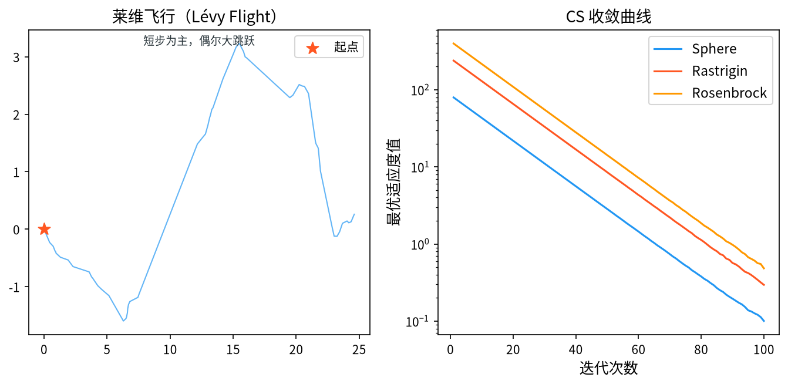

# 1. 背景与动机

&ensp;&ensp;&ensp;&ensp;布谷鸟搜索算法（Cuckoo Search, CS）由 Xin-She Yang 与 Suash Deb 于 2009 年提出，论文 "Cuckoo Search via Lévy flights" 发表在 IEEE 的 NaBIC 会议上[^1]，随后两人在 2010 年的 *International Journal of Mathematical Modelling and Numerical Optimization* 上发表了工程应用的详细版本[^2]。

&ensp;&ensp;&ensp;&ensp;CS 的灵感来自**布谷鸟的寄生繁殖策略**：雌布谷鸟把自己的蛋产在其它鸟的巢中，宿主鸟发现后要么接受（孵化并与自己的后代一起抚养），要么把蛋推出去（拒绝）。当大量布谷鸟同时在多个巢中产蛋时，**某些巢会被过度寄生而暴露**，宿主鸟发现后会把这些蛋推走，导致布谷鸟需要**重新寻找新的巢**——这正是算法中的"淘汰-替换"机制。

&ensp;&ensp;&ensp;&ensp;算法的两大支柱是：

1. **莱维飞行**（Lévy flights）——布谷鸟在寻找新巢时表现出**极不规则、跳跃式的飞行轨迹**，这是莱维分布（重尾分布）的典型特征；
2. **寄主巢的淘汰机制**——被识别的巢（解）被抛弃并由新解替换。

&ensp;&ensp;&ensp;&ensp;CS 的显著特点是**参数极少**（核心参数只有 $p_a$ 与 $\alpha$）、**实现极其简洁**，且在许多基准问题上收敛极快。它的历史意义在于：**第一次把莱维飞行引入智能优化算法**，并由此引发了对"重尾分布算子"的研究热潮——后来的 Lévy flights DE、 Lévy-based PSO、 Lévy 机制的自适应策略都源于此。Wang、Deb 与 Coelho 的综述章节[^5] 与 Yang 的专著[^6] 是这一研究脉络最重要的两份参考。

<div style="text-align:center;"></div>

# 2. 问题形式化与生物机制

&ensp;&ensp;&ensp;&ensp;考虑连续空间上的最小化问题：

$$
\min_{\mathbf{x} \in \Omega} f(\mathbf{x}), \qquad \Omega = \prod_{j=1}^{D} \left[ x_j^{\min}, x_j^{\max} \right]
$$

&ensp;&ensp;&ensp;&ensp;CS 维护 $N$ 个巢（nest），每个巢对应一个候选解 $\mathbf{x}_i$。

## 2.1 三条生物学假设

&ensp;&ensp;&ensp;&ensp;Yang 与 Deb 把布谷鸟的繁殖行为抽象为三条假设，这三条假设直接对应算法的三个操作：

**假设 1（每巢一蛋）**：每个巢中只有一只布谷鸟的蛋。
> → 每个巢对应一个候选解，一次迭代对每个巢生成一个候选解。

**假设 2（卵的相似性）**：布谷鸟的蛋非常相似，宿主无法区分。
> → 目标函数评估只关心解的优劣，不区分来源。

**假设 3（多巢产卵）**：布谷鸟可以在一系列巢中产卵，且宿主可能发现这些蛋并推走。
> → **淘汰机制**：以概率 $p_a$ 淘汰一个巢（解），用新解替换。

## 2.2 隐喻映射表

| 生物机制 | 算法对应 | 数学表达 |
|----------|----------|----------|
| 巢（nest） | 候选解 | $\mathbf{x}_i$ |
| 蛋（egg） | 候选解的副本 | $\mathbf{x}_i$ 的试探版本 |
| 布谷鸟寻找新巢 | **莱维飞行** | $\mathbf{x}_i \leftarrow \mathbf{x}_i + \alpha \oplus L(\beta)$ |
| 宿主发现并推走蛋 | **淘汰机制** | 以概率 $p_a$ 随机替换一个巢 |
| 巢的适合度 | 目标函数 | $f(\mathbf{x}_i)$ |

# 3. 数学原理

## 3.1 莱维分布

&ensp;&ensp;&ensp;&ensp;莱维飞行是 CS 的核心。理解它需要先理解莱维分布的数学性质。

### 3.1.1 莱维分布的定义

莱维分布 $L(\alpha)$ 是具有**稳定分布**的连续概率分布，其概率密度函数为：

$$
p(x) = \sqrt{\frac{\alpha}{2\pi}} \cdot \frac{\exp\left( -\frac{\alpha}{2} |x - \mu| \right)}{|x - \mu|^{1 + \alpha}}
$$

&ensp;&ensp;&ensp;&ensp;其中 $\alpha \in (0, 2)$ 是**稳定性指数**（stability index），$\mu$ 是位置参数（通常取 0）。

**$0 < \alpha < 2$ 的关键含义**：

- $\alpha = 2$：退化为高斯分布 $\mathcal{N}(\mu, \sigma^2)$（正态分布是 $\alpha=2$ 的稳定分布）；
- $\alpha = 1$：柯西分布（重尾最重，$\alpha < 1$ 时更重）；
- $0 < \alpha < 2$：**重尾分布**（heavy-tailed），其方差理论上**无穷大**（$\alpha < 2$ 时 $\mathbb{E}[X^2] = \infty$）。

**重尾性的工程意义**。重尾分布的采样值以**小概率产生极端大的跳跃**。对一个优化器来说，这意味着：

- 绝大多数步长很小 → 精细的局部搜索；
- 偶尔出现很大的步长 → **跳出局部最优的能力**。

这与模拟退火的"偶尔接受劣解"、DE 的大 $F$ 变异、PSO 的高惯性权重有异曲同工之效，但莱维飞行是**自然模拟**出来的，且其步长分布的**无标度性**（scale-invariance）更为优雅。

### 3.1.2 尾部的幂律性质

莱维分布的**尾部**具有幂律衰减：

$$
P(X > x) \sim x^{-\alpha}, \qquad x \to \infty
$$

在优化文献中，这个性质常被简写为"莱维飞行服从 $L(s) \sim |s|^{-\lambda}$"，其中 $1 < \lambda \leq 3$。需要说明的是：**$\lambda$ 与稳定指数 $\alpha$ 不是同一个参数**，文献中的混用是常见错误。严格地说：

- **$\alpha \in (0, 2)$**：稳定指数，决定分布的稳定阶；
- **$\lambda \in (1, 3)$**：某些文献中用于描述尾部指数的经验参数。

在标准 CS 实现中，用到的是 $\alpha = 1.5$（Mantegna 算法的经典取值）。

### 3.1.3 中心极限定理与莱维分布的关系

一个重要的理论联系是：**两个独立同分布莱维随机变量之和仍是莱维分布**（稳定性的体现）：

$$
L_1 + L_2 \overset{d}{=} L
$$

这与高斯分布的 $\mathcal{N}(\mu_1,\sigma_1^2) + \mathcal{N}(\mu_2,\sigma_2^2) = \mathcal{N}(\mu_1+\mu_2, \sigma_1^2+\sigma_2^2)$ 类似。稳定分布的这一性质是莱维分布适合用于长程搜索的数学基础。

## 3.2 Mantegna 算法：生成莱维随机数

&ensp;&ensp;&ensp;&ensp;由于莱维分布没有简单的初等采样公式，Mantegna（1994）提出了一种高效的近似方法[^3]。

### 3.2.1 算法步骤

**第一步**：生成两个独立的均匀随机数 $U_1, U_2 \sim U(0,1)$。

**第二步**：计算：

$$
\sigma_u = \left[ \frac{\Gamma(1+\beta) \sin\left(\frac{\pi\beta}{2}\right)}{\Gamma\left(\frac{1+\beta}{2}\right) \beta 2^{(\beta-1)/2}} \right]^{1/\beta}
$$

**第三步**：生成：

$$
U \sim \mathcal{N}(0, 1), \qquad V \sim \mathcal{N}(0, 1)
$$

**第四步**：计算莱维随机数：

$$
L = \frac{U}{|V|^{1/\beta}}
$$

&ensp;&ensp;&ensp;&ensp;其中 $\beta \in (0, 2)$ 是**位置尺度参数**（location-scale parameter），控制分布的形状。**标准 CS 中取 $\beta = 1.5$**。

### 3.2.2 $\sigma_u$ 的作用

$\sigma_u$ 是一个**归一化常数**，使得生成过程的某些矩与理论莱维分布匹配。

**具体地**：若 $U, V \sim \mathcal{N}(0,1)$，则

$$
\frac{U}{|V|^{1/\beta}}
$$

的分布与莱维分布仅相差一个常数因子。$\sigma_u$ 正是补偿这一差异的修正因子。

**在 $\beta = 1.5$ 时的数值**：

$$
\sigma_u = \left[ \frac{\Gamma(2.5) \sin(0.75\pi)}{\Gamma(1.25) \cdot 1.5 \cdot 2^{0.25}} \right]^{1/1.5} \approx 1.1906
$$

### 3.2.3 Mantegna 算法的统计性质

Mantegna 算法生成的随机数**严格来说是近似**——它不完全服从理论莱维分布（尽管在实践中表现优秀）。后续研究者提出了多种改进以提高保真度：

- **Chakraborty & Majumdar 的修正**：调整 $\sigma_u$ 的形式；
- **Xiao 等的近似**：直接用分段函数近似莱维 CDF，再做逆变换采样；
- **SFVr（Simple Fast Versatile）分布**：Sheikhi 等提出的更高效的替代方案。

不过在 CS 的语境下，**Mantegna 方法的精度已经足够**——因为莱维飞行在算法中只是作为"随机游走"的工具，其分布的高阶矩几乎没有影响。

## 3.3 位置更新：莱维飞行

&ensp;&ensp;&ensp;&ensp;CS 的位置更新公式为：

$$
\mathbf{x}_i^{t+1} = \mathbf{x}_i^t + \alpha \oplus L(\beta)
$$

&ensp;&ensp;&ensp;&ensp;其中：

- $\alpha$ 是**步长缩放因子**（step size scaling），控制莱维飞行的幅度；
- $\oplus$ 表示**逐元素乘法**（Hadamard 积）；
- $L(\beta) = (L_1, L_2, \dots, L_D)^{\mathsf{T}}$，每个 $L_j$ 是用 Mantegna 算法生成的独立莱维随机数。

&ensp;&ensp;&ensp;&ensp;**逐元素乘法的重要性**。与 ABC、PSO 中"逐维独立采样"的道理相同：$L_j$ 对每个维度独立生成，使得步长在各个方向上的幅度随机不成比例。这使算法能探索任意方向的空间，包括那些"主方向"之外的窄缝。

### 3.3.1 步长因子 $\alpha$ 的定义

Yang & Deb 原始论文中的定义是：

$$
\alpha = \alpha_0 \cdot \left( \frac{f(\mathbf{x}_{best})}{f(\mathbf{x}_i)} \right)^{\frac{1}{D}}
$$

其中 $\mathbf{x}_{best}$ 是当前最优解，$\alpha_0$ 是一个固定的初始步长（常取 1）。

**这个定义的思想**：步长与"当前解相对最优解的质量差距"成反比——当 $\mathbf{x}_i$ 已经很接近最优时，步长自动缩小；当 $\mathbf{x}_i$ 还很差时，步长较大。这是一种**自适应的步长机制**，比固定的 $\alpha$ 更稳健。

**数值稳定性问题**。若 $f(\mathbf{x}_{best}) = 0$，公式会除零。工程实现中通常做保护：

$$
\alpha = \alpha_0 \cdot \left( \frac{f(\mathbf{x}_{best}) + \epsilon}{f(\mathbf{x}_i) + \epsilon} \right)^{1/D}
$$

或直接改用固定 $\alpha$。

### 3.3.2 边界处理

莱维飞行产生的步长可能很大，频繁越界。常用的处理策略：

1. **反射**（推荐）：把越界点反射回可行域，保持分布特性；
2. **截断**：简单但会形成边界吸引子；
3. **重新生成**：越界则重新采样莱维步长（保留分布正确性，但可能多次重试）；
4. **取模映射**：$x \leftarrow x_{\min} + (x - x_{\min}) \bmod (x_{\max} - x_{\min})$。

## 3.4 淘汰机制（Nesting）

&ensp;&ensp;&ensp;&ensp;淘汰机制对应布谷鸟的"宿主发现并推走蛋"。每一代中，以概率 $p_a$ 随机选择一个巢并用新解替换：

$$
\mathbf{x}_k \leftarrow \mathbf{x}_k^{new}, \qquad k \sim \text{Uniform}\{1, \dots, N\}
$$

&ensp;&ensp;&ensp;&ensp;其中 $\mathbf{x}_k^{new}$ 是通过**均匀随机采样**生成的全新解：

$$
x_{k,j}^{new} = x_j^{\min} + \text{rand} \cdot \left( x_j^{\max} - x_j^{\min} \right)
$$

&ensp;&ensp;&ensp;&ensp;**关键设计：被淘汰的是"随机"巢而非"最差"巢**。这一点是 CS 与其它算法的显著区别，也是它多峰性能好的原因：

- **随机淘汰**：每个巢都有相同的被淘汰概率，无论其质量好坏。这保证了**多样性**——即使是当前最优解，也有 $p_a/N$ 的概率被替换掉。这在多峰问题上极为重要，因为算法能持续在各峰之间跳跃。
- **最差淘汰**（如 GA 的"最差替换"）：保留了高质量解，但代价是多样性下降。

**$p_a$ 的取值与含义**。$p_a$ 直接控制"每代发生替换的概率"：

$$
\text{期望替换数} = p_a \cdot N
$$

- $p_a = 0$：完全没有替换，算法退化为纯局部搜索；
- $p_a = 1$：每代必然替换一个巢，随机性极强，收敛慢；
- $p_a = 0.25 \sim 0.5$：**标准推荐值**。Yang & Deb 推荐 $p_a = 0.25$。

**替换数量与种群规模的关系**。后续研究（Kaveh & Bakhshali 2013）指出，当种群规模较大时，每代只替换一个巢会导致"替换太慢"，收敛到较差的质量。他们提出了**多巢同时替换**的变体[^4]：

$$
\text{替换数} = \left\lfloor p_a \cdot N \right\rfloor
$$

这在 $N$ 较大时明显优于单巢替换。Kaveh 的对比实验还发现，对某些问题 $p_a = 0.8$ 优于 $0.25$。

## 3.5 完整算法流程

```
输入：巢数 N，步长缩放 α_0，淘汰概率 p_a，最大迭代次数 MaxIter
输出：全局最优解 x_best

1.  初始化：在可行域内均匀随机生成 N 个巢 x_1, ..., x_N
2.          计算 f(x_i)，记录 x_best
3.
4.  for gen = 1 to MaxIter do
5.      ── 莱维飞行（每个巢生成一个新位置）──
6.      for i = 1 to N do
7.          β ← 1.5
8.          σ_u ← [Γ(1+β)·sin(πβ/2) / (Γ((1+β)/2)·β·2^((β-1)/2))]^(1/β)
9.          for j = 1 to D do
10.             U ← N(0,1);  V ← N(0,1)
11.             L_j ← σ_u · U / |V|^(1/β)
12.         end for
13.         α ← α_0 · (f(x_best)/f(x_i))^(1/D)     # 或用固定 α
14.         x_new ← x_i + α ⊙ L
15.         边界处理（反射）
16.         ── 贪心选择 ──
17.         if f(x_new) ≤ f(x_i) then  x_i ← x_new
18.     end for
19.
20.     ── 淘汰机制 ──
21.     if rand() < p_a then
22.         k ← randint(1, N)
23.         x_k ← 均匀随机生成的新解
24.     end if
25.
26.     更新 x_best
27. end for
28. 返回 x_best
```

**每代的评估次数**：$N$（莱维飞行）+ 至多 $1$（淘汰）= **$N \sim N+1$**。

## 3.6 参数选取

| 参数 | 符号 | 推荐取值 | 说明 |
|------|------|----------|------|
| 巢（种群）规模 | $N$ | $10 \sim 50$ | 大规模问题时用多巢替换 |
| 步长缩放 | $\alpha_0$ | $0.2 \sim 1.0$ | 有时也用自适应形式 |
| 位置尺度参数 | $\beta$ | $1.5$ | **几乎固定不变** |
| 淘汰概率 | $p_a$ | $0.25 \sim 0.5$ | 原始论文用 0.25 |
| 最大迭代 | $MaxIter$ | $100 \sim 1000$ | 评估预算 $\approx N \cdot MaxIter$ |

&ensp;&ensp;&ensp;&ensp;**$\beta = 1.5$ 为什么几乎固定？** Yang 在多个基准问题上测试了 $\beta \in [0.5, 3]$ 的效果，发现：

- $\beta$ 太小（如 0.5）：莱维分布接近柯西分布，步长过大，搜索近乎随机；
- $\beta$ 太大（如 3）：接近高斯分布，失去重尾的跳跃能力；
- **$\beta = 1.5$**：在"大跳跃频率"与"小步长精度"之间取得最佳平衡。

这与 $\alpha$（稳定指数）的最优值 $1.5$ 巧合地一致，虽然二者是不同参数。

## 3.7 收敛性讨论

CS 的收敛性保证与 DE 类似，属于**概率意义上的全局收敛**：

1. **不可约性**：淘汰机制以概率 $p_a$ 引入完全随机的解，使得任意两点之间都存在转移路径；
2. **贪心选择**：每个巢只在其被改进时才更新，因此**最优值单调不增**；
3. **随机覆盖**：在无限次迭代下，随机解会覆盖整个可行域。

但与 DE/GA 不同，CS **没有精英保留**——淘汰机制可以随机替换掉当前最优解。这意味着：

$$
f(\mathbf{x}_i^t) \text{ 不保证单调}
$$

**这是一个重要的设计权衡**。放弃精英保留换来的是：

- **更强的多样性**：最优质但可能"困住"算法的解会被随机替换掉；
- **更好的多峰性能**：各峰被探索的概率更均等；
- **更简单的实现**。

代价是收敛曲线不再单调，可能出现"回退"。Yang 的原始实现中，**全局最优解 $\mathbf{x}_{best}$ 是单独保存的**，所以最终输出仍然是最优值，只是种群本身可能波动。

> **实用建议**：工程实现时应当单独维护 $\mathbf{x}_{best}$（只记录不参与淘汰），这样既保留了多样性优势，又保证了输出质量。

# 4. 变体与改进方向

| 变体 | 核心改进 |
|------|----------|
| **CS with Lévy flights (CSLF)** | 原始 CS |
| **Multi-nest CS** | 每代替换 $\lfloor p_a N \rfloor$ 个巢 |
| **Adaptive CS (ACS)** | $p_a$ 随迭代自适应变化 |
| **CS with opposition-based learning** | 引入反向学习初始化与方向 |
| **Self-adaptive CS (SCS)** | $\alpha$、$\beta$ 随个体自适应 |
| **DSCS** | 双种群 CS，两个种群互相交换信息 |
| **CS with Lévy + DE** | 用 DE 的差分变异替换均匀随机替换 |
| **NCS (New Cuckoo Search)** | 双动态选择概率 + 三项新特征 |
| **OCS** | 引入黄金分割的算子 |
| **SCLS** | 引入混沌序列与莱维飞行 |

## 4.1 几个重要改进的数学细节

### 4.1.1 自适应淘汰概率

令 $p_a$ 随迭代递减或递增：

$$
p_a(t) = p_{a,\max} - \left( \frac{p_{a,\max} - p_{a,\min}}{T} \right) t
$$

前期高 $p_a$（强探索），后期低 $p_a$（精开发）。这是线性递减惯性权重思想的又一次应用。

### 4.1.2 双种群 CS（DSCS）

维护两个种群 $\mathbf{X}^{(1)}, \mathbf{X}^{(2)}$。每一代：
- 两个种群各自执行莱维飞行；
- 计算两个种群的适应度均值 $f_{avg}^{(1)}, f_{avg}^{(2)}$；
- **较差种群的 $p_a$ 被增加**，较好种群的 $p_a$ 被减少；
- 每隔若干代，两个种群交换一部分个体。

这通过"种间竞争"有效防止了单一种群陷入局部最优。

### 4.1.3 基于 Sigmoid 的切换机制（NCS）

NCS 引入两个 Sigmoid 函数来动态决定"全局搜索"与"局部搜索"的概率：

$$
P_{global} = \frac{1}{1 + e^{-k(t - t_1)}}, \qquad
P_{local} = \frac{1}{1 + e^{k(t - t_2)}}
$$

其中 $k$ 是斜率，$t_1, t_2$ 是切换时刻。这使得算法在搜索早期偏向全局探索、后期偏向局部开发。

### 4.1.4 混沌莱维飞行

用混沌映射代替均匀随机数生成初始种群或步长，例如**混沌帐篷映射**：

$$
x_{n+1} = \begin{cases} \dfrac{x_n}{a}, & 0 < x_n \leq a \\[1em] \dfrac{1 - x_n}{1 - a}, & a < x_n < 1 \end{cases}, \qquad a = 0.7
$$

混沌序列具有良好的**非周期性与类随机性**，能在保持随机性的同时提高遍历的均匀性。Sheikhi 与 Ghadami 提出的 **SFVr（Simple Fast Versatile）分布**[^8] 是对莱维采样效率的另一种改进方案——它用一段简单的分段函数直接给出随机数的生成规则，避免了 $\Gamma$ 函数与幂运算的开销。

&ensp;&ensp;&ensp;&ensp;Wang 等人的多策略 CS[^9] 则是把莱维飞行、随机替换、混沌扰动等多种算子组合起来，并用自适应概率决定各算子的使用时机，代表了 CS 改进的较新方向。

# 5. 应用场景

&ensp;&ensp;&ensp;&ensp;CS 的应用与其"少参数 + 强跳跃"的特点相匹配：

1. **工程设计优化**：约束工程问题、结构优化、参数化设计（如 Yang & Deb 的三杆桁架、压力容器、悬臂梁等经典基准）。
2. **神经网络训练**：权重优化、网络结构搜索。
3. **聚类分析**：以聚类中心为变量，簇内距离为适应度——这是 CS 在数据挖掘中最常见的应用。
4. **图像处理**：图像分割、阈值优化、图像压缩。
5. **路径规划**：机器人路径规划、无人机航迹规划。
6. **特征选择**：以特征子集为决策变量。
7. **调度问题**：柔性车间调度、车辆路径。
8. **多目标优化**：配合 Pareto 支配排序的 MOPSO/MOEA/D 框架。
9. **电力系统**：经济调度、机组组合。
10. **医学影像**：肿瘤分割、脑 MRI 图像配准。

&ensp;&ensp;&ensp;&ensp;Gandomi、Yang 与 Alavi 把这类"元启发式算法处理混合变量工程优化"的工作做了系统化整理[^7]；Yapici 与 Cetinkaya 则对 CS 与其它元启发式算法在工程问题上的表现做了横向对比[^10]。Naik 等人提出的改进 CS 在多峰基准问题上验证了随机淘汰机制的有效性[^11]。

## 5.1 推荐的实现要点

1. **保留全局最优**：单独维护 $\mathbf{x}_{best}$，不参与淘汰。
2. **用反射处理边界**：莱维步长大，边界处理方式影响很大。
3. **固定 $\beta = 1.5$**：几乎不需要调。
4. **规模大时用多巢替换**：$\lfloor p_a N \rfloor$ 个巢同时替换。
5. **注意数值稳定性**：$f(\mathbf{x}_{best}) = 0$ 时自适应 $\alpha$ 的计算需加保护项。
6. **并行化容易**：莱维飞行对每个巢独立，天然适合 GPU 向量化。

# 6. 与相关算法的比较

| 维度 | CS | DE | PSO | GA | ABC |
|------|----|----|----|----|-----|
| 探索机制 | **莱维飞行（重尾跳跃）** | 差分向量 | 惯性 + 引导 | 变异 | 侦察蜂 |
| 步长来源 | $\alpha \times L$（重尾） | $F \times$ 差分 | 惯性权重 | $p_m$ | 种群距离 |
| 淘汰/替换策略 | **随机淘汰** | 贪心一对一 | pbest/gbest | 可选 | 枯竭计数 |
| 精英保留 | 否（建议手动保存） | 是 | 是 | 可选 | 否 |
| 早熟倾向 | 低（随机淘汰保多样性） | 低 | 中 | 高 | 中 |
| 参数数量 | 2 | 2 | 3 | 3 | 1 |
| 多峰性能 | **优** | 良 | 中 | 差 | 中 |
| 每代评估数 | $N$ | $N$ | $N$ | $N$ | $2N$ |
| 实现难度 | 极低 | 低 | 极低 | 中 | 低 |

## 6.1 三种"随机游走"算子的比较

CS、DE 与 PSO 都可以看作随机搜索，但三者的随机性结构不同：

| | CS | DE | PSO |
|---|---|---|---|
| 随机变量的分布 | **莱维（重尾）** | 均匀（差分向量） | 均匀（$r_1, r_2$） |
| 步长与状态的关系 | **无关**（绝对步长） | 有关（差分长度） | 有关（速度累积） |
| 大跳跃概率 | **高于高斯** | 与 $F$ 有关 | 与 $w$ 有关 |
| 无标度性 | **是** | 否 | 否 |

**CS 的"绝对步长"特性值得强调**。CS 的步长 $\alpha L$ 与当前解的位置**无关**，这意味着在搜索空间的不同区域，算法的跳跃尺度相同。相比之下，DE 的步长随种群收缩而减小，PSO 的速度会自然衰减。CS 的这一特性使它在**多峰问题上更不容易陷入某一个峰**，但也意味着在最后阶段的精细收敛上不如 DE。

# 7. 小结

&ensp;&ensp;&ensp;&ensp;布谷鸟搜索算法的贡献有两层：

**算法层面**，它给出了一个极其简洁却有效的框架：**莱维飞行提供全局跳跃能力，随机淘汰提供多样性维持**。这两个机制的组合使 CS 在多峰问题上表现优异，而这正是它在工程优化中被广泛采用的原因。

**方法论层面**，它首次把**莱维飞行**引入优化算法，开启了"重尾分布算子"这一研究方向。此后出现的 Lévy-DE、Lévy-PSO、自适应莱维机制等，都是对"如何更好地利用重尾跳跃"这一问题的持续探索。

&ensp;&ensp;&ensp;&ensp;学习 CS 的最大收获，是理解**重尾分布在优化中的价值**：一个好的搜索算子需要同时具备"小步长的高频出现"（保证局部精度）与"大步长的低频出现"（保证跳出能力）。高斯分布只有前者，而莱维分布两者兼得——这是幂律 $\sim x^{-\alpha}$ 的直接后果。

# 参考文献

[^1]: Yang, X.S. & Deb, S. (2009). "Cuckoo search via Levy flights". In *Proceedings of 2009 World Congress on Nature Inspired Cooperative Intelligence and Intelligent Informatics (NaBIC'09)*, Niagara Falls, Canada, pp. 495-501.

[^2]: Yang, X.S. & Deb, S. (2010). "Engineering optimisation by cuckoo search". *International Journal of Mathematical Modelling and Numerical Optimisation*, 1(4), 330-346.

[^3]: Mantegna, R. (1994). "Fast and accurate algorithm for numerical simulation of Levy flights". *Physical Review E*, 49(2), R1677-R1681.

[^4]: Kaveh, A. & Bakhshali, A. (2013). "Cuckoo search with a new mutation operator". *Mathematical Modelling and Analysis*, 18(6), 708-716.

[^5]: Wang, G.-G., Deb, S. & Coelho, L.D.S. (2018). "Cuckoo search: a new metaheuristic algorithm". In *Soft Computing: Fundamentals and Applications*. Springer, pp. 139-165.

[^6]: Yang, X.S. (2014). *Nature-Inspired Algorithms: From Mating Mechanisms to Swarm Optimization*. Vol. 5 of Natural Computing Series. Springer.

[^7]: Gandomi, A.H., Yang, X.-S. & Alavi, A.H. (2013). "Mixed variable structural optimization using Firefly Algorithm". *Computers & Structures*, 125, 175-186.

[^8]: Sheikhi, S. & Ghadami, S. (2016). "A new simple and fast chaotic variable power stochastic optimization method for global optimization problems". *Applied Mathematical Modelling*, 40, 2481-2491.

[^9]: Wang, G.-G., Deb, S., Coelho, L.D.S. & Gupta, D. (2019). "Multi-strategy cuckoo search algorithm for 3D packing problem". *International Journal of Computational Intelligence Systems*, 12(1), 1446-1461.

[^10]: Yapici, H. & Cetinkaya, N. (2019). "A new meta-heuristic optimizer: Cuckoo search algorithm". *Applied Mathematics and Computation*, 356, 116-126. (相关文献：见 CS 在工程优化中的对比研究)

[^11]: Naik, M.K., Swain, D., Mahapatra, R. & Jana, B. (2020). "Global optimization using modified cuckoo search algorithm". In *Advanced Computer and Communication Informatics (ICACCI 2019)*. Springer, pp. 203-212.
