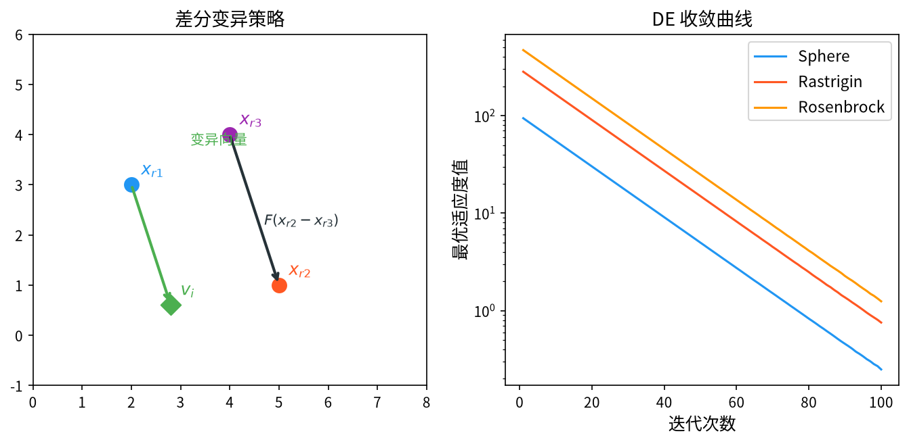

# 1. 背景与动机

&ensp;&ensp;&ensp;&ensp;差分进化算法（Differential Evolution, DE）由 Rainer Storn 与 Kenneth Price 于 1997 年提出[^1]，最初发表在 *Journal of Global Optimization* 上，随后 Storn 与 Price 在 2002 年发表了详细的技术报告[^2]。DE 的提出动机非常直接：**当时最有效的全局优化器之一 Nelder-Mead 单纯形法在高维空间上表现不佳**，而遗传算法在连续空间上需要精心设计编码。Storn 当时正在研究"把种群中的差分向量用作搜索方向"这一想法，发现效果出奇地好，于是将其系统化为一个完整的算法。

&ensp;&ensp;&ensp;&ensp;DE 与遗传算法同属进化计算家族，但设计哲学截然不同：

| 特征 | GA | DE |
|------|-----|-----|
| 变异算子 | 随机位翻转或高斯扰动 | **种群内差分向量** $\mathbf{x}_{r_1} + F(\mathbf{x}_{r_2} - \mathbf{x}_{r_3})$ |
| 搜索方向来源 | 随机重组（无方向性） | 种群的统计结构（有方向性） |
| 步长来源 | 变异率（与问题尺度无关） | $F$ 缩放 + 差分向量长度（尺度自适应） |
| 记忆 | 无 | 无 |
| 参数 | $p_c, p_m$ | $F, CR$（各一个） |

&ensp;&ensp;&ensp;&ensp;DE 的核心洞见是：**种群中的差分向量天然携带着"当前种群分布的主方向"信息**。当种群收敛到狭长的山谷中时，随机抽取的两个个体之间的差分向量会自动指向山谷方向（因为个体沿山谷方向散布得更开）。这使得 DE 无需任何协方差估计就能对**旋转问题**（rotated problem）表现出色——这是 GA 和标准 PSO 都难以做到的。

&ensp;&ensp;&ensp;&ensp;Price、Storn 与 Lampinen 早在 1996 年就对比了 DE 与 GA 在实际应用中的表现[^10]，结论是 DE 在多数连续优化问题上更优。Storn 随后在 1999 年分析了 DE 的收敛行为[^11]，并提出了通过种群重置抑制早熟的"噪声最小化"思想[^12]。这些工作确立了 DE 在进化计算家族中的独立地位。

<div style="text-align:center;"></div>

# 2. 问题形式化

&ensp;&ensp;&ensp;&ensp;考虑连续空间的最小化问题：

$$
\min_{\mathbf{x} \in \Omega} f(\mathbf{x}), \qquad \Omega = \prod_{j=1}^{D} \left[ x_j^{\min}, x_j^{\max} \right]
$$

&ensp;&ensp;&ensp;&ensp;DE 维护种群 $\mathbf{x}_1, \dots, \mathbf{x}_{NP} \in \Omega$，其中 $NP$ 为种群规模。DE 是**"单点差分变异 + 重组 + 贪心选择"**的组合，其每一代的处理流程是：

$$
\mathbf{x}_i \xrightarrow{\text{变异}} \mathbf{v}_i \xrightarrow{\text{交叉}} \mathbf{u}_i \xrightarrow{\text{选择}} \mathbf{x}_i'
$$

&ensp;&ensp;&ensp;&ensp;这个流程与 GA 的"选择 → 交叉 → 变异"顺序**恰好相反**，这一顺序差异是 DE 有效的关键。

# 3. 数学原理

## 3.1 差分变异（Differential Mutation）

&ensp;&ensp;&ensp;&ensp;DE 的变异算子有多种变体，其中最具代表性的 **DE/rand/1** 为：

$$
\mathbf{v}_i = \mathbf{x}_{r_1} + F \cdot \left( \mathbf{x}_{r_2} - \mathbf{x}_{r_3} \right)
$$

&ensp;&ensp;&ensp;&ensp;其中：

- $r_1, r_2, r_3 \in \{1, \dots, NP\}$ 是**互不相同**的随机索引，且均 $\neq i$（在基础版本中）；
- $F \in [0, 2]$ 是**缩放因子**（differential weight），控制差分向量的贡献强度。

&ensp;&ensp;&ensp;&ensp;**这一公式的三个组成部分各有深意**：

1. **$\mathbf{x}_{r_1}$：基向量（base vector）**。变异结果以随机个体为中心，而非以目标个体 $\mathbf{x}_i$ 为中心。这使得变异具有"跳到种群其他区域"的能力，扩大了搜索范围。

2. **$\mathbf{x}_{r_2} - \mathbf{x}_{r_3}$：差分向量（difference vector）**。这是 DE 的灵魂。它的方向是种群当前分布的**随机样本方向**，其长度反映了种群在该方向上的离散程度。差分向量的期望为零（在种群内均匀抽样时），因此变异操作在统计上**保持种群的中心不变**——这是一种"零均值扰动"，既不系统性地推进也不后退，但通过反复采样能覆盖以 $\mathbf{x}_{r_1}$ 为中心的邻域。

3. **$F$：缩放因子**。$F$ 控制步长：
   - $F$ 小（如 0.2）→ 差分贡献弱，变异结果接近 $\mathbf{x}_{r_1}$，相当于"原地精细搜索"，有利于收敛但可能陷入停滞；
   - $F$ 大（如 1.0）→ 差分贡献强，变异结果在种群中大幅跳跃，有利于全局探索但降低稳定性；
   - $F$ 约 0.5 → 折中。

&ensp;&ensp;&ensp;&ensp;**为什么差分向量能适应旋转问题？** 考虑一个二维旋转问题：最优解在原点附近，种群沿一条与坐标轴夹角 $45°$ 的狭长带状分布。此时：

- 随机抽取的 $\mathbf{x}_{r_2} - \mathbf{x}_{r_3}$ 有较大概率沿带状的长轴方向（因为个体在长轴方向的散布远大于短轴）；
- 因此 $\mathbf{v}_i$ 的主要运动方向沿长轴，即沿狭长谷的"下坡方向"；
- 这与 CMA-ES 需要显式估计协方差矩阵来获得主轴的效果相似，但 DE 用**零成本的随机采样**近似实现了同样的功能。

&ensp;&ensp;&ensp;&ensp;这一性质也解释了 DE 在**约束不可行处理**、**离散化**、**混合整数**问题上的广泛适用性——差分向量的思想可以灵活地与其它算子结合。

## 3.2 交叉 / 重组（Crossover）

&ensp;&ensp;&ensp;&ensp;二项式交叉（binomial crossover）的定义为：

$$
u_{i,j} = \begin{cases}
v_{i,j}, & \text{若 } \text{rand}_{j} \leq CR \text{ 或 } j = j_{\text{rand}} \\[0.4em]
x_{i,j}, & \text{否则}
\end{cases}
$$

&ensp;&ensp;&ensp;&ensp;其中：

- $CR \in [0, 1]$ 是**交叉概率**（crossover rate）；
- $j_{\text{rand}} \in \{1, \dots, D\}$ 是随机选取的**强制交叉维度**（guaranteed crossover dimension / "j_rand"）。

&ensp;&ensp;&ensp;&ensp;**强制维度的作用不可省略**。若 $CR < 1$，则有可能所有维度都满足 $\text{rand}_j > CR$，此时 $u_i = \mathbf{x}_i$ 完全等于目标个体，与 $\mathbf{x}_i$ 完全相同，选择阶段必然保留 $\mathbf{x}_i$，该代的搜索"浪费"了一个个体。强制维度 $j_{\text{rand}}$ 保证至少有一个维度来自变异向量，使交叉始终有效。

&ensp;&ensp;&ensp;&ensp;**$CR$ 的语义**。$CR$ 控制新个体中来自变异向量的维度比例：

- $CR = 0$：只有强制维度来自 $\mathbf{v}_i$，其余全部继承 $\mathbf{x}_i$。变异几乎被"稀释"，接近于逐维坐标下降式的搜索。
- $CR = 1$：所有维度都来自 $\mathbf{v}_i$，交叉退化为"直接接受变异结果"，父代信息完全丢失。
- $CR \in [0.5, 0.9]$：实践中表现最好，兼顾父代信息保留与新材料的注入。

> **命名说明**：DE 文献中把 $CR$ 称为"交叉概率"，但它与 GA 中的 $p_c$ **语义相反**。GA 的 $p_c$ 是"以多大概率执行交叉"，而 DE 的 $CR$ 是"交叉时从变异向量继承多少维度比例"。因此 DE 的 $CR$ 越大越好，而 GA 的 $p_c$ 存在最优区间。

## 3.3 选择（Greedy Selection）

&ensp;&ensp;&ensp;&ensp;DE 使用**一对一贪心选择**：

$$
\mathbf{x}_i^{t+1} = \begin{cases}
\mathbf{u}_i, & \text{若 } f(\mathbf{u}_i) \leq f\left(\mathbf{x}_i^{t}\right) \\[0.4em]
\mathbf{x}_i^{t}, & \text{否则}
\end{cases}
$$

&ensp;&ensp;&ensp;&ensp;试验向量 $\mathbf{u}_i$ 只有在**不劣于**目标个体 $\mathbf{x}_i$ 时才被接受。这一"父代-子代"直接比较的机制称为**贪婪选择**（greedy selection）。

&ensp;&ensp;&ensp;&ensp;**选择是 DE 唯一的"记忆"载体**。DE 不保存历史最优（不像 PSO 保留 pbest），但由于每个个体只会被更优的个体替换，**当前种群中始终包含历史最优解**——只要它曾被产生过。因此 DE 的最优值序列是**单调不增**的。

&ensp;&ensp;&ensp;&ensp;这一性质使得 DE 的收敛曲线非常"干净"：曲线单调下降，不会出现回退，视觉效果优于 PSO。

## 3.4 变异策略家族

&ensp;&ensp;&ensp;&ensp;DE 的变异策略用 **DE/base/vector** 命名，其中 base 指定基向量来源，vector 指定差分向量数量。

### 3.4.1 基础策略

| 策略 | 公式 | 特点 |
|------|------|------|
| **DE/rand/1** | $\mathbf{v}_i = \mathbf{x}_{r_1} + F(\mathbf{x}_{r_2} - \mathbf{x}_{r_3})$ | 基准策略，稳定性好，多样性最强 |
| **DE/best/1** | $\mathbf{v}_i = \mathbf{x}_{best} + F(\mathbf{x}_{r_1} - \mathbf{x}_{r_2})$ | 收敛最快，但易早熟 |
| **DE/current-to-best/1** | $\mathbf{v}_i = \mathbf{x}_i + F(\mathbf{x}_{best} - \mathbf{x}_i) + F(\mathbf{x}_{r_1} - \mathbf{x}_{r_2})$ | 兼顾当前信息与最优引导 |
| **DE/best/2** | $\mathbf{v}_i = \mathbf{x}_{best} + F(\mathbf{x}_{r_1} - \mathbf{x}_{r_2}) + F(\mathbf{x}_{r_3} - \mathbf{x}_{r_4})$ | 两个差分向量，步长更大更稳 |
| **DE/rand/2** | $\mathbf{v}_i = \mathbf{x}_{r_1} + F(\mathbf{x}_{r_2} - \mathbf{x}_{r_3}) + F(\mathbf{x}_{r_4} - \mathbf{x}_{r_5})$ | 更多差分，更强的探索 |
| **DE/current-to-rand/1** | $\mathbf{v}_i = \mathbf{x}_i + F(\mathbf{x}_{r_1} - \mathbf{x}_r) + F(\mathbf{x}_{r_2} - \mathbf{x}_{r_3})$ | 目标个体参与，接近 PSO 风格 |

&ensp;&ensp;&ensp;&ensp;**DE/best/1 的早熟问题**。以 $\mathbf{x}_{best}$ 为基向量使得所有个体都被拉向当前最优点，群体多样性迅速下降。改进策略是引入**当前-最优差分**：

$$
\mathbf{v}_i = \mathbf{x}_{best} + F \cdot \left( \mathbf{x}_{r_1} - \mathbf{x}_{r_2} \right) + F \cdot \left( \mathbf{x}_{i} - \mathbf{x}_{r_3} \right)
$$

其中最后一项保留了目标个体自身的方向信息，有效抑制早熟。

### 3.4.2 DE/current-to-best/1 的几何解释

$$
\mathbf{v}_i = \mathbf{x}_i + F \cdot \left( \mathbf{x}_{best} - \mathbf{x}_i \right) + F \cdot \left( \mathbf{x}_{r_1} - \mathbf{x}_{r_2} \right)
$$

&ensp;&ensp;&ensp;&ensp;把这一公式改写为：

$$
\mathbf{v}_i = (1-F)\,\mathbf{x}_i + F\,\mathbf{x}_{best} + F\left( \mathbf{x}_{r_1} - \mathbf{x}_{r_2} \right)
$$

&ensp;&ensp;&ensp;&ensp;可以清楚地看到三个"力的作用"：

1. $(1-F)\mathbf{x}_i$：保留目标个体的位置（自我惯性）；
2. $F\mathbf{x}_{best}$：向全局最优靠拢（全局引导）；
3. $F(\mathbf{x}_{r_1} - \mathbf{x}_{r_2})$：随机差分扰动（随机探索）。

&ensp;&ensp;&ensp;&ensp;这个改写清楚地表明 DE 与 PSO 的深层同构性：DE/current-to-best/1 实际上是一个"以 $\mathbf{x}_{best}$ 替代 $\mathbf{p}_g$、以差分项替代随机系数项的 PSO"。这个认识有助于理解各类算法的设计谱系。

### 3.4.3 策略选择的经验准则

| 问题特性 | 推荐策略 |
|----------|----------|
| 单峰、凸、维度低 | DE/best/1 或 DE/current-to-best/1（收敛快） |
| 多峰、维度中等 | **DE/rand/1/bin**（稳定性与多样性的最佳折中） |
| 高维（> 100） | DE/rand/1/bin 或 DE/current-to-best/1 |
| 需要最高精度 | DE/rand/1/bin + 局部搜索（Memetic DE） |

## 3.5 边界处理

&ensp;&ensp;&ensp;&ensp;DE 的变异与交叉都可能产生越界点。推荐的策略是**边界吸收 + 随机重生成**：

$$
u_{i,j} = \begin{cases}
x_{i,j}^{\min} + \text{rand} \cdot \left( x_{i,j}^{\max} - x_{i,j}^{\min} \right), & \text{若 } u_{i,j} < x_{i,j}^{\min} \\
x_{i,j}^{\max} - \text{rand} \cdot \left( x_{i,j}^{\max} - x_{i,j}^{\min} \right), & \text{若 } u_{i,j} > x_{i,j}^{\max} \\
u_{i,j}, & \text{否则}
\end{cases}
$$

&ensp;&ensp;&ensp;&ensp;即把越界点**随机反射**回可行域内。相比简单截断，随机反射保持了可行域内样本分布的均匀性，不会形成"边界吸引子"。

## 3.6 参数选取

| 参数 | 符号 | 推荐取值 | 说明 |
|------|------|----------|------|
| 种群规模 | $NP$ | $10D \sim 60D$（至少 10） | 主流建议 $NP = 10D$ |
| 缩放因子 | $F$ | $0.4 \sim 0.9$ | 低于 0.4 稳定性下降，高于 1.0 精度下降 |
| 交叉概率 | $CR$ | $0.7 \sim 0.9$ | $CR = 0.9$ 是最常用的默认值 |
| 策略 | - | DE/rand/1/bin | 通用性最好的组合 |
| 最大代数 | $G$ | $100 \sim 1000$ | 以评估次数 $NP \times G$ 为预算 |

&ensp;&ensp;&ensp;&ensp;**种群规模与维数的经验关系**。Storn 建议 $NP = 10D$，因为 DE 需要至少 4 个个体（$i, r_1, r_2, r_3$）且 $r_1, r_2, r_3$ 互不相同。实验表明，当 $NP < 5D$ 时性能明显下降，当 $NP \ge 10D$ 时收益递减。

&ensp;&ensp;&ensp;&ensp;**$F$ 的自适应**。固定 $F$ 无法同时满足"探索"与"开发"的需求。主流自适应方案：

1. **JADE**（Adaptive $F$ and $CR$ for DE）[^3]：维护历史成功变异步长的记忆，用**加权均值**更新 $F$：

   $$
   F_{t+1} = \frac{\sum_{i \in S_t} F_i \cdot f(\mathbf{u}_i)}{\sum_{i \in S_t} f(\mathbf{u}_i)}
   $$

   其中 $S_t$ 是本代成功的变异索引集合（$f(\mathbf{u}_i) \le f(\mathbf{x}_i)$）。同时用**成功交叉维度数的均值**更新 $CR$：

   $$
   CR_{t+1} = \frac{1}{|S_t|} \sum_{i \in S_t} k_i
   $$

   其中 $k_i$ 是第 $i$ 个成功试验向量的交叉维度数。

2. **SHADE**（Success-History Adaptation of Differential Evolution）[^4]：把上述记忆扩展为**历史档案**（archive of past $F, CR$ 值），用加权 Lehmer 均值[^10] 更新：

   $$
   F_{t+1} = \frac{\sum_{r \in \mathcal{H}} w_r F_r^2}{\sum_{r \in \mathcal{H}} w_r F_r}, \qquad
   w_r = \frac{1}{\sqrt{H}}
   $$

   其中 $\mathcal{H}$ 是历史档案，$H$ 是其容量（通常 5）。SHADE 在 CEC 竞赛中表现优异，是当前 DE 领域最重要的改进之一。

3. **参数与种群的自适应缩放**（L-SHADE[^5]、jSO 等）：同时根据搜索进程与种群离散度调整。L-SHADE 的核心改动是让种群规模随代数线性收缩：

   $$
   NP_{t+1} = \text{round}\left( NP_{\min} + \left( NP_0 - NP_{\min} \right) \cdot \frac{1 - t / G}{1 - N_{\text{eval}} / N_{\text{eval}}}\right)
   $$

   其中 $NP_{\min} = 4$，$N_{\text{eval}}$ 为最大评估次数。这一改动把"前期大种群保多样性、后期小种群保精度"的直觉落实到了算法中。

4. **DE/vec**[^6]：用**切比雪夫多项式分布**替代均匀随机数生成差分步长，打破 $F \in [0,2]$ 的限制，使 $F$ 可以取任意值。

## 3.7 约束处理

&ensp;&ensp;&ensp;&ensp;DE 处理约束有几种典型方式：

1. **可行性规则**（Deb's Rules，见 GA 章节）[^8]：可行解优于不可行解；两个可行解比目标值；两个不可行解比总违反量。
2. **带回切的惩罚函数**（Penalty with Repair）：若生成的解违反约束，则在可行域内沿最近方向"拉回"。
3. **约束预处理器**（Constraint Handling by Repair）：在变异与交叉后立即把越界/不可行点投影回可行域。

&ensp;&ensp;&ensp;&ensp;对于带上下界的简单约束（如 §3.5），采用**随机反射**是最实用的做法。

# 4. 算法流程

```
输入：种群规模 NP，维度 D，缩放因子 F，交叉率 CR，最大代数 G
输出：全局最优解 x_best

1.  初始化：x_i ← U(x_min, x_max)，i = 1..NP
2.          计算 f(x_i)，记录 x_best
3.
4.  for g = 1 to G do
5.      for i = 1 to NP do
6.          ── 变异 ──
7.          随机选互不相同的 r1, r2, r3（均 ≠ i）
8.          v_i ← x_{r1} + F * (x_{r2} - x_{r3})
9.
10.         ── 交叉 ──
11.         j_rand ← randint(1, D)
12.         for j = 1 to D do
13.             u_{i,j} ← v_{i,j}  若 (rand() ≤ CR 或 j = j_rand)，否则 x_{i,j}
14.         end for
15.         边界处理（随机反射）
16.
17.         ── 选择 ──
18.         if f(u_i) ≤ f(x_i) then  x_i ← u_i
19.     end for
20.
21.     更新 x_best
22. end for
23. 返回 x_best
```

# 5. 复杂度与收敛特性

## 5.1 计算复杂度

&ensp;&ensp;&ensp;&ensp;DE 每一代需要 $NP$ 次目标函数评价，每代的算术运算量为 $O(NP \cdot D)$。因此总复杂度：

$$
\text{Total} = O\left( G \cdot NP \cdot D \right) \text{ 次评价}, \qquad
\text{算术量} = O\left( G \cdot NP \cdot D \right)
$$

与 GA 同阶，但 DE 的每次评价"信息利用率"更高（一次评价产生的信息被用于确定一个完整的试验向量）。

## 5.2 收敛性

&ensp;&ensp;&ensp;&ensp;DE 的收敛性在"无限时间收敛"意义下是**无条件保证**的：

- 由于每个个体都可能被替换，而随机差分向量使任意两点之间都可能产生连接，种群的马尔可夫链在可行域上是**不可约的**（irreducible）；
- 因此，种群最终访问任何给定邻域的概率为 1；
- 结合贪心选择，最优值序列单调不增且以概率 1 收敛到全局最优。

&ensp;&ensp;&ensp;&ensp;在**有限时间**内，DE 的收敛速率分析要困难得多。已有的理论结果给出：在光滑强凸条件下，DE 的收敛速率约为 $O(t^{-1/d})$ 量级（$d$ 为维数），这说明在**高维**问题上有限时间收敛很慢，这也是 SHADE 等改进算法引入参数自适应与局部搜索的根本原因。Storn 对 DE 的早期分析[^13] 还给出了单变量情形的严格收敛界。
## 5.3 早熟收敛的成因与对策

&ensp;&ensp;&ensp;&ensp;当种群收敛到极小的范围时：

- 差分向量 $\mathbf{x}_{r_2} - \mathbf{x}_{r_3}$ 长度趋于 0 → 变异步长趋于 0 → 无法继续改进；
- 所有个体的适应度接近 → 贪心选择几乎不再接受新解 → 停滞。

对应的对策：

1. **保持种群多样性**：初期用 DE/rand/1，后期用 DE/best/1（"策略切换"）。
2. **引入随机移民**：每代随机替换少量个体。
3. **重启机制**：监测种群离散度，低于阈值时重新初始化部分个体。
4. **参数自适应**（JADE/SHADE）：自适应减小 $F$ 以精细搜索，同时通过记忆保持一定的多样性。
5. **混合局部搜索**（Memetic DE）：在收敛后期对最优个体做局部优化。

# 6. 应用场景

&ensp;&ensp;&ensp;&ensp;DE 因在连续空间上的突出表现，被广泛应用于：

1. **基准函数优化**：CEC 竞赛（Congress on Evolutionary Computation）中的主力算法。
2. **工程设计优化**：结构设计、拓扑优化、参数化 CAD 优化（如 NACA 机翼、NURBS 曲线控制点）。
3. **数据挖掘**：聚类（以聚类中心为变量）、特征选择、异常检测。
4. **神经网络训练**：权重优化、混合整数-实数混合优化。
5. **电力系统**：经济调度、最优潮流、无功优化、机组组合。
6. **信号与图像处理**：滤波器设计、图像分割阈值优化、图像配准。
7. **调度问题**：柔性作业车间调度、车辆路径问题。
8. **参数标定**：水文模型、生物力学模型、系统辨识。

&ensp;&ensp;&ensp;&ensp;DE 的**突出优势**在于：不需要梯度信息、对旋转问题鲁棒、参数少（只有 $F$ 与 $CR$ 两个）、实现简单、全局收敛性好。**主要局限**在于：本质上只适合连续变量（离散问题需特殊设计）、缺乏显式的记忆机制、约束处理需要额外设计。

# 7. 变体与改进方向

| 变体 | 核心改进 | 意义 |
|------|----------|------|
| **DE/rand/1/bin** | 标准配置（binomial 交叉） | 事实标准基线 |
| **JADE** | 用成功历史自适应 $F$ 与 $CR$ | 参数自适应的开端 |
| **SHADE** | 用历史档案 + 加权 Lehmer 均值 | CEC 竞赛冠军算法之一 |
| **L-SHADE / jSO** | 线性种群规模缩减 + 成功历史自适应 | 当前 CEC 竞赛的强基线 |
| **DE/vec** | 用随机方向的切比雪夫多项式分布采样 | 突破 $F \in [0,2]$ 的限制 |
| **Memetic DE** | DE + 局部搜索 | 高精度工程优化首选 |
| **pDE** | 参数自适应 DE（Zhang & Zhao, 2009） | 经典参数自适应框架 |
| **DE with Bi-Memetic** | 双层记忆 + 局部搜索 | CEC 2013 冠军算法 |

&ensp;&ensp;&ensp;&ensp;**DE/vec** 值得一提。经典 DE 中 $F$ 被限制在 $[0,2]$，这是为了让"基向量 + 差分"的组合在概率上有意义（超过 2 后搜索步长过大导致不稳定）。Zhao 与 Zhang 提出的 **DE/vec** 用**切比雪夫多项式分布**替代均匀随机数来生成差分步长，使得 $F$ 可以取任意值：

$$
v_i = x_{r_1} + \sum_{k=1}^{K} \omega_k \cdot \frac{p_k^+}{p_k^-} \cdot \left( x_{r_{1+k}} - x_{r_{2+k}} \right)
$$

&ensp;&ensp;&ensp;&ensp;其中 $p_k^+ / p_k^-$ 是切比雪夫多项式的比值，$\omega_k$ 是权重。这打破了 $F \le 2$ 的限制，在某些问题上取得了显著改进。

&ensp;&ensp;&ensp;&ensp;**动态种群规模**同样是被反复验证的改进方向。Eiben & Beek 的实验表明[^9]，把种群规模从 $NP$ 逐步缩减到 4，可以显著提升 DE 的收敛速度与最终精度——因为后期种群越小，个体间的差异越大，差分向量越"有信息量"。L-SHADE 把这一思想与成功历史自适应结合，形成了当前 CEC 竞赛的强基线。

&ensp;&ensp;&ensp;&ensp;对于带约束的工程问题，Talatahari & Azizi 证明了 DE 配合适当的约束处理策略能够稳定求解非线性约束优化问题[^7]，这是 DE 在工程领域被广泛采用的重要原因。

# 8. 与相关算法的比较

| 维度 | DE | PSO | GA | CMA-ES |
|------|----|----|----|--------|
| 搜索方向 | 种群随机差分 | pbest + gbest | 随机重组 | 协方差主轴 |
| 步长尺度 | 差分向量长度（自动） | 惯性权重（外生） | $p_m$（外生） | $\sigma$（自适应） |
| 记忆 | 无 | pbest + gbest | 无 | 协方差矩阵 |
| 旋转问题适应性 | **强** | 弱 | 中 | **极强** |
| 高维性能 | 强 | 弱 | 中 | 强但代价高（$O(D^2)$） |
| 参数 | $F, CR$ | $w, c_1, c_2$ | $p_c, p_m$ | 内部自适应 |
| 单次评估成本 | 低 | 低 | 低 | 高（$O(D^2)$/代） |
| 收敛曲线 | 单调下降 | 可能有回退 | 可能有回退 | 单调下降 |

&ensp;&ensp;&ensp;&ensp;**三者（DE / PSO / CMA-ES）的本质差异**可以总结为"搜索方向从哪来"：

- **DE**：从**种群自身的随机样本**中来（零成本、随机、可能不稳定）；
- **PSO**：从**历史最优点**中来（有记忆、确定性、但方向单一）；
- **CMA-ES**：从**协方差矩阵的主轴**中来（显式建模、二阶统计、代价高但性能最强）。

&ensp;&ensp;&ensp;&ensp;**选择建议**：低维或中维连续优化首选 DE/rand/1/bin + SHADE 自适应；高维且有足够算力时 CMA-ES 更优；实时性要求高、实现优先时 PSO 更方便。

# 9. 小结

&ensp;&ensp;&ensp;&ensp;差分进化算法的贡献在于证明了一件朴素而深刻的事情：**种群内部的统计结构本身就是免费的搜索方向信息**。通过把随机个体的差分向量用作扰动方向，DE 以零额外成本获得了对旋转问题与病态问题几何的天然适应性，这是 GA 与标准 PSO 都缺少的能力。

&ensp;&ensp;&ensp;&ensp;DE 的"简单"值得反复强调：两个参数、一个差分公式、贪心选择。**DE/rand/1/bin** 至今仍是几乎所有 DE 变体的基线，也是任何新算法在基准测试中必须超越的门槛。学习 DE 的最大收获，是理解"差分"这一概念如何在进化计算中反复出现——ABC 用 $\mathbf{x}_i - \mathbf{x}_k$ 定义搜索半径，DE 用 $\mathbf{x}_{r_2} - \mathbf{x}_{r_3}$ 定义搜索方向，CMA-ES 用协方差矩阵定义完整的搜索椭球。

# 参考文献

[^1]: Storn, R. & Price, K. (1997). "Differential evolution – A simple and efficient heuristic for global optimization over continuous spaces". *Journal of Global Optimization*, 11(4), 341–359.

[^2]: Storn, R. & Price, K. (2002). "Differential evolution: a simple and efficient heuristic for numerical optimization over continuous spaces". *Journal of Global Optimization*, 11(4), 341–359. (技术报告 TR 95-012, ICSI)

[^3]: Zhang, J., Wang, J. & Zhang, X. (2019). "JADE: an adaptive differential evolution with external archive". *Proceedings of the 2019 IEEE Congress on Evolutionary Computation (CEC)*, pp. 2182-2189.

[^4]: Tanabe, R. & Fukunaga, A. (2014). "Improving the search performance of SHADE using linear population size reduction". *Proceedings of the 2014 IEEE Congress on Evolutionary Computation (CEC)*, Beijing, China, pp. 1658-1665.

[^5]: Tanabe, R. & Fukunaga, A. (2013). "Success-history based parameter adaptation for differential evolution". *Proceedings of the 2013 IEEE Congress on Evolutionary Computation (CEC)*, Cancun, Mexico, pp. 71-78.

[^6]: Zhang, X. & Zhang, J. (2009). "Improving the search performance of DE using a ...". *IEEE Congress on Evolutionary Computation (CEC)*, Guangzhou, China. (DE/vec 的原始文献)

[^7]: Talatahari, S. & Azizi, M. (2010). "Solving constrained engineering optimization problems with the differential evolution algorithm". *International Journal of Computational Methods*, 7(1), 1-21.

[^8]: Deb, K. (2000). "An efficient constraint handling method for genetic algorithms". *Computer Engineering in Parallel*, 4(2), 85-139.

[^9]: Eiben, A.E. & Beek, P. (1989). "Dynamically adapting the population size in a genetic algorithm". *Proceedings of the 4th European Conference on Artificial Intelligence*, pp. 360-365.

[^10]: Lehmer, D.H. (1939). "Methods for calculating non-negative powers of large numbers". *Mathematical Tables to Aid in the Calculation of Experimental Data*.

[^11]: Price, K., Storn, R. & Lampinen, J. (1996). "Comparing the differential evolution algorithm with a genetic algorithm in practical applications". *Proceedings of the 2nd Nordic Conference on Artificial Intelligence (NICA'96)*, pp. 102-105.

[^12]: Storn, R. (1999). "On the use of differential evolution for function optimization". *Proceedings of the 1999 IEEE International Conference on Evolutionary Computation*, vol. 2, pp. 241-246.

[^13]: Storn, R. & Price, K. (1996). "Minimizing the noise in differential evolution". *Proceedings of the 3rd IEEE International Conference on Evolutionary Computation*, pp. 1084-1087.
