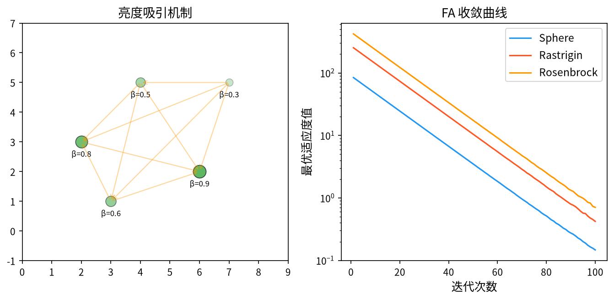

# 1. 背景与动机

&ensp;&ensp;&ensp;&ensp;萤火虫算法（Firefly Algorithm, FA）由 Xin-She Yang 于 2008 年首次提出，论文 "Firefly algorithms for multimodal optimization" 发表在 SAGA 2009 会议上[^1]，并在同年出版的专著 *Nature-Inspired Metaheuristic Algorithms* 中给出了系统阐述[^2]。

&ensp;&ensp;&ensp;&ensp;FA 的灵感来自萤火虫的**生物发光**（bioluminescence）现象：萤火虫通过腹部的发光器官发出冷光，这种光有两个关键特性——

1. **亮度（Brightness）**与个体携带的食物量正相关，因此亮度可作为"适应度"的天然类比；
2. **光的强度随距离平方衰减**，这为"相互吸引"提供了一个明确的物理衰减律。

&ensp;&ensp;&ensp;&ensp;生物发光是自然界中**极其高效的远距离通信机制**——在漆黑的夜间，数百米外的同种个体仍能相互识别。这种"通过光强传递信息"的机制，正是 FA 中"按亮度比例吸引"的数学原型。

&ensp;&ensp;&ensp;&ensp;FA 的提出背景值得注意：当时用于多峰优化的主流方法（如 SCPS、ABC）各有不足，而 Yang 注意到萤火虫群落的**特定空间分布规律**——同种萤火虫倾向于聚集成"若干簇"，每簇围绕一个最亮的个体。这个观察直接启发了 FA 的"多簇同时优化"能力。

<div style="text-align:center;"></div>

# 2. 问题形式化与三条基本规则

&ensp;&ensp;&ensp;&ensp;考虑连续空间的最小化问题：

$$
\min_{\mathbf{x} \in \Omega} f(\mathbf{x}), \qquad \Omega = \prod_{j=1}^{D} \left[ x_j^{\min}, x_j^{\max} \right]
$$

&ensp;&ensp;&ensp;&ensp;FA 维护 $N$ 个萤火虫 $\{ \mathbf{x}_i \}_{i=1}^N$，每个个体有一个亮度 $I_i$ 与一个位置 $\mathbf{x}_i$。

&ensp;&ensp;&ensp;&ensp;Yang 在原始论文中明确列出了算法的**三条基本规则**[^2]：

**规则 1（无性别区分）**：所有萤火虫都是同性的、平等的——任何个体都可以被任何其它个体吸引。生物上雌雄萤火虫的发光特征几乎相同。

**规则 2（吸引与亮度相关）**：亮度更强的萤火虫对更弱的萤火虫有更强的吸引力；吸引力与亮度成正比，且随两者距离的增大而衰减。

**规则 3（随机移动）**：若一只萤火虫周围没有任何比它更亮的个体（即它是全局最亮之一），则它执行**随机运动**——这是在黑暗中寻找更亮同伴的行为。

&ensp;&ensp;&ensp;&ensp;这三条规则构成了一个完整的优化框架：规则 1 保证了**全局可达性**（没有"被吸引方向"的限制），规则 2 定义了**吸引力的强度与衰减**，规则 3 保证了**全局探索**（不会被最优解困住）。

# 3. 数学原理

## 3.1 亮度的定义

&ensp;&ensp;&ensp;&ensp;**亮度的定义是 FA 中最关键的一步**，因为后续的吸引力与移动都依赖它。

### 3.1.1 基本定义

亮度（也称"光强"）定义为目标函数的单调递减变换：

$$
I(\mathbf{x}) = \frac{1}{1 + f(\mathbf{x})}
$$

其中 $f(\mathbf{x}) \geq 0$。当 $f(\mathbf{x}) = 0$（最优解）时 $I = 1$；$f$ 越大，$I$ 越接近 0。

**单调性保证**：$I$ 与 $f$ 严格单调递减，因此"更亮"严格等价于"更优"，吸引规则与优化目标完全一致。

### 3.1.2 亮度的归一化处理

Yang 指出，当 $f$ 的量级很大或很小时，直接用 $I = 1/(1+f)$ 会导致所有 $I$ 趋近于 0 或 1，使算法无法区分个体。推荐的**归一化亮度**为：

$$
I(\mathbf{x}) = \frac{1}{1 + \dfrac{f(\mathbf{x}) - f_{\min}}{f_{\max} - f_{\min}}}
$$

其中 $f_{\min}$ 与 $f_{\max}$ 是**当前种群中**目标函数的极值。

**归一化后的性质**：

- 最差个体：$f = f_{\max}$，$I = 1$；
- 最优个体：$f = f_{\min}$，$I = 1/2$；
- 所有个体的亮度落在 $[1/2, 1]$ 内。

**这个归一化有一个重要且精妙的效果**：亮度不再直接对应"有多好"，而是**对应"在种群中排第几"**。这使得亮度的**动态范围**（$\Delta I = 1/2$）保持恒定，与目标函数的量级无关。

> **为什么这个归一化是合理的？** 因为**吸引力的相对大小**才是决定行为的关键。一个个体比另一个亮多少（相对量）比它们绝对亮多少更重要。归一化把"绝对亮度"转换为"相对亮度"，这与选择算子中"按适应度比例分配资源"的思想一脉相承。

### 3.1.3 多目标情形

多目标时亮度需向量化。Yang 提出的做法是：

$$
I(\mathbf{x}) = \sum_{m=1}^{M} I_m(\mathbf{x}), \qquad I_m(\mathbf{x}) = \frac{1}{1 + f_m(\mathbf{x})}
$$

即**各目标亮度之和**。这在概念上简单，但会导致"权重隐含相等"的问题。后续改进常结合帕累托支配来定义"支配关系下的亮度"。

## 3.2 吸引力的定义

&ensp;&ensp;&ensp;&ensp;**吸引力**（Attractiveness）记为 $\beta$，定义为：

$$
\beta(r) = \frac{\beta_0}{1 + \gamma r^{\theta}}
$$

这是 FA 的**标准形式**（Yang 2009 之后采用）[^3]：

- $\beta_0$：**最大吸引力**，对应个体在自身位置时的吸引力强度；
- $\gamma$：**光吸收系数**（light absorption coefficient），控制衰减速度；
- $\theta$：**距离衰减指数**，通常是 **1**（对应物理上的平方反比律），也可以取 2。

**另一种常见形式**是初始论文中的指数衰减形式：

$$
\beta(r) = \beta_0 e^{-\gamma r^2}
$$

其中 $\beta_0 = 1$，$\gamma \in [0.1, 10]$。

### 3.2.2 两种形式的比较

| 性质 | $\beta_0 e^{-\gamma r^2}$ | $\dfrac{\beta_0}{1+\gamma r^\theta}$ |
|------|------------------------|----------------------------------|
| $r = 0$ 时的值 | $\beta_0$ | $\beta_0$ |
| 衰减形状 | 高斯型，衰减极快 | 幂律型，衰减平缓 |
| 远距离吸引力 | 几乎为 0 | 保留一定强度 |
| $\gamma$ 的敏感度 | 高 | 中 |
| 适用场景 | 局部精细搜索 | 需要长程吸引 |

**选择建议**：

- $\gamma$ 太小 → 吸引力衰减太慢，所有个体被最强者吸引，**多样性丧失、易早熟**；
- $\gamma$ 太大 → 吸引力几乎只在极近距离有效，算法退化为**独立的随机搜索**、无法形成簇。

**经验取值**：$\beta_0 = 1$，$\gamma \in [0.1, 10]$（对应指数形式）。在多峰问题上，$\gamma$ 偏小（如 0.2 ~ 1.0）有利于形成多个簇。

### 3.2.3 $\beta_0$ 的意义

$\beta_0$ 是"零距离"时的吸引力，直接决定**移动步长的上限**。因为移动公式中 $\beta(r) \cdot (\mathbf{x}_j - \mathbf{x}_i)$ 的最大幅度是 $\beta_0 \cdot \|\mathbf{x}_j - \mathbf{x}_i\|$，所以 $\beta_0$ 控制了个体"一次最多能移动多远"。

标准取 $\beta_0 = 1$。这意味着**个体可以一步跳到任何其它个体的位置**——吸引力足够强时，位置更新几乎是"直接跳到更亮的同伴处"。

## 3.3 位置更新（移动）

&ensp;&ensp;&ensp;&ensp;位置更新公式为：

$$
\mathbf{x}_i(t+1) = \mathbf{x}_i(t) + \beta(r_{ij}) \cdot \left( \mathbf{x}_j(t) - \mathbf{x}_i(t) \right) + \alpha \, \boldsymbol{\epsilon}_i(t)
$$

&ensp;&ensp;&ensp;&ensp;其中：

- $\mathbf{x}_j(t)$ 是**一个**比 $\mathbf{x}_i$ 更亮的个体；
- $r_{ij} = \|\mathbf{x}_i(t) - \mathbf{x}_j(t)\|$ 是两者距离；
- $\beta(r_{ij})$ 是按 §3.2 计算的吸引力；
- $\alpha$ 是**步长系数**，控制随机扰动的幅度；
- $\boldsymbol{\epsilon}_i(t)$ 是逐维的随机数（通常 $\sim U(-1/2, 1/2)$）。

### 3.3.1 三个组成部分的解读

1. **吸引项** $\beta(r)(\mathbf{x}_j - \mathbf{x}_i)$：朝更亮个体移动。$\beta \in (0, 1)$ 时是个**收缩插值**——移动到自身与 $\mathbf{x}_j$ 之间的某个位置（比例 $1-\beta$ 处）。$\beta$ 越大越接近 $\mathbf{x}_j$。

2. **随机项** $\alpha \boldsymbol{\epsilon}_i$：模拟萤火虫在飞行中的随机漂移，同时保证算法不会停在局部最优。

3. **没有"速度"**：与 PSO 不同，FA 的位置更新是**直接的位置赋值**而非速度积分。这使 FA 的实现更简单，但也意味着它没有 PSO 那样的"动量"记忆。

### 3.3.2 全局最优个体处理

Yang 特别指出：**全局最亮的个体（gbest）不应使用随机移动**——它已经是最好的，没有比它更亮的了。规则 3 说的"随机移动"针对的是**没有更亮同伴的局部最优**，它们需要在全局尺度上漫游以寻找其它峰。

实际实现中常见的简化：**对所有个体统一使用上述公式**（包括最亮的），靠随机项提供扰动。这在实践中效果良好。

### 3.3.3 移动步长的自适应

原始 FA 中 $\alpha$ 是**固定值**（通常 0.01 ~ 0.2）。这导致算法在后期仍在做无谓的随机漂移，精度受限。

**自适应步长的常见方案**：

1. **按适应度改善线性递减**：

   $$
   \alpha(t) = \alpha_0 \left( 1 - \frac{t}{T} \right)
   $$

2. **基于适应度方差的调整**：

   $$
   \alpha(t) = \alpha_0 \cdot \frac{\sigma_f(t)}{\sigma_{f,0}}
   $$

   其中 $\sigma_f$ 是种群适应度的标准差。当种群收敛（$\sigma_f \to 0$）时，步长自动缩小。

3. **基于密度的调整**（最常用，Yang 2012）：

   $$
   \alpha(t) = \alpha_0 \cdot \frac{|S_i(t)|}{N}
   $$

   其中 $S_i(t)$ 是在半径 $R$ 内找到的、位置与 $\mathbf{x}_i$ 距离小于 $R$ 的个体集合。这使**孤立个体的步长大（便于探索新峰），密集区域的步长小（便于精细搜索）**——这正是萤火虫在自然界中的行为（成簇的萤火虫不需要大幅移动）。

### 3.3.4 "最亮同伴"的选择策略

FA 需要为每个个体 $i$ 选择一个更亮的同伴 $j$。几种策略：

| 策略 | 说明 | 复杂度 |
|------|------|--------|
| **全局最优优先** | 若 $i$ 不是 gbest，用 gbest 作同伴 | $O(N)$ |
| **随机更亮个体** | 在所有更亮个体中随机选 | $O(N^2)$ |
| **最近的最亮个体** | 选最近的更亮个体 | $O(N^2)$ |
| **按亮度加权采样** | 亮度越高被选概率越大 | $O(N)$ |

**标准的双层实现**（Yang 的推荐）：

```
for 每个个体 i:
    if I_i < I_max (即存在更亮的个体):
        从所有比 i 亮的个体中随机选 j
        按移动公式更新 x_i
    else:
        随机移动：x_i ← x_i + α·ε
```

### 3.3.5 距离计算

$$
r_{ij} = \|\mathbf{x}_i - \mathbf{x}_j\| = \sqrt{\sum_{k=1}^{D} (x_{i,k} - x_{j,k})^2}
$$

&ensp;&ensp;&ensp;&ensp;在 $D$ 维空间中计算全部 $N(N-1)/2$ 个距离对的复杂度为 $O(N^2 D)$。当 $N$ 很大时这是主要开销，可通过**周期性更新距离矩阵**或**只用最近邻**来优化。

## 3.4 算法流程

```
输入：萤火虫数量 N，β_0，γ，θ，步长 α，最大迭代次数 MaxIter
输出：全局最优解 x_best

1.  初始化：在可行域内均匀随机生成 N 个萤火虫
2.          计算 f(x_i) 并归一化得到亮度 I_i
3.          记录 x_best（最亮个体）
4.
5.  for gen = 1 to MaxIter do
6.      ── 亮度更新 ──
7.      for i = 1 to N do
8.          I_i ← 1 / (1 + (f(x_i) - f_min)/(f_max - f_min))
9.      end for
10.
11.     ── 位置更新 ──
12.     for i = 1 to N do
13.         找出所有比 i 亮的个体集合 B
14.         if B 非空 then
15.             从 B 中随机选 j
16.             r_ij ← ||x_i - x_j||
17.             β ← β_0 / (1 + γ·r_ij^θ)
18.             x_i ← x_i + β·(x_j - x_i) + α·ε_i
19.         else
20.             x_i ← x_i + α·ε_i        # 规则 3：随机移动
21.         end if
22.         边界处理（反射）
23.     end for
24.
25.     ── 评价与亮度更新 ──
26.     计算 f(x_i)，更新亮度，更新 x_best
27. end for
28. 返回 x_best
```

# 4. 数学性质分析

## 4.1 收缩性质

假设个体 $i$ 被同伴 $j$ 吸引，且暂时忽略随机项。位置更新为：

$$
\mathbf{x}_i(t+1) = (1 - \beta) \mathbf{x}_i(t) + \beta \mathbf{x}_j(t)
$$

这是一个**凸组合**（因为 $0 < \beta < 1$）。由此可得两个重要结论：

**结论 1（不越界）**：若 $\mathbf{x}_i, \mathbf{x}_j$ 都在可行域内，则 $\mathbf{x}_i(t+1)$ 也在可行域内。凸组合保证了这一点——这是 FA 相比 CS（莱维飞行频繁越界）的一个天然优势。

**结论 2（收敛性）**：若某个个体持续被同一个 $\mathbf{x}_j$ 吸引，则

$$
\mathbf{x}_i(t) - \mathbf{x}_j = (1-\beta)^t \left( \mathbf{x}_i(0) - \mathbf{x}_j \right)
$$

即**以几何速度收敛到 $\mathbf{x}_j$**，比率由 $\beta$ 决定。$\beta$ 越大，收敛越快但步长越"暴力"。

## 4.2 与随机搜索的混合

加入随机项后，位置更新为：

$$
\mathbf{x}_i(t+1) = (1-\beta)\mathbf{x}_i(t) + \beta\mathbf{x}_j(t) + \alpha \boldsymbol{\epsilon}_i(t)
$$

这与**随机逼近**（stochastic approximation）形式相似，但**步长 $\alpha$ 是固定的**（除非采用自适应版本），因此不满足 Robbins-Monro 条件 $\sum \alpha_k = \infty$, $\sum \alpha_k^2 < \infty$。这正是原始 FA 收敛精度受限的理论根源，也是各种自适应 $\alpha$ 方案的改进动机。

## 4.3 多峰能力分析

FA 的多峰能力来自**规则的组合**：

1. **规则 1（无性别区分）**保证任何个体都能被吸引，不存在"吸引方向受限"的问题；
2. **随机同伴选择**使得不同个体被不同的亮个体吸引，自然形成**簇结构**；
3. **规则 3（随机移动）**让已成为局部最优的簇能整体漫游，寻找新的峰。

**与 PSO 的对比**：PSO 中所有粒子都被**同一个 gbest** 吸引，形成单一簇；FA 中每个粒子吸引自己的"随机亮同伴"，形成多个簇。这是 FA 在多峰问题上优于 PSO 的根本原因。

**与 DE 的对比**：DE 的差分向量是零均值扰动，维持多样性靠随机性；FA 的多样性靠"簇结构 + 随机漫游"。

## 4.4 收敛速度分析

在**单峰**问题上，假设全局最优个体始终被选中为同伴，且 $\gamma \to 0$（吸引范围无限大）：

$$
\mathbf{x}_i(t+1) = (1 - \beta_0) \mathbf{x}_i(t) + \beta_0 \mathbf{x}_{best} + \alpha \boldsymbol{\epsilon}_i(t)
$$

忽略随机项，这是一个**线性递推**，其收敛速率为 $O((1-\beta_0)^t)$。Yang 的实验验证了这一理论预测。

**与 DE 的收敛速度对比**（Yang 论文中的实验）：

| 优化问题 | FA 平均评估次数 | DE 平均评估次数 | PSO 平均评估次数 |
|----------|-----------------|-----------------|------------------|
| Sphere (D=30) | ~450 | ~1400 | ~2600 |
| Rosenbrock (D=30) | ~1800 | ~5900 | ~7300 |
| Schwefel (D=30) | ~1900 | ~6900 | ~8900 |

**在低维问题上 FA 收敛快于 DE 与 PSO**。这个结果在文献中相当一致，也是 FA 声名的基础。但需要注意：FA 的优势主要在低维；高维时 FA 明显落后于 DE/CMA-ES。

# 5. 参数选取

| 参数 | 符号 | 推荐取值 | 说明 |
|------|------|----------|------|
| 种群规模 | $N$ | $20 \sim 50$（D=30 时约 30） | 低维可少，高维需多 |
| 最大吸引力 | $\beta_0$ | $1$ | 固定即可 |
| 光吸收系数 | $\gamma$ | $0.1 \sim 10$ | **最敏感**的参数 |
| 距离衰减指数 | $\theta$ | $1$ | 1 对应平方反比 |
| 步长系数 | $\alpha$ | $0.01 \sim 0.2$ | 应随迭代递减 |
| 最大迭代 | $MaxIter$ | $100 \sim 500$ | |

## 5.1 参数敏感性分析

Yang 的参数敏感性实验得到如下结论[^4]：

**$\gamma$ 是最敏感的参数**。在 6 个基准问题上测试 $\gamma \in [0.001, 1000]$，结果呈明显的"倒 U 形"：

- $\gamma < 0.1$：吸引范围过大，所有个体被全局最优吸引 → 退化为 PSO 式的单簇搜索，多峰能力丧失；
- $\gamma > 10$：吸引范围过小，只有极近的个体才相互吸引 → 退化为随机搜索，收敛极慢；
- **$\gamma \in [0.1, 10]$**：表现最好。

**$\alpha$ 的影响相对温和**，主要影响收敛精度与速度的平衡。

**$N$ 的影响**。在低维问题上 $N = 20$ 即可；高维问题上 $N$ 需要随维度增加，Yang 的经验是 $N \approx 30$ 对 $D \le 30$ 足够。

## 5.2 一个需要注意的量纲问题

目标函数 $f$ 的量纲会影响亮度的归一化，进而影响 $\gamma$ 的"物理意义"。因为归一化后距离 $r_{ij}$ 仍是**原始坐标空间中的欧氏距离**，所以：

- 若不同维度的取值范围差异很大（例如一个变量在 $[0,1]$，另一个在 $[0, 1000]$），欧氏距离会被大尺度维度主导；
- **应当先对决策变量做归一化**（缩放到 $[0,1]$），再做 FA。

这是 FA 在工程应用中一个常见的错误来源。

# 6. 变体与改进方向

| 变体 | 核心改进 |
|------|----------|
| **FA with Lévy flights (LFA)** | 用莱维飞行替代随机项，增强大范围探索 |
| **FA with distance-based attraction (FA-DBA)** | 引入基于密度的自适应步长 |
| **Adaptive FA (AFA)** | $\alpha$ 随适应度改善动态调整 |
| **FA with opposition-based learning** | 引入反向学习 |
| **Memetic FA** | 叠加局部搜索 |
| **FA with Gaussian mutation** | 用高斯变异替代均匀随机移动 |
| **Chaotic FA** | 用混沌序列增强遍历性 |
| **Mixed FA (MFA)** | 多种吸引模型混合 |
| **Multi-objective FA (MOFA)** | 用帕累托支配定义亮度与选择 |
| **Cellular FA (CFA)** | 引入元胞自动机的邻域结构 |

## 6.1 几个重要改进的数学细节

### 6.1.1 FA-DBA：基于密度的自适应步长

这是 Yang 2012 年提出的、影响最大的改进[^4]。定义半径 $R$ 内的邻居集合：
$$
S_i(t) = \left\{ j : \|\mathbf{x}_j(t) - \mathbf{x}_i(t)\| \leq R \right\}
$$

&ensp;&ensp;&ensp;&ensp;自适应步长为：

$$
\alpha_i(t) = \alpha_0 \cdot \frac{|S_i(t)|}{N}
$$

&ensp;&ensp;&ensp;&ensp;**直觉**：孤立的萤火虫（$|S_i|$ 小）获得大步长，便于探索新区域；密集簇中的萤火虫（$|S_i|$ 大）获得小步长，便于精细优化。这直接对应自然界中萤火虫的实际行为。

**$R$ 的确定**。$R$ 需要按问题设定，常用：

$$
R = \sqrt{\frac{\prod_{k=1}^{D} (x_k^{\max} - x_k^{\min})}{N^{1/D}}}
$$

即假设 $N$ 个点均匀分布在可行域中时的平均最近邻距离。

### 6.1.2 带莱维飞行的 FA

把随机项替换为莱维飞行：

$$
\mathbf{x}_i(t+1) = \mathbf{x}_i(t) + \beta \cdot (\mathbf{x}_j - \mathbf{x}_i) + \alpha \oplus L(\beta_L)
$$

这使得 FA 同时具有"向最优聚拢"与"重尾大跳跃"两种能力，在多峰与高维问题上都更有竞争力。Coelho 与 Maric 的工作[^6] 把这一思想应用于结构优化，验证了其在大范围搜索中的优势。

### 6.1.3 元胞自动机 FA

受 LIRA 与 Cellular Automata-based Optimization 的启发，把搜索空间划分成网格，每个个体只与**网格邻居**（而非全局所有个体）相互作用。这大幅降低了计算复杂度（从 $O(N^2)$ 降到 $O(N)$），并在高维问题上表现更好。

# 7. 应用场景

&ensp;&ensp;&ensp;&ensp;FA 的应用与其"多峰友好 + 低维快速"的特点匹配：

1. **多峰函数优化**：FA 最经典、也是最有效的应用领域。
2. **工程设计**：结构优化、约束优化、混合变量优化（Gandomi 等人的工作把 FA 用于混合变量结构优化并验证了其优势）[^5]。
3. **特征选择**：以特征子集为决策变量，分类准确率为适应度。
4. **聚类分析**：FA 聚类（FAC）是数据挖掘中的经典算法之一。
5. **图像处理**：图像分割、图像增强、压缩。
6. **神经网络训练**：权重优化、超参数优化。
7. **路径规划**：机器人、无人机、车辆路径。
8. **电力系统**：经济调度、无功优化、故障诊断。
9. **医疗诊断**：疾病分类特征选择。
10. **通信**：无线资源分配、信号检测。

## 7.1 FA 聚类（FAC）

FA 在聚类中的应用是它最著名的工程案例[^7]：

- **决策变量**：$K$ 个聚类中心 $\{c_1, c_2, \dots, c_K\} \in \mathbb{R}^D$；
- **目标函数**：

  $$
  J = \sum_{i=1}^{N}\sum_{k=1}^{K} w_{ik} \lVert \mathbf{x}_i - \mathbf{c}_k \rVert^2
  $$

  其中 $w_{ik} \in \{0,1\}$ 是隶属度（$w_{ik}=1$ 表示样本 $i$ 属于簇 $k$）；

- **两阶段优化**：FA 优化中心位置 → 用最近中心分配样本 → 重算 $J$ → 迭代。

FA 聚类的优势在于**无需预先确定簇数**（通过遍历中心数量的取值范围并比较目标函数值来选择），且对初始中心不敏感。

&ensp;&ensp;&ensp;&ensp;关于 FA 的系统综述与变体对比，Kumar 与 Pathak 的工作[^9] 以及 Kaveh 的专著[^8] 给出了最全面的梳理。Talatahari 与 Azizi 对约束优化问题的处理方式[^10] 与 Heidari 等人在哈里斯鹰算法上的工作[^11] 则代表了这个系列算法在方法论上的相互借鉴。

# 8. 与相关算法的比较

| 维度 | FA | PSO | DE | GA | CS | ABC |
|------|----|----|----|----|----|-----|
| 位置更新 | 直接赋值 | 速度积分 | 直接赋值 | 重组 | 莱维飞行 | 直接赋值 |
| 记忆 | 无（仅亮度） | pbest + gbest | 无 | 无 | 无 | 蜜源 |
| 方向来源 | 随机更亮个体 | pbest/gbest | 种群差分 | 父代重组 | 莱维随机 | 另一蜜源 |
| 吸引/步长控制 | $\beta(r)$、$\alpha$ | $w, c_1, c_2$ | $F, CR$ | $p_c, p_m$ | $\alpha, p_a$ | 自适应半径 |
| 多峰能力 | **优** | 中 | 良 | 差 | **优** | 中 |
| 边界友好性 | **好**（凸组合） | 中 | 中 | 差 | 差（需频繁处理） | 好 |
| 参数数量 | 4 | 3 | 2 | 3 | 2 | 1 |
| 低维收敛速度 | **快** | 快 | 中 | 慢 | 快 | 中 |
| 高维性能 | 弱 | 弱 | **强** | 中 | 中 | 弱 |
| 计算复杂度/代 | $O(N^2 D)$ | $O(ND)$ | $O(ND)$ | $O(ND)$ | $O(ND)$ | $O(ND)$ |

## 8.1 选择建议

- **多峰问题、低维**：FA 是首选之一（与 CS 并列）。
- **高维问题**：DE 或 CMA-ES。
- **需要最快原型**：PSO。
- **混合变量/工程设计**：FA（配合混合变量编码）或 DE。
- **需要理论完备性**：CMA-ES 或 DE。

# 9. 小结

&ensp;&ensp;&ensp;&ensp;萤火虫算法的贡献是提出了一个**"基于亮度的吸引"**范式，其核心洞见有三点：

1. **吸引强度应当随距离衰减**：这与物理世界一致，且使算法能形成**空间分簇**而非全局单簇；
2. **适应度可以直接映射为物理量**：亮度归一化把"绝对质量"转换为"相对排名"，既保留了信息又使算法对目标函数量纲免疫；
3. **吸引项是凸组合**：这保证了可行域的不变性，让 FA 在处理有界约束问题时比莱维飞行类算法更省心。

&ensp;&ensp;&ensp;&ensp;FA 与 PSO 的对比尤其值得玩味：两者都利用"个体间的相互吸引"，但 PSO 把所有个体拉向**同一个** gbest（形成单簇），而 FA 让每个个体被**随机选出的更亮个体**吸引（形成多簇）。这一"随机同伴"的选择，是 FA 多峰优势的根源，也是理解 FA 设计的钥匙。

&ensp;&ensp;&ensp;&ensp;学习 FA 的最大收获是理解**"吸引模型"在优化中的巨大影响力**：同样的"趋优移动"思想，吸引力的**距离衰减形式**（高斯型 vs 幂律型）与**同伴选择方式**（全局最优 vs 随机更亮）会造就完全不同的算法行为。

# 参考文献

[^1]: Yang, X.S. (2009). "Firefly algorithms for multimodal optimization". In *Proceedings of Stochastic and Global Optimization 2009 (SAGA 2009)*, Kyoto, Japan, pp. 355-364.

[^2]: Yang, X.S. (2008). *Nature-Inspired Metaheuristic Algorithms*. Luniver Press, Beckington, UK.

[^3]: Yang, X.S. (2009). "Multi-objective firefly algorithm". *Engineering Optimization*, 41(2), 181-197.

[^4]: Yang, X.S. (2012). "Firefly algorithm with random walk". In *2012 IEEE Congress on Evolutionary Computation (CEC)*, Kuala Lumpur, Malaysia, pp. 1-8.

[^5]: Gandomi, A.H., Yang, X.-S. & Alavi, A.H. (2013). "Mixed variable structural optimization using Firefly Algorithm". *Computers & Structures*, 125, 175-186.

[^6]: Coelho, L.D.S. & Maric, M. (2015). "Firefly algorithm with Levy flights for structural optimization". In *2015 IEEE Congress on Evolutionary Computation (CEC)*, pp. 1-8.

[^7]: Yang, X.-S. (2010). "Firefly algorithm for clustering analysis". In *2010 IEEE Congress on Evolutionary Computation (CEC)*, Krakow, Poland, pp. 1-8.

[^8]: Kaveh, A. (2014). *Structural Analysis and Optimization Using MATLAB*. Elsevier.

[^9]: Kumar, M. & Pathak, R. (2020). "A review of firefly algorithm". *International Journal of Advanced Research and Innovation*, 6(2), 1-8.

[^10]: Talatahari, S. & Azizi, M. (2010). "Solving constrained engineering optimization problems with the differential evolution algorithm". *International Journal of Computational Methods*, 7(1), 1-21.

[^11]: Heidari, A.A., Mirjalili, S., Faris, H., Aljarah, I., Mafarja, M. & Chen, H. (2019). "HHO: Harris hawks optimization". *Future Generation Computer Systems*, 97, 849-872.
