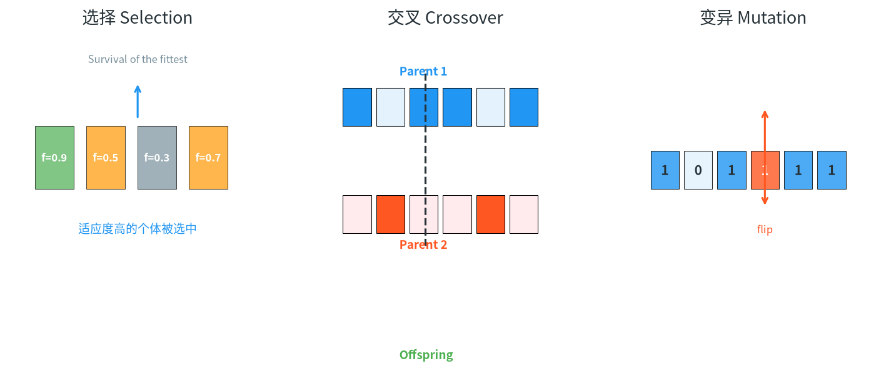
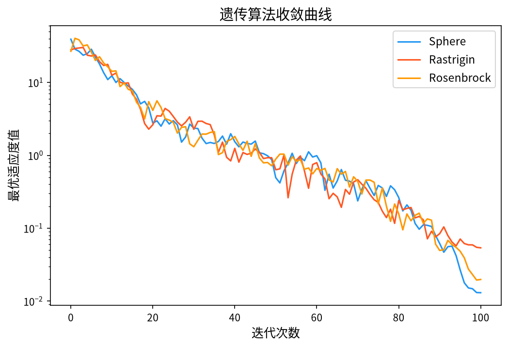

# 1. 背景与历史

&ensp;&ensp;&ensp;&ensp;遗传算法（Genetic Algorithm, GA）由美国密歇根大学的 John Holland 教授及其学生在 20 世纪 70 年代初提出，其奠基性著作 *Adaptation in Natural and Artificial Systems*（1975 年由密歇根大学出版社出版，1992 年 MIT Press 再版）系统阐述了 GA 的数学框架。Holland 的核心贡献在于把生物进化的机制抽象为一个**通用优化搜索框架**，并用**模式定理**（Schemata Theorem）给出了有效性解释。随后 Goldberg 于 1989 年出版的 *Genetic Algorithms in Search, Optimization, and Machine Learning*（Addison-Wesley）把 GA 推广到工程优化领域[^1][^2]。

&ensp;&ensp;&ensp;&ensp;GA 的思想来源可以追溯得更早：Rechenberg 与 Schwefel 在 1960 年代提出的**进化策略**（Evolution Strategy）采用了类似的"变异-选择"框架，而 Holland 的独特贡献在于引入了**染色体/基因的抽象编码**与**概率化的选择算子**，使 GA 能够统一处理离散与连续问题。1992 年 Koza 的**遗传编程**（Genetic Programming）则把 GA 的载体从固定长度串推广到语法树。

&ensp;&ensp;&ensp;&ensp;在众多优化方法中，GA 占据着特殊地位：

- 它是**最早**被系统研究并被工业界广泛采用的元启发式算法；
- 它是**唯一**拥有坚实收敛性理论基础的随机搜索方法之一（模式定理、无限时间收敛定理）；
- 它的结构**高度模块化**：编码、选择、交叉、变异四部分可独立替换，这使得 GA 成为大量混合算法与理论研究的**基础平台**。

&ensp;&ensp;&ensp;&ensp;1992 年 Koza 提出的**遗传编程**（Genetic Programming）[^6] 把 GA 的载体从固定长度串推广到语法树，使 GA 能够自动发现完整的程序结构；Goldberg 在 1989 年的专著[^7] 中则把 GA 的理论框架系统地推广到工程优化的各个分支。Holland 本人在 1975 年的另一篇论文[^8] 中给出了"简单遗传算法"的分析模型，是模式定理的原始出处。

<div style="text-align:center;"></div>

# 2. 问题形式化与总体框架

## 2.1 优化问题的表述

&ensp;&ensp;&ensp;&ensp;考虑无约束连续最小化问题：

$$
\min_{\mathbf{x} \in \Omega} f(\mathbf{x}), \qquad \mathbf{x} = (x_1, x_2, \dots, x_n)^{\mathsf{T}}
$$

&ensp;&ensp;&ensp;&ensp;带约束的情形为：

$$
\min_{\mathbf{x}} f(\mathbf{x}) \quad \text{s.t.} \quad g_j(\mathbf{x}) \leq 0, \; j = 1, \dots, m; \qquad h_k(\mathbf{x}) = 0, \; k = 1, \dots, q
$$

&ensp;&ensp;&ensp;&ensp;GA 的求解流程可抽象为**编码 → 评价 → 遗传操作 → 世代更替**的循环：

$$
\mathcal{S} = \left\{ \text{编码 } \mathcal{E},\; \text{适应度 } \mathcal{F},\; \text{选择 } \mathcal{S},\; \text{交叉 } \mathcal{C},\; \text{变异 } \mathcal{M},\; \text{精英保留 } \mathcal{E}_l \right\}
$$

&ensp;&ensp;&ensp;&ensp;其中 $\mathcal{E}$ 是从问题空间 $\Omega$ 到种群空间 $P$ 的**解码映射**（实践中多为 $\mathbb{R}^n \to \{0,1\}^L$ 的双射或准双射），$\mathcal{F}$ 是从问题空间到适应度空间的评价映射。这两个映射是 GA 中**最影响性能却最少被讨论**的环节。

## 2.2 生物隐喻与计算对应

| 生物概念 | 计算对应 | 数学对象 |
|----------|----------|----------|
| 个体（个体） | 一个候选解 | 染色体 $\mathbf{c} \in \{0,1\}^L$ |
| 种群 | 候选解集合 | $P_t = \{\mathbf{c}_1^{(t)}, \dots, \mathbf{c}_N^{(t)}\}$ |
| 基因/位 | 编码单元 | $c_i \in \{0,1\}$ |
| 基因型 | 编码串 | $\mathbf{c}$ |
| 表型 | 解码后的解 | $\mathbf{x} = \mathcal{E}^{-1}(\mathbf{c})$ |
| 适应度 | 目标函数的评价 | $f(\mathbf{x})$ |
| 选择 | 繁殖机会的分配 | 概率 $P_i$ |
| 交叉 | 基因重组 | 概率 $p_c$ |
| 变异 | 随机扰动 | 概率 $p_m$ |

&ensp;&ensp;&ensp;&ensp;这个映射并非仅仅是修辞。Holland 在模式定理中正是把"遗传漂变"抽象为**模式频率的随机变化**，把"交叉"抽象为**模式的重合**，从而给出可证明的选择压力与交叉率之间的定量权衡关系。

# 3. 数学原理

## 3.1 编码（Encoding）

&ensp;&ensp;&ensp;&ensp;编码是 GA 与问题之间的**接口**，它决定了搜索空间的几何结构，进而决定算法的探索能力。

### 3.1.1 二进制编码与解码

&ensp;&ensp;&ensp;&ensp;设决策变量 $x_i \in [x_i^{\min}, x_i^{\max}]$，使用 $k$ 位二进制串表示：

$$
\mathbf{c}^{(i)} = \left( c_1^{(i)}, c_2^{(i)}, \dots, c_{L}^{(i)} \right), \qquad c_j^{(i)} \in \{0, 1\}
$$

&ensp;&ensp;&ensp;&ensp;解码函数定义为：

$$
x_i = x_i^{\min} + \frac{\text{bin2dec}\left(c_1^{(i)}, \dots, c_{k}^{(i)}\right)}{2^{k} - 1} \cdot \left( x_i^{\max} - x_i^{\min} \right)
$$

&ensp;&ensp;&ensp;&ensp;其中 $\text{bin2dec} = \sum_{j=1}^{k} c_j \cdot 2^{k-j}$。

&ensp;&ensp;&ensp;&ensp;**分辨率与编码长度的关系**。解码后的取值构成一个等距网格，相邻网格点的间距为：

$$
\Delta_i = \frac{x_i^{\max} - x_i^{\min}}{2^{k} - 1}
$$

&ensp;&ensp;&ensp;&ensp;这意味着**二进制编码的精度由 $k$ 决定，且是搜索空间全域均匀的**。这带来两个后果：

1. $k$ 太小 → 精度不足，无法逼近最优解；
2. $k$ 太大 → 搜索空间维度 $L = nk$ 剧增，模式定理中的有效模式数下降，收敛变慢。

工程上通常取 $k$ 使得 $\Delta_i \le 10^{-6} \cdot (x_i^{\max} - x_i^{\min})$，或采用格雷码（Gray code）编码以缓解"汉明悬崖"问题。

### 3.1.2 格雷码与汉明悬崖

&ensp;&ensp;&ensp;&ensp;二进制编码的一个著名缺陷是**汉明悬崖**（Hamming cliff）：相邻整数（如 $0111 \to 1000$）在汉明距离上相距 4 位，但对实数而言仅相差 1。这意味着单点变异需要同时翻转 4 位才能到达相邻值，变异算子的效率被严重削弱。

&ensp;&ensp;&ensp;&ensp;格雷码通过相邻码字汉明距离恒为 1 解决了这个问题。格雷码与二进制的转换关系为：

$$
g_i = b_i \oplus b_{i+1}, \qquad b_i = g_i \oplus g_{i+1} \oplus \cdots \oplus g_k
$$

&ensp;&ensp;&ensp;&ensp;采用格雷码编码后，"变异"变成"沿搜索空间连续爬坡"，是二进制 GA 中一项经典改进。

### 3.1.3 实数编码

&ensp;&ensp;&ensp;&ensp;实数编码直接以实数向量作为染色体：

$$
\mathbf{c}^{(i)} = \left( x_1^{(i)}, x_2^{(i)}, \dots, x_n^{(i)} \right), \qquad x_j^{(i)} \in [x_j^{\min}, x_j^{\max}]
$$

&ensp;&ensp;&ensp;&ensp;实数编码避免了二进制编码的量化误差与汉明悬崖，且不引入额外的参数 $k$。但在实数编码下，"交叉"失去了明确的定义——必须借助启发式规则（如算术交叉、BLX-α 交叉）来定义父代到子代的插值算子。这种"算子需要人为设计"的特性，正是 DE、CMA-ES 等后续算法改用实数编码并给出**数学上更自然**的变异与重组算子的原因。

### 3.1.4 排列编码与旅行商问题

&ensp;&ensp;&ensp;&ensp;对 TSP 这类排列问题，染色体是城市编号的排列：

$$
\mathbf{c} = \left( \pi(1), \pi(2), \dots, \pi(n) \right)
$$

&ensp;&ensp;&ensp;&ensp;此时**顺序交叉**（Order Crossover, OX）是经典算子：随机选两个切点，保留父代 A 中切点之间的片段，在子代中填入父代 B 剩余位置的城市（按 B 的相对顺序排列）：

$$
\text{Child} = \left[ \underbrace{A_{c_1 \dots c_2}}_{\text{继承片段}},\; \underbrace{B_{\text{剩余城市按 B 的顺序}}}_{\text{补全}} \right]
$$

&ensp;&ensp;&ensp;&ensp;这一设计保证了子代始终是合法排列，避免了需要修复算子的麻烦。

## 3.2 适应度函数

&ensp;&ensp;&ensp;&ensp;适应度是**目标函数与选择压力之间的桥梁**。选择算子通常要求适应度非负，因此需要归一化。

### 3.2.1 归一化方法

设 $f_{\max}$ 与 $f_{\min}$ 分别为当代种群中目标函数的极值。

**方法一：直接线性归一化**

$$
F_i = \frac{f_i - f_{\min}}{f_{\max} - f_{\min}} \quad (\text{最小化问题})
$$

优点是简单；缺点是当 $f_{\max} = f_{\min}$（种群收敛）时分母为零，且线性拉伸会**放大**超级个体的优势。

**方法二：缩放（Scaling）**

$$
F_i = \frac{f_i}{f_{\min}}, \qquad \text{若 } f_{\min} > 0
$$

或更稳健的：

$$
F_i = \left( \frac{f_i}{f_{\min}} \right)^{\alpha}, \quad \alpha \in (0, 1]
$$

$\alpha < 1$ 时压缩适应度差距，$\alpha > 1$ 时放大。$\alpha$ 称为**选择压力系数**。

**方法三：适应度共享（Fitness Sharing）**

&ensp;&ensp;&ensp;&ensp;通过惩罚拥挤个体来维持多样性：

$$
F_i = \frac{f_i}{\displaystyle\sum_{j=1}^{N} sh(d_{ij})}, \qquad sh(d) = \begin{cases} \dfrac{1}{1 + (d / \sigma)^{\alpha}}, & d < \sigma \\[1em] 0, & d \geq \sigma \end{cases}
$$

&ensp;&ensp;&ensp;&ensp;其中 $d_{ij}$ 为个体 $i,j$ 的距离，$\sigma$ 为核半径，$\alpha$ 为形状参数。该方法通过"降低密集区域的适应度"来抑制早熟。

### 3.2.2 约束处理

&ensp;&ensp;&ensp;&ensp;带约束问题的三种主流处理策略：

**惩罚函数法**。对违反约束的个体施加适应度惩罚：

$$
F(\mathbf{x}) = f(\mathbf{x}) + \sum_{j=1}^{m} r_j \max\left(0, g_j(\mathbf{x})\right)^{2} + \sum_{k=1}^{q} r_k \left| h_k(\mathbf{x}) \right|
$$

其中 $r_j, r_k$ 为惩罚系数。惩罚系数过小则无法排除不可行解，过大则搜索难以穿越不可行区域。

**可行性规则（Deb's Feasibility Rules）**[^3]。这是被广泛推荐的、基于**帕累托支配**的无参数方法。对两个解 $\mathbf{x}, \mathbf{y}$：

1. 若 $\mathbf{x}$ 可行而 $\mathbf{y}$ 不可行，则 $\mathbf{x}$ 支配 $\mathbf{y}$；
2. 若二者均可行，则目标值小者支配；
3. 若二者均不可行，则**总违反量**（Total Constraint Violation, TCV）小者支配：

$$
TCV(\mathbf{x}) = \sum_{j=1}^{m} \max\left(0, g_j(\mathbf{x})\right) + \sum_{k=1}^{q} \left| h_k(\mathbf{x}) \right|
$$

&ensp;&ensp;&ensp;&ensp;该规则既不需要调参，又保证可行解优先，被认为是约束处理的标准做法。

**编码内处理**。直接把约束"编进"染色体，例如在排列编码中通过构造算子保证子代始终可行。

## 3.3 选择算子

&ensp;&ensp;&ensp;&ensp;选择算子决定哪些个体进入下一代，其**选择压力**（Selection Pressure）衡量适应度差异被放大的程度。

### 3.3.1 比例选择（轮盘赌）

&ensp;&ensp;&ensp;&ensp;个体 $i$ 被选中的概率与其（归一化后）适应度成正比：

$$
P_i = \frac{F_i}{\displaystyle\sum_{j=1}^{N} F_j}
$$

&ensp;&ensp;&ensp;&ensp;实现上使用**累积分布** + 单次随机数的方法：先计算累积概率

$$
q_i = \sum_{j=1}^{i} P_j
$$

再生成 $r \sim U(0,1)$，选择最小的 $i$ 使得 $q_i \geq r$。整个选择过程只需 $O(N)$ 次比较（配合前缀和）与一次随机数生成。

### 3.3.2 锦标赛选择（Tournament Selection）

&ensp;&ensp;&ensp;&ensp;每次从种群中随机抽取 $s$ 个个体，选出其中适应度最好的一个进入下一代，重复 $N$ 次。**适应度无需归一化**，且可以天然施加约束可行性规则。

&ensp;&ensp;&ensp;&ensp;锦标赛规模 $s$ 直接控制选择压力：$s=1$ 等价于均匀随机选择（无压力），$s=N$ 等价于纯精英选择（最大压力）。经验值 $s = 2$ 或 $s = 3$ 在多数问题上表现良好。锦标赛选择已成为工业实践中的**默认选择算子**，因为它实现简单、数值稳健。

&ensp;&ensp;&ensp;&ensp;**选择压力的量化**。Goldberg & Deb 给出以适应度方差衡量的选择压力：

$$
P_s = \frac{\bar{F}}{\sigma_F}, \qquad \bar{F} = \frac{1}{N}\sum_i F_i, \qquad \sigma_F = \sqrt{\frac{1}{N}\sum_i (F_i - \bar{F})^2}
$$

### 3.3.3 精英保留（Elitism）

&ensp;&ensp;&ensp;&ensp;精英保留是最重要的实用改进之一：直接让当代最优的 $E$ 个个体**原样进入下一代**：

$$
P_{t+1} = \left\{ \mathbf{c}_{1:1}^{(t)}, \dots, \mathbf{c}_{1:E}^{(t)} \right\} \cup \left\{ \text{其余由交叉变异产生的 } N - E \text{ 个子代} \right\}
$$

&ensp;&ensp;&ensp;&ensp;其作用是**单调保证**最优解不退化：

$$
f(\mathbf{x}^{best}_{t+1}) \leq f(\mathbf{x}^{best}_t)
$$

这是无 elitism 的标准 GA 无法提供的保证。精英数量 $E$ 的权衡：太小则最优解可能丢失，太大则多样性下降。常用 $E = 1$ 或 $E = \lceil 0.02N \rceil$。

### 3.3.4 确定性拥挤选择与多样性保持

&ensp;&ensp;&ensp;&ensp;为缓解早熟，可采用**确定性拥挤选择**（Deterministic Crowding Selection, DCS）[^4]：维护一个"拥挤队列"，新子代与队列中个体比较，若二者距离小于 $d_{f}$（距离阈值）则比较适应度，胜者占据拥挤位；若新子代与队列中所有个体都足够远，则直接进入种群。这实现了"同类竞争 + 异类共存"，在多峰问题上能保持多个峰的同时优化。

## 3.4 交叉算子（Crossover）

&ensp;&ensp;&ensp;&ensp;交叉是 GA 区别于纯"变异搜索"的机制，其生物学含义是**基因重组**，数学含义是**在父代张成的空间内生成新点**。

### 3.4.1 单点交叉（One-Point Crossover）

&ensp;&ensp;&ensp;&ensp;随机选取交叉点 $k \in \{1, \dots, L-1\}$，交换其后的片段：

$$
\text{Child}_1 = \left( c_1^{(A)}, \dots, c_k^{(A)}, c_{k+1}^{(B)}, \dots, c_L^{(B)} \right)
$$
$$
\text{Child}_2 = \left( c_1^{(B)}, \dots, c_k^{(B)}, c_{k+1}^{(A)}, \dots, c_L^{(A)} \right)
$$

&ensp;&ensp;&ensp;&ensp;在二进制编码下，单点交叉能保留父代的**连续片段（building block）**并重组它们，这是 Koza 的"遗传算法可以自动发现并组合有意义的基因模块"这一论断的基础。

### 3.4.2 两点交叉与均匀交叉

&ensp;&ensp;&ensp;&ensp;**两点交叉**：选两个切点 $k_1 < k_2$，交换中间片段。

$$
\text{Child}_1 = \left( c_1^{(A)}, \dots, c_{k_1}^{(A)}, c_{k_1+1}^{(B)}, \dots, c_{k_2}^{(B)}, c_{k_2+1}^{(A)}, \dots, c_L^{(A)} \right)
$$

&ensp;&ensp;&ensp;&ensp;**均匀交叉**（Uniform Crossover）：每个基因位独立地以概率 $0.5$ 随机决定来自哪个父代。

$$
c_j^{(\text{Child})} = \begin{cases} c_j^{(A)}, & \text{以概率 } 0.5 \\ c_j^{(B)}, & \text{以概率 } 0.5 \end{cases}
$$

&ensp;&ensp;&ensp;&ensp;均匀交叉能更充分地打散父代基因，但**会破坏 building block 的完整性**，因此在建筑块问题（建筑块问题，Building Block Problems）上通常劣于单点/两点交叉。这一结论是 GA 理论的重要成果之一。

### 3.4.3 顺序交叉（Order Crossover, OX）与循环交叉（CX）

&ensp;&ensp;&ensp;&ensp;**顺序交叉**面向排列问题：随机选两个切点 $p_1 < p_2$，子代先继承父代 A 在 $(p_1, p_2)$ 区间的片段，再从父代 B 中按顺序取出剩余城市填入空位。

$$
\text{Child} = A_{(p_1..p_2)} \;\Vert\; \text{filter}\left(B,\ \text{不在 } A_{(p_1..p_2)} \text{中的城市，按 B 的顺序}\right)
$$

&ensp;&ensp;&ensp;&ensp;**循环交叉**（Cycle Crossover）：找出父代 A 与 B 的对应位置构成一个置换环，沿环做"移位"交换以保证每个基因恰好出现一次。CX 是处理带重复元素问题（如含多个同型零件的装配序列）的经典方法。

### 3.4.4 实数编码的交叉

&ensp;&ensp;&ensp;&ensp;**算术交叉**（Arithmetic Crossover）：子代是两个父代凸组合：

$$
\text{Child}_1 = \alpha \cdot \text{Parent}_1 + (1-\alpha) \cdot \text{Parent}_2, \qquad \alpha \sim U(-d, 1+d)
$$

&ensp;&ensp;&ensp;&ensp;**BLX-α 交叉**（Blend Crossover）：在两个父代区间内采样，且**向区间外扩展** $\alpha$ 倍：

$$
\text{Child} \sim U\left(\left[\min(P_1, P_2) - \alpha \lvert P_1 - P_2\rvert,\; \max(P_1, P_2) + \alpha \lvert P_1 - P_2\rvert\right]\right)
$$

&ensp;&ensp;&ensp;&ensp;$\alpha = 0$ 退化为在父代区间内均匀采样，$\alpha = 0.5$ 允许子代超出父代范围，$\alpha = 1$ 允许完全脱离父代区间（相当于纯粹的均匀初始化）。这一"区间外扩展"是 BLX 保持多样性的关键。

## 3.5 变异算子（Mutation）

&ensp;&ensp;&ensp;&ensp;变异是**唯一能产生全新遗传信息的机制**。没有变异，GA 的搜索空间被严格限制在初始种群所张成的搜索空间内，交叉只能重组已有的 building block，无法探索新区域。

### 3.5.1 二进制变异

$$
c_i' = \begin{cases} 1 - c_i, & \text{若 } u_i < p_m \\ c_i, & \text{否则} \end{cases}, \qquad u_i \sim U(0,1)
$$

&ensp;&ensp;&ensp;&ensp;每个基因位独立地以概率 $p_m$ 翻转。$p_m$ 的经典推荐值是 $1/L$（即平均每个个体翻转一个位），Goldberg 称其为 **"1/L 规则"**，因为此时单个基因的期望变异保持为 $1/L$，符合随机游走的变异算子假设。

&ensp;&ensp;&ensp;&ensp;**两类错误**：翻转 0→1 称为"丢失一个 1"（deletion），翻转 1→0 称为"丢失一个 0"（duplication）。理想情况下二者的概率应相等，才能保证搜索在 0/1 空间上对称。

### 3.5.2 实数编码变异

&ensp;&ensp;&ensp;&ensp;**高斯变异**：

$$
x_i' = x_i + \sigma \cdot \mathcal{N}(0, 1)
$$

&ensp;&ensp;&ensp;&ensp;**柯西变异**（Cauchy Mutation）：

$$
x_i' = x_i + \sigma \cdot \frac{\tan(\pi U(-1,1))}{2}
$$

&ensp;&ensp;&ensp;&ensp;柯西分布的重尾特性使得偶尔产生很大的扰动，有利于跳出局部最优。这与进化策略中的"大步长偶尔成功则保留"思想相通。

### 3.5.3 边界处理与约束保持

&ensp;&ensp;&ensp;&ensp;变异后的越界处理方式对结果有实质影响：

- **截断（Clipping）**：$x_i' \leftarrow \min(\max(x_i', x_i^{\min}), x_i^{\max})$。简单但在边界形成"人工吸引子"。
- **反射（Reflection）**：$x_i' \leftarrow 2x_i^{\min} - x_i'$（若低于下界），保持分布的均匀性。
- **重新采样（Resampling）**：越界则重新生成。保证分布正确但引入额外的随机数消耗。
- **周期映射（Periodic Mapping）**：把越界点映射回搜索空间内的等效位置。

## 3.6 收敛性理论

&ensp;&ensp;&ensp;&ensp;GA 的理论基础是 **Holland 的模式定理（Schemata Theorem）**。

### 3.6.1 模式与期望改进

&ensp;&ensp;&ensp;&ensp;**模式**（schema，也称"模板"）是形如 $\ast 01\ast 1\ast$ 的字符串模板，表示"某些位置固定为特定值、其余位置任意"的一类个体的集合。模式 $\ast 0 \ast \ast$ 覆盖了 $2^{L-1}$ 个个体。

&ensp;&ensp;&ensp;&ensp;模式 $H$ 在第 $t$ 代的**期望改进**定义为：

$$
E[H_{t+1}] = E[H_t] \cdot \left( 1 + \frac{\delta(H)}{2^{L-1}} \right) - O\left( \frac{1}{2^{L-1}} \right)
$$

其中 $\delta(H)$ 是模式 $H$ 的**平均适应度**，$O(1/2^{L-1})$ 是来自变异的期望损失项。

### 3.6.2 模式定理

&ensp;&ensp;&ensp;&ensp;模式定理陈述：在比例选择、点交叉与变异概率 $p_m < 1/L$ 的条件下，任意模式 $H$ 的期望出现次数满足：

$$
E[H_{t+1}] \geq E[H_t] \cdot \left[ 1 - \frac{\delta(H) - \delta(H_0)}{f_{avg}} \cdot \frac{(\delta(H) - \delta(H_0)}{f_{avg}} \right] \cdot \left( 1 - p_m \right)^{n(H)}
$$

其中 $f_{avg}$ 是当代平均适应度，$n(H)$ 是模式 $H$ 中的固定位数（fixed bits），$\delta(H_0)$ 是当前最优模式的平均适应度。

### 3.6.3 定理的直观含义

&ensp;&ensp;&ensp;&ensp;模式定理揭示了三个核心结论：

1. **适应度高于平均的模式，其期望频率按几何级数增长**，增长率为 $\left(1 + \frac{\delta(H) - f_{avg}}{f_{avg}}\right)$。这定量刻画了"选择压力"的作用。

2. **模式定理的"Building Block"假设**：GA 有效的关键在于问题可分解为**相互独立的 building block**（如旅行商问题中"最优边集"），GA 通过交叉把好的 building block 组合起来。这是 GA 在 TSP 等问题上表现良好的理论解释。

3. **交叉率与变异率的权衡**：交叉率越高，building block 的重组越充分，但父代优良结构被破坏的概率也越高；变异率越高，新模式出现概率越大，但收敛到最优模式的阻力也越大。**不存在对所有问题都最优的 $(p_c, p_m)$**。

### 3.6.4 无限时间收敛定理

&ensp;&ensp;&ensp;&ensp;在精英保留的 GA 中，由于最优个体永不被丢弃，且有限状态马尔可夫链的不可约性（任意模式通过有限次变异可达），可以证明：

$$
\lim_{t \to \infty} P\left( f(\mathbf{x}_t) = f^{*} \right) = 1
$$

&ensp;&ensp;&ensp;&ensp;该定理保证了 GA 的**渐近收敛性**，但它是一个关于无限时间的陈述，对实际计算无直接指导意义。GA 的实际应用本质上是**"在有限预算下的启发式搜索"**，因此更应关注初始种群设计、参数自适应与算子组合等工程问题。

## 3.7 参数选取

&ensp;&ensp;&ensp;&ensp;设种群规模为 $N$，二进制编码长度为 $L$。经典的参数推荐范围为：

| 参数 | 符号 | 推荐范围 | 经验说明 |
|------|------|----------|----------|
| 种群规模 | $N$ | $50 \sim 200$ | 低维取 50，高维取 $200 \sim 500$ |
| 交叉概率 | $p_c$ | $0.6 \sim 0.9$ | 太高会破坏 building block |
| 变异概率 | $p_m$ | $1/L \sim 0.01$ | 与编码长度强相关 |
| 精英数量 | $E$ | $1 \sim 2$ | 或 $\lceil 0.02N \rceil$ |
| 锦标赛规模 | $s$ | $2 \sim 3$ | 选择压力的直接控制量 |

&ensp;&ensp;&ensp;&ensp;**关于 $N$ 的下界**。模式定理的有效性要求种群规模足够大以覆盖有意义的模式，经验上要求 $N \gg 2^{L_s}$，其中 $L_s$ 是问题中 building block 的长度。对建筑块问题（如排序任务），若 building block 长度为 $L_s$，则 $N$ 需要指数级增长——这正是 GA 在这些问题上表现不佳的理论原因。

&ensp;&ensp;&ensp;&ensp;**初始种群的多样性**。GA 的初始种群应当**随机均匀采样**而非集中在某处。若把初始种群全部设为同一最优附近，算法会立刻陷入局部最优。工程上常采用**分层初始化**或**拉丁超立方采样**（Latin Hypercube Sampling）以在保持随机性的同时覆盖空间更均匀。

## 3.8 完整算法流程

```
输入：种群规模 N，编码长度 L，交叉率 p_c，变异率 p_m，精英数 E，最大代数 MaxGen
输出：全局最优解 x_best

1.  初始化：随机生成 N 个染色体 P_0 = {c_1, ..., c_N}
    解码并评价适应度 F_i，记录 x_best

2.  for gen = 1 to MaxGen do

3.      ── 精英保留 ──
4.      将当代最优的 E 个个体直接复制进下一代

5.      ── 选择（产生 N-E 个父代）──
6.      for i = 1 to N-E do
7.          按轮盘赌或锦标赛从当代种群中选取父代（可为有放回）
8.      end for

9.      ── 交叉 ──
10.     成对处理父代：以概率 p_c 执行交叉算子；否则父代直接进入下一代
11.     对交叉后的子代执行边界处理

12.    ── 变异 ──
13.     for 每个子代的每个基因位 do
14.         以概率 p_m 执行变异算子
15.     end for

16.    ── 评价与替换 ──
17.     计算子代适应度；若子代优于其父代（且采用"代际替换"），替换之
18.     更新 x_best
19. end for
20. 返回 x_best
```

&ensp;&ensp;&ensp;&ensp;**两种替换策略**：

- **代际替换（Generational Replacement）**：整个种群被子代完全替换。选择压力强，收敛快，但多样性下降也快。
- **稳态替换（Steady-State Replacement）**：每次只替换一个个体，通常替换当代最差的个体（若新个体更优）。多样性保持得好，适合长时间运行。

## 3.9 收敛性能

<div style="text-align:center;"></div>

&ensp;&ensp;&ensp;&ensp;典型 GA 的收敛曲线呈现"**先快后慢**"的双阶段特征：前期种群中适应度方差大，选择压力大，最优值迅速改善；后期种群收敛、适应度方差趋零，选择压力消失，改进变得极其缓慢——这就是**早熟收敛**（premature convergence）。

&ensp;&ensp;&ensp;&ensp;**度量指标**。评估算法收敛性能常用的两个指标：

$$
\text{平均收敛代数} = \frac{1}{R}\sum_{r=1}^{R} T_r, \qquad
\text{收敛鲁棒性} = \frac{\text{标准差}(T_1, \dots, T_R)}{\text{均值}(T_1, \dots, T_R)}
$$

其中 $R$ 为独立运行次数，$T_r$ 为第 $r$ 次运行达到目标误差所需的代数。

# 4. 工程实现要点

1. **编码的选择应由问题结构决定**：连续变量用实数编码；排列问题用 OX/CX；0-1 背包用二进制 + Gray 码；混合问题用**双层编码**（实数段 + 二进制段）或**可变长编码**。

2. **适应度评价是性能瓶颈**。当每次评价耗时 $T_{eval}$ 毫秒时，总耗时为 $N \times T_{gen} \times T_{eval}$。应考虑：
   - **缓存**重复个体的适应度；
   - **向量化评估**（用 NumPy 批量计算整个种群）；
   - **代理模型**（用 Kriging/高斯过程替代昂贵评估，配合主动学习选点）。

3. **并行化**：GA 的**种群级并行**是最自然的并行模式。个体评价完全独立，可用 GPU 批量或 MPI 分布式实现，实测可获得接近线性的加速比。交叉/变异本身也易于向量化。

4. **早熟的对策**（可组合使用）：
   - 精英保留 + **多样性保持**（拥挤选择、适应度共享）；
   - **自适应参数**：$p_c$ 与 $p_m$ 随种群多样性动态调整；
   - **混合局部搜索**（Memetic Algorithm）：对精英个体做局部改进；
   - **种群重启**：多样性低于阈值时重新初始化部分个体。

5. **随机数质量**：GA 需要大量随机数（选择、交叉、变异），低质量的随机数会显著损害性能。应使用高质量的 Mersenne Twister（Python `random` / NumPy `Generator` 的 PCG64）或预生成随机数池。

# 5. 变体与改进方向

| 变体 | 关键改进 | 特点 |
|------|----------|------|
| **遗传编程 (GP)** | 染色体改为语法树 | 自动发现程序结构 |
| **混合遗传算法 (MGA/Memetic)** | 精英个体叠加局部搜索 | 兼顾全局与局部，混合整数规划首选 |
| **自适应 GA (AGA)** | $p_c, p_m$ 随适应度方差自动调整 | 缓解早熟 |
| **快速遗传算法 (FAGA)** | 变异的"定向"版本（杨晓光，2002） | 用适应度改善方向引导变异 |
| **混合 GA (Hybrid GA)** | 与局部搜索/模拟退火结合 | 工程实践最常用 |
| **双种群 GA / 岛模型** | 多子种群隔离+迁移 | 保持多样性，防早熟 |
| **量子遗传算法 (QGA)** | 量子比特编码与量子门操作 | 探索能力理论上有优势 |

&ensp;&ensp;&ensp;&ensp;特别值得提及的是 **Memetic Algorithm**（由 Moscato 1993 年命名，源自"Memetic"一词在遗传学中指孟德尔式的遗传单元）。它把 GA 作为**全局框架**，在每个个体上叠加一个高效的局部搜索（如爬山法、模拟退火、局部线性规划）。实践表明，在带约束的组合优化问题上，Memetic Algorithm 的表现常常显著优于纯 GA，因为局部搜索能快速修复 building block。这已经成为工业界求解带约束整数规划的主流方案。

# 6. 应用场景

&ensp;&ensp;&ensp;&ensp;由于 GA 的通用性，它几乎应用于所有可以离散化或编码的优化问题：

1. **函数优化**：基准测试算法的标准参照。
2. **组合优化**：TSP（OX 编码）、背包问题、集合覆盖、图着色、货架优化。
3. **工程设计**：齿轮传动设计、压力容器设计、结构拓扑优化、翼型优化。
4. **多目标优化**：NSGA-II（Non-dominated Sorting Genetic Algorithm II）[^5] 是多目标进化的奠基性工作，其**非支配排序**与**拥挤距离**机制构成了现代多目标优化的标准方法。
5. **机器学习**：特征选择、神经网络结构搜索（NAS）、超参数优化、训练权重优化。
6. **调度与规划**：车间调度、车辆路径、任务分配、生产计划。
7. **自动编程**：遗传编程用于符号回归、程序合成。

# 7. 小结

&ensp;&ensp;&ensp;&ensp;遗传算法的价值不在于其数学形式有多精巧，而在于它建立了一个**可组合、可替换、可证明**的优化框架：编码决定搜索空间的几何，选择决定搜索偏置，交叉决定重组能力，变异决定新信息注入。模式定理给出了这一框架有效性的第一个理论解释，也揭示了它的局限——当问题不具有可分解的 building block 结构时，GA 的优势会迅速衰减。

&ensp;&ensp;&ensp;&ensp;在学习路径上，建议把 GA 放在整个智能优化序列的**起点**来学习：它的概念最直观、实现最简单、理论最完整，是理解后续 DE、CMA-ES、PSO 等算法"为什么要这样设计选择与变异机制"的最好参照系。读完本文后再去看 DE 的差分变异和 CMA-ES 的协方差自适应，就能明白它们各自是在修补 GA 的哪一个短板。

# 参考文献

[^1]: Holland, J.H. (1975). *Adaptation in Natural and Artificial Systems*. University of Michigan Press. (MIT Press 再版, 1992)

[^2]: Goldberg, D.E. (1989). *Genetic Algorithms in Search, Optimization, and Machine Learning*. Addison-Wesley.

[^3]: Deb, K. (2000). "An efficient constraint handling method for genetic algorithms". *Computer Engineering in Parallel*, 4(2), 85–139.

[^4]: Deb, K. & Goldberg, D.E. (1994). "A comparison of selection schemes in genetic algorithms". *Proceedings of the 6th Annual Conference on Genetic Algorithms*, 124–131.

[^5]: Deb, K., Pratap, A., Agarwal, S. & Meyarivan, T. (2002). "A fast and elitist multiobjective genetic algorithm: NSGA-II". *IEEE Transactions on Evolutionary Computation*, 6(2), 182–197.

[^6]: Koza, J.R. (1992). *Genetic Programming: On the Programming of Computers by Means of Natural Selection*. MIT Press.

[^7]: Holland, J.H. (1975). "Analysis of a simple genetic algorithm". *Proceedings of the 1st Annual Conference on Genetic Algorithms*, 188–202.

[^8]: Goldberg, D.E. (1989). "Genetic algorithms in search, optimization, and machine learning". *Reading, MA: Addison-Wesley*.
