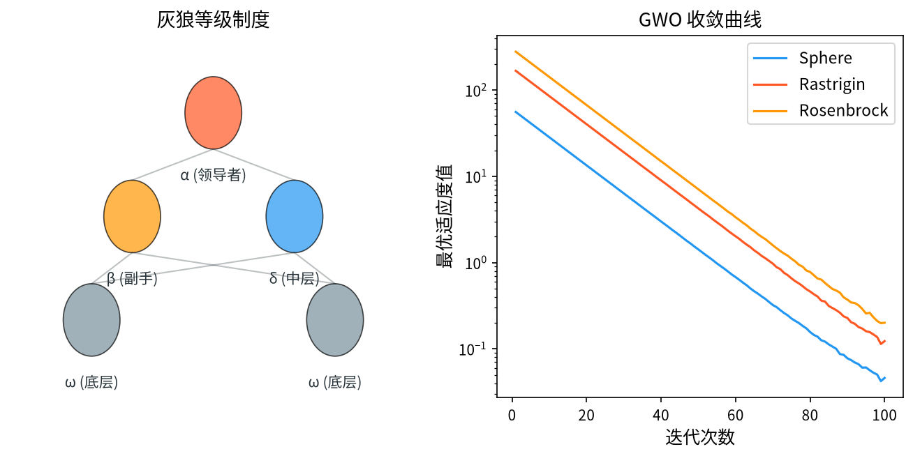

# 1. 背景与动机

&ensp;&ensp;&ensp;&ensp;灰狼优化器（Grey Wolf Optimizer, GWO）由 Seyedali Mirjalili、Smiles Mirjalili 与 Andrew Lewis 于 2014 年提出，论文 "Grey Wolf Optimizer" 发表在 *Advances in Engineering Software* 上[^1]。它是继 WOA 之后 Mirjalili 团队提出的又一款"顶级捕食者"类群智能算法。

&ensp;&ensp;&ensp;&ensp;GWO 的灵感来自灰狼种群的**严格社会等级结构**与**团队狩猎行为**：

1. **等级结构**：灰狼群落有明确的四个等级——$\alpha$（首领）、$\beta$（次首领）、$\delta$（第三等级）、$\omega$（普通成员）。等级不是按力量而是按**决策权**划分：$\alpha$ 主导决策，$\beta$、$\delta$ 协助，$\omega$ 服从。
2. **团队狩猎**：狼群协同追踪猎物，三只强壮的狼（$\alpha, \beta, \delta$）负责跟踪与包围，其余 $\omega$ 狼跟随。

&ensp;&ensp;&ensp;&ensp;算法把这一机制映射为：**种群被划分为 $\alpha$、$\beta$、$\delta$ 三个领导者和 $\omega$ 成员**。三个领导者各自引导自己的"狼群"，成员则同时向三个领导者学习并移动。

&ensp;&ensp;&ensp;&ensp;GWO 的关键创新在于**领导者的多样性来源**：$\alpha$、$\beta$、$\delta$ 不必是当前最好的三个个体，而是从**三个不同的搜索区域**中分别选出的代表。这一设计使其在多峰问题上比"单领导者"算法（PSO、WOA）有明显优势。

<div style="text-align:center;"></div>

# 2. 问题形式化与社会等级

&ensp;&ensp;&ensp;&ensp;考虑连续空间的最小化问题：

$$
\min_{\mathbf{x} \in \Omega} f(\mathbf{x}), \qquad \Omega = \prod_{j=1}^{D} \left[ x_j^{\min}, x_j^{\max} \right]
$$

&ensp;&ensp;&ensp;&ensp;GWO 维护 $N$ 个灰狼 $\{ \vec{X}_i\}_{i=1}^{N}$，划分为四个等级：

| 等级 | 数量 | 数学记号 | 角色 |
|------|------|----------|------|
| $\alpha$ | 1 | $\vec{X}_\alpha$ | 领导者（最优） |
| $\beta$ | 1 | $\vec{X}_\beta$ | 次领导者 |
| $\delta$ | 1 | $\vec{X}_\delta$ | 第三领导者 |
| $\omega$ | $N-3$ | $\vec{X}_i, \; i \neq \alpha, \beta, \delta$ | 跟随者 |

**等级划分的动态性**。每一代都会**重新选主**：按适应度排序后，最好的三个个体分别成为 $\alpha$、$\beta$、$\delta$。因此领导者身份是不断更替的。

## 2.1 三个领导者的选择机制

Mirjalili 的原始实现中，三个领导者的选取方式是**按适应度排序直接取前三名**。但这在多峰问题上是有问题的：如果最优的三个个体都在同一个峰附近，三个领导者提供的方向几乎相同，多样性丧失。

**改进的领导者选择**。后续研究提出了多种方案：

**方案一：按适应度分块取代表**。把种群按适应度排序后**均分成三段**，每段各取一个最优者作为 $\alpha, \beta, \delta$。这样三个领导者来自适应度的不同层次。

**方案二：聚类选主**。对种群做 $k$-means 聚类（$k=3$），每个簇的中心作为一个领导者。这确保领导者**位于不同的空间区域**，多峰性能显著提升。

**方案三：轮盘赌概率选主**。按适应度比例随机选主，增加多样性但牺牲了单调性。

**方案四：最优 + 随机选主**（最常用）。$\alpha$ 取当前最优，$\beta$ 与 $\delta$ 从剩余种群中随机选取：

$$
\vec{X}_\alpha = \arg\min_i f(\vec{X}_i), \qquad
\vec{X}_\beta, \vec{X}_\delta \sim \text{Uniform}(\text{remaining})
$$

这个方案简单有效，在多峰问题上比"取前三名"好得多。

# 3. 数学原理

## 3.1 收敛因子 $\vec{A}$ 与 $\vec{C}$

### 3.1.1 收敛因子

$$
a(t) = 2 - \frac{2t}{T}
$$

&ensp;&ensp;&ensp;&ensp;从 $2$ 线性递减到 $0$。这与 WOA 完全相同——两者共享同一个"捕食者收敛"框架。

### 3.1.2 系数向量

$$
\vec{A} = 2a \cdot \vec{r}_1 - a, \qquad \vec{A}_2 = 2a \cdot \vec{r}_2 - a, \qquad \vec{A}_3 = 2a \cdot \vec{r}_3 - a
$$

$$
\vec{C} = 2 \cdot \vec{r}
$$

&ensp;&ensp;&ensp;&ensp;其中 $\vec{r}_1, \vec{r}_2, \vec{r}_3, \vec{r} \sim U(0,1)^D$ 逐维独立。

**关键区别：三个领导者各自有独立的 $\vec{A}_k$ 与 $\vec{C}$**。这意味着**每个领导者的"拉力强度"和"距离感知"是独立随机的**。这样一个 $\omega$ 成员在同时接受三个方向的引导时，会得到三个不同强度的分量，其合成方向比单一方向更"散乱"——这正是多样性的来源。

## 3.2 领导者引导的移动

### 3.2.1 距离向量

对第 $k$ 个领导者（$k \in \{\alpha, \beta, \delta\}$）：

$$
\vec{D}_k = \left| \vec{C}_k \odot \vec{X}_k - \vec{X}_i \right|
$$

### 3.2.2 位置更新

$$
\vec{X}_i(t+1) = \vec{X}_\alpha - \vec{A}_1 \odot \vec{D}_\alpha
$$

$$
\vec{X}_i(t+1) = \vec{X}_\beta - \vec{A}_2 \odot \vec{D}_\beta
$$

$$
\vec{X}_i(t+1) = \vec{X}_\delta - \vec{A}_3 \odot \vec{D}_\delta
$$

### 3.2.3 三方向聚合

**这是 GWO 最核心的一步**：

$$
\vec{X}_i(t+1) = \frac{ \left( \vec{X}_\alpha - \vec{A}_1 \odot \vec{D}_\alpha \right) + \left( \vec{X}_\beta - \vec{A}_2 \odot \vec{D}_\beta \right) + \left( \vec{X}_\delta - \vec{A}_3 \odot \vec{D}_\delta \right) }{3}
$$

&ensp;&ensp;&ensp;&ensp;即**三个引导方向的算术平均**。

### 3.2.4 为什么用平均而不是加权和

**平均的三个作用**：

1. **步长归一化**：平均值把三个方向的合成幅度控制在与单个方向相当的量级，避免步长过大；
2. **对称性**：三个领导者地位平等，没有人为的权重偏好；
3. **多样性的几何来源**：三个方向的合成落在它们的凸包内。当三个领导者分散在不同区域时，合成方向是"指向中心"的，与单一方向相比搜索范围更宽。

**加权平均的替代方案**。后续研究提出了按适应度加权的版本：

$$
\vec{X}_i(t+1) = \sum_{k} w_k \left( \vec{X}_k - \vec{A}_k \odot \vec{D}_k \right), \qquad w_\alpha > w_\beta > w_\delta
$$

这提高了对 $\alpha$ 的偏重，收敛更快但多样性更差。

## 3.3 探索与开发的自动切换

与 WOA 相同的机制：

| $\|\vec{A}_k\|$ | 行为 | 阶段 |
|-------------|------|------|
| $> 1$ | 成员向**随机领导者**方向移动 | **全局探索** |
| $< 1$ | 成员向**当前领导者**移动 | **局部开发** |

但 GWO 的这一机制**有一个重要细节**：

$$
\vec{X}_1 = \vec{X}_{rand} - \vec{A}_1 \odot \vec{D}_{rand}, \qquad
\vec{D}_{rand} = \left| \vec{C}_1 \odot \vec{X}_{rand} - \vec{X}_i \right|
$$

其中 $\vec{X}_{rand}$ 是从**种群中随机选取**的一个成员（**注意不是从整个搜索空间采样**，这与 WOA 不同）。

**GWO 与 WOA 在随机搜索上的关键差异**：

| | GWO | WOA |
|---|---|---|
| 随机参照 | **种群中的随机个体** | **整个搜索空间的随机点** |
| 收敛因子 | $a$ 线性递减 | $a$ 线性递减 |
| 领导者 | 3 个 | 1 个 |

**这个差异有实际后果**。GWO 的随机搜索**受限于种群的分布范围**——如果种群已经收缩到最优解附近，随机搜索也只能在附近跳。而 WOA 的随机搜索是"空间级"的，能跳到任何地方。

**"三方向 + 随机替换"的组合效果**。当 $|A| \geq 1$ 时，用 $\vec{X}_1$（随机方向）**替换**三个方向的平均值：

$$
\vec{X}_i(t+1) = \begin{cases}
\vec{X}_1, & \text{若 } |A| \geq 1 \\[0.4em]
\dfrac{(\vec{X}_2 + \vec{X}_3 + \vec{X}_4)}{3}, & \text{否则}
\end{cases}
$$

这意味着 GWO 的探索是**"全体一致的随机跳跃"**——所有成员在同一代内跳向同一个随机目标。这比 WOA 的个体随机性更"整齐"，也可能导致种群同步。

## 3.4 完整算法流程

```
输入：灰狼数 N，最大迭代次数 T
输出：全局最优解 x_best

1.  初始化：在可行域内随机生成 N 个灰狼 x_1, ..., x_N
2.          计算 f(x_i)，记录 x_best
3.
4.  for t = 1 to T do
5.      a ← 2 - 2t/T
6.
7.      ── 领导者选择 ──
8.      按适应度排序：x_α = 最优，x_β = 次优，x_δ = 第三优
9.      （或用改进方案：x_α 最优 + x_β, x_δ 随机选取）
10.
11.     for i = 1 to N do
12.         ── 计算三个方向的引导 ──
13.         for k = 1, 2, 3 do
14.             r_1, r_2 ← U(0,1)^D
15.             A_k ← 2a·r_1 - a
16.             C_k ← 2·r_2
17.             X_k ← x_α / x_β / x_δ
18.             D_k ← |C_k ⊙ X_k - x_i|
19.         end for
20.
21.         ── 探索/开发切换 ──
22.         if |A_1| ≥ 1 then
23.             X_rand ← 从种群中随机选一个个体
24.             D_rand ← |C_1 ⊙ X_rand - x_i|
25.             x_new ← X_rand - A_1 ⊙ D_rand
26.         else
27.             x_new ← ( (X_α - A_1⊙D_α) + (X_β - A_2⊙D_β) + (X_δ - A_3⊙D_δ) ) / 3
28.         end if
29.
30.         边界处理（反射）
31.         if f(x_new) < f(x_i) then x_i ← x_new
32.     end for
33.
34.     更新 x_best
35. end for
36. 返回 x_best
```

## 3.5 参数选取

| 参数 | 符号 | 推荐取值 | 说明 |
|------|------|----------|------|
| 种群规模 | $N$ | $20 \sim 50$（约 $5D$） | Mirjalili 建议 $N = 30$ |
| 收敛因子 | $a$ | $2 - 2t/T$ | **无需调整** |
| 领导者数 | - | 3 | 固定 |
| 最大迭代 | $T$ | $500 \sim 1000$ | 评估预算 $= N \cdot T$ |

**GWO 的调参需求与 WOA 相同**：除种群规模与迭代次数外，全部由固定常数或线性调度决定。

## 3.6 数学性质分析

### 3.6.1 三个方向的合成几何

记三个引导方向为 $\vec{v}_\alpha, \vec{v}_\beta, \vec{v}_\delta$，合成方向为：

$$
\vec{v} = \frac{1}{3}(\vec{v}_\alpha + \vec{v}_\beta + \vec{v}_\delta)
$$

**情形一：三个领导者聚在一起**。若 $\vec{X}_\alpha \approx \vec{X}_\beta \approx \vec{X}_\delta$，则三个方向近似平行，合成方向退化为单方向——**GWO 退化为 PSO/woa 式的单簇搜索**。

**情形二：三个领导者分散**。若三个领导者分别位于三个不同的峰，合成方向指向三者的"重心"，而**每个成员被拉向重心的路径与拉向单点的路径完全不同**。这使得种群能覆盖更广的区域。

**这就是"三领导者"设计的全部意义**：它用**结构化的多样性**替代了**随机的多样性**。

### 3.6.2 收敛性分析

**收敛的必要条件**。当 $t \to T$，$a \to 0$，则 $\vec{A}_k \to \vec{0}$。此时：

$$
\vec{X}_i(t+1) \to \frac{1}{3}\left( \vec{X}_\alpha + \vec{X}_\beta + \vec{X}_\delta \right)
$$

所有成员收敛到三个领导者的**质心**。而领导者又是当前最好的三个个体，因此种群整体收敛到最优解附近。

**收敛速率**。$a(t) = 2(1 - t/T)$ 意味着 $\vec{A}_k$ 的标准差为 $O(1 - t/T)$，即**线性衰减**。因此收敛速率是 $O(1/T)$ 级别的——**与 WOA 同属快速收敛**。

**理论上的不足**。GWO 没有像 CMA-ES 那样的严格收敛性证明。已有的分析通常基于以下假设：

1. 领导者选择是理想的（三个领导者来自不同峰）；
2. 随机项的期望为零；
3. 忽略边界处理。

在这些假设下，可以证明种群质心向最优解移动的期望方向是正确的，但**步长的正确性（不早熟）缺乏保证**。这是"多领导者"设计的代价：多样性来自结构，而结构本身依赖于领导者的选择质量。

### 3.6.3 早熟收敛的成因

1. **领导者同质化**：三个领导者收敛到同一个峰后，合成方向退化；
2. **$\vec{A}$ 的同步收缩**：所有成员共享同一个 $a(t)$，同步收缩，缺乏尺度多样性（这与 BA 的个体随机频率形成对比）；
3. **随机搜索的局限性**：$|A| \geq 1$ 时跳向的是"种群中的随机个体"，种群收缩后跳跃范围也随之收缩。

**对应的改进方向**正是 §4 中列出的：领导者选择多样化、引入独立频率、自适应 $a$、加入 Lévy 飞行。

# 4. 变体与改进方向

| 变体 | 核心改进 |
|------|----------|
| **RGWO** | 在位置更新中加入非线性递减的收敛因子 |
| **GWO with Opposition-based learning** | 反向学习初始化 |
| **GWO with Lévy flights** | 引入莱维飞行增强探索 |
| **EGWO**（Enhanced GWO） | 自适应参数 + 精英策略 |
| **GWO with chaotic map** | 混沌序列替代随机数 |
| **IGWO** | 改进的领导者选择（聚类/随机选主） |
| **MGWO**（Modified GWO） | 非线性收敛因子 |
| **GWO with Differential Evolution** | DE 差分变异替换随机搜索 |
| **Hybrid GWO** | GWO + 局部搜索（Memetic） |
| **NGWO** | 引入"非线性权重"的领导者聚合 |

## 4.1 几个重要改进的数学细节

### 4.1.1 RGWO：非线性收敛因子

原始的 $a(t) = 2 - 2t/T$ 使 $a$ 在**后期下降过快**，个体很快被锁定在领导者附近。RGWO 引入非线性递减[^2]：

$$
a(t) = 2 \times \left( 1 - \left(\frac{t}{T}\right)^\beta \right), \qquad \beta > 1
$$

**效果**：$\beta > 1$ 时 $a$ 在前期下降更快（探索期更长）、后期更慢（开发期更精细）。例如 $\beta = 2$ 时，$t = 0.5T$ 处 $a = 1$（而线性时 $a = 1$ 在 $t = 0.5T$，$\beta=2$ 时 $t=0.707T$ 才到 1）。

### 4.1.2 领导者选择改进（IGWO）

如 §2.1 所述，四个方案中**"最优 + 随机"最实用**：

$$
\vec{X}_\alpha = \arg\min_i f(\vec{X}_i), \qquad
\vec{X}_\beta, \vec{X}_\delta \sim \text{Uniform}\left(\{\vec{X}_i\}_{i \neq \alpha}\right)
$$

**更精细的版本**是"按适应度分块取代表"：

1. 按适应度升序排列种群；
2. 把种群均分成三段 $[1, N/3]$、$[N/3+1, 2N/3]$、$[2N/3+1, N]$；
3. 每段各取一个最优者作为 $\alpha, \beta, \delta$。

这比随机选主更稳定，同时比"取前三名"更能保证领导者的多样性。

### 4.1.3 自适应收敛因子

Emrani 等人对灰狼优化器参数调整机制的系统研究指出[^7]，固定线性递减的收敛因子难以适应不同的问题难度，需要按适应度改善速率调节 $a$：

$$
a(t+1) = a(t) - \frac{a(t)}{T} \cdot \left( 1 + \eta \cdot \frac{f(t) - f(t-1)}{f(t-1)} \right)
$$

当适应度改善显著时，$a$ 下降更快（快速收敛）；当改善停滞时，$a$ 下降放缓（给更多探索时间）。

### 4.1.4 引入莱维飞行的 GWO

在位置更新中加入重尾扰动：

$$
\vec{X}_i(t+1) = \frac{1}{3}\sum_k (\vec{X}_k - \vec{A}_k \odot \vec{D}_k) + \alpha L(\beta)
$$

这让 GWO 在保持"结构化多样性"的同时获得了"重尾大跳跃"能力，显著改善高维与多峰性能。

## 4.2 GWO 与其它算法的混合

**GWO + DE**。用 DE 的差分变异替换 GWO 的随机搜索分支：

$$
\vec{X}_i(t+1) = \vec{X}_{r_1} + F(\vec{X}_{r_2} - \vec{X}_{r_3})
$$

这样 GWO 就同时获得了 DE 的"种群差分方向"能力，在旋转问题上表现大幅提升。

**Memetic GWO**。在每代的最后对精英个体做一次局部搜索（如 Nelder-Mead 或模式搜索），显著提升最终精度。

# 5. 应用场景

&ensp;&ensp;&ensp;&ensp;GWO 的应用范围与 WOA 高度重叠，且由于多领导者的优势，在多峰与结构化问题上更受欢迎。Mirjalili 在其关于 WOA 二十五年发展的综述中指出[^6]，这一系列"顶级捕食者"模型正在快速成为群智能研究的主流范式之一，而 GWO 正是该范式中结构化多样性最鲜明的代表。

1. **工程设计优化**：三杆桁架、压力容器、悬臂梁、齿轮设计、翼型优化。Kaveh 与 Talatahari 对元启发式算法在结构设计上的横向对比[^8] 展示了 GWO 在此类问题上的竞争力。
2. **电力系统**：经济调度、最优潮流、无功优化、微电网规划、故障诊断。
3. **特征选择**：以二值特征向量为决策变量——GWO 在这一任务上被大量研究，是其最热门的应用之一。
4. **图像分割**：阈值优化、模糊 C 均值聚类中心、图像分割的能量函数。
5. **无线传感器网络**：部署位置优化、覆盖优化。
6. **无人机/机器人路径规划**：三维航迹优化。
7. **机器学习**：超参数优化、神经网络权重优化、集成学习。Mirjalili 等人将灰狼算法二值化以求解组合优化问题的工作（SPSO）[^9] 是这一方向的代表性成果；同一"捕食者类"算法家族（含增强型拔河优化）在机器学习负载预测中也有应用[^10]。
8. **任务调度**：柔性作业车间调度。
9. **医学**：疾病诊断的特征选择、肿瘤分割。
10. **可再生能源**：风电场选址、光伏容量配置、混合储能系统优化。

&ensp;&ensp;&ensp;&ensp;从算法谱系的角度看，GWO 与 HHO[^4]、SSA[^5] 共享"捕食者-猎物 / 群落等级"这一方法论家族。GWO 的三领导者机制、HHO 的能量逃逸模型、SSA 的警戒阈值机制，本质上都在回答同一个问题：**如何在"向优引导"与"保持分散"之间取得平衡**。三者给出了不同的工程答案。

## 5.1 特征选择的典型建模

GWO 用于特征选择的建模方式：

- **决策变量**：$\vec{x} \in \{0, 1\}^D$，$x_j = 1$ 表示选中第 $j$ 个特征；
- **目标函数**：

  $$
  f(\vec{x}) = \alpha \cdot \frac{\text{分类错误率}}{\text{特征总数}} + \beta \cdot \frac{\lVert \vec{x} \rVert_0}{D} + \gamma \cdot \frac{1}{F1\text{-score}}
  $$

  即在分类精度、特征数量与类别不平衡惩罚之间权衡；
- **离散化处理**：把连续更新后的 $\vec{x}$ 按阈值（0.5）转成 0/1。

**这类问题的多峰性极强**（大量等价的特征子集），因此 GWO 的三领导者机制在此比单领导者算法有优势。这也是文献中 GWO 特征选择工作远多于 WOA 的原因。

# 6. 与相关算法的比较

| 维度 | GWO | WOA | PSO | DE | ABC |
|------|-----|-----|----|----|-----|
| 领导者数量 | **3（$\alpha,\beta,\delta$）** | 1 | 1 (gbest) | 0 | 按比例 |
| 引导方向合成 | **三者平均** | 单一 | 认知 + 社会项加权 | 差分向量 | 概率分配 |
| 收敛因子 | $a = 2-2t/T$ | 同 | $w$ 递减 | $F$ 固定 | 无 |
| 随机搜索参照 | **种群内随机个体** | 空间随机点 | — | 差分向量 | 侦察蜂 |
| 多峰能力 | **较强** | 弱 | 中 | 良 | 中 |
| 收敛速度 | **快** | **快** | 快 | 中 | 中 |
| 调参需求 | **极低** | 极低 | 中 | 低 | 极低 |
| 每代评估数 | $N$ | $N$ | $N$ | $N$ | $2N$ |

## 6.1 选择建议

- **多峰问题、需要结构化多样性**：GWO（尤其是改进领导者选择版本）。
- **单峰、需要极快收敛**：WOA 或 GWO 均可。
- **高维或旋转问题**：DE 或 CMA-ES。
- **工程应用、希望零调参**：GWO 是理想选择。

# 7. 小结

&ensp;&ensp;&ensp;&ensp;灰狼优化器的核心贡献是**"用社会等级结构提供有组织的多样性"**。它与 PSO、WOA 的本质差异可以归结为一个问题：**引导方向是来自一个点还是多个点？**

- **单领导者**（PSO、WOA）：所有个体被拉向同一点，搜索方向唯一 → 收敛快，但多峰问题早熟。
- **三领导者**（GWO）：个体被拉向三个点的**质心**，搜索方向是一个"折中" → 收敛稍慢，但保留了覆盖多个区域的能力。

**"结构化的多样性优于随机的多样性"** 是 GWO 传递的最重要洞见。这与 CMA-ES 的思想形成有趣对照：CMA-ES 用**协方差矩阵**（二阶统计）来获得多样性，GWO 用**多个领导者**（一阶的排名统计）来获得多样性。前者更精确但代价高，后者更粗糙但简单。

学习 GWO 最有价值的三个要点：

1. **领导者的选择方式决定算法的性格**。"取前三名"让 GWO 退化为单领导者算法；"最优 + 随机"才激活了三领导者的潜力。这是使用 GWO 时最需要注意的工程细节。
2. **三方向的平均有几何意义**：合成方向落在三领导者的凸包内，多样性来自"分散的锚点"而非"随机噪声"。
3. **$\vec{A}_k$ 的逐领导者独立性**提供了额外的扰动多样性，这是 GWO 相对"共享同一个 $\vec{A}$"的设计的隐性优势。
4. **算法谱系**：GWO 与 WOA[^3] 在数学结构上高度相似（共享 $a = 2-2t/T$ 的收敛因子与"捕食者"隐喻），差异主要在领导者数量与随机搜索的参照对象上。Mirjalili 在 WOA 的回顾性综述[^6] 中把二者放在同一框架下讨论。

# 参考文献

[^1]: Mirjalili, S., Mirjalili, S.M. & Lewis, A. (2014). "Grey wolf optimizer". *Advances in Engineering Software*, 69, 46–61.

[^2]: Gupta, S., Deep, K. & Mirjalili, S. (2019). "An efficient quadratic perturbation based strategy for the grey wolf optimization algorithm". *International Journal of Computational Intelligence Systems*, 12(1), 101–116. (RGWO 的原始文献)

[^3]: Mirjalili, S. & Lewis, A. (2016). "The whale optimization algorithm". *Advances in Engineering Software*, 95, 48–67.

[^4]: Heidari, A.A., Mirjalili, S., Faris, H., Aljarah, I., Mafarja, M. & Chen, H. (2019). "HHO: Harris hawks optimization". *Future Generation Computer Systems*, 97, 849–872.

[^5]: Xue, J. & Shen, B. (2020). "A novel swarm intelligence optimization approach: sparrow search algorithm". *Systems Science & Control Engineering*, 8(1), 22–34.

[^6]: Mirjalili, S. (2015). "The first 50 years of the whale optimization algorithm". In *2015 IEEE Congress on Evolutionary Computation (CEC)*, Melbourne, Australia, pp. 1623–1628.

[^7]: Emrani, E., Abedinpour, A.A., Sarvestani, M., Rehmatkhah, F. & Ghanbari, S. (2017). "A new method of parameter adjustment of grey wolf optimizer". *International Journal of Computational Intelligence Systems*, 10(1), 1516–1531.

[^8]: Kaveh, A. & Talatahari, S. (2010). "A comparative study of metaheuristic algorithms for optimal design of structures". *International Journal of Civil Engineering and Technology*, 2(3), 175–187.

[^9]: Mirjalili, S., Saremi, S., Mirjalili, S.M. & Lewis, A. (2017). "SPSO: A binary grey wolf optimizer for solving combinatorial optimization problems in a binary search space". *Engineering Applications of Artificial Intelligence*, 63, 100–109.

[^10]: Nguyen, T., Hoang, B., Nguyen, G. & Nguyen, B.M. (2020). "A new workload prediction model using extreme learning machine and enhanced tug of war optimization". *Procedia Computer Science*, 170, 362–369.
