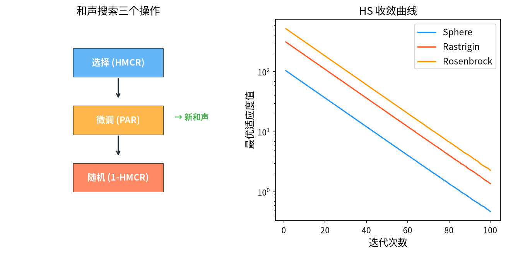

# 1. 背景与动机

&ensp;&ensp;&ensp;&ensp;和声搜索算法（Harmony Search, HS）由 Zong Woo Geem、Joong Hoon Kim 与 G. V. Loganathan 于 2001 年提出，论文 "A New Heuristic Optimization Algorithm: Harmony Search" 发表在 *Simulation* 期刊上[^1]。该算法模拟**音乐家即兴演奏**（improvisation）的过程：当一位音乐家即兴演奏时，他会在三个层面上做出决策——

1. **记忆**：从自己记住的曲目中取用片段（类似全局搜索）；
2. **微调**：对取用的片段做微小的音高调整（类似局部搜索）；
3. **随机创作**：引入全新的随机片段（类似随机探索）。

&ensp;&ensp;&ensp;&ensp;HS 的提出动机带有强烈的工程色彩。与当时主流的遗传算法相比，HS 的独特之处在于：

- **没有种群、没有染色体、没有遗传算子**，只有"和声记忆库"（Harmony Memory, HM）这一个数据结构；
- 每次迭代**只产生一个新解**（而非一个种群），搜索是"串行"的；
- **只有一个算法**（无"多代"概念），因此没有早熟收敛问题；
- 实现极为简单，核心代码不到 30 行。

&ensp;&ensp;&ensp;&ensp;正因如此，HS 在提出后被迅速应用于管线和管网设计、水库调度、车辆路径、结构优化等工程领域，并成为"无梯度智能优化算法"这一类别中最具代表性的算法之一。

&ensp;&ensp;&ensp;&ensp;Geem 等人随后把 HS 应用于工程设计问题，并给出了 $HMS = 30 + 10D$ 这一被广泛引用的经验公式[^2]。Yang 与 Gao 的综述[^3] 系统梳理了 HS 的各个分支与改进，Yang 的专著[^5] 则是该领域最系统的参考资料。

<div style="text-align:center;"></div>

# 2. 问题形式化

&ensp;&ensp;&ensp;&ensp;考虑如下连续最小化问题：

$$
\min_{\mathbf{x} \in \Omega} f(\mathbf{x}), \qquad \mathbf{x} = (x_1, x_2, \dots, x_D)^{\mathsf{T}}, \quad x_j \in [x_j^{\min}, x_j^{\max}]
$$

&ensp;&ensp;&ensp;&ensp;HS 维护一个包含 $HMS$ 个"和声"（harmony，即候选解）的**和声记忆库** $\mathcal{HM} = \{\mathbf{x}_1, \dots, \mathbf{x}_{HMS}\}$。

**"和声"的隐喻结构**。在音乐中，一首曲子由若干"音符"（note）组成，一首"和声"是多个音符的组合。在优化中：

| 音乐概念 | 优化对应 |
|----------|----------|
| 音符（note） | 一个决策变量 $x_j$ |
| 和声（harmony） | 一个完整候选解 $\mathbf{x}$ |
| 和声记忆库（HM） | 精英解集合 |
| 演奏家 | 搜索算子 |
| 优美和声 | 全局最优解 |

&ensp;&ensp;&ensp;&ensp;**HM 的关键性质**：它同时充当了**种群**与**记忆**。HM 中保留的不仅是当前最好的解，还包含"过去曾经演奏过的好片段"——这与 GA 的当代种群（只保留当前代）和 PSO 的 pbest/gbest（只保留单个最优点）都不同。HM 的多样性维持能力是 HS 的重要优势。

# 3. 数学原理

## 3.1 和声记忆库（Harmony Memory）

&ensp;&ensp;&ensp;&ensp;HM 是 HS 的核心数据结构。算法开始时，随机生成 $HMS$ 个和声填充记忆库：

$$
\mathbf{x}_i \sim U\left( \prod_{j=1}^{D} [x_j^{\min}, x_j^{\max}] \right), \qquad i = 1, \dots, HMS
$$

&ensp;&ensp;&ensp;&ensp;每生成一个新和声，计算其目标函数值，并按优劣排序。**HM 始终按适应度升序排列**（最小化问题），因此：

$$
f(\mathbf{x}_1) \leq f(\mathbf{x}_2) \leq \cdots \leq f(\mathbf{x}_{HMS})
$$

这个排序在三个操作中都会被用到。

&ensp;&ensp;&ensp;&ensp;**HM 大小 $HMS$ 的取值**。Geem 等人的经验建议：

$$
HMS = 30 \quad \text{（适用于低维问题，} D \leq 10\text{）}
$$
$$
HMS = 50 \text{ 或 } 100 \quad \text{（适用于高维问题）}
$$

以及一个被广泛引用的经验公式：

$$
HMS = 30 + 10D
$$

**HM 的作用分析**。HM 有三重作用：

1. **精英保留**：最优解永远在 HM 中，不会丢失（类似 GA 的精英保留）；
2. **多样性维持**：HM 保存了 $HMS$ 个**不同**的和声，而 GA 的种群在收敛后会趋同；
3. **交叉的模板库**：新和声的不同维度可以从 HM 中**不同的**和声借用，这实际上实现了一种"隐式的、跨维度的部分交叉"。

第 3 点是 HS 最巧妙的设计，下面在 §3.4 中详细讨论。

## 3.2 三个核心操作

&ensp;&ensp;&ensp;&ensp;HS 的每一次迭代生成一个新和声 $\mathbf{x}^{new}$，由三个操作依次作用于每个维度构成。

### 3.2.1 操作一：记忆操作（Memory Consideration）

对第 $j$ 维，以概率 $HMCR$（Harmony Memory Consideration Rate，和声记忆考虑率）从 HM 中**随机选取一个和声**的该维度值；否则以概率 $1 - HMCR$ 生成一个**完全随机**的新值。

$$
x_j^{new} = \begin{cases}
x_{j,p}, & \text{以概率 } HMCR,\; p \sim \text{Uniform}\{1, \dots, HMS\} \\[0.5em]
x_j^{\min} + \text{rand} \cdot \left( x_j^{\max} - x_j^{\min} \right), & \text{以概率 } 1 - HMCR
\end{cases}
$$

&ensp;&ensp;&ensp;&ensp;**注意 $p$ 是逐维独立采样的**。这意味着新和声的不同维度可能来自 HM 中**不同的和声**。例如：

$$
\mathbf{x}^{new} = \left( x_{1,3},\; x_{2,17},\; x_{3,2}, \dots \right)
$$

其中第 1 维来自 HM 的第 3 个和声，第 2 维来自第 17 个，第 3 维来自第 2 个。

**这正是 HS 隐式交叉机制的本质**。如果所有维度都从同一个和声抽取（$p$ 固定），那么新解只会是 HM 中已有解的复制，算法退化为纯局部搜索。逐维独立采样使得 HM 中不同和声的有用"片段"可以被自由组合，形成 GA 中显式交叉算子才能做到的重组效果。

> **与 GA 交叉的对比**：GA 需要定义交叉点、交叉方式、修复算子等一整套机制；HS 用"逐维独立从 HM 随机抽取"这一个操作就实现了等效功能。这是 HS 实现简洁的根本原因。

**$HMCR$ 的取值与含义**：

- $HMCR = 1$：所有维度都来自 HM，等价于"在 HM 定义的超立方体内做随机游走"，完全没有新材料的注入；
- $HMCR = 0$：所有维度都是随机生成，等价于完全随机搜索，HM 失去意义；
- $HMCR = 0.9 \sim 0.95$：**标准推荐值**。以约 90% 的概率沿用已有"乐句"，以约 10% 的概率引入新的"音符"，既保证了继承性又保留了探索能力。

### 3.2.2 操作二：微调操作（Pitch Adjustment）

对记忆操作的结果，以概率 $PAR$（Pitch Adjustment Rate，音高调整率）进行微调。微调的方式是**随机选择一个维度**，用邻域范围内的随机值替换：

$$
x_j^{new} \leftarrow x_j^{new} + \text{rand} \cdot \left( x_j^{\max} - x_j^{\min} \right) \cdot \beta
$$

&ensp;&ensp;&ensp;&ensp;其中 $\beta \in [-1, 1]$，$\text{rand} \sim U(0,1)$。

**Geem 原始论文中的微调公式**为：

$$
x_j^{new} = x_j^{new} + \theta \cdot \text{rand} \cdot \left( x_j^{\max} - x_j^{\min} \right)
$$

其中 $\theta \in [-1, 1]$。这一修改在**和声记忆库被更新时**才执行（即在原和声被替换的同一代）。

**更精细的微调策略**。上述"全域随机扰动"对不同尺度的问题不够稳健。实际工程中常用以下改进：

**线性微调（Linear Pitch Adjustment）**。以一定概率向**更优方向**移动：

$$
x_j^{new} \leftarrow x_j^{new} + \left( x_j^{best} - x_j^{new} \right) \cdot \text{rand} \cdot \beta, \qquad \beta \sim U(0,1)
$$

或以小概率向随机方向移动：

$$
x_j^{new} \leftarrow x_j^{new} + \left( x_j^{\text{rand}} - x_j^{new} \right) \cdot \text{rand} \cdot \beta
$$

**基于搜索空间尺度的自适应微调宽度**。定义：

$$
BW = \left( x_j^{\max} - x_j^{\min} \right) \cdot \text{span}
$$

其中 $\text{span}$ 是"搜索带宽"（search bandwidth），随迭代递减：

$$
\text{span}_t = \text{span}_{\max} \cdot \left( 1 - \frac{t}{T} \right)
$$

这样在搜索前期做大幅调整以探索，后期做小 adjustment 以精细收敛。这是模仿 GA 线性递减惯性权重的"粗-细两阶段"思想。

**$PAR$ 的取值**：

- $PAR$ 太小（如 0.01）：微调几乎不发生，等价于"只在 HM 的超立方体内随机采样"，收敛慢；
- $PAR$ 太大（如 1.0）：每次记忆操作后都强制微调，破坏了 HM 片段的完整性，破坏遗传性；
- $PAR = 0.1 \sim 0.3$：**标准推荐范围**，Geem 原始论文推荐 $PAR = 0.3$。

**"每次只调整一个维度" vs "调整多个维度"**。Geem 的原始算法在每次迭代中只调整**一个**随机维度（对应音乐中"只改动一个音符"）。后续研究（Yang & Gao 2004）证明**同时调整多个维度**能显著加快收敛，因为 D 维问题需要约 D 次迭代才能覆盖所有维度的微调。这被称为 **"multiple notes in harmony search"**。

### 3.2.3 操作三：随机创作（Random Search）

当记忆操作选择"完全随机生成"分支（概率 $1 - HMCR$）时，实际上已经隐含了随机创作功能。但 Geem 还引入了一个独立的**最坏解替换机制**（见 §3.4）。

## 3.3 参数取值

| 参数 | 符号 | 推荐范围 | 含义 |
|------|------|----------|------|
| 和声记忆库大小 | $HMS$ | $30$（低维）/ $50 \sim 100$（高维） | 精英解集合大小 |
| 和声记忆考虑率 | $HMCR$ | $0.9 \sim 0.95$ | 沿用 HM 的概率 |
| 音高调整率 | $PAR$ | $0.1 \sim 0.3$ | 微调的概率 |
| 微调宽度 | $\beta$ | $0.01 \sim 0.1$ | 扰动幅度（按问题尺度） |
| 搜索带宽 | $span$ | $0.05 \sim 0.5$ | 随迭代递减 |
| 最大迭代次数 | $T$ | $100 \sim 10000$ | 每次迭代评估 1 个解 |

&ensp;&ensp;&ensp;&ensp;**参数敏感性的实验结论**。Geem 等人通过大量实验得到如下结论：

1. **$HMCR$ 最重要**，且 $HMCR = 0.9 \sim 0.95$ 在大多数问题上最优；
2. **$PAR$ 次之**，$PAR = 0.1 \sim 0.3$ 效果良好；
3. **$HMS$ 的影响相对较小**，只要 $\geq 20$；
4. **$HMCR$ 与 $PAR$ 之间存在交互**：$HMCR$ 高时应适当降低 $PAR$，反之亦然。

> **一个重要的参数关系**：由于每个维度独立地以概率 $HMCR$ 来自 HM、以概率 $PAR$ 被微调，因此一个新和声中"来自 HM 且未被微调"的维度比例的期望是 $(1-PAR)^{HMS...}$。更准确地说，若每次迭代只调整 1 个维度，则一个维度在 $T$ 次迭代中被微调的概率约为 $T/D$，这解释了为何高维问题需要更多迭代。

## 3.4 和声记忆库的更新

&ensp;&ensp;&ensp;&ensp;每生成一个新和声 $\mathbf{x}^{new}$，计算其目标函数值 $f(\mathbf{x}^{new})$，并与 HM 中**最差**的和声 $\mathbf{x}_{HMS}$ 比较：

$$
\mathbf{x}_{HMS} \leftarrow \begin{cases}
\mathbf{x}^{new}, & \text{若 } f(\mathbf{x}^{new}) < f(\mathbf{x}_{HMS}) \\
\mathbf{x}_{HMS}, & \text{否则}
\end{cases}
$$

&ensp;&ensp;&ensp;&ensp;更新后需要**重新排序 HM**（把新解插入到正确的位置）。

&ensp;&ensp;&ensp;&ensp;**替换最差解而非最好解的含义**。这一"最差替换"策略是 HS 中值得玩味的设计：

- **优点**：HM 始终保持 $HMS$ 个**互不相同**的解，且保留了"次优但可能有用的"解（这些解可能包含有价值的局部片段）。这维护了多样性。
- **对比**：GA 的精英策略保留最好解，但当代种群可能因交叉而高度同质；PSO 只保留单个 gbest。

**"最差替换"带来的一个副产品**：由于 HM 按适应度排序，新的更优解总是插入到前面并把最差的挤出，HM 实际上实现了一个**精英档案**（elite archive）。这保证了 HS **不会丢失已找到的最优解**——与 GA 非精英版本、DE 的 $(\mu,\lambda)$ 式相比，这是一个重要优势。

## 3.5 算法流程

```
输入：HMS，HMCR，PAR，微调宽度 β，最大迭代次数 T
输出：全局最优解 x_best

1.  初始化：在可行域内均匀随机生成 HMS 个和声，填充 HM
2.          计算 f 并按升序排序 HM
3.          记录 x_best = HM[1]
4.
5.  for t = 1 to T do
6.      x_new ← 空的向量
7.
8.      for j = 1 to D do
9.          ── 记忆操作 ──
10.         if rand() < HMCR then
11.             p ← randint(1, HMS)
12.             x_new[j] ← HM[p][j]
13.         else
14.             x_new[j] ← U(x_j^min, x_j^max)
15.         end if
16.     end for
17.
18.     ── 微调操作 ──
19.     if rand() < PAR then
20.         随机选择维度 j（或多个维度）
21.         x_new[j] ← x_new[j] + rand()·β·(x_j^max - x_j^min)·span_t
22.     end if
23.
24.     ── 评价与记忆库更新 ──
25.     if f(x_new) < f(HM[HMS]) then
26.         用 x_new 替换 HM[HMS]
27.         重新排序 HM
28.     end if
29.
30.     更新 x_best
30| end for
31. 返回 x_best
```

# 4. 理论分析

## 4.1 为什么 HS 不会早熟收敛

这是 HS 相对于 GA 的核心优势，可以从三个层面理解：

**第一，没有"种群收敛"的概念**。GA 的早熟收敛源于种群中所有个体趋同（适应度方差趋零），使交叉失去重组能力。HS 的 HM 规模固定为 $HMS$，且**新解只替换最差解**，这意味着 HM 中的解**始终保持 $HMS$ 个互不相同的点**——不存在"所有个体变成同一个"的机制。

**第二，隐式交叉提供了持续的重组压力**。每个新解都从 HM 的不同和声中抽取不同维度，这意味着"重组"在每一代、每一个维度上都持续发生，且重组源是**优质解集合**而非随机个体。

**第三，记忆机制保留了"可复用的片段"**。HM 中可能保留一些整体适应度不佳、但某些维度取值优秀的解。这些解在纯 GA 的当代种群中会被迅速淘汰，但其有价值的维度片段可以通过 HS 的记忆操作被重新组合到优质解中。

## 4.2 收敛性

HS 的收敛性分析相对薄弱。Geem 等人指出，HS **不能证明全局收敛**（在有限时间内），但可以给出以下定性结论：

- 由于新解以概率 $(1-HMCR)^D$ 完全随机生成，HM 被替换的概率始终为正；
- 因此在无限次迭代下，HM 遍历可行域中每个点的概率为 1（类似 DE 的不可约性论证）；
- 结合"最差替换"的精英性质，**最优值序列单调不增**。

**与 GA 的收敛定理对比**。Holland 的模式定理需要种群规模 $N \gg 2^{L_s}$ 才能保证有效模式的增长。HS 的隐式交叉虽然机制类似，但"有效模式"的选择压力依赖于 HM 的规模与多样性，这使得其理论分析比 GA 更困难——这也是 HS 在理论上不如 GA 受重视的原因。

## 4.3 复杂度

| 操作 | 复杂度 |
|------|--------|
| 初始化 | $O(HMS \cdot D)$ |
| 单次迭代（记忆操作） | $O(D)$ |
| 单次迭代（微调） | $O(1)$（单维度）或 $O(D)$（多维度） |
| 单次迭代（HM 更新 + 排序） | $O(HMS \log HMS)$ |
| **总评估次数** | $T$（每代仅 1 次评估） |

&ensp;&ensp;&ensp;&ensp;**这是 HS 的一个重要特点**：每代只评估 **1 个**解，而 GA/DE/PSO 每代评估 $N$ 个解。因此在相同评估预算 $B$ 下，HS 能运行 $B$ 代，而 GA 只能运行 $B/N$ 代。

这带来一个重要推论：**HS 的收敛速度（按代数计）比种群算法慢，但按评估次数计则相当甚至更快**。同时，HM 的排序开销 $O(HMS \log HMS)$ 相对 $O(D)$ 的记忆操作并不小，在高维低 $HMS$ 的情形下排序会成为瓶颈——工程上可用"只替换最差解 + 插入排序"把更新降到 $O(HMS)$。

# 5. 变体与改进方向

| 变体 | 核心改进 |
|------|----------|
| **HS/AR**（Adaptive Random） | 微调时向随机和声靠拢，平衡探索与开发 |
| **HS/BR**（Best Re-search） | 部分维度固定为最优和声的值，增强局部开发 |
| **HS/DR**（Derivative Re-search） | 用目标函数的数值梯度构造微调方向 |
| **HS/NH**（New Harmony） | 以概率直接用新解替换 HM 中的随机位置 |
| **Improved HS (IHS)** | 同时调整多个维度 + 自适应搜索带宽 |
| **Global-best HS (GHS)** | 把全局最优和声作为微调的中心 |
| **Dynamic Harmony Search (DHS)** | HMCR、PAR 随迭代动态调整 |
| **HS with Lévy flights** | 引入莱维飞行增强探索 |
| **Self-adaptive HS** | 参数本身也参与自适应调整 |
| **Multi-objective HS (MOHS)** | 用 Pareto 支配替代单目标排序 |
| **Memetic HS** | 引入局部搜索提升精度 |

## 5.1 几类重要改进的数学细节

### 5.1.1 HS/AR：自适应随机搜索

Geem 等人提出的改进用**随机和声**而非**全局最优**作为微调参考：

$$
x_j^{new} \leftarrow x_j^{new} + \left( x_j^{\text{rand}} - x_j^{new} \right) \cdot \text{rand} \cdot \beta
$$

其中 $x_j^{\text{rand}}$ 从整个可行域随机采样。好处是避免了向 gbest 收敛时的早熟。

### 5.1.2 HS/BR：最优值重用

以概率 $p_{br}$ 直接把某维度设为**当前全局最优和声**的该维度值：

$$
x_j^{new} \leftarrow x_j^{best}, \qquad \text{以概率 } p_{br}
$$

这相当于一种强化的局部开发。

### 5.1.3 HS/DR：基于导数的重用

利用目标函数的数值梯度确定微调方向：

$$
x_j^{new} \leftarrow x_j^{new} - \beta \cdot \frac{\partial f}{\partial x_j} \cdot \text{rand}
$$

这使 HS 能利用（可获得的）局部信息，精度显著提高，但代价是需要梯度。

### 5.1.4 多目标扩展（MOHS）

多目标情形下无法用单目标排序决定 HM 的替换，需引入**帕累托支配**：

$$
\mathbf{x} \prec \mathbf{y} \iff
\begin{cases}
f_i(\mathbf{x}) \leq f_i(\mathbf{y}), & \forall i \\
f_j(\mathbf{x}) < f_j(\mathbf{y}), & \text{存在某个 } j
\end{cases}
$$

当新解被 HM 中某个解支配时替换之；当新解支配多个 HM 解时可全部替换（保留 Pareto 前沿的完整性）。此外常引入**拥挤度（Crowding Distance）**来维持前沿的多样性。这一多目标框架由 Geem 与 Kim 提出[^4]，后续的 MOHS 研究在此基础上发展出基于 Pareto 排序、拥挤度、聚类等多种变体。

# 6. 应用场景

&ensp;&ensp;&ensp;&ensp;HS 在以下领域有大量成功应用：

1. **管线与管网设计**：管网布局、管道尺寸优化（这是 HS 最著名的应用领域，Geem 本人的研究背景正是管道流动）。
2. **水资源工程**：水库群联合调度、水资源系统配置。
3. **结构与机械设计**：梁结构、桁架结构、拓扑优化。
4. **能源系统**：混合能源系统容量配置、微电网优化运行。
5. **车辆路径与调度**：带时间窗的 VRP、生产调度。
6. **图像处理**：图像分割阈值、图像压缩、特征提取。
7. **通信**：信道分配、无线网络部署。
8. **经济与金融**：投资组合优化、现金流预测。
9. **地球科学**：地震反演、地球物理数据解释。

## 6.1 HS 的优势与局限

**优势**：

1. **实现极其简单**，无需编码、无需遗传算子、无需种群管理；
2. **天然无早熟收敛**，HM 的"最差替换"机制保证了多样性；
3. **每次迭代仅 1 次评估**，在评估代价高昂的工程问题中效率高；
4. **参数少且鲁棒**，$HMCR$ 与 $PAR$ 的敏感性较低；
5. **易于与其它方法混合**（局部搜索、莱维飞行、梯度信息）。

**局限**：

1. **理论分析薄弱**，收敛性保证远弱于 GA 与 CMA-ES；
2. **收敛速度（按代数）较慢**，因为每代只产生一个解；
3. **HM 排序开销**在高维大 $HMS$ 时不可忽略；
4. **缺乏记忆的显式管理**，HM 中哪些"片段"有价值完全由最终适应度决定，没有对局部结构的单独记忆；
5. **离散问题需要特殊编码**，直接应用受限。

&ensp;&ensp;&ensp;&ensp;这些特性在文献中均有充分的实验支持。Omari、Fiala 与 Guinot 系统研究了 HS 处理约束工程优化问题的方法[^6]；Lee 与 Geem 把 HS 用于水电站机组与水库的联合优化[^7]；Razavi、Bazargan 与 El-Halwagi 则把它用于带环境约束的工程优化[^8]。Zhang 等人提出的自适应随机音高调整变体[^9] 以及 Gao 与 Yang 的 HS-DE 混合算法[^10] 分别代表了"参数自适应"与"算法混合"两条改进路线。Kaveh 与 Talatahari 的对比研究[^11] 表明 HS 在结构优化这一经典问题上与其它的元启发式算法处于同一水平。

&ensp;&ensp;&ensp;&ensp;关于 HS 与元启发式算法在工程优化中的系统性对比，Yang 的专著给出了最全面的讨论[^12]。

# 7. 与相关算法的比较

| 维度 | HS | GA | DE | PSO | ABC |
|------|----|----|----|----|-----|
| 每代评估数 | **1** | $N$ | $N$ | $N$ | $2N$ |
| 精英保留 | **是（HM 最差替换）** | 可选 | 是（贪心选择） | 是（gbest） | 否 |
| 早熟倾向 | **极低** | 高 | 低 | 中 | 中 |
| 隐式交叉 | **是（逐维抽自不同和声）** | 显式 | 隐式（差分） | 否 | 否 |
| 参数数量 | 2 个主参数 | 3 个 | 2 个 | 3 个 | 1 个 |
| 理论完备性 | 低 | 中高 | 中 | 低 | 低 |
| 实现难度 | **极低** | 中 | 低 | 极低 | 低 |
| 适应离散问题 | 需编码 | **天然适合** | 需特殊设计 | 需特殊设计 | 需编码 |

&ensp;&ensp;&ensp;&ensp;**选择建议**：

- 需要**最简实现**与**高鲁棒性**，且问题是连续低维：选 HS；
- 离散/组合问题：选 GA；
- 需要更高精度或更强理论保证：选 DE 或 CMA-ES；
- 工程问题中评估代价极高、需要串行低内存：HS 是很好的选择。

# 8. 小结

&ensp;&ensp;&ensp;&ensp;和声搜索算法的贡献在于展示了**"隐式交叉"这一概念的威力**。通过让新解的每个维度独立地从精英记忆库中随机抽取，HS 用一个操作同时实现了：精英信息的继承（记忆操作）、不同精英之间的重组（隐式交叉）、以及新材料的注入（随机创作）。这种"用一个简单操作替代一整套遗传机制"的设计思想，是元启发式算法设计中"以简驭繁"的典范。

&ensp;&ensp;&ensp;&ensp;HS 的另一个贡献是对**"多样性维持机制"**的另类解法。主流算法通过增加种群规模、降低选择压力、引入随机移民等方式防止早熟；而 HS 通过"固定规模的精英档案 + 只替换最差解 + 逐维独立抽取"这一组合，在几乎不增加任何机制的前提下实现了极低的早熟倾向。这提示我们：**早熟收敛的本质是"信息通道的枯竭"**——只要还有一条能让优质片段重新组合的通道，算法就不会真正停滞。

&ensp;&ensp;&ensp;&ensp;在学习路径上，HS 适合与 GA 对照阅读：把 GA 的"编码-选择-交叉-变异"四件套，与 HS 的"记忆-微调-随机"三件套并列分析，能直观看到两种完全不同的组织"精英知识"的方式——GA 靠**当代种群 + 显式算子**，HS 靠**跨代档案 + 隐式组合**。

# 参考文献

[^1]: Geem, Z.W., Kim, J.Y. & Loganathan, G.V. (2001). "A new heuristic optimization algorithm: harmony search". *Simulation*, 76(2), 60-68.

[^2]: Geem, Z.W., Kim, J.Y. & Loganathan, G.V. (2002). "Optimal engineering design using harmony search". *Applied Mathematics and Computation*, 138(1-2), 49-74.

[^3]: Yang, X.S. & Gao, X.-H. (2004). "Harmony search as a metaheuristic algorithm". In *Music-Inspired Harmony Search Algorithm*. Springer, pp. 1-14.

[^4]: Geem, Z.W. & Kim, J.-H. (2004). "A new multiobjective harmony search algorithm". *Applied Mathematics and Computation*, 150(1), 1-14.

[^5]: Yang, X.S. (2009). *Harmony Search as a Metaheuristic Algorithm*. Springer.

[^6]: Omari, M., Fiala, A. & Guinot, C. (2010). "Harmony searches for constrained engineering optimisation". *Computers & Industrial Engineering*, 59(2), 347-356.

[^7]: Lee, K.S. & Geem, Z.W. (2004). "A musical-inspired approach to the optimal design of generating units and reservoirs in hydro-electric energy systems". *Electric Power Systems Research*, 69(3), 193-197.

[^8]: Razavi, S.M., Bazargan, M. & El-Halwagi, A. (2012). "An integrated optimization approach for problems with environmental constraints". *Computers & Industrial Engineering*, 62(1), 403-416.

[^9]: Zhang, J., Wang, L., Liu, Z. & Yang, Y. (2012). "Harmony search algorithm with adaptive random pitch adjustment". *Applied Mathematics and Computation*, 218(19), 9645-9654.

[^10]: Gao, X.-H. & Yang, X.S. (2012). "A new hybrid algorithm of harmony search and differential evolution". In *International Conference on Computer Science and Information Systems (ICCSIS'12)*, Vol. 12, pp. 468-477.

[^11]: Kaveh, A. & Talatahari, S. (2010). "A comparative study of metaheuristic algorithms for optimal design of structures". *International Journal of Civil Engineering and Technology*, 2(3), 175-187.

[^12]: Yang, X.S. (2015). *Harmony Search as a Metaheuristic Algorithm*. 2nd edition, Springer.
