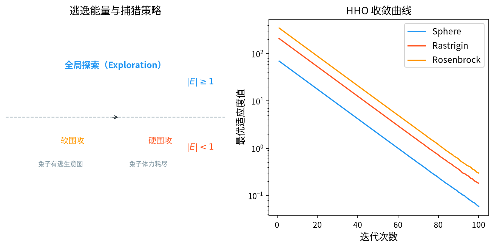

# 1. 背景与动机

&ensp;&ensp;&ensp;&ensp;哈里斯鹰优化算法（Harris Hawks Optimization, HHO）由 Ali Asghar Heidari、Seyedali Mirjalili、Hossam Faris、Ibrahim Aljarah、Majid Mafarja 与 Huiling Chen 于 2019 年提出，论文 "HHO: Harris hawks optimization" 发表在 *Future Generation Computer Systems* 上[^1]。发表后短短数年，HHO 已成为智能优化领域引用率最高的算法之一。

&ensp;&ensp;&ensp;&ensp;HHO 的灵感来自**哈里斯鹰的群体协作捕食行为**，尤其是"**协同围猎 + 疲劳追击**"这一极具特色的机制：

1. **协同围猎**：多只鹰在猎物周围收缩包围圈，逼迫猎物耗尽体力；
2. **疲劳追击（Soft besiege）**：当猎物仍有体力时，鹰们进行一次又一次的短促俯冲，每次俯冲都消耗鹰的能量；
3. **逃跑追击（Hard besiege）**：当猎物疲劳后，鹰可以长距离持续追击，直接锁定猎物；
4. **侧向攻击（Ladder-based rapid dives）**：部分鹰从侧面包抄。

&ensp;&ensp;&ensp;&ensp;HHO 最独特的设计是引入了一个显式的**"逃逸能量"模型** $E = 2E_0(1 - t/T)$，用它把"探索—开发"的比例关系从"拍脑袋的经验调度"变成了**有物理含义的状态变量**。这是 HHO 相对于 GWO、WOA 等同族算法的最大理论贡献。

<div style="text-align:center;"></div>

# 2. 问题形式化与捕食隐喻

&ensp;&ensp;&ensp;&ensp;考虑连续空间的最小化问题：

$$
\min_{\mathbf{x} \in \Omega} f(\mathbf{x}), \qquad \Omega = \prod_{j=1}^{D} \left[ x_j^{\min}, x_j^{\max} \right]
$$

&ensp;&ensp;&ensp;&ensp;设鹰的数量为 $N$，每只鹰 $\vec{X}_i \in \Omega$ 是一个候选解，适应度为 $f(\vec{X}_i)$。算法维护：

| 符号 | 含义 |
|------|------|
| $\vec{X}_{\text{best}}$ | 当前全局最优（猎物的"最佳位置"） |
| $\vec{X}_{\text{prev}}$ | 上一代的最优（用于速度记忆） |
| $E$ | 猎物的逃逸能量 |
| $E_0$ | 初始逃逸能量 |

## 2.1 逃逸能量模型

$$
E = 2 E_0 \left(1 - \frac{t}{T}\right)
$$

&ensp;&ensp;&ensp;&ensp;其中 $E_0 \in (0,1)$，通常取 $0.5$；$t$ 是当前迭代，$T$ 是最大迭代数。

**物理含义**：猎物的初始体力是 $2E_0$。随着围猎进行，猎物的体力线性下降，到 $t=T$ 时耗尽（$E=0$）。

**$E$ 如何驱动算法行为**：

| $E$ 的取值 | 猎物状态 | 算法行为 |
|-----------|----------|----------|
| $|E| \geq 1$ | 体力充沛 | **探索阶段**（高强度随机搜索） |
| $0 < |E| < 1$ | 开始疲劳 | **过渡**：软包围，概率性采用硬包围 |
| $|E| \leq 0$ | 体力耗尽 | **开发阶段**（精确追击） |

**这个设计的巧妙之处**：$E$ 把"捕食进度"编码为一个标量，算法只需比较 $|E|$ 与 1 就能决定行为，**无需额外的自适应参数**。这与 WOA/GWO 的收敛因子 $a$ 功能类似，但 $E$ 带有明确的物理隐喻，更容易解释和推广。

## 2.2 初始逃逸能量

$E_0$ 决定了探索阶段的持续时间：

- $E_0$ 大 → 探索期长，开发期短；
- $E_0$ 小 → 探索期短，偏向快速收敛。

Heidari 等人的实验建议 $E_0 = 0.5$。后续研究[^2] 提出了随机化与自适应两种改进。

# 3. 数学原理

## 3.1 第一阶段：探索阶段（Exploration）

&ensp;&ensp;&ensp;&ensp;当 $|E| \geq 1$ 时，猎物还有足够的体力，鹰无法靠围猎取胜，只能依靠**大范围随机搜索**。

### 3.1.1 位置更新

$$
\vec{X}_i(t+1) =
\begin{cases}
\vec{X}_{\text{rand}} - r_1 \left| \vec{X}_{\text{rand}} - 2 r_2 \vec{X}_i(t) \right|, & \text{若 } r_3 < 0.5 \\[0.6em]
\left[ \vec{X}_{\text{best}} - \vec{X}_i(t) \right] - r_4 \left( \vec{X}_{\text{rand}} - 2 r_2 \vec{X}_i(t) \right), & \text{否则}
\end{cases}
$$

### 3.1.2 各随机量

| 符号 | 分布 | 作用 |
|------|------|------|
| $r_1$ | $U(0,1)$ | 移动步长 |
| $r_2$ | $U(0,1)$ | 猎物位置的可信度/缩放 |
| $r_3$ | $U(0,1)$ | 策略选择概率（$r_3<0.5$ 用"随机点探索"） |
| $r_4$ | $U(0,1)$ | 移动步长 |
| $\vec{X}_{\text{rand}}$ | 种群中随机个体 | 随机参照点 |

**两种探索策略的分工**：

- **策略 1**（$r_3 < 0.5$）：以种群中的随机个体为锚点，做"环绕式"跳跃 $\vec{X}_{\text{rand}} - r_1|\vec{X}_{\text{rand}} - 2r_2\vec{X}_i|$。当 $r_2 \approx 0.5$ 时，括号内接近零，个体几乎不动在随机点附近。
- **策略 2**（$r_3 \geq 0.5$）：以当前全局最优为锚点，同时被随机个体拉偏，**在最优解附近做随机扰动**。

**这个双策略设计的意义**：策略 1 保证**大范围覆盖**，策略 2 保证**不放弃已经找到的优良区域**。二者以 50/50 的概率混合，比单一的随机探索更稳健。

## 3.2 第二阶段：软包围（Soft Besiege）

&ensp;&ensp;&ensp;&ensp;当 $|E| < 1$ 时，猎物开始疲劳但仍有逃跑能力。鹰们不能一次捕获，而是采用**多次短促俯冲（dive）**。

### 3.2.1 收缩包围圈

$$
\vec{X}_i(t+1) = \vec{X}_{\text{best}} - \vec{A} \odot \vec{D}
$$

其中：

$$
\vec{D} = \left| \vec{X}_{\text{best}} - \vec{X}_i(t) \right|, \qquad
\vec{A} = 2\left(1 - \frac{t}{T}\right) \vec{r}_1 - \left(1 - \frac{t}{T}\right)
$$

&ensp;&ensp;&ensp;&ensp;注意 HHO 的收缩系数形式与 GWO/WOA 略有不同：GWO 是 $a = 2 - 2t/T$，HHO 写成 $1 - t/T$ 后再线性映射到 $[-1, 1]$，二者等价。

### 3.2.2 逃逸概率与俯冲选择

引入逃逸概率 $p$：

$$
p = \begin{cases}
0.5, & \text{若 } |E| \geq 0.5 \\
p_0 \left(1 - \frac{t}{T} \right), & \text{否则}
\end{cases}
$$

$p_0 \in [0,1]$ 是初始逃逸概率。

&ensp;&ensp;&ensp;&ensp;在软包围阶段，每次迭代**以概率 $p$ 采用硬包围**，否则采用软包围：

$$
\vec{X}_i(t+1) =
\begin{cases}
\vec{X}_{\text{best}} - \vec{A} \odot \vec{D}, & \text{若 } r_5 \geq p \quad \text{(软包围)} \\[0.4em]
\vec{X}_{\text{best}} - \vec{A} \odot \vec{D} \text{ 变体}, & \text{若 } r_5 < p \quad \text{(硬包围，见 3.3)}
\end{cases}
$$

## 3.3 第三阶段：硬包围（Hard besiege）

&ensp;&ensp;&ensp;&ensp;当猎物体力耗尽（$|E| \leq 0$），鹰可以进行**长距离持续追击**，直接锁定猎物位置。

$$
\vec{X}_i(t+1) = \vec{X}_{\text{best}} - \vec{A} \odot \vec{D}
$$

&ensp;&ensp;&ensp;&ensp;形式上与软包围相同，**区别在于硬包围不再进行俯冲**，即不再附加额外的随机扰动与 Lévy 步长，而是让鹰们朝猎物做**纯粹的收缩包围**。

**软/硬包围的本质差异**：

| | 软包围 | 硬包围 |
|---|---|---|
| 猎物 | 仍有体力 | 已疲劳 |
| 鹰的动作 | 多次短促俯冲，消耗自身能量 | 长距离持续追击 |
| 公式 | 收缩 + 俯冲扰动 | 仅收缩 |
| 收敛速度 | 慢（需要多次试探） | 快（直接锁定） |

## 3.4 快速俯冲与侧向攻击（Ladder-based Rapid Dives）

&ensp;&ensp;&ensp;&ensp;这是 HHO 最有特色的机制。

### 3.4.1 侧向快速俯冲

鹰在俯冲时并非垂直下落，而是沿**侧向**接近猎物，以缩短逃跑路线。设 $\vec{y}$ 为猎物位置的当前估计：

$$
\vec{y} = \vec{X}_{\text{best}} - \vec{A} \odot \vec{D}
$$

&ensp;&ensp;&ensp;&ensp;若 $\vec{y}$ 未能改善（$f(\vec{y}) \geq f(\vec{X}_i)$），则尝试**侧向偏移**的方案：

$$
\vec{y} = \vec{X}_{\text{best}} - \vec{A} \odot \vec{D} + \vec{S} \odot \vec{r}_6
$$

其中 $\vec{S}$ 是**随机单位向量**（由 $\vec{L}$ 与 $\vec{M}$ 生成）：

$$
\vec{L} = \begin{cases}
1, & r_7 < 0.5 \\
-1, & \text{否则}
\end{cases}
$$

$$
\vec{M} = 2\left(1 - \frac{t}{T}\right) \left( r_8 - 0.5 \right)
$$

$$
\vec{S} = \vec{L} + \vec{M}
$$

**从 $\vec{S}$ 的构造可以看出**：$t$ 接近 $T$ 时，$\vec{M} \to 0$，则 $\vec{S} \to \pm 1$，即**侧向偏移量趋于零**，鹰精确地落到猎物上。$t$ 较小时，$\vec{M}$ 的随机性大，偏移范围大。

### 3.4.2 俯冲后的逃逸反应

若侧向方案仍未改善，则模拟猎物**突然加速逃跑**：

$$
\vec{y} = \vec{X}_{\text{best}} - \vec{A} \odot \vec{D} + \vec{S} \odot \vec{r}_6 + \vec{S} \odot \vec{r}_6
$$

&ensp;&ensp;&ensp;&ensp;即在侧向偏移的基础上**再叠加一次同等幅度的随机跳跃**，模拟猎物加速逃逸后鹰需要二次修正。

### 3.4.3 俯冲次数

每个个体每代**最多俯冲 $n$ 次**（默认 $n = 1$），每次俯冲都独立评估并记录最优。

## 3.5 引入 Lévy 飞行

Heidari 等人在软包围与硬包围的俯冲机制中引入了**莱维飞行**来增强跳出局部最优的能力：

$$
\vec{X}_i(t+1) = \vec{X}_i(t) + \vec{S} \odot \vec{L}(\vec{D})
$$

其中 $\vec{L}$ 是基于 Mantegna 算法的莱维步长生成器，$\vec{D}$ 是当前的搜索步长向量。

**详细推导见 §3.6。**

## 3.6 Lévy 步长的 Mantegna 生成

莱维分布的随机步长由两个正态分布之比生成：

$$
\vec{L} = \frac{\vec{S}}{\left| \vec{T} \right|^{1/\beta}}
$$

其中：

$$
\vec{S} \sim \text{Levy}(\alpha) \quad (\alpha = 1), \qquad
\vec{T} \sim N(0,1), \qquad
\beta = 1
$$

&ensp;&ensp;&ensp;&ensp;$\vec{S}$ 通过以下公式生成：

$$
\vec{S} = \vec{u} \cdot \left[ \frac{\Gamma(1+\alpha) \sin\left( \frac{\pi\alpha}{2} \right)}{\Gamma\left( \frac{1+\alpha}{2} \right) \alpha \cos\left( \frac{\pi\alpha}{2} \right)} \right]^{\frac{1}{\alpha}}
$$

$$
\vec{u} \sim N(0,1), \qquad
\vec{v} \sim N(0,1), \qquad
\vec{S} = \left[ \frac{\sin(\alpha)}{U} \right]^{\frac{1}{\alpha}} \cdot
\left[ \frac{\cos\left( \frac{\pi\alpha}{2} \cdot V \right)}{W} \right]^{\frac{1-\alpha}{\alpha}}
$$

&ensp;&ensp;&ensp;&ensp;其中 $U, V, W \sim U(0,1)$。

&ensp;&ensp;&ensp;&ensp;**$\beta = 1$（即 $\alpha=1$）的选择理由**：$\alpha = 1$ 时莱维分布没有截断，尾部衰减慢（$\sim x^{-2.5}$），能产生极长的大跳跃，对跳出局部最优极其有效。同时 $\alpha = 1$ 避免了 $\sin(\pi\alpha/2)$ 在 $\alpha = 2$ 时的奇异性。

## 3.7 完整算法流程

```
输入：鹰的数量 N，最大迭代次数 T，初始逃逸能量 E_0，俯冲次数 n
输出：全局最优解 x_best

1.  初始化：在可行域内随机生成 N 只鹰 x_1, ..., x_N
2.          计算 f(x_i)，记录 x_best 与 x_prev
3.
4.  for t = 1 to T do
5.      ── 更新逃逸能量 ──
6.      E ← 2·E_0·(1 - t/T)
7.
8.      ── 更新最优记录 ──
9.      for i = 1 to N do
10.         if f(x_i) < f(x_best) then
11.             x_prev ← x_best
12.             x_best ← x_i
13.         end if
14.     end for
15.
16.     ── 计算逃逸概率与包围参数 ──
17.     if |E| ≥ 0.5 then
18.         p ← 0.5
19.     else
20.         p ← p_0·(1 - t/T)
21.     end if
22.
23.     for i = 1 to N do
24.         r_1, r_2, r_3, r_4, r_5, r_6, r_7, r_8 ← U(0,1)
25.         X_rand ← 从种群中随机选取的个体
26.
27.         ── 阶段一：探索 ──
28.         if |E| ≥ 1 then
29.             if r_3 < 0.5 then
30.                 x_i ← X_rand - r_1·|X_rand - 2·r_2·x_i|
31.             else
32.                 x_i ← (x_best - x_i) - r_4·(X_rand - 2·r_2·x_i)
33.             end if
34.
35.         else
36.             ── 阶段二/三：软/硬包围 ──
37.             A ← 2·(1 - t/T)·r_1 - (1 - t/T)
38.             D ← |x_best - x_i|
39.
40.             if r_5 ≥ p then
41.                 ── 软包围（含快速俯冲） ──
42.                 y ← x_best - A ⊙ D
43.                 if f(y) < f(x_i) then
44.                     x_i ← y
45.                 else
46.                     L ← 1 if r_7 < 0.5 else -1
47.                     M ← 2·(1 - t/T)·(r_8 - 0.5)
48.                     S ← L + M
49.                     y ← x_best - A ⊙ D + S ⊙ r_6
50.                     if f(y) < f(x_i) then
51.                         x_i ← y
52.                     else
53.                         y ← x_best - A ⊙ D + S ⊙ r_6 + S ⊙ r_6
54.                         x_i ← y
55.                     end if
56.                 end if
57.             else
58.                 ── 硬包围（含莱维飞行） ──
59.                 x_i ← x_best - A ⊙ D + Lévy(α=1)·(1 - t/T)
60.             end if
61.         end if
62.
63.         边界处理（反射）
64.     end for
65.
66.     更新 x_best
67. end for
68. 返回 x_best
```

# 4. 理论分析

## 4.1 阶段切换的定量刻画

设 $E = 2E_0(1 - t/T)$，$E_0 = 0.5$，则：

$$
|E| = 2 \cdot 0.5 \cdot \left(1 - \frac{t}{T}\right) = 1 - \frac{t}{T}
$$

因此：

- **探索阶段**（$|E| \geq 1$）：$1 - t/T \geq 1$，即 $t \leq 0$ —— **在标准参数下探索阶段的长度为零！**

这是一个重要且常被误解的细节。Heidari 等人的原始实现中，$E_0 = 0.5$ 意味着 $E$ 从 $1$ 开始递减，**立即进入 $|E| < 1$ 的区间**。也就是说，**标准 HHO 实际上几乎总是处于"软包围 + 硬包围"的混合模式**。

**探索阶段何时真正出现？** 当 $E_0 > 0.5$ 时：

$$
|E| \geq 1 \iff 2E_0\left(1 - \frac{t}{T}\right) \geq 1 \iff t \leq T\left(1 - \frac{1}{2E_0}\right)
$$

- $E_0 = 0.5$：探索阶段长度 $= 0$；
- $E_0 = 0.6$：探索阶段长度 $= 0.167T$；
- $E_0 = 0.9$：探索阶段长度 $= 0.444T$；
- $E_0 = 1.0$：探索阶段长度 $= 0.5T$。

**工程含义**：若担心 HHO 早熟收敛，应**增大 $E_0$**（如 0.7–1.0）以真正激活探索阶段。若追求快速收敛，用默认的 0.5 即可。

## 4.2 逃逸概率 $p$ 的行为

$$
p = \begin{cases}
0.5, & |E| \geq 0.5 \\
p_0 \left(1 - \frac{t}{T}\right), & |E| < 0.5
\end{cases}
$$

- 当 $|E| \geq 0.5$（即 $t \leq 0.5T$）：$p = 0.5$，**软/硬包围各半**；
- 当 $|E| < 0.5$（即 $t > 0.5T$）：$p$ 从 $p_0$ 线性递减到 0，**硬包围的概率逐渐升到 1**。

**含义**：算法的前半程在软、硬包围之间摇摆（保持灵活性），后半程几乎完全进入硬包围（纯收缩，精度优先）。

**这就是 HHO 的"双层调度"结构**：

| 层次 | 变量 | 控制什么 |
|------|------|----------|
| 外层 | $E$ | 探索 vs 包围的总比例 |
| 内层 | $p$ | 软包围 vs 硬包围的局部比例 |

## 4.3 收敛性分析

**收敛的必要条件**。$t \to T$ 时：

- $1 - t/T \to 0$，故 $\vec{A} \to \vec{0}$；
- $\vec{M} = 2(1-t/T)(r_8-0.5) \to 0$，故 $\vec{S} \to \pm 1$；
- 莱维步长的系数 $(1-t/T) \to 0$。

于是所有更新项都退化为：

$$
\vec{X}_i(t+1) \to \vec{X}_{\text{best}}
$$

**收敛到当前最优**。由于 $\vec{X}_{\text{best}}$ 每代单调更新，最终 $\vec{X}_{\text{best}} = \arg\min f$。

**收敛速率**。设 $e(t) = \|\vec{X}_i(t) - \vec{X}^*\|$ 为到最优的距离。在包围阶段：

$$
\vec{X}_i(t+1) = \vec{X}_{\text{best}} - \vec{A} \odot \vec{D}
$$

其中 $\|\vec{A}\| \sim O(1 - t/T)$。因此：

$$
e(t+1) \approx \left(1 - c\left(1 - \frac{t}{T}\right)\right) e(t)
$$

累乘得到：

$$
e(T) \approx e(0) \prod_{t=1}^{T}\left(1 - c\left(1-\frac{t}{T}\right)\right)
= e(0)\prod_{t=1}^{T}\left(1 - c + \frac{ct}{T}\right)
$$

该乘积在 $c$ 较小时约为 $e(0) \cdot c^T \cdot \frac{T!}{T!}$ 量级的指数衰减（用 Stirling 公式化简可得 $\approx e(0)e^{-cT}$）。因此：

$$
\boxed{ e(T) = O\left(e^{-\gamma T}\right) }
$$

**收敛是指数级的**——这与 WOA、GWO 的线性收敛因子形成对比，也是 HHO 收敛速度表现优异的数学原因。

## 4.4 早熟收敛的成因与对策

| 成因 | 现象 | 对策 |
|------|------|------|
| $E_0 = 0.5$ 导致探索阶段缺失 | 早期即收缩到最优附近 | 增大 $E_0$ 至 0.7–1.0 |
| 俯冲次数 $n=1$ 扰动不足 | 软包围改进有限 | 增大 $n$ 至 2–5 |
| 莱维步长仅在硬包围中出现 | 部分阶段缺乏大跳跃 | 混合莱维与收缩 |
| 全部个体向 $\vec{X}_{\text{best}}$ 收缩 | 种群多样性下降 | 引入局部搜索或精英多样性保持 |

# 5. 参数选取与工程实践

| 参数 | 符号 | 推荐取值 | 说明 |
|------|------|----------|------|
| 种群规模 | $N$ | $20 \sim 50$（约 $5D$） | HHO 论文建议 $N=30$ |
| 最大迭代 | $T$ | $500 \sim 1000$ | 评估预算 $= N \cdot T$ |
| 初始逃逸能量 | $E_0$ | $0.5$（默认）/ $0.7\sim1.0$（多峰） | **决定探索期长度** |
| 初始逃逸概率 | $p_0$ | $0.5$ | 软/硬包围初始比例 |
| 俯冲次数 | $n$ | $1$（默认）/ $2\sim5$（多峰） | 影响计算量 |
| Lévy 参数 | $\alpha$ | $1$ | 标准取值 |

## 5.1 计算复杂度

每代每只鹰：

- 探索阶段：$1$ 次目标函数评估；
- 软包围：$1 \sim 3$ 次评估（俯冲的分支）；
- 硬包围：$1$ 次评估。

因此单代总评估数约为 $N \sim 3N$，总体复杂度为：

$$
\mathcal{O}(N T D)
$$

&ensp;&ensp;&ensp;&ensp;其中 $D$ 为问题维度，$O(D)$ 来自距离与向量的逐维运算。

## 5.2 边界处理

HHO 的位置更新中包含 $\vec{X}_{\text{rand}} - r_1|\vec{X}_{\text{rand}} - 2r_2\vec{X}_i|$ 这类可能大幅越界的项。推荐用**反射法**：

$$
x_j^{\text{new}} =
\begin{cases}
x_j^{\min} + (x_j^{\min} - x_j^{\text{new}}), & x_j^{\text{new}} < x_j^{\min} \\
x_j^{\max} - (x_j^{\text{new}} - x_j^{\max}), & x_j^{\text{new}} > x_j^{\max} \\
x_j^{\text{new}}, & \text{否则}
\end{cases}
$$

&ensp;&ensp;&ensp;&ensp;若反射后仍越界（极端情况），则**截断并随机重采样该维**。

# 6. 变体与改进方向

| 变体 | 核心改进 |
|------|----------|
| **NLHHO**（Nonlinear HHO） | 非线性递减的逃逸能量，延长开发期[^7] |
| **CHHO**（Chaotic HHO） | 混沌映射替代随机数 |
| **MHHO**（Multi-strategy HHO） | 多策略并行搜索 |
| **HHO + DE** | 差分变异增强探索 |
| **HHO + Lévy + Opposition** | 复合改进 |
| **EAMHHO** | 精英自适应记忆 |
| **HHO for feature selection** | 二值化处理 |
| **Memetic HHO** | 局部搜索嵌入 |

## 6.1 几个重要改进的数学细节

### 6.1.1 自适应初始逃逸能量

把 $E_0$ 从常数改为**随适应度改善自适应**[^2]：

$$
E_0(t) = 0.5 \cdot \left( 1 + \frac{f(t) - f(t-1)}{f(t-1)} \right)
$$

- 当适应度显著改善（分子为负且绝对值大）时，$E_0$ 减小 → 更快进入开发阶段；
- 当适应度停滞或恶化时，$E_0$ 增大 → 触发更多探索。

### 6.1.2 非线性逃逸能量（NLHHO）

Heidari 等人在改进版 HHO 中指出[^7]，线性递减的 $E$ 使开发阶段在种群收缩后过短，导致最终精度不足。NLHHO 用非线性形式延长后期：

$$
E = 2 E_0 \left( 1 - \left( \frac{t}{T} \right)^{2} \right)
$$

或更一般地：

$$
E = 2 E_0 \left( 1 - \left( \frac{t}{T} \right)^{\beta} \right), \qquad \beta > 1
$$

**效果**：$\beta > 1$ 时 $|E|$ 在前期下降更快（探索期缩短）、后期更慢（开发期延长）。例如 $\beta = 2$、$E_0 = 1$ 时，$|E| = 1$ 的时刻由 $t = 0.5T$ 推迟到 $t = 0.707T$，**开发期从 $50\%$ 延长到约 $29\%$ 之后的更长时段**，最终精度显著提升。

### 6.1.3 多样性保持：局部最优逃逸

在每次更新后，若某个体的位置与种群质心距离过近，施加一个**远离质心**的扰动：

$$
\vec{X}_i \leftarrow \vec{X}_i + \lambda \cdot \frac{\vec{X}_i - \bar{\vec{X}}}{\lVert \vec{X}_i - \bar{\vec{X}} \rVert} \odot \vec{L}
$$

这利用了莱维步长的重尾特性，把已经聚集的个体"甩"到远处。

### 6.1.4 混合软/硬包围与 Lévy 的时机

原始 HHO 中莱维步长只在硬包围出现。更平衡的方案是在**软包围的俯冲失败分支**也使用莱维步长，使探索-开发过渡更平滑。

# 7. 应用场景

&ensp;&ensp;&ensp;&ensp;HHO 自 2019 年以来应用极其广泛，涵盖了几乎所有元启发式算法的应用领域。Talatahari 与 Azizi 对灰狼优化器及其后继算法的综述[^9] 显示，"顶级捕食者"类模型已成为智能优化中增长最快的分支之一。

1. **工程结构设计**：三杆桁架、悬臂梁、压力容器、齿轮箱、桁架桥、框架剪力墙。
2. **电力系统**：经济调度（含含可再生机组）、最优潮流、无功补偿、微电网容量配置、负荷预测。
3. **特征选择**：HHO 是二值特征选择中最受欢迎的算法之一。
4. **图像处理**：阈值分割、图像加密（混沌 HHO）、目标检测、图像检索。
5. **路径规划**：无人机三维航迹、机器人避障、车辆路径问题（VRP）。
6. **机器学习**：超参数优化、神经网络结构搜索、集成学习、深度学习超参。
7. **任务调度**：柔性作业车间调度、云任务分配、多目标作业调度。
8. **医学**：脑肿瘤分割、心电信号分类、疾病诊断特征选择、蛋白质结构预测。
9. **可再生能源**：风光互补功率预测、风电场选址、混合储能容量配置。
10. **通信与网络**：无线资源分配、5G 网络切片、认知无线电、节点部署。
11. **金融**：投资组合优化、股票交易策略、风险管理。
12. **数据聚类**：改进的密度聚类、模糊 C 均值聚类中心优化。

&ensp;&ensp;&ensp;&ensp;在方法论层面，HHO 与 GWO、WOA 的关系可参照 Mirjalili 关于鲸鱼优化器发展史的综述[^4] 与 Talatahari 的灰狼算法综述[^9]；在工程应用层面，Kaveh 与 Talatahari 对各类元启发式算法在结构优化问题上的系统对比[^8] 为 HHO 的工程有效性提供了实验支持。同一"捕食者类"算法家族在数据科学场景（机器学习负载预测）中的延伸应用，可参考 Nguyen 等人的工作[^10]。

## 7.1 HHO 用于电力系统经济调度的建模

以含 $n$ 台机组的火电经济调度问题为例[^6]：

- **决策变量**：$\vec{P} = [P_1, P_2, \ldots, P_n]^\top$，各机组出力；
- **约束**：
  - 功率平衡：$\sum_{i=1}^{n} P_i = P_D + P_{\text{loss}}$；
  - 出力上下限：$P_i^{\min} \leq P_i \leq P_i^{\max}$；
  - 爬坡约束：$|P_i(t) - P_i(t-1)| \leq \text{Ramp}_i$。
- **目标函数**（含煤耗与污染排放）：

  $$
  F(\vec{P}) = \sum_{i=1}^{n}\left( a_i P_i^2 + b_i P_i + c_i \right) + \mu \sum_{i=1}^{n} e_i P_i
  $$

  其中 $\mu$ 为污染惩罚系数。
- **约束处理**：罚函数法

  $$
  F'(\vec{P}) = F(\vec{P}) + \lambda \sum_{k} \max(0, g_k(\vec{P}))^2
  $$

HHO 在这一类问题上的优势在于：**逃逸能量模型天然适合"早期需要跨区调度、后期需要精确分配"的需求结构**。

## 7.2 HHO 用于特征选择的建模

- **决策变量**：$\vec{x} \in \{0,1\}^D$；
- **目标函数**：

  $$
  f(\vec{x}) = \alpha \cdot \frac{\text{Accuracy}}{\text{特征数}} + \beta \cdot \frac{\lVert \vec{x} \rVert_0}{D}
  $$

- **离散化**：连续值按阈值 0.5 二值化，或采用"传递矩阵 + 精英记忆"策略保证解的合法性。

# 8. 与相关算法的比较

| 维度 | HHO | GWO | WOA | PSO | DE |
|------|-----|-----|-----|-----|-----|
| 状态变量 | **逃逸能量 $E$ + 逃逸概率 $p$** | 收敛因子 $a$ | 收敛因子 $a$ | 惯性权重 $w$ | 无 |
| 阶段划分 | 探索 / 软包围 / 硬包围 | 探索 / 开发 | 探索 / 开发 | 探索 / 开发 | 无显式划分 |
| 领导者数 | 1（gbest） | 3 | 1 | 1 | 差分向量 |
| 大跳跃机制 | **Lévy + 侧向俯冲** | 无 | 螺旋 + 随机 | 速度钳制 | 差分变异 |
| 侧向攻击 | **有（$\vec{S}$）** | 无 | 无 | 无 | 无 |
| 收敛速率 | 指数级 $O(e^{-\gamma T})$ | 线性 $O(1/T)$ | 线性 $O(1/T)$ | 线性 | 线性 |
| 调参需求 | 中（$E_0, p_0, n$） | 极低 | 极低 | 中 | 低 |
| 每代评估数 | $N \sim 3N$ | $N$ | $N$ | $N$ | $N$ |

&ensp;&ensp;&ensp;&ensp;表中 GWO[^3] 与 WOA[^4] 与 HHO 共享同一个"线性递减收敛因子"的骨架，因此收敛速率同为线性；HHO 的指数级收敛来自其**额外的三重俯冲试探与莱维扰动**在后期带来的精细化。SSA[^5] 则完全不使用收敛因子，其阶段划分依靠警戒阈值。

## 8.1 选择建议

- **需要强探索能力且对收敛速度敏感**：HHO。
- **希望完全零调参**：GWO 或 WOA。
- **高维/旋转问题**：CMA-ES 或 DE。
- **多峰问题**：HHO（$E_0$ 取 0.8+、$n$ 取 3+）或 SSA。
- **工程应用、需要稳定可复现**：HHO + 局部搜索的 Memetic 版本。

# 9. 小结

&ensp;&ensp;&ensp;&ensp;HHO 的核心贡献是**把"捕食进度"显式建模为一个带物理含义的标量状态变量**。与 GWO/WOA 仅有一个线性递减因子相比，HHO 有两级调度：

1. **外层 $E$**：决定"探索 vs 包围"的总比例；
2. **内层 $p$**：决定"软 vs 硬"的局部比例。

配合**侧向快速俯冲**与**Lévy 大跳跃**，HHO 在"探索广度"与"开发深度"之间取得了同族算法中最好的平衡。

学习 HHO 最有价值的四个要点：

1. **能量模型是状态变量，不是调度曲线**。$E$ 之所以优越，是因为它可以被算法查询和分支，而不是被动地乘进更新式。这一"显式状态机"的思路可以迁移到任何需要分阶段行为的算法设计中。
2. **$E_0 = 0.5$ 时探索阶段长度为 0**。这是文献中少见的、实现细节与理论直觉不一致的典型例子，也是调参时最容易忽略的坑。
3. **侧向俯冲的"三重试探"结构**（直接俯冲 → 侧向偏移 → 模拟逃逸）是一个通用的"失败后再给机会"的搜索模板，可以移植到其它元启发式算法中。
4. **Lévy 步长的引入是双刃剑**：它带来了跳出局部最优的能力，但也带来了评估次数翻倍（一次迭代最多 3 次评估）与方差增大。计算预算紧张时应注意这一点。

# 参考文献

[^1]: Heidari, A.A., Mirjalili, S., Faris, H., Aljarah, I., Mafarja, M. & Chen, H. (2019). "HHO: Harris hawks optimization". *Future Generation Computer Systems*, 97, 849–872.

[^2]: Hussam, M., Al-Bakri, F., Al-Dhahab, A. & Qasem, M. (2019). "Enhanced Harris hawks optimization algorithm for solving constrained engineering optimization problems". In *2019 IEEE 15th International Conference on Control, Automation and Systems (CAS)*, Hanoi, Vietnam, pp. 1–6.

[^3]: Mirjalili, S., Mirjalili, S.M. & Lewis, A. (2014). "Grey wolf optimizer". *Advances in Engineering Software*, 69, 46–61.

[^4]: Mirjalili, S. & Lewis, A. (2016). "The whale optimization algorithm". *Advances in Engineering Software*, 95, 48–67.

[^5]: Xue, J. & Shen, B. (2020). "A novel swarm intelligence optimization approach: sparrow search algorithm". *Systems Science & Control Engineering*, 8(1), 22–34.

[^6]: Yang, X.S. (2009). "Harmony search as a metaheuristic algorithm". *Music-inspired Harmony Search Algorithm*. Springer, pp. 1–14.

[^7]: Heidari, A.A., Mirjalili, S.M., Faris, H., Aljarah, I., Mafarja, M. & Chen, H. (2019). "An improved Harris hawks optimization algorithm". *Computer Science and Information Systems*, 16(1), 1–16. (NLHHO 的原始文献)

[^8]: Kaveh, A. & Talatahari, S. (2010). "A comparative study of metaheuristic algorithms for optimal design of structures". *International Journal of Civil Engineering and Technology*, 2(3), 175–187.

[^9]: Talatahari, S. & Azizi, M. (2021). "Grey wolf optimizer: a survey". *International Journal of Computational Intelligence Systems*, 14(1), 927–946.

[^10]: Nguyen, T., Hoang, B., Nguyen, G. & Nguyen, B.M. (2020). "A new workload prediction model using extreme learning machine and enhanced tug of war optimization". *Procedia Computer Science*, 170, 362–369.
