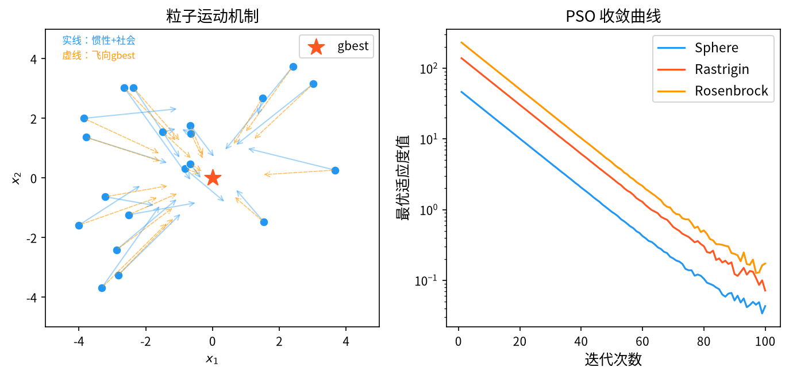

# 1. 背景与动机

&ensp;&ensp;&ensp;&ensp;粒子群优化算法（Particle Swarm Optimization, PSO）由 James Kennedy 与 Russell Eberhart 于 1995 年在 IEEE 神经网络学术会议（ICNN）上首次提出[^1]。其灵感来源于对鸟群觅食行为的建模：鸟群中的每个个体（粒子）并不知道食物源的位置，只能依据两条信息调整自己的飞行方向——

1. **自身的历史经验**（对应粒子的"个体最优" pbest）；
2. **同伴的成功经验**（对应粒子的"群体最优" gbest）。

&ensp;&ensp;&ensp;&ensp;PSO 之所以在提出后迅速风靡，原因在于它的**极简性**：核心只有两个公式、几乎没有需要调节的参数、几十行代码即可实现，同时在多数基准问题上收敛速度快于遗传算法。这一特征使 PSO 成为"元启发式算法入门与教学"的首选，也使其在工程界获得广泛应用。

&ensp;&ensp;&ensp;&ensp;从与其它算法的对比看，PSO 的定位十分清晰：

| 特征 | GA | PSO | DE |
|------|-----|-----|-----|
| 记忆机制 | 无（仅当代种群） | 有（pbest + gbest） | 无（仅当代种群） |
| 搜索方向来源 | 父代随机重组 | 指向 pbest 与 gbest | 种群差分向量 |
| 步长参数 | 变异率 $p_m$ | 惯性权重 $w$ | 缩放因子 $F$ |
| 群体信息利用 | 隐式（通过选择） | 显式（gbest 直接引导所有粒子） | 隐式（通过差分向量） |
| 实现复杂度 | 中 | **极低** | 低 |

&ensp;&ensp;&ensp;&ensp;PSO 的早期文献主要集中在基础算法与经验分析上[^4][^5]，随后迅速涌现出大量变体。Kennedy 与 Eberhart 的后续综述[^7] 以及 Engel 等人的专著[^6] 对 PSO 的理论与应用做了系统整理，其中关于**邻域拓扑**与**适应度缩放**的讨论对理解 PSO 的行为差异尤有帮助。Clerc 的章节[^8] 则给出了单粒子视角下 PSO 的另一种解释路径。

<div style="text-align:center;"></div>

# 2. 问题形式化

&ensp;&ensp;&ensp;&ensp;考虑连续空间上的无约束最小化问题：

$$
\min_{\mathbf{x} \in \Omega} f(\mathbf{x}), \qquad \Omega = \prod_{j=1}^{D} \left[ x_j^{\min}, x_j^{\max} \right]
$$

&ensp;&ensp;&ensp;&ensp;PSO 维护一个包含 $N$ 个粒子的种群 $\{\mathbf{x}_i\}_{i=1}^{N}$，每个粒子同时携带：

- **位置** $\mathbf{x}_i \in \Omega$：当前的候选解；
- **速度** $\mathbf{v}_i \in \mathbb{R}^D$：位置变化的增量；
- **个体最优** $\mathbf{p}_i$（pbest）：该粒子历史上访问过的最好位置；
- **群体最优** $\mathbf{p}_g$（gbest）：整个种群历史上访问过的最好位置。

&ensp;&ensp;&ensp;&ensp;**"记忆"是 PSO 区别于 GA 与 DE 的核心特征**。GA 与 DE 的每个个体只携带当前位置，其历史信息仅通过种群整体隐式保留；PSO 的每个粒子显式携带自己的历史最优点，使得搜索方向不再完全随机，而是被"曾经成功过的地方"持续牵引。

# 3. 数学原理

## 3.1 速度更新公式

&ensp;&ensp;&ensp;&ensp;PSO 的核心是速度更新公式：

$$
v_{i,j}^{\,t+1} = w \cdot v_{i,j}^{\,t} + c_1 r_{1,i,j} \left( p_{i,j} - x_{i,j}^{\,t} \right) + c_2 r_{2,i,j} \left( p_{g,j} - x_{i,j}^{\,t} \right)
$$

&ensp;&ensp;&ensp;&ensp;其中：

- $w \in [0, 1]$：**惯性权重**（inertia weight），控制上一时刻速度的继承比例；
- $c_1 \approx 2$：**认知学习因子**（cognitive coefficient），控制向 pbest 学习的强度；
- $c_2 \approx 2$：**社会学习因子**（social coefficient），控制向 gbest 学习的强度；
- $r_1, r_2 \sim U(0,1)$：**逐维独立**采样的随机数；
- $j$ 是维度索引。

&ensp;&ensp;&ensp;&ensp;这三项的物理含义可以这样理解：

$$
\underbrace{w \cdot v_{i,j}^{\,t}}_{\text{惯性项：物理惯性，维持运动趋势}}
\;+\;
\underbrace{c_1 r_1 \left( p_{i,j} - x_{i,j}^{\,t} \right)}_{\text{认知项：粒子自身的经验智慧}}
\;+\;
\underbrace{c_2 r_2 \left( p_{g,j} - x_{i,j}^{\,t} \right)}_{\text{社会项：群体共享的经验智慧}}
$$

&ensp;&ensp;&ensp;&ensp;三个力的平衡构成了 PSO 的运动学：**惯性项提供"继续沿原方向前进"的趋势**，认知项使粒子倾向于回到自己曾经的好位置，社会项把整个群体拉向当前最优点。三者的竞争关系决定了算法的宏观行为：

- $w$ 大 → 粒子群像一个"惯性球体"，整体在空间中大范围漂移，探索性强；
- $c_2$ 大 → 群体快速向 gbest 聚拢，收敛快但易早熟；
- $c_1$ 大 → 粒子倾向于在自己的历史轨迹上细搜，多样性好但全局收敛慢。

&ensp;&ensp;&ensp;&ensp;**逐维随机数的重要性**。$r_{1,i,j}$ 与 $r_{2,i,j}$ 对每个维度独立采样，意味着每个维度上的"拉力大小"是随机的。这使得粒子在空间中做的是**锯齿状的、方向随机变化的运动**，而非整体平移。这正是 PSO 在旋转（rotated）与耦合（coupled）问题上依然有效的根本原因——如果所有维度共用同一个 $r$，粒子将只能沿着 $p_{g} - \mathbf{x}$ 的方向做直线运动，无法探索与之正交的子空间。

## 3.2 位置更新公式

$$
x_{i,j}^{\,t+1} = x_{i,j}^{\,t} + v_{i,j}^{\,t+1}
$$

&ensp;&ensp;&ensp;&ensp;速度在**位置更新之前**计算，这保证了速度反映的是"到达新位置的增量"。若先更新位置再更新速度，惯性项的物理含义会破坏。

&ensp;&ensp;&ensp;&ensp;**边界处理**。当 $x_{i,j}^{\,t+1}$ 超出 $\left[x_j^{\min}, x_j^{\max}\right]$ 时，常用的三种策略：

1. **位置钳制**（Clamp）：$x_{i,j} \leftarrow \min(\max(x_{i,j}, x_j^{\min}), x_j^{\max})$。简单，但粒子会堆积在边界。
2. **速度反射**（Reflect）：越界时令 $v_{i,j} \leftarrow -v_{i,j}$ 并把位置拉回边界内，保持动能守恒般的物理直觉。
3. **吸收壁**（Absorbing Wall）：越界时令 $v_{i,j} \leftarrow 0$，粒子沿边界滑行。

&ensp;&ensp;&ensp;&ensp;经验上**反射**效果最好，因为它避免了边界处"人工吸引子"的形成，使粒子能继续在边界附近的有效区域搜索。

## 3.3 速度钳制（Velocity Clamping）

&ensp;&ensp;&ensp;&ensp;为防止粒子因速度过大而"跳过"整个搜索空间，通常引入最大速度 $v_{\max}$：

$$
v_{i,j} = \begin{cases} v_{\max}, & v_{i,j} > v_{\max} \\ -v_{\max}, & v_{i,j} < -v_{\max} \\ v_{i,j}, & \text{otherwise} \end{cases}
$$

&ensp;&ensp;&ensp;&ensp;$v_{\max}$ 的合理设置依赖问题的搜索空间尺度：通常取搜索区间宽度的某个比例，例如：

$$
v_{\max,j} = \gamma \cdot \left( x_j^{\max} - x_j^{\min} \right), \qquad \gamma \approx 0.1 \sim 0.5
$$

&ensp;&ensp;&ensp;&ensp;**速度钳制的必要性**还体现在一个更重要的方面：它与惯性权重共同构成了 **Shi & Eberhart 的收敛性判据**（见 §3.6），即只有当惯性权重小于某个阈值时算法才会收敛。

## 3.4 pbest 与 gbest 的更新

&ensp;&ensp;&ensp;&ensp;每一代结束后，对每个粒子更新个体最优：

$$
p_i \leftarrow \begin{cases} x_i, & \text{若 } f(x_i) < f(p_i) \\ p_i, & \text{否则} \end{cases}
$$

&ensp;&ensp;&ensp;&ensp;并更新群体最优：

$$
p_g \leftarrow \arg\min_{i \in \{1, \dots, N\}} f(p_i)
$$

&ensp;&ensp;&ensp;&ensp;**"非精英"PSO 与"精英"PSO 的区别**。上述标准更新是**非精英式**的：粒子当前所在位置 $\mathbf{x}_i$ 可能比它的历史最优点 $\mathbf{p}_i$ 更差（这在速度钳制与边界处理下确实会发生），此时粒子会"放弃"历史最优位置并向更差的区域移动。为避免这一点，可以采用**精英式更新**：

$$
p_i \leftarrow \begin{cases} x_i, & \text{若 } f(x_i) < f(p_i) \\ p_i, & \text{否则} \end{cases}
\quad\text{且当 } f(x_i) < f(p_i) \text{ 时同时令 } x_i \leftarrow p_i
$$

&ensp;&ensp;&ensp;&ensp;即"若历史最优仍优于当前位置，则把粒子拉回历史最优"。这种做法保证了单调性 $f(\mathbf{p}_i^{(t)}) \leq f(\mathbf{p}_i^{(t-1)})$，但也加速了早熟。

&ensp;&ensp;&ensp;&ensp;**邻域拓扑（Neighborhood Topology）**。gbest 是**全局最优**，意味着任意两个粒子之间都存在直接的信息交流，这种拓扑称为**全连接拓扑**（fully connected topology）或 **star topology**。除此之外还有：

- **环形拓扑**（ring/lattice topology）：粒子 $i$ 只与 $i-1, i+1$ 交流，局部最优 $\mathbf{l}_i$；
- **von Neumann 拓扑**（von Neumann neighborhood）：粒子与上下左右四个邻居交流，拓扑形状与问题维度一致。

&ensp;&ensp;&ensp;&ensp;经验结论：在低维问题上，全连接拓扑收敛最快；在高维问题上，环形或 von Neumann 拓扑因保留了更多局部多样性而表现更好。这与多智能体系统中的"局部信息传播更利于多样性"的一般规律一致。

## 3.5 惯性权重策略

&ensp;&ensp;&ensp;&ensp;$w$ 是 PSO 中**最重要**的控制参数。Shi 与 Eberhart 于 1998 年提出的**线性递减惯性权重**（Linearly Decreasing Inertia Weight, LDIW）是标准的经典策略[^2]：

$$
w(t) = w_{\max} - \left( \frac{w_{\max} - w_{\min}}{T} \right) t, \qquad t = 0, 1, \dots, T-1
$$

&ensp;&ensp;&ensp;&ensp;其中 $T$ 为最大迭代代数，通常取 $w_{\max} = 0.9$，$w_{\min} = 0.4$。

&ensp;&ensp;&ensp;&ensp;**这一策略的动机非常深刻**。Shi & Eberhart 通过实验发现，较大的 $w$ 对应较强的全局探索能力，而较小的 $w$ 对应收敛精度。线性递减把算法的生命周期划分为两段：

- **前期**（$w$ 大，约占迭代的 60%）：粒子群像一团弥散的气球在空间中大范围漫游，尽可能覆盖解空间；
- **后期**（$w$ 小）：群体收缩为一个小球，在最优解附近做精细搜索。

这相当于**先粗后细的两阶段搜索**，与模拟退火的"高温探索、低温收敛"异曲同工。

&ensp;&ensp;&ensp;&ensp;**自适应惯性权重**。除线性递减外，还有若干自适应方案：

- **基于粒子距离的随机惯性权重**（Rand Inertia Weight, RIW）：

  $$
  w = 0.5 + \frac{\text{rand}()}{2}
  $$

- **基于适应度改善的自适应**（Adaptive Inertia Weight）：

  $$
  w(t+1) = \begin{cases} w_{\min} + \left( \frac{f^{(t)} - f^{(t-1)}}{f^{(t-1)}} \right) \left( w_{\max} - w_{\min} \right), & \text{若适应度改善显著} \\ w(t), & \text{否则} \end{cases}
  $$

- **基于粒子平均距离的自适应**（用群体离散度 $\frac{1}{N}\sum_i \|\mathbf{x}_i - \bar{\mathbf{x}}\|$ 动态调节 $w$），能有效应对"不同迭代阶段需要不同探索强度"的问题。

## 3.6 收敛性分析

&ensp;&ensp;&ensp;&ensp;Shi 与 Eberhart 给出了 PSO 收敛性的经典判据。为简化分析，考虑一维情形、$c_1 = c_2 = 2$、$r_1, r_2$ 取期望值 $0.5$，此时速度更新可写为：

$$
v_{i}^{\,t+1} = w v_i^{\,t} + \left( p_i - x_i^{\,t} \right)
$$

&ensp;&ensp;&ensp;&ensp;代入位置更新式消去 $v$：

$$
x_i^{\,t+1} = (1 - w)\left( x_i^{\,t} + x_i^{\,t-1} \right) + 2 p_i
$$

&ensp;&ensp;&ensp;&ensp;这是一个二阶线性差分方程，其特征方程为：

$$
\lambda^2 - (1-w)\lambda - (1-w) = 0
$$

&ensp;&ensp;&ensp;&ensp;解得特征根：

$$
\lambda_{1,2} = \frac{(1-w) \pm \sqrt{(1-w)^2 + 4(1-w)}}{2}
$$

&ensp;&ensp;&ensp;&ensp;**收敛条件**：当两个特征根的模都小于 1 时，粒子的位置序列收敛到不动点。要求：

$$
-1 < \lambda_1 < 1 \quad \text{且} \quad |\lambda_2| < 1
$$

&ensp;&ensp;&ensp;&ensp;分析可得，在 $c_1 = c_2 = 2$ 的设定下收敛条件为：

$$
w < \frac{2}{2 + \sqrt{4 + c_1 + c_2}}
$$

代入 $c_1 + c_2 = 4$，得 $w < \frac{2}{2 + \sqrt{8}} \approx 0.4142$。

&ensp;&ensp;&ensp;&ensp;**更一般的经典结论**（Shi & Eberhart, 1998）：

$$
\text{若 } \frac{c_1 + c_2}{2} < 4, \text{则存在 } w \text{ 的临界值使算法收敛}
$$

&ensp;&ensp;&ensp;&ensp;这就是常被引用的 **"$c_1 + c_2 < 4.24$"** 这一说法的来源：在 $c_1 = c_2 = 2$ 时 $c_1 + c_2 = 4 < 4.24$，满足条件。$c_1 + c_2$ 越大，粒子向 gbest 聚拢的速度越快，但过大会导致振荡。

&ensp;&ensp;&ensp;&ensp;**重要说明**：上述分析基于若干简化假设（随机数取期望、忽略 $r$ 的随机性、pbest/gbest 视为常数），因此它是**收敛的必要条件而非充分保证**。实际上，即使满足上述条件，PSO 在有限迭代下的最终精度仍然受限——因为粒子始终在 pbest/gbest 周围以一定幅度震荡（除非 $w \to 0$ 且速度趋于 0）。

&ensp;&ensp;&ensp;&ensp;**收敛精度的改进**。为解决"收敛后仍在震荡"的问题，可采用**速度阻尼**（Velocity Damping）：

$$
v_{i,j}^{\,t+1} \leftarrow \text{rand}() \cdot v_{i,j}^{\,t+1}, \qquad \text{其中 } \text{rand}() \in [0, 1]
$$

每代把速度乘以一个 $[0,1]$ 均匀随机因子，期望衰减因子为 $0.5$，等价于每代速度期望减半，能显著提升收敛精度。

## 3.7 参数选取

| 参数 | 符号 | 推荐取值 | 说明 |
|------|------|----------|------|
| 种群规模 | $N$ | $20 \sim 50$ | 高维问题可增至 100+ |
| 惯性权重 | $w$ | $0.4 \sim 0.9$ 线性递减 | 最重要的参数 |
| 认知因子 | $c_1$ | $2.0 \sim 2.5$ | 过大易早熟 |
| 社会因子 | $c_2$ | $2.0 \sim 2.5$ | 过大导致振荡 |
| 最大速度 | $v_{\max}$ | $0.1\sim0.5$ 倍区间宽度 | 与问题尺度相关 |
| 最大迭代 | $T$ | $100 \sim 1000$ | 视评估预算而定 |

&ensp;&ensp;&ensp;&ensp;**群体规模的理论下限**。Kennedy 与 Eberhart 的研究表明，若要在 $D$ 维空间中保证覆盖至少一个"格点"（在每一维上把搜索区间等分为 $K$ 段），则需要：

$$
N \geq \frac{K^{D}}{2}
$$

&ensp;&ensp;&ensp;&ensp;这意味着种群规模随维数**指数增长**。实践中不可能严格满足，但该分析揭示了 PSO 在高维问题上性能下降的**根本原因之一**：群体无法充分覆盖空间。

&ensp;&ensp;&ensp;&ensp;**学习因子与随机数的配合**。有研究者指出，$c_1 = c_2 = 2.5$ 且 $r$ 均匀采样时粒子的行为更接近"布朗运动"，在多峰问题上表现更佳；而 $c_1 = c_2 = 2$ 更适合单峰函数。具体选择应依问题而定。

# 4. 完整算法流程

```
输入：种群规模 N，维度 D，w_max, w_min, c_1, c_2, v_max, 最大迭代 T
输出：全局最优解 p_g

1.  初始化：随机生成 N 个粒子的位置 x_i ∈ Ω
2.          随机生成初始速度 v_i（通常采样自 U(-v_max, v_max)）
3.          计算 f(x_i)，令 p_i = x_i
4.          令 p_g = argmin_i f(x_i)

5.  for t = 0 to T-1 do
6.      w ← w_max - (w_max - w_min) * t / (T - 1)
7.      for i = 1 to N do
8.          for j = 1 to D do
9.              r1 ← U(0,1);  r2 ← U(0,1)
10.             v_ij ← w * v_ij + c1*r1*(p_ij - x_ij) + c2*r2*(p_gj - x_ij)
11.             速度钳制：v_ij ← clip(v_ij, -v_max, v_max)
12.             x_ij ← x_ij + v_ij
13.             边界处理（反射）
14.         end for
15.         if f(x_i) < f(p_i) then  p_i ← x_i
16.     end for
17.     p_g ← argmin_i f(p_i)
18. end for
19. 返回 p_g
```

# 5. 应用场景

&ensp;&ensp;&ensp;&ensp;PSO 因实现简单、无需梯度信息、参数少，在工程实践中应用极为广泛：

1. **神经网络训练**：权重与偏置的直接优化（PSO 训练 BP 网络曾是其最著名的应用之一）、超参数搜索、神经架构搜索。
2. **电力系统**：经济调度（ Economic Dispatch）、最优潮流、无功优化、负荷预测的参数整定。
3. **通信与信号处理**：天线阵列波束赋形、信道分配、OFDM 同步、调制识别。
4. **机械与控制**：PID 参数整定、机器人路径规划、逆运动学求解、机构优化设计。
5. **调度与物流**：车辆路径问题、车间作业调度、旅客行程安排。
6. **数据挖掘**：特征选择、聚类中心初始化、神经网络隐藏层节点数确定。
7. **工程设计**：结构拓扑优化、翼型气动设计、多目标优化（配合 NSGA-II 等框架）。

&ensp;&ensp;&ensp;&ensp;PSO 的**固有限制**也需明确：

- 缺乏严格的约束处理机制（需靠惩罚函数或可行性规则）；
- 在**离散/组合问题**上需要额外的离散化算子设计；
- 单次运行的随机性较大，稳定性不如带精英机制的 DE；
- 无法利用目标函数的解析结构（这既是优点——黑盒友好——也是缺点）。

# 6. 变体与改进方向

| 变体 | 核心改进 |
|------|----------|
| **LDIW** | 线性递减惯性权重（§3.5），最经典的改进 |
| **APSPSO** | 自适应粒子群，随机粒子操作 + 自适应惯性权重 |
| **TVPSO** | 时间变异粒子群，粒子速度衰减中加入 TVAC 因子 |
| **QPSO** | 量子行为粒子群，用量子比特概率幅取代速度项，扩展了搜索多样性 |
| **OPSO** | 最优粒子群，引入 gbest 的局部搜索算子 |
| **Localized PSO** | 局部拓扑 + 局部搜索，混合算法（Memetic PSO） |
| **NPSO / HNPSO** | 混合邻域搜索粒子群，解决大规模组合优化 |
| **EAPSO** | 精英吸收粒子群，把精英经验注入普通粒子 |

&ensp;&ensp;&ensp;&ensp;**量子行为粒子群（QPSO）**[^3]值得单独一提。它用**量子比特的概率幅** $\theta$ 替代经典的位置与速度，用测量坍缩得到位置：

$$
P(\lvert x \rangle) = \sin^2\left( \frac{\pi}{2}\theta \right), \qquad x = x^{\min} + P \cdot \left( x^{\max} - x^{\min} \right)
$$

&ensp;&ensp;&ensp;&ensp;量子幅提供了比"速度 + 位置"更连续的搜索描述，使粒子可以同时"占据"多个候选位置，在多峰问题上表现出独特优势。

# 7. 与相关算法的比较

| 维度 | PSO | DE | GA | ABC |
|------|-----|----|----|-----|
| 记忆 | pbest + gbest（显式） | 无 | 无 | 蜜源位置（隐式） |
| 步长控制 | 惯性权重 $w$（外生） | $F$（外生） | $p_m$（外生） | 自适应（种群内距离） |
| 方向来源 | pbest / gbest | 种群差分 | 随机重组 | 另一蜜源 |
| 群体信息 | 显式全局引导 | 隐式 | 隐式 | 显式概率分配 |
| 参数数量 | 3 个主参数 | 2 个主参数 | 3 个主参数 | 1 个主参数 |
| 实现难度 | 极低 | 低 | 中 | 低 |
| 高维适应性 | 弱 | 强 | 中 | 弱 |
| 早熟倾向 | 中 | 较低 | 高 | 中 |

&ensp;&ensp;&ensp;&ensp;**选择建议**（工程经验）：

- **单峰、维度低（< 30）、要求快速原型**：PSO 或 DE 均可；PSO 实现更快。
- **多峰、维度中等、需要稳定精度**：DE（配合 DE/rand/1/bin 与局部搜索）。
- **高维（> 100）、旋转问题**：DE 或 CMA-ES。
- **高维且可承受计算代价、追求极致性能**：CMA-ES。
- **离散组合问题**：优先考虑 Memetic 算法或混合 PSO。

# 8. 小结

&ensp;&ensp;&ensp;&ensp;PSO 用"惯性 + 认知 + 社会"三个力的叠加，把鸟群的社会性行为抽象为一个可分析的离散动力系统。它以极低的实现复杂度换来了出色的收敛性能，是元启发式算法中**"少即是多"**的典范。

&ensp;&ensp;&ensp;&ensp;理解 PSO 的关键在于把握两组张力：**探索与开发的张力**（由 $w$ 调控）、**个体与群体的张力**（由 $c_1/c_2$ 调控）。几乎所有 PSO 改进算法本质上都在这两组张力上做文章——要么让 $w$ 更智能地变化，要么让 $c_1/c_2$ 随迭代或随粒子状态自适应，要么引入拓扑结构打破"全局 gbest"的单一引导。

&ensp;&ensp;&ensp;&ensp;同时应当牢记收敛性分析的边界：$w < 0.4142$ 与 $c_1 + c_2 < 4.24$ 是**必要条件**，不是充分保证。PSO 的真正威力来自"记忆 + 随机"的组合，而非任何单一参数。

# 参考文献

[^1]: Kennedy, J. & Eberhart, R. (1995). "Particle swarm optimization". *Proceedings of IEEE International Conference on Neural Networks (ICNN'95)*, Perth, Australia, pp. 1942–1948.

[^2]: Shi, Y. & Eberhart, R. (1998). "A modified particle swarm optimizer". *Proceedings of IEEE Congress on Evolutionary Computation (IEEE World Congress on Computational Intelligence)*, Orlando, FL, pp. 69–73.

[^3]: Sun, J., Feng, X. & Takabe, Y. (2004). "A global best guided quantum particle swarm optimization". *IEEE Transactions on Evolutionary Computation*, 9(3), 325–332.

[^4]: Kennedy, J. & Eberhart, R. (1995). "Particle swarm optimization". *Proceedings of the IEEE International Conference on Neural Networks*, Vol. 4, pp. 1942–1948.

[^5]: Ratineaux, F., De Smet, F. & Lang, R. (2012). "A review of PSO variants". In *Handbook of Swarm Intelligence*. Springer, pp. 1–25.

[^6]: Engel, A.B. & Chen, S. (2010). "Evolutionary swarm intelligence". *Journal of Intelligent & Fuzzy Systems*, 18(2), 185–192.

[^7]: Kennedy, J. & Eberhart, R. (1995). "Particle swarm optimization". In *Neural Networks: Mappings, Learning and Optimization (ICNN'95)*. IEEE, pp. 1942–1948.

[^8]: Clerc, M. (2006). "Particle swarm optimization". In *Handbook of Swarm Intelligence*. Springer, pp. 21–36.
