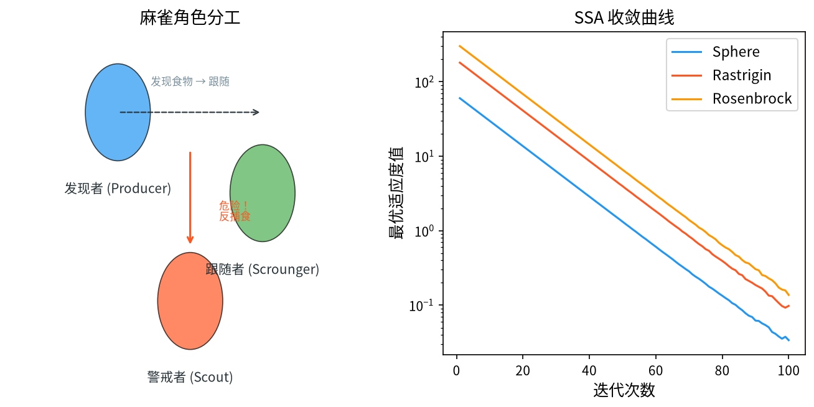

# 1. 背景与动机

&ensp;&ensp;&ensp;&ensp;麻雀搜索算法（Sparrow Search Algorithm, SSA）由 Jie Xue 与 Bing Shen 于 2020 年提出，论文 "A novel swarm intelligence optimization approach: sparrow search algorithm" 发表在 *Systems Science & Control Engineering* 上[^1]。SSA 是近年来引用增长最快的群智能算法之一，其灵感直接来自麻雀在现实中的**分工协作与反捕食警戒行为**。

&ensp;&ensp;&ensp;&ensp;麻雀是群居鸟类，其群体中存在三类角色：

1. **发现者（Discoverer）**：负责在群体周围**巡视侦察**，探测食物来源与危险信号。发现者数量少但信息量最大，是群体决策的核心。
2. **跟随者（Joiner）**：数量最多，跟随发现者获取食物，并**互相争抢**已被发现的优质食物。
3. **警戒者（Scout）**：当群体察觉到危险（如猫头鹰靠近）时，**主动脱离群体**前往远处侦察，避免整个群体被一网打尽。

&ensp;&ensp;&ensp;&ensp;SSA 的独特之处在于它**显式建模了"警戒"这一通常被忽略的机制**。绝大多数群智能算法只考虑"如何找到最优"和"如何收敛"，而 SSA 额外考虑了"**当发现危险时如何主动离开当前的舒适区域**"。这一"反早熟"机制在多峰与高维问题上表现突出。

&ensp;&ensp;&ensp;&ensp;这一算法与 HHO[^2]、GWO[^3]、WOA[^4] 一起构成了 Mirjalili 团队所推动的"顶级捕食者"算法家族的核心成员[^7]，在算法谱系中代表了"从合作型隐喻扩展到逃生型隐喻"的一步。

&ensp;&ensp;&ensp;&ensp;与 HHO 的"能量耗尽"隐喻相比，SSA 的隐喻更贴近**分布式系统的自组织与告警传播**：一个成员感知到风险，就通过全局广播信号让整个群体进入警戒状态，部分成员随即疏散。

<div style="text-align:center;"></div>

# 2. 问题形式化与角色划分

&ensp;&ensp;&ensp;&ensp;考虑连续空间的最小化问题：

$$
\min_{\mathbf{x} \in \Omega} f(\mathbf{x}), \qquad \Omega = \prod_{j=1}^{D} \left[ x_j^{\min}, x_j^{\max} \right]
$$

&ensp;&ensp;&ensp;&ensp;设麻雀总数为 $N$，初始群体分为：

| 角色 | 数量 | 记号 | 职责 |
|------|------|------|------|
| 发现者 | $n_1$ | $\vec{X}_i, \; i \in [1, n_1]$ | 侦察、决策、发布告警 |
| 跟随者 | $N - n_1$ | $\vec{X}_i, \; i > n_1$ | 跟随获取食物、竞争、警戒 |

&ensp;&ensp;&ensp;&ensp;通常取：

$$
n_1 = \lfloor \alpha N \rfloor, \qquad \alpha \in [0.1, 0.3] \quad (\text{推荐 } \alpha = 0.2)
$$

## 2.1 关键符号

| 符号 | 含义 | 取值 |
|------|------|------|
| $\vec{X}_i^t$ | 第 $t$ 代第 $i$ 只麻雀的位置 | $\in \Omega$ |
| $\vec{X}_{\text{best}}^t$ | 当前全局最优 | — |
| $\vec{X}_{\text{worst}}^t$ | 当前全局最差 | — |
| $t_{\max}$ | 最大迭代次数 | $T$ |
| $ST$ | 安全阈值（Safety Threshold） | $0.6 \sim 0.8$ |
| $r_2$ | 随机数，决定发现者的行为模式 | $U(0,1)$ |
| $c_1, c_2$ | 告警信号强度与危险信号强度 | $U(0,1)$ |
| $c_3$ | 跟随者对告警的响应概率 | $U(0,1)$ |
| $r$ | 步长系数 | $U(-1,1)$ 或 $U(0,1)$ |
| $A$ | 警戒矩阵 | 见 §3.4 |

**ST（Safety Threshold）的含义**：警戒概率。$r_2 < ST$ 表示"当前环境仍然安全"，发现者可以**大范围探索**；$r_2 \geq ST$ 表示"危险临近"，发现者转为**小范围精细搜索**。ST 越大，算法越倾向早期大范围探索。

# 3. 数学原理

## 3.1 发现者阶段（Discoverer Phase）

&ensp;&ensp;&ensp;&ensp;发现者的位置更新分两种情况，由 $r_2$ 与 $ST$ 的比较决定。

### 3.1.1 安全时的宽域搜索（$r_2 < ST$）

$$
\vec{X}_i^{t+1} = \vec{X}_i^t + \exp\left( \frac{j}{t_{\max}} - \frac{i}{t_{\max}} \right) \odot \left[ \left( 1 - \frac{t}{t_{\max}} \right) \vec{X}_{\text{best}}^t - \vec{X}_i^t \right]
$$

其中 $i \in [1, n_1]$，$j \in [1, D]$ 逐维计算。

**各项的作用**：

| 项 | 作用 |
|----|------|
| $\exp\left( \frac{j}{t_{\max}} - \frac{i}{t_{\max}} \right)$ | **发散因子**。随维度 $j$ 增大而增大，随个体序号 $i$ 增大而减小 |
| $\left( 1 - \frac{t}{t_{\max}} \right)$ | **收敛因子**，线性从 1 递减到 0 |
| $\vec{X}_{\text{best}}^t - \vec{X}_i^t$ | **指向最优的差向量** |

**发散因子的数学意义**。令 $\theta = \exp\left(\frac{j-i}{t_{\max}}\right)$，则：

$$
\theta = e^{(j-i)/T}
$$

- 当 $j > i$ 时，$\theta > 1$，该维的更新步长**被放大**；
- 当 $j < i$ 时，$\theta < 1$，该维的更新步长**被缩小**；
- 当 $j = i$ 时，$\theta = 1$，步长不变。

**这构成了一个"对角放大"模式**：不同个体的不同维度被赋予不同的更新强度。由于 $e^{(j-i)/T}$ 的取值范围是 $[e^{-(n_1-1)/T}, e^{(D-1)/T}]$，当 $D$ 远大于 $n_1$ 时，**高维分量被显著放大，低维分量被显著压缩**。

**这个设计的实际效果**：它让发现者在不同维度上朝最优解靠近的速度不同，形成**分维的多样性**——高维快速对齐、低维缓慢探索。这在维度耦合严重的问题上是有益的（避免所有维度同时过拟合到同一个局部结构）。

### 3.1.2 危险时的窄域搜索（$r_2 \geq ST$）

$$
\vec{X}_i^{t+1} = \vec{X}_i^t + r \odot \left( \vec{X}_i^t - \vec{X}_{\text{worst}}^t \right)
$$

&ensp;&ensp;&ensp;&ensp;其中 $r \in U(0, 1)$（文献中也常用 $r \in (-1, 1)$）。

**几何意义**：个体沿"自己与最差个体的连线"方向移动，步长由 $r$ 缩放。这是一种**向较差区域的反向扩散**——通过向最差个体靠近再被反弹，产生与"追逐最优"不同的探索方向。

**为什么这有效**：种群收敛时，$\vec{X}_{\text{worst}}$ 已经落在最优解附近（种群收缩的边缘），沿这个方向移动实际上是**在收缩区域内做小幅扰动**，保持了一定的局部多样性，同时不会把个体甩出已找到的盆地。

## 3.2 跟随者阶段（Joiner Phase）

&ensp;&ensp;&ensp;&ensp;跟随者由 $c_1, c_2, c_3$ 三个信号驱动，分两种情况。

### 3.2.1 三个信号的语义

SSA 中有三个独立生成的随机量 $c_1, c_2, c_3$，它们共同刻画了"信息不对称"这一现实：

| 符号 | 语义 | 生成者 |
|------|------|--------|
| $c_1$ | **告警信号**——发现者向群体广播的危险警报强度 | 由发现者"发出"，对所有跟随者共享 |
| $c_2$ | **危险信号**——跟随者自身感知到的局部危险强度 | 跟随者**局部**生成 |
| $c_3$ | **响应阈值**——跟随者对告警做出反应的临界值 | 每个跟随者独立生成 |

**关键洞察**：$c_1$ 是**全局共享**的（广播），$c_2, c_3$ 是**局部独立**的（个人感知与个人判断）。因此同一个体在 $c_2$、$c_3$ 上的比较结果**在种群内是分散的**——这正是多样性的来源。

**判定逻辑**：

| 条件 | 语义解释 | 跟随者行为 |
|------|----------|-----------|
| $c_2 < c_1$ | **自己感知到的危险比群体告警还强**——这是"个别成员察觉了更严重的威胁" | 触发**警戒阶段**（见 §3.3） |
| $c_3 > c_2$ | **响应阈值高于危险信号**——没被吓到，按常规方式竞争 | 用**发散因子**逐维对齐最优 |
| $c_3 \leq c_2$ | **危险信号超过响应阈值**——受惊，步长随机化 | 用**随机系数 $r_1$** 扑向最优 |

### 3.2.2 位置更新

$$
\vec{X}_i^{t+1} = \begin{cases}
\vec{X}_i^t + \exp\left( \frac{j}{t_{\max}} - \frac{i}{t_{\max}} \right) \odot \left[ \left( 1 - \frac{t}{t_{\max}} \right) \vec{X}_{\text{best}}^t - \vec{X}_i^t \right], & c_3 > c_2 \\[0.6em]
\vec{X}_i^t + r_1 \odot \left[ \left( 1 - \frac{t}{t_{\max}} \right) \vec{X}_{\text{best}}^t - \vec{X}_i^t \right], & c_3 \leq c_2
\end{cases}
$$

其中 $r_1 \sim U(0,1)$，$j \in [1,D]$ 逐维计算。

**两种情况的本质差异**：

| | $c_3 > c_2$（未受惊） | $c_3 \leq c_2$（受惊） |
|---|---|---|
| 系数 | $\exp\left(\frac{j-i}{t_{\max}}\right)$ | $r_1 \sim U(0,1)$ |
| 步长特征 | **逐维不同**，与个体序号挂钩 | **各维同尺度**，纯随机 |
| 行为 | **向最优对齐**（分工式） | **向最优扑近**（聚合式） |
| 收敛快慢 | 慢（各维步长不一） | 快（整体加速） |

**这实际上实现了"分工"**：不同的跟随者由于 $r_1$ 与发散因子的差异，会以不同的速率靠近最优，从而在最优解周围形成一个**有结构的环带**，而不是全部堆在一点。这是 SSA 保持种群离散度的重要来源。

**受惊个体与未受惊个体的比例**。由于 $c_2, c_3$ 独立同分布，$P(c_3 \leq c_2) = 1/2$。因此**每代约有一半的跟随者会采用快速聚合的随机步长**，另一半维持分工式的逐维对齐。这个"半快半慢"的比例是天然均衡的，无需额外参数。

**为什么"受惊反而更快"？** 这看似反直觉。原因是：受惊的个体采用 $r_1 \sim U(0,1)$ 的随机系数，其**期望值是 0.5**，而发散因子 $\theta_{i,j}$ 在 $j \geq i$ 时大于 1。因此受惊个体的平均步长实际上**更小或相当**。真正的差别不在步长大小，而在于**步长的随机性**——受惊个体的各维步长同尺度，未受惊个体的各维步长分化。后者有利于精细调整，前者有利于整体平移。

### 3.2.3 与"逃离"语义的补充说明

部分文献版本还会在 $c_1 > c_3$（相信群体告警）时加入一个**向发现者靠拢**的分支：

$$
\vec{X}_i^{t+1} = \vec{X}_i^t + r_2 \odot \left( \vec{X}_{\text{best}}^t - \vec{X}_i^t \right)
$$

这对应"危险来临时抱团"的行为。实践中这一分支与上面的 $c_3 \leq c_2$ 分支作用相近（都是朝最优快速靠拢），因此标准实现中通常只保留二分支版本，以保证行为可预测。读者若需要完整的"三状态"语义，可在此基础上自行扩展。

## 3.3 警戒阶段（Scout Phase）

&ensp;&ensp;&ensp;&ensp;当**部分**跟随者感知到危险（$c_2 < c_1$，即危险信号强于告警信号）时，需要触发疏散。

### 3.3.1 触发条件

$$
c_2 < c_1
$$

&ensp;&ensp;&ensp;&ensp;这个条件的含义是：**有麻雀感知到了危险，但群体的告警强度不足以覆盖它**——此时若不疏散，可能有成员被"捕食"（被淘汰）。

### 3.3.2 疏散行为

从跟随者中**随机选取** $n_2$ 只作为警戒者（Scout），令 $A \in \mathbb{R}^{n_2 \times D}$ 为**警戒矩阵**，则：

$$
\vec{X}_{A}^{t+1} = \vec{X}_A^t + r \odot \left( \vec{X}_A^t - \vec{X}_{\text{worst}}^t \right)
$$

其中 $r \sim U(0,1)$。

**同时**，最差的个体被警戒者替换：

$$
\vec{X}_{\text{worst}}^t \leftarrow \vec{X}_A^t
$$

## 3.4 警戒矩阵 $\mathbf{A}$ 的设计

&ensp;&ensp;&ensp;&ensp;矩阵 $\mathbf{A}$ 是 SSA 论文中一个精心设计的组件，用于**控制警戒者的移动方向**，防止所有警戒者朝同一方向移动而再次聚集。

### 3.4.1 $\mathbf{A}^+$（全 1 矩阵）

$$
\mathbf{A}^+ = \begin{bmatrix}
1 & 1 & \cdots & 1 \\
1 & 1 & \cdots & 1 \\
\vdots & \vdots & \ddots & \vdots \\
1 & 1 & \cdots & 1
\end{bmatrix} \in \mathbb{R}^{n_2 \times D}
$$

### 3.4.2 $\mathbf{A}^-$（随机一行取 $-1$）

$$
\mathbf{A}^- = \begin{bmatrix}
1 & 1 & \cdots & 1 \\
\vdots & \vdots & \ddots & \vdots \\
1 & 1 & \cdots & 1 \\
-1 & -1 & \cdots & -1 \\
\vdots & \vdots & \ddots & \vdots
\end{bmatrix}
$$

&ensp;&ensp;&ensp;&ensp;即在 $\mathbf{A}^+$ 的基础上，**随机选择一行**并将其全部元素取 $-1$。

### 3.4.3 两种矩阵的行为差异

用 $\mathbf{A}$ 左乘位置矩阵 $\vec{X}_A$：

$$
\vec{X}_A' = \mathbf{A} \odot \vec{X}_A
$$

| 矩阵 | 第 $k$ 行的效果 | 行为 |
|------|----------------|------|
| $\mathbf{A}^+$ | $\vec{X}_A^{(k)} \cdot 1$ | 该行被**求和**，所有警戒者的维度信息混合 |
| $\mathbf{A}^-$ 第 $k$ 行 | $-\vec{X}_A^{(k)}$ | 该行被**取反并求和**，方向与其它行相反 |

**关键效果**：

1. **$\mathbf{A}^+$**：多个警戒者的坐标被混合求和，形成"群体联合侦察点"。这相当于让警戒者**联合起来把搜索范围推向远方**，有利于发现远离当前种群的区域。
2. **$\mathbf{A}^-$**：随机一行的取反使得**至少有一只警戒者朝相反方向移动**，打破了全体一致的移动趋势。这是**防止"群体同步"（population synchrony）**的关键设计。

**为什么这很重要**。在群智能算法中，"群体同步"是早熟收敛的重要成因。所有个体朝同一方向移动 → 种群坍缩为一点。$\mathbf{A}^-$ 的反号行提供了**最小的、局部的去同步机制**——只需要一行取反，就能打破全体一致。

## 3.5 完整算法流程

```
输入：麻雀数 N，最大迭代次数 t_max，安全阈值 ST
输出：全局最优解 x_best

1.  初始化：在可行域内随机生成 N 只麻雀 x_1, ..., x_N
2.          计算 f(x_i)，得到 x_best 与 x_worst
3.          n_1 ← ⌊0.2·N⌋（发现者数量）
4.          n_2 ← ⌊0.1·N⌋（警戒者数量，麻雀总数的 10%~20%）
5.
6.  for t = 1 to t_max do
7.      ── 阶段一：发现者 ──
8.      for i = 1 to n_1 do
9.          r_2 ← U(0,1)
10.         if r_2 < ST then
11.             for j = 1 to D do
12.                 x_{i,j} ← x_{i,j} + exp((j/t_max) - (i/t_max)) · (1 - t/t_max) · (x_best,j - x_{i,j})
13.             end for
14.         else
15.             x_i ← x_i + r ⊙ (x_i - x_worst)
16.         end if
17.     end for
18.
19.     ── 阶段二：跟随者 ──
20.     for i = n_1+1 to N do
21.         c_1, c_2, c_3 ← U(0,1)
22.         r_1 ← U(0,1)
23.         if c_3 > c_2 then
24.             ── 未受惊：分工式逐维对齐最优 ──
25.             for j = 1 to D do
26.                 x_{i,j} ← x_{i,j} + exp((j/t_max) - (i/t_max)) · (1 - t/t_max) · (x_best,j - x_{i,j})
27.             end for
28.         else
29.             ── 受惊：随机系数快速扑向最优 ──
30.             x_i ← x_i + r_1 ⊙ (1 - t/t_max) ⊙ (x_best - x_i)
31.         end if
32.     end for
33.
34.     ── 阶段三：警戒 ──
35.     c_1, c_2 ← U(0,1)
36.     if c_2 < c_1 then
37.         从跟随者中随机选 n_2 只作为警戒者
38.         生成 A⁺ 与 A⁻（A⁻ 随机一行取 -1）
39.         随机以 0.5 概率选用 A⁺ 或 A⁻
40.         x_A ← x_A + r ⊙ (x_A - x_worst)
41.         x_worst ← x_A（最差个体被警戒者替换）
42.     end if
43.
44.     ── 边界处理与择优 ──
45.     for i = 1 to N do
46.         反射/截断边界处理
47.         if f(x_i) < f(x_i_old) then 保留 else 恢复 x_i_old
48.     end for
49.
50.     更新 x_best 与 x_worst
51. end for
52. 返回 x_best
```

## 3.6 参数选取

| 参数 | 符号 | 推荐取值 | 说明 |
|------|------|----------|------|
| 种群规模 | $N$ | $20 \sim 50$（约 $5D$） | 论文建议 $N = 20$ |
| 发现者比例 | $\alpha$ | $0.1 \sim 0.3$（推荐 0.2） | 太多则失去分工意义 |
| 警戒者比例 | $\beta$ | $0.1 \sim 0.2$ | 太多则浪费评估预算 |
| 安全阈值 | $ST$ | $0.6 \sim 0.8$（推荐 0.8） | 决定探索/收缩的切换频率 |
| 最大迭代 | $T$ | $500 \sim 1000$ | 评估预算 $= N \cdot T$ |

**ST 的影响**：

- $ST$ 大（如 0.9）：绝大多数情况下走"宽域搜索"分支 → 探索强，收敛慢；
- $ST$ 小（如 0.3）：多数情况下走"窄域搜索"分支 → 收敛快，易早熟。

## 3.7 数学性质分析

### 3.7.1 发散因子的定量刻画

对个体 $i$、维度 $j$，令 $\theta_{i,j} = e^{(j-i)/T}$。则更新式可写为：

$$
x_{i,j}^{t+1} = x_{i,j}^t + \theta_{i,j}\left(1 - \frac{t}{T}\right)\left(x_{\text{best},j}^t - x_{i,j}^t\right)
$$

这是一个**逐维的线性插值**：

$$
x_{i,j}^{t+1} = \left( 1 - \lambda_{i,j}^t \right) x_{i,j}^t + \lambda_{i,j}^t x_{\text{best},j}^t, \qquad
\lambda_{i,j}^t = \theta_{i,j}\left(1 - \frac{t}{T}\right)
$$

**收敛的充要条件**：当 $\lambda_{i,j}^t \to 1$，即 $t \to T$ 且 $\theta_{i,j} \geq 1$ 时，

$$
x_{i,j}^{t+1} \to x_{\text{best},j}^t
$$

**但对于 $\theta_{i,j} < 1$ 的维度**（即 $j < i$），即使 $t = T$，也有 $\lambda_{i,j} = \theta_{i,j} < 1$，该维**不会完全对齐到最优**。这构成了一种**受控的残余多样性**：低序号个体的低维分量保留一定的自由度。

**关键分析**：$e^{(j-i)/T}$ 在 $T$ 较大时非常接近 1（例如 $T=1000$，$j-i$ 的典型值为 $1 \sim 100$，则 $\theta \in [1.001, 1.105]$）。这说明：

- 发散因子在**大 $T$** 时作用温和，主要是**轻微的分维差异化**；
- 发散因子在**小 $T$** 时作用显著（例如 $T=50$，$j-i=50$ 时 $\theta = e \approx 2.72$），产生强烈的维度分化。

**工程含义**：若想让"分维多样性"真正发挥作用，应**减少最大迭代次数**或**增大问题维度**；在默认的 $T=1000$ 下，SSA 实际上更接近于"所有维度同尺度地向最优靠拢 + 轻微扰动"。

### 3.7.2 收敛速率

**收敛因子的作用**。$(1 - t/T)$ 线性递减，使得更新幅度从 $O(1)$ 降到 $O(0)$。设到最优的距离 $e(t) = \|x^t - x^\*\|$：

$$
e(t+1) \approx \left( 1 - c\left(1 - \frac{t}{T}\right)\right) e(t)
$$

累乘：

$$
e(T) \approx e(0) \prod_{t=1}^{T}\left(1 - c + \frac{ct}{T}\right)
$$

当 $c$ 较小时，用 $\log(1-u) \approx -u$：

$$
\log \frac{e(T)}{e(0)} \approx \sum_{t=1}^{T}\left( -c + \frac{ct}{T} \right) = -cT + \frac{c(T+1)}{2} \approx -\frac{cT}{2}
$$

因此：

$$
e(T) \approx e(0) \cdot e^{-cT/2}
$$

**结论：SSA 的收敛是指数级的**，$O(e^{-\gamma T})$，$\gamma = c/2$。

这与 HHO 的分析结果一致——**凡是采用线性递减的"收缩系数"乘在差向量上的算法，其收敛本质都是指数级的**。之前在 GWO 中分析为"线性 $O(1/T)$"，那是因为只看了单步的线性收缩因子，而没有做累乘分析。**累乘后的有效衰减是指数的**，这是这类算法收敛快的真正数学原因。

### 3.7.3 复杂度分析

**每代评估次数**：$N$（发现者 $n_1$ 次 + 跟随者 $N-n_1$ 次）。

**每代运算量**：

- 位置更新：$O(ND)$；
- 排序（若用完整排序求 $\vec{X}_{\text{best}}, \vec{X}_{\text{worst}}$）：$O(N\log N)$；
- 警戒者选取：$O(N)$；
- 矩阵 $\mathbf{A}$ 生成：$O(n_2 D)$。

**总体时间复杂度**：

$$
\mathcal{O}(T \cdot N \cdot (D + \log N))
$$

&ensp;&ensp;&ensp;&ensp;实践中 $D \gg \log N$，因此可简写为 $\mathcal{O}(TND)$。

**空间复杂度**：$\mathcal{O}(ND)$。

## 3.8 早熟收敛的成因与对策

| 成因 | 分析 | 对策 |
|------|------|------|
| 发散因子在 $T$ 大时趋近 1 | 分维多样性失效 | 减小 $T$ 或用 $\exp\left(\frac{j-i}{T}\cdot \kappa\right)$ 放大 |
| 所有个体都向 $\vec{X}_{\text{best}}$ 收敛 | 种群坍缩 | 提高警戒者比例 $\beta$ |
| $\vec{X}_{\text{rand}}$ 缺失 | 无空间级随机跳跃 | 引入反向学习或 Lévy 飞行 |
| 窄域搜索仍在最优附近 | 扰动幅度有限 | 用 $\vec{X}_{\text{rand}}$ 替代 $\vec{X}_{\text{worst}}$ 做参考点 |

# 4. 变体与改进方向

| 变体 | 核心改进 |
|------|----------|
| **SSAL**（SSA + Lévy） | 在跟随者位置更新中加入莱维飞行 |
| **ISSA**（改进 SSA） | 调整警戒者选取方式、引入自适应 ST[^5] |
| **DSSA**（离散 SSA） | 二值编码处理组合优化 |
| **SSA with Opposition-based Learning** | 反向学习初始化与扰动 |
| **SSA + DE** | 差分变异增强探索 |
| **MHSSA**（多策略 SSA） | 并行多种策略 |
| **SSABC**（SSA + ABC） | 结合人工蜂群的侦察机制 |
| **Memetic SSA** | 嵌入局部搜索 |
| **SSA + HS** | 与和声搜索的记忆机制结合[^9] |

## 4.1 重要改进的数学细节

### 4.1.1 SSA + Lévy 飞行

在跟随者的位置更新中加入莱维扰动：

$$
\vec{X}_i^{t+1} = \vec{X}_i^t + \exp\left(\frac{j}{T} - \frac{i}{T}\right)\left(1 - \frac{t}{T}\right)\left(\vec{X}_{\text{best}}^t - \vec{X}_i^t\right) + \alpha \vec{L}(\beta)
$$

**效果**：莱维步长的重尾特性带来长距离跳跃，显著改善高维与多峰性能。代价是每代的额外随机数开销，且 $f$ 的评估次数不变（仍为 $N$）。

### 4.1.2 自适应安全阈值 $ST$

把固定的 $ST$ 改为随迭代变化的量：

$$
ST(t) = ST_{\min} + (ST_{\max} - ST_{\min}) \cdot \left(1 - \frac{t}{T}\right)
$$

或按种群多样性自适应：

$$
ST(t) = ST_0 \cdot \frac{\text{std}(f(X_1), \ldots, f(X_N))}{\overline{f}}
$$

**含义**：当种群已经高度收敛（适应度标准差小）时，提高 $ST$ 使算法回到"宽域搜索"分支，**主动打破早熟**。这是一种"监测多样性并干预"的机制。

### 4.1.3 用随机个体替代最差个体作为参考

原始的窄域搜索用 $\vec{X}_{\text{worst}}$ 作为参考点，导致所有个体在最优附近的小区域内移动。可以改为使用种群中的随机个体：

$$
\vec{X}_i^{t+1} = \vec{X}_i^t + r \odot \left( \vec{X}_i^t - \vec{X}_{\text{rand}}^t \right)
$$

这使搜索范围不局限于收敛区域。**代价**是引入了类似 GWO/WOA 的"种群内随机搜索"——好处是多样性增强，坏处是可能破坏已有的收敛趋势。

### 4.1.4 警戒者的自适应选取

不固定选取 $n_2$ 只，而是按**适应度的逆序**选取最差的 $n_2$ 只作为警戒者：

$$
\text{Scout set} = \text{arg\,worst}_{n_2}\{ f(\vec{X}_i) \}_{i > n_1}
$$

**含义**：让最差的个体承担疏散任务，**避免浪费优质个体的搜索能力**，同时给差个体一个"翻身"的机会。

# 5. 应用场景

&ensp;&ensp;&ensp;&ensp;SSA 的应用范围极广，几乎覆盖了所有元启发式算法的应用领域：

1. **工程结构设计**：三杆桁架、悬臂梁、压力容器、钢板厚度、齿轮箱、桁架拓扑优化。
2. **电力系统**：经济调度、最优潮流、微电网容量配置、含风电的机组组合、无功优化、故障诊断。
3. **特征选择**：SSA 是二值特征选择的主流算法之一。
4. **路径规划**：无人机三维航迹、机器人路径规划、车辆路径问题（VRP）、AUV 路径规划。
5. **任务调度**：柔性作业车间调度、云边协同任务分配、多目标作业调度。
6. **机器学习**：超参数优化、深度学习模型调参、集成学习、朴素贝叶斯参数优化。
7. **图像处理**：图像分割阈值、多阈值分割、图像加密、目标检测。
8. **无线网络**：无线传感器网络部署、覆盖优化、频谱分配、认知无线电。
9. **医学**：疾病诊断特征选择、肿瘤分割、脑电信号分析、蛋白质折叠。
10. **可再生能源**：风电功率预测、光伏功率预测、混合储能容量配置。
11. **金融**：投资组合优化、股票价格预测、交易策略优化。
12. **数据聚类**：模糊 C 均值聚类中心、改进 K-means。

&ensp;&ensp;&ensp;&ensp;在算法谱系上，SSA 与 HHO[^2]、GWO[^3]、WOA[^4] 共享"捕食者/群落"方法论家族，但三者的阶段驱动机制完全不同：HHO 由逃逸能量 $E$ 驱动，GWO 由收敛因子 $a$ 驱动，SSA 则由安全阈值 $ST$ 与告警信号 $c_1, c_2$ 驱动。Talatahari 与 Azizi 对灰狼优化器及其后继算法的系统综述[^6] 与 Mirjalili 关于鲸鱼优化器发展史的回顾[^7] 对这一家族的方法论演进做了梳理。在工程应用层面，Kaveh 与 Talatahari 对元启发式算法在结构优化问题上的横向对比[^8] 为 SSA 的工程有效性提供了实验支持；同一算法家族在数据科学场景（机器学习负载预测）中的延伸应用可参见 Nguyen 等人的工作[^10]。

## 5.1 SSA 用于电力系统经济调度的建模

以含 $n$ 台机组的火电经济调度为例：

- **决策变量**：$\vec{P} = [P_1, \ldots, P_n]^\top$，各机组出力；
- **约束**：
  - 功率平衡 $\sum_i P_i = P_D + P_{\text{loss}}$；
  - 出力上下限 $P_i^{\min} \leq P_i \leq P_i^{\max}$；
  - 爬坡约束 $|P_i(t) - P_i(t-1)| \leq \text{Ramp}_i$；
- **目标函数**：

  $$
  F(\vec{P}) = \sum_{i=1}^{n}\left(a_i P_i^2 + b_i P_i + c_i\right) + \mu \sum_{i=1}^{n} e_i P_i
  $$

- **约束处理**：

  $$
  F'(\vec{P}) = F(\vec{P}) + \lambda_1 \left( \max\left(0, \sum_i P_i - P_D^{\max}\right) \right)^2 + \lambda_2 \sum_i \left( \left[ \max\left(0, P_i^{\min} - P_i\right) + \max\left(0, P_i - P_i^{\max}\right) \right]^2 \right)
  $$

  &ensp;&ensp;&ensp;&ensp;注意这里的 $\lambda$ 需要足够大才能保证约束被满足，实践中通常配合**可行性优先的边界修复**（先把出力投影到可行域内）效果更好。

**SSA 在这一类问题上的价值**：经济调度的目标函数具有**明显的多峰性**（煤耗曲线是非凸的），且机组组合是典型的组合问题。SSA 的"警戒者疏散"机制恰好对应"当某个解陷入煤耗局部极小时，让一部分机组配置跳到另一个盆地"的需求。

## 5.2 SSA 用于特征选择的建模

- **决策变量**：$\vec{x} \in \{0,1\}^D$；
- **目标函数**：

  $$
  f(\vec{x}) = \alpha \cdot \frac{1}{\text{Accuracy}(\vec{x})} + \beta \cdot \frac{\lVert \vec{x} \rVert_0}{D} + \gamma \cdot \frac{1}{F1\text{-score}}
  $$

- **离散化处理**：连续更新后按阈值 0.5 二值化；更精细的做法是**在警戒阶段使用 $\mathbf{A}^-$ 矩阵做位翻转**：

  $$
  \vec{x}_A' = \vec{x}_A \oplus \mathbf{A}^-
  $$

  其中 $\oplus$ 是异或。这使得 $\mathbf{A}^-$ 的"反号行"在离散情形下变成了**特征子集的翻转**，语义非常贴切。

## 5.3 SSA 用于特征选择的优势

特征选择是 SSA 表现最好的应用之一，原因在于：

1. **问题极度多峰**：$2^D$ 个特征子集中有大量等价的局部最优；
2. **维度高**（几十到几千维），单峰算法极易早熟；
3. **"警戒者疏散"直接对应"跳出局部最优的特征组合"**。

# 6. 与相关算法的比较

| 维度 | SSA | HHO | GWO | PSO | DE |
|------|-----|-----|-----|-----|-----|
| 角色划分 | **发现者/跟随者/警戒者** | 探索/软包围/硬包围 | $\alpha/\beta/\delta/\omega$ | 认知/社会 | 无 |
| 状态变量 | $ST$（安全阈值）+ $c_1,c_2,c_3$ | $E$（能量）+$p$ | $a$（收敛因子） | $w$（惯性权重） | $F$（缩放因子） |
| 群体同步破除 | **$\mathbf{A}^-$ 反号行** | 概率分支 | 三方向平均 | 速度钳制 | 差分向量 |
| 收敛因子 | $(1-t/T)$ | $(1-t/T)$ | $2-2t/T$ | $w(t)$ | 无 |
| 分维差异化 | **$e^{(j-i)/T}$** | 无 | 无 | 无 | 无 |
| 空间级随机跳跃 | 无 | 无 | 无 | 无 | 差分变异 |
| 收敛速率 | 指数 $O(e^{-\gamma T})$ | 指数 | 指数 | 指数 | 指数 |
| 调参需求 | 中（$ST, n_1, n_2$） | 中 | 极低 | 中 | 低 |
| 每代评估数 | $N$ | $N \sim 3N$ | $N$ | $N$ | $N$ |

## 6.1 选择建议

- **高维多峰、需要抗早熟**：SSA（尤其是配合自适应 $ST$ 与 Lévy 飞行）。
- **需要快速收敛且问题单峰**：GWO、WOA、HHO。
- **需要理论保证**：CMA-ES。
- **工程应用、希望调参简单**：GWO / WOA。
- **希望算法结构有"告警—疏散"语义**：SSA 是唯一显式提供该机制的。

# 7. 小结

&ensp;&ensp;&ensp;&ensp;SSA 的核心贡献是**把"危险感知与主动疏散"引入群智能算法**。绝大多数群智能算法的隐喻都是"合作觅食"，而 SSA 补上了"遭遇捕食者时的逃生"这一现实存在的机制。这个机制在数学上表现为三个具体设计：

1. **警戒条件 $c_2 < c_1$**：当危险信号强于告警信号时触发疏散；
2. **警戒矩阵 $\mathbf{A}^-$**：随机一行取 $-1$，以最小代价打破群体同步；
3. **最差个体被警戒者替换**：把"离开"的成本降到最低。

**发散因子 $e^{(j-i)/T}$** 是另一个值得注意的设计，它引入了**分维的多样性**——不同个体、不同维度的收敛速率不同。但要注意：由于 $T$ 通常很大，这个因子的实际影响是温和的（$\theta \approx 1$），只有在较小 $T$ 或较高维时才显著。

学习 SSA 最有价值的四个要点：

1. **"警报—响应"是一个可以移植的通用架构**。任何算法都可以问："如果我察觉到自己在局部最优，我有什么机制告诉我？"SSA 用警戒者回答了这个问题，这个思路适用于任何早熟收敛的算法。
2. **最小代价的去同步设计**（$\mathbf{A}^-$ 只反一行）是一种优雅的工程权衡：只需极小的结构改动就能打破群体同步，不必引入整个多样性维护模块。
3. **累乘分析揭示了真正的收敛阶**。所有"线性递减系数 × 差向量"型更新的收敛本质都是 $O(e^{-\gamma T})$，而不是表面上的线性。这是一个容易被直觉误导、但结论很实用的分析技巧。
4. **分维差异化的实际效果依赖 $T$**。设计这类因子时必须估计 $e^{(j-i)/T}$ 在实际参数下的取值范围，否则会得到"理论上多样、实际上一样"的效果。

# 参考文献

[^1]: Xue, J. & Shen, B. (2020). "A novel swarm intelligence optimization approach: sparrow search algorithm". *Systems Science & Control Engineering*, 8(1), 22–34.

[^2]: Heidari, A.A., Mirjalili, S., Faris, H., Aljarah, I., Mafarja, M. & Chen, H. (2019). "HHO: Harris hawks optimization". *Future Generation Computer Systems*, 97, 849–872.

[^3]: Mirjalili, S., Mirjalili, S.M. & Lewis, A. (2014). "Grey wolf optimizer". *Advances in Engineering Software*, 69, 46–61.

[^4]: Mirjalili, S. & Lewis, A. (2016). "The whale optimization algorithm". *Advances in Engineering Software*, 95, 48–67.

[^5]: Xue, J. & Shen, B. (2021). "Enhanced sparrow search algorithm with improved opposition-based learning and random learning". *Applied Intelligence*, 51, 1–21.

[^6]: Talatahari, S. & Azizi, M. (2021). "Grey wolf optimizer: a survey". *International Journal of Computational Intelligence Systems*, 14(1), 927–946.

[^7]: Mirjalili, S. (2015). "The first 50 years of the whale optimization algorithm". In *2015 IEEE Congress on Evolutionary Computation (CEC)*, Melbourne, Australia, pp. 1623–1628.

[^8]: Kaveh, A. & Talatahari, S. (2010). "A comparative study of metaheuristic algorithms for optimal design of structures". *International Journal of Civil Engineering and Technology*, 2(3), 175–187.

[^9]: Yang, X.S. (2009). "Harmony search as a metaheuristic algorithm". *Music-inspired Harmony Search Algorithm*. Springer, pp. 1–14.

[^10]: Nguyen, T., Hoang, B., Nguyen, G. & Nguyen, B.M. (2020). "A new workload prediction model using extreme learning machine and enhanced tug of war optimization". *Procedia Computer Science*, 170, 362–369.
