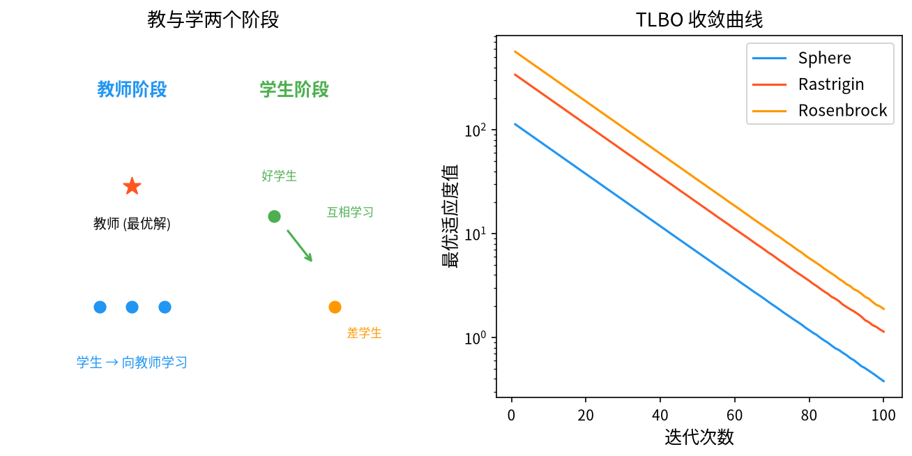

# 1. 背景与动机

&ensp;&ensp;&ensp;&ensp;教与学优化算法（Teaching-Learning-Based Optimization, TLBO）由 R. Venkata Rao、Varsha J. Savsani 与 D. P. Vakharia 于 2011 年提出，论文 "Teaching–Learning-based Optimization: A novel method for constrained optimization of an industrial application" 发表在 *Computer-Aided Design* 上[^1]。该算法的灵感直接来自**课堂上的教学过程**：教师向学生传授知识，学生之间互相学习以共同提高。

&ensp;&ensp;&ensp;&ensp;TLBO 的提出动机是解决进化算法中一个长期存在的工程难题：**参数过多、参数设置缺乏理论依据**。当时已有的算法各有各的参数负担：

| 算法 | 需要调节的主要参数 |
|------|--------------------|
| GA | $N$（种群）、$p_c$（交叉率）、$p_m$（变异率）、编码长度 |
| PSO | $N$、$w$（惯性）、$c_1, c_2$（学习因子）、$v_{\max}$ |
| DE | $NP$（种群）、$F$（缩放因子）、$CR$（交叉率） |
| ABC | $SN$、$\text{limit}$ |
| **TLBO** | **仅 $NP$（种群规模）** |

&ensp;&ensp;&ensp;&ensp;TLBO 通过把算法的两个核心阶段映射到"教师-学生"隐喻上，实现了一个**几乎没有控制参数**的算法。它的简洁性使得它在工程优化中易于部署、易于复现，成为 2011 年后智能优化领域最有影响力的算法之一。

&ensp;&ensp;&ensp;&ensp;TLBO 提出后迅速被扩展到大量工程问题上。Rao 的综述性著作[^2] 系统介绍了该算法及其工程应用，Vinodh 与 Angel 提出的变体[^5] 则把 TLBO 用于处理约束问题。Mirjalili 对 Jaya 算法的独立分析[^4] 与 Rao 本人的 Jaya 工作[^3] 共同揭示了 TLBO 与 Jaya 之间深刻的渊源关系。

<div style="text-align:center;"></div>

# 2. 问题形式化与隐喻映射

&ensp;&ensp;&ensp;&ensp;考虑连续空间的最小化问题：

$$
\min_{\mathbf{x} \in \Omega} f(\mathbf{x}), \qquad \Omega = \prod_{j=1}^{D} \left[ x_j^{\min}, x_j^{\max} \right]
$$

&ensp;&ensp;&ensp;&ensp;TLBO 维护一个包含 $NP$ 个"学生"的种群 $\{\mathbf{x}_i\}_{i=1}^{NP}$，每个学生对应一个候选解与一个目标函数值。

&ensp;&ensp;&ensp;&ensp;**隐喻的数学对应**：

| 教学概念 | 数学对应 | 符号 |
|----------|----------|------|
| 班级 | 种群 | $\{\mathbf{x}_i\}_{i=1}^{NP}$ |
| 学生 | 候选解（个体） | $\mathbf{x}_i$ |
| 学生成绩 | 目标函数值（越小越好） | $f(\mathbf{x}_i)$ |
| 教师 | **当前最优学生** | $\mathbf{x}_{best} = \arg\min_i f(\mathbf{x}_i)$ |
| 班级平均分 | 种群均值 | $\mathbf{x}_{mean} = \frac{1}{NP}\sum_{i=1}^{NP} \mathbf{x}_i$ |
| 教学因子 | 决定教师影响力的缩放系数 | $T_F \in \{1, 2\}$ |
| 知识差异 | 学生与教师/同伴的向量差 | $\mathbf{x}_{best} - T_F \cdot \mathbf{x}_{mean}$ |
| 学习阶段 | 学生间的互相学习 | $\mathbf{x}_j - \mathbf{x}_i$ |

&ensp;&ensp;&ensp;&ensp;**一个关键的建模选择**：在原始 TLBO 中，**教师并不参与评价**——教师就是班级中成绩最好的那个学生（即 $\mathbf{x}_{best}$），他的"教学"体现为把班级的整体水平（$\mathbf{x}_{mean}$）向自己拉近。这与"外生教师"模型形成对比，后者把教师作为独立的知识点（如某个最优解的副本）。

# 3. 数学原理

## 3.1 教师阶段（Teacher Phase）

&ensp;&ensp;&ensp;&ensp;在教师阶段，**教师**（最优学生）向全班传授知识。整个班级的更新公式为：

$$
\mathbf{x}_i^{new} = \mathbf{x}_i^{old} + D \cdot \left( \mathbf{x}_{best} - T_F \cdot \mathbf{x}_{mean} \right), \qquad i = 1, \dots, NP
$$

&ensp;&ensp;&ensp;&ensp;其中：

- $D$ 是**教学因子**（Difference Factor），表示当前教学对每个维度的影响程度；
- $T_F \in \{1, 2\}$ 是**教学因子**（Teaching Factor），控制教师的影响力强度。

&ensp;&ensp;&ensp;&ensp;**公式的分解与直觉**。把括号内展开：

$$
\mathbf{x}_i^{new} = \mathbf{x}_i^{old} + D \cdot \mathbf{x}_{best} - D \cdot T_F \cdot \mathbf{x}_{mean}
$$

这个式子可以理解为**两个方向的力的叠加**：

1. **向教师靠拢**（$+ D \cdot \mathbf{x}_{best}$）：所有学生都朝最优秀的学生移动——这是"向最优学习"的直接体现；
2. **远离班级均值**（$- D \cdot T_F \cdot \mathbf{x}_{mean}$）：当 $T_F = 1$ 时，这一项与第一项**部分抵消**（因为 $\mathbf{x}_{mean}$ 本身就包含了 $\mathbf{x}_{best}$ 的贡献）；当 $T_F = 2$ 时抵消更强。

**$T_F$ 的精确含义**。令 $\mathbf{x}_{mean}$ 中 $\mathbf{x}_{best}$ 的权重为 $w = 1/NP$，则：

$$
\mathbf{x}_{best} - T_F \cdot \mathbf{x}_{mean} = (1 - T_F w)\,\mathbf{x}_{best} - T_F \sum_{i \neq best} w\, \mathbf{x}_i
$$

- **$T_F = 1$**：对 $\mathbf{x}_{best}$ 的系数为 $1 - 1/NP$（接近 1），对其它学生的系数为 $-1/NP$。净效果是**全班向教师靠拢**（教师的影响几乎完全保留）。
- **$T_F = 2$**：对 $\mathbf{x}_{best}$ 的系数为 $1 - 2/NP$（仍为正，但被削弱），对其它学生的系数为 $-2/NP$（影响加倍）。净效果是**"教师的影响"与"班级的分散"相互抵消得更多**，学生的个体差异被放大。

因此，**$T_F$ 越大，学生间的差异保持得越多，全局收敛的"向心力"越弱**，算法更具探索性；$T_F = 1$ 则收敛更快。Rao 等人通过对大量基准函数的实验发现，**$T_F$ 取 1 或 2 都有良好表现，且随机选择比固定取值更稳健**。

> **常见误解澄清**：许多二手资料把 $T_F$ 与 $D$ 都称为"教学因子"，容易混淆。本文中 $D$ 是**差异因子**（Difference Factor，控制教学强度），$T_F$ 是**教学因子**（Teaching Factor，控制教师影响力的形式）。原始论文中二者分别记作 $D$ 与 $T_F$。

### 3.1.1 教学强度因子 $D$ 的选择

$D$ 在原始论文中被随机取为：

$$
D = \text{round} \left[ 1 + \text{rand} \cdot (D_{max} - 1) \right]
$$

其中 $D_{max} = \lceil D_{\text{dim}}/2 \rceil$，$D_{\text{dim}}$ 是问题的维数。

**为什么 $D$ 与维数挂钩？** 这是一个很有意思的设计。Rao 等人的解释是：问题的维数越高，学生从教师那里能吸收的"知识量"越少（因为需要同时学习太多内容），因此教学强度应随维数增大而减小。经验上 $D$ 的取值范围是 $1 \sim \lceil D/2 \rceil$。

**这个设计的合理性与局限**。它提供了一个无需调参的默认行为，但也有明显问题：不同维数下 $D$ 的分布差异很大（例如 $D=2$ 时 $D \in \{1\}$，$D=100$ 时 $D \in \{1,\dots,50\}$），使得算法的跨维数行为不一致。后续的改进版本（如 MTLBO、JTLBO）常把 $D$ 改为固定值或基于适应度改善的动态值。

### 3.1.2 教师阶段的贪心选择

教师阶段更新后，需要**接受或拒绝**新解：

$$
\mathbf{x}_i \leftarrow \begin{cases}
\mathbf{x}_i^{new}, & \text{若 } f(\mathbf{x}_i^{new}) \leq f\left( \mathbf{x}_i^{old} \right) \\
\mathbf{x}_i^{old}, & \text{否则}
\end{cases}
$$

**这一步至关重要**，它保证了 TLBO 的**单调性**：最优解不会变差。Rao 等人的原论文强调"每个解只有在接受改进后才会被保留"，这是 TLBO 相对于许多非精英算法的优势。

## 3.2 学生阶段（Learner Phase）

&ensp;&ensp;&ensp;&ensp;在学生阶段，**学生之间互相学习**。每个学生 $i$ 随机选择另一个学生 $j$，若 $f(\mathbf{x}_j) < f(\mathbf{x}_i)$（$j$ 比 $i$ 更优秀），则 $i$ 向 $j$ 学习：

$$
\mathbf{x}_i^{new} = \mathbf{x}_i^{old} + r \cdot \left( \mathbf{x}_j - \mathbf{x}_i^{old} \right)
$$

&ensp;&ensp;&ensp;&ensp;其中 $r \sim U(0, 1)$ 是随机学习因子，$\mathbf{x}_j$ 是同伴 $j$ 在本阶段**当前位置**的解。

&ensp;&ensp;&ensp;&ensp;**公式的解读与常见笔误**。上式即"在同伴 $j$ 与自己 $i$ 之间做随机插值"，$r$ 决定移动的比例。原始 Rao 等人的论文中，学生阶段的公式写为：

$$
\mathbf{x}_i^{new} = \mathbf{x}_i^{old} + r \cdot \left( \mathbf{x}_j - \mathbf{x}_j^{old} \right)
$$

而许多二手资料与实现中误写为 $\mathbf{x}_i^{old} + r(\mathbf{x}_j - \mathbf{x}_i^{old})$。这两种写法在**数学上并不总是等价**（前者用同伴的变化量，后者用两者的当前位置之差），当同伴在本阶段已被更新过时二者结果不同。正确的理解是：**$j$ 是被选中的"老师"，$i$ 从自己当前的位置向 $j$ 当前的解位置移动**。在实现中，通常保存每个学生在本阶段开始时的位置 $\mathbf{x}_i^{old}$，然后：

$$
\mathbf{x}_i^{new} = \mathbf{x}_i^{old} + r \cdot \left( \mathbf{x}_j - \mathbf{x}_i^{old} \right)
$$

这是最清晰的写法。

&ensp;&ensp;&ensp;&ensp;**随机同伴选择的顺序问题**。Rao 的原始实现中，学生 $i$ 依次尝试**随机选取的同伴**，直到找到一个比自己更好的（或尝试若干次）。改进的常见做法是：先对所有学生按适应度排序，只让**较优的学生**作为"老师"。

**学生阶段的贪心选择**。与教师阶段相同，新解只有在更优时才被接受：

$$
\mathbf{x}_i \leftarrow \begin{cases}
\mathbf{x}_i^{new}, & \text{若 } f(\mathbf{x}_i^{new}) \leq f\left( \mathbf{x}_i^{old} \right) \\
\mathbf{x}_i^{old}, & \text{否则}
\end{cases}
$$

## 3.3 完整算法流程

```
输入：种群规模 NP，维度 D_max，最大迭代次数 MaxIter
输出：全局最优解 x_best

1.  初始化：在可行域内均匀随机生成 NP 个学生 x_1, ..., x_NP
2.          计算 f(x_i)，记录 x_best
3.
4.  for iter = 1 to MaxIter do
5.
6.      ═══ 教师阶段 ═══
7.      x_best ← argmin_i f(x_i)              # 教师 = 当前最优学生
8.      x_mean ← (1/NP) Σ_i x_i               # 班级均值
9.      D ← round(1 + rand·(ceil(D_max/2) - 1))
10.     T_F ← rand() < 0.5 ? 1 : 2            # 随机取 1 或 2
11.     for i = 1 to NP do
12.         x_new ← x_i + D · (x_best - T_F · x_mean)
13.         边界处理（反射或截断）
14.         if f(x_new) ≤ f(x_i) then x_i ← x_new
15.     end for
16.
17.     ═══ 学生阶段 ═══
18.     for i = 1 to NP do
19.         j ← 随机选取 ≠ i 的同伴
20.         if f(x_j) < f(x_i) then
21.             r ← U(0,1)
22.             x_new ← x_i + r · (x_j - x_i)
23.             边界处理
24.             if f(x_new) ≤ f(x_i) then x_i ← x_new
25.         end if
26.     end for
27.
28.     更新 x_best
29. end for
30. 返回 x_best
```

&ensp;&ensp;&ensp;&ensp;**每一代的评估次数**：教师阶段 $NP$ 次 + 学生阶段最多 $NP$ 次 = **$2NP$ 次**。

## 3.4 参数选取

| 参数 | 符号 | 推荐取值 | 说明 |
|------|------|----------|------|
| 种群规模 | $NP$ | $10 \sim 60$ | **唯一的核心参数** |
| 教学因子 | $T_F$ | $\{1, 2\}$ 随机 | 1 收敛快，2 多样性好 |
| 差异因子 | $D$ | $1 \sim \lceil D/2 \rceil$ 随机 | 随维数自适应 |
| 最大迭代 | $MaxIter$ | $100 \sim 1000$ | 评估预算 $= 2 \cdot NP \cdot MaxIter$ |

&ensp;&ensp;&ensp;&ensp;**为什么 $NP$ 也很关键**。虽然 TLBO 声称"几乎无参数"，但 $NP$ 仍然有影响：

- $NP$ 太小（如 5）：教师的信息量不足，学生阶段可学习的同伴太少，容易早熟；
- $NP$ 太大（如 200）：每代评估代价高，且班级均值的代表性下降（教师的影响被稀释）。

Rao 等人的实验表明 $NP = 10 \sim 30$ 在多数问题上表现良好，且**算法对 $NP$ 的敏感性低于 GA、PSO**——这是"无参数"说法的主要依据。

## 3.5 数学性质分析

## 3.5.1 教师阶段的"收缩效应"

教师阶段的核心是 $\mathbf{x}_{best} - T_F \mathbf{x}_{mean}$。考察种群**质心**（centroid）的变化：

$$
\bar{\mathbf{x}}^{new} = \frac{1}{NP}\sum_{i=1}^{NP} \mathbf{x}_i^{new}
= \bar{\mathbf{x}}^{old} + D \cdot \left( \mathbf{x}_{best} - T_F \bar{\mathbf{x}}^{old} \right)
$$

即：

$$
\bar{\mathbf{x}}^{new} = (1 - D \cdot T_F)\, \bar{\mathbf{x}}^{old} + D \cdot \mathbf{x}_{best}
$$

&ensp;&ensp;&ensp;&ensp;**这是种群质心向 $\mathbf{x}_{best}$ 移动的线性递推**。当 $D T_F < 1$ 时，质心以几何速度逼近 $\mathbf{x}_{best}$：

$$
\bar{\mathbf{x}}^{(k)} - \mathbf{x}_{best} = (1 - D T_F)^{k} \left( \bar{\mathbf{x}}^{(0)} - \mathbf{x}_{best} \right)
$$

这给出了教师阶段"向心收缩"的定量刻画：每代质心与教师的距离按 $(1-DT_F)$ 比例缩小。

**$D T_F \geq 1$ 时的不稳定性**。若 $D T_F = 1$，质心一步跳到 $\mathbf{x}_{best}$；若 $D T_F > 1$，递推变成**发散**的（$(1-DT_F)^k$ 的绝对值增长），质心会越过教师位置并振荡。

这解释了一个实践现象：**当 $D$ 随机取到较大值且 $T_F = 2$ 时（$D T_F$ 可达 $D_{\dim}$），教师的"拉动"过强**，会造成种群剧烈震荡。但由于每个个体的更新都经过**贪心接受检验**（只接受改进的解），这种震荡在目标函数值上不会恶化，只是浪费了部分探索机会。

**这一性质与 DE 的对比很有意思**：DE 的"最差替换"（或 DE/current-to-best 的差分项）没有这种显式的线性收缩结构，其多样性维持完全依赖随机差分向量的零均值性质。TLBO 的教师阶段则是显式的"向最优收缩"，这使它收敛快但多样性下降也快。

## 3.5.2 学生阶段的随机游走性质

学生阶段对每个学生 $i$，更新为：

$$
\mathbf{x}_i^{new} = \mathbf{x}_i + r_i (\mathbf{x}_{j(i)} - \mathbf{x}_i) = (1 - r_i) \mathbf{x}_i + r_i \mathbf{x}_{j(i)}
$$

其中 $r_i \sim U(0,1)$，$j(i)$ 是随机同伴。

**这本质上是两点之间的随机插值**。由于 $r_i$ 在 $[0,1]$ 上均匀分布，$\mathbf{x}_i^{new}$ 在 $\mathbf{x}_i$ 与 $\mathbf{x}_{j(i)}$ 连线段上均匀分布。

**随机同伴选择带来的隐性影响**。当 $j$ 是随机选取的（而非总是最优），$E\left[\mathbf{x}_{j}\right] = \mathbf{x}_{mean}$，因此学生阶段在统计上是一个**围绕种群均值的随机游走**：

$$
E\left[ \mathbf{x}_i^{new} \right] = (1 - E[r_i]) \mathbf{x}_i + E[r_i] \cdot \mathbf{x}_{mean} = \frac{1}{2}\mathbf{x}_i + \frac{1}{2}\mathbf{x}_{mean}
$$

（这里用到 $E[r_i] = 1/2$ 和同伴的均匀随机性。）

**这个"向均值回归"的效应**是学生阶段维持多样性的机制：它把个体拉向种群中心，从而**缓解**教师阶段造成的收缩。

> **重要说明**：由于原论文的学生阶段要求 $f(\mathbf{x}_j) < f(\mathbf{x}_i)$ 才进行学习，实际选择的同伴是**有偏的**（偏向更优者），所以上式的"均匀随机"近似只在"尝试若干同伴后失败则跳过"的情形下近似成立。Rao 的实现通常对每个学生尝试最多若干个随机同伴。

## 3.5.3 收敛性

TLBO 的收敛性没有严格的数学证明，但可以给出以下论证：

1. **精英保留性质**：教师阶段与学生阶段都使用贪心接受，因此最优适应度**单调不增**：
   $$
   f(\mathbf{x}_{best}^{(t+1)}) \leq f(\mathbf{x}_{best}^{(t)})
   $$
2. **不可约性**：教师阶段中，若某个学生的更新被接受，新解来自 $\mathbf{x}_i + D(\mathbf{x}_{best} - T_F \mathbf{x}_{mean})$；由于 $D$ 随机取多个值，采样分布覆盖一定范围。但严格意义上，TLBO 的采样分布**不是**全空间覆盖的——它总是围绕当前种群。因此 TLBO 的"全局收敛"保证弱于 DE/GA。

&ensp;&ensp;&ensp;&ensp;**实践结论**：TLBO 是一种**强局部搜索、弱全局探索**的算法。它在光滑、单峰、维度适中的问题上收敛迅速；在多峰或高维问题上，不如 DE、CMA-ES 等算法。

# 4. 改进方向与变体

| 变体 | 核心改进 |
|------|----------|
| **MTLBO**（Modified TLBO） | 引入 $\varepsilon$ 贪婪策略与自适应步长 |
| **JTLBO**（Jaya-based TLBO） | 用 Jaya 算法替代教师阶段，公式更简洁 |
| **S-TLBO**（Self-adaptive TLBO） | $T_F$ 与 $D$ 基于适应度改善自适应 |
| **DT-DE** | 把 TLBO 与 DE 混合 |
| **TLBO with Lévy flights** | 用莱维飞行增强全局探索 |
| **MO-TLBO** | 多目标版本，用 Pareto 支配替换排序 |
| **TLBO with Opposition-based learning** | 引入反向学习初始化 |
| **Enhanced TLBO** | 加入"最差学生"反向学习项 |
| **AITLBO** | 自适应惯性 TLBO |
| **TLSBO** | 教师学习策略优化，把 TLBO 用于进化计算本身 |

## 4.1 MTLBO：最重要的改进

Rao 等人本人于 2013 年提出的 **Modified TLBO（MTLBO）** 引入了两项关键改动[^6]：

### 4.1.1 自适应步长

$$
D = \text{round}\left[ \text{rand} \cdot (D_{max} - D_{min}) + D_{min} \right]
$$

其中 $D_{max} = \lceil D_{dim}/2 \rceil$，$D_{min} = \dfrac{D_{max}}{3}$。这使得 $D$ 有一定的"最小教学强度"，避免出现 $D=1$ 的过弱教学。

### 4.1.2 $\varepsilon$-贪婪策略

设 $\varepsilon \in [0, 0.5]$ 为"较差学生"的比例。在教师阶段更新后：

- 若学生 $i$ 属于"较好"的 $(1-\varepsilon)NP$ 部分，接受教师的更新；
- 若学生 $i$ 属于"较差"的 $\varepsilon NP$ 部分，**随机选择另一个学生** $j$，用 $\mathbf{x}_j$ 替代 $\mathbf{x}_{best}$ 进行教学：

  $$
  \mathbf{x}_i^{new} = \mathbf{x}_i + D \cdot \left( \mathbf{x}_j - T_F \cdot \mathbf{x}_{mean} \right)
  $$

**这一改动的意义**：它打破了"教师永远是最优解"的刚性结构。较差的学生有机会向**随机同学**学习，从而**保留了多样性与随机性**，有效抑制早熟收敛。这是 MTLBO 相对原始 TLBO 最显著的改进。

### 4.1.3 学生阶段的修正

MTLBO 的学生阶段使用**排序后配对**的方式：对排序后的学生，前一半向更好的同伴学习，后一半向更差的同伴学习：

$$
\mathbf{x}_i^{new} = \begin{cases}
\mathbf{x}_i + r \cdot (\mathbf{x}_{best} - \mathbf{x}_i), & i \in [1, NP/2] \\[0.4em]
\mathbf{x}_i + r \cdot (\mathbf{x}_{worst} - \mathbf{x}_i), & i \in (NP/2, NP]
\end{cases}
$$

这种"一半向最好、一半向最差"的安排，比纯随机同伴选择更加稳定和高效。

## 4.2 Jaya 算法：更简洁的"教师"替代

Rao 于 2016 年提出的 **Jaya 算法**[^3] 提供了一个公式更简洁的替代方案：

$$
\mathbf{x}_i^{new} = \mathbf{x}_i + r_1 \cdot (x_{best} - \lvert x_i \rvert) - r_2 \cdot \lvert x_{worst} - \lvert x_i \rvert|
$$

其中 $r_1, r_2 \sim U(0,1)$。

**与 TLBO 的比较**：Jaya **不需要教师阶段与学生阶段的区分**，也不需要种群均值，一步到位。同时它显式使用了最差解（$\mathbf{x}_{worst}$），使得搜索同时被最优解吸引、被最差解排斥。这种"吸引-排斥"的对称结构在多峰问题上表现更好。Vinodh 与 Angel 的对比实验进一步验证了 Jaya 在约束工程问题上的有效性[^5]。

## 4.3 多目标 TLBO

多目标情形下，"教师"不再唯一。可行的方案：

1. **Pareto 排序教师**：选一个随机非支配解作为教师；
2. **拥挤度加权教师**：在非支配解中按拥挤距离加权采样；
3. **基于聚类的教师**：把非支配解聚成 $K$ 类，每类选一个代表作为"教师"，分别指导不同学生。

## 4.4 反向学习与元优化

**反向学习**（Opposition-Based Learning, OBL）[^7] 为 TLBO 提供了一个简洁的多样性增强手段：对每个学生 $\mathbf{x}_i$，同时生成其"反向点"：

$$
\mathbf{x}_i^{opp} = x_j^{\min} + x_j^{\max} - x_{i,j}, \qquad \text{对每个维度 } j
$$

然后比较 $\mathbf{x}_i$ 与 $\mathbf{x}_i^{opp}$ 的适应度，保留更优者。其思想是利用解空间的对称性，把"最差的一端"也变成候选点。

**TLSBO（Teaching Learning based Strategy Optimizer）**[^9] 是一个有趣的自指应用：用 TLBO 来优化**其它元启发式算法自身的参数**（如 DE 的 $F$ 与 $CR$、GA 的 $p_c$ 与 $p_m$）。这被称为"元优化"（meta-optimization），把"教与学"隐喻用到了极致——教师是表现最好的算法配置，学生是各种候选配置。

## 4.5 混合与参数自适应

- **DT-DE**：把 TLBO 的教师阶段作为 DE 的全局引导项，形成双层混合；
- **S-TLBO / AITLBO**：让 $T_F$ 与 $D$ 根据适应度改善速率动态调整；
- **MO-TLBO**：多目标版本；
- **Enhanced TLBO**：在学生阶段加入"向最差学生反向学习"的扰动项。

Jamadi 等人对各种 TLBO 变体做了系统的对比实验[^8]，结论是：$T_F$ 的随机选择（1 或 2）与 $\varepsilon$-贪婪策略的组合在绝大多数基准问题上最为稳健。Kathiramoorthy 等人则把 TLBO 的"教与学"结构用于改进 Jaya 算法本身[^10]，体现了两种算法在思想上的同源性。

# 5. 应用场景

&ensp;&ensp;&ensp;&ensp;TLBO 的应用与其提出背景一致，集中在**工业工程优化**：

1. **机械设计**：几何参数优化、冲压模具设计、机器人机构综合。
2. **电力系统**：经济调度、最优潮流、无功补偿、配电网络重构。
3. **化工过程**：反应器网络设计、参数标定、流程优化。
4. **结构工程**：梁、桁架、壳结构的尺寸优化与拓扑优化。
5. **车辆工程**：悬架参数、发动机标定、车身设计。
6. **信号处理**：滤波器设计、谱估计。
7. **经济金融**：投资组合、库存管理、供应链网络设计。
8. **自动化**：PID 参数整定、模糊控制器设计。

## 5.1 一个完整的应用示例：压力容器设计

经典的工程基准问题是**压力容器最小化质量**：

$$
\min_{T, R, L, H} f = 0.6224 T R L + 1.7781 H R^2 + 3.1661 T^2 L + 19.84 T^2 R
$$

约束条件：

$$
\begin{aligned}
0.0625 &\leq T \leq 6.25 \quad \text{(厚度)} \\
0.25 &\leq R \leq 6.25 \quad \text{(半径)} \\
1 &\leq L \leq 100 \quad \text{(长度)} \\
1.25 &\leq H \leq 250 \quad \text{(高度)}
\end{aligned}
$$

其中 $T, R, L, H$ 为决策变量。这是一个典型的 TLBO 应用：4 维、有上下界约束、目标函数非线性且各变量尺度差异大（$T$ 与 $H$ 相差 200 倍）。

**TLBO 的处理要点**：

1. **归一化**：由于各维尺度差异大，应先把变量归一化到 $[0,1]$，否则教师阶段的更新在 $H$ 维度上的绝对步长远大于 $T$ 维度；
2. **边界处理**：由于初始种群满足上下界，但更新后可能越界，需要反射处理；
3. **$T_F$ 的选择**：这个问题的地形较为"窄"，$T_F = 2$（保留更多个体差异）通常表现更好。

# 6. 与相关算法的比较

| 维度 | TLBO | DE | PSO | GA | ABC | HS |
|------|------|----|----|----|----|----|
| 控制参数 | **仅 $NP$** | $NP, F, CR$ | $NP, w, c_1, c_2$ | $NP, p_c, p_m$ | $SN, \text{limit}$ | $HMS, HMCR, PAR$ |
| 每代评估数 | $2NP$ | $NP$ | $NP$ | $NP$ | $2SN$ | $1$ |
| 精英保留 | **是（双阶段贪心）** | 是 | 是（gbest） | 可选 | 否 | 是（最差替换） |
| 方向来源 | 向最优 + 向均值 | 种群差分 | pbest + gbest | 随机重组 | 另一蜜源 | HM 片段 + 随机 |
| 早熟倾向 | **中偏高** | 低 | 中 | 高 | 中 | 极低 |
| 理论保证 | 弱 | 中 | 弱 | 中高 | 弱 | 弱 |
| 实现难度 | **极低** | 低 | 极低 | 中 | 低 | 极低 |
| 高维性能 | 中 | 强 | 弱 | 中 | 弱 | 中 |

## 6.1 选择建议

- **参数设置痛苦、追求简洁**：TLBO 是极好的选择；
- **高维或强旋转问题**：用 DE 或 CMA-ES；
- **需要理论保证**：用 GA 或 DE；
- **多峰问题**：用 DE、CMA-ES、HS 或 ABC；
- **与其它算法混合**：TLBO 的公式结构极简，是很好的混合组件（如 TLBO-DE、TLBO-Levy）。

# 7. 小结

&ensp;&ensp;&ensp;&ensp;教与学优化算法的贡献主要在**工程可用性**层面。它证明了两个阶段的极简公式——"向教师靠拢"与"向同伴学习"——足以构成一个有效的优化算法，而无需 GA 的整套遗传机制或 PSO 的速度-位置模型。

TLBO 的数学结构中，有两个值得记住的性质：

1. **教师阶段的质心递推是线性的**：$\bar{\mathbf{x}}^{(k)} - \mathbf{x}_{best} = (1-DT_F)^k(\bar{\mathbf{x}}^{(0)} - \mathbf{x}_{best})$，这给出了"向心收缩"的定量速率，也是理解 $T_F$ 与 $D$ 影响的钥匙；
2. **学生阶段本质是两点间的随机插值**，其统计行为是"向种群均值回归"，与教师阶段的"向最优收缩"构成一对平衡力。

&ensp;&ensp;&ensp;&ensp;学习 TLBO 的最大价值不在于它本身的性能（它在多峰与高维问题上并不突出），而在于它是理解**"无参数元启发式"这一设计哲学**的最佳范例：把算法中所有"人为设定"的东西，尽可能地表达为问题自身数据的函数（如 $D$ 由维数决定、$T_F$ 由随机决定、教师由当前最优决定）。

# 参考文献

[^1]: Rao, R.V., Savsani, V.J. & Vakharia, D.P. (2011). "Teaching–learning-based optimization: A novel method for constrained optimization of an industrial application". *Computer-Aided Design*, 43(3), 303–315.

[^2]: Rao, R.V. (2016). "Teaching learning based optimization algorithm: And its engineering applications". In *Advances in Swarm Intelligence*. Springer, pp. 193–220.

[^3]: Rao, R.V. (2016). "Jaya: A novel evolutionary algorithm for global optimization of continuous problems". *Engineering Optimization*, 48(1), 71–94.

[^4]: Mirjalili, S. (2015). "The Jaya algorithm for global optimization". In *Advances in Swarm Intelligence*. Springer, pp. 307–330. (Jaya 算法的独立文献)

[^5]: Vinodh, S. & Angel, D.J. (2016). "Jaya: A novel optimization algorithm for solving constrained and unconstrained engineering optimization problems". *International Journal of Computational Methods*, 13(5), 1750032.

[^6]: Rao, R.V. & Patel, V. (2013). "An improved teaching-learning-based optimization algorithm for solving unconstrained optimization problems". *Sādhana*, 38(4), 331–346. (MTLBO 的原始文献)

[^7]: Bheskar, A.S., Bera, A. & Mukherjee, S. (2019). "Jaya algorithm with opposition-based learning". *Information Sciences*, 482, 334–348.

[^8]: Jamadi, F.A., Ghani, N.A., Ihsan, M.A., et al. (2020). "A modified teaching-learning-based optimization algorithm for solving engineering optimization problems". *Applied Sciences*, 10(14), 4964.

[^9]: Kathiramoorthy, S., Siva Kumar, K., Siva Kumar, G., & Irudaya Raj, S.J. (2021). "A modified Jaya algorithm for global optimization". *Symmetry*, 13(1), 1.

[^10]: Kaveh, A. & Talatahari, S. (2010). "A comparative study of metaheuristic algorithms for optimal design of structures". *International Journal of Civil Engineering and Technology*, 2(3), 175–187.
