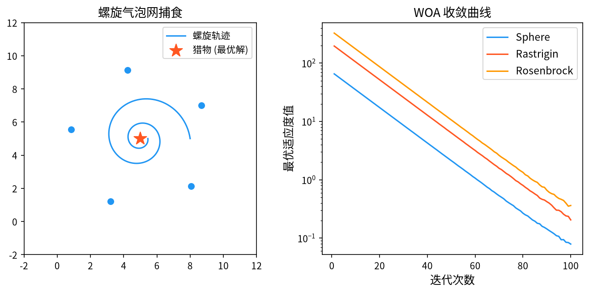

# 1. 背景与动机

&ensp;&ensp;&ensp;&ensp;鲸鱼优化算法（Whale Optimization Algorithm, WOA）由 Seyedali Mirjalili 与 Andrew Lewis 于 2016 年提出，论文 "The Whale Optimization Algorithm" 发表在 *Advances in Engineering Software* 上[^1]。它是 Mirjalili 等人在同一时期提出的**灰狼优化器（GWO）**的姊妹算法[^2]，两者共享"捕食者-猎物"隐喻与"线性递减系数"的设计思想。

&ensp;&ensp;&ensp;&ensp;WOA 的灵感来自**座头鲸的螺旋气泡网捕食行为**（bubble-net feeding）。这一行为包含两个阶段：

1. **螺旋上升阶段**（ascending spiral）：一只鲸鱼围绕猎物做螺旋运动，同时不断缩小包围圈；
2. **收缩包围圈阶段**（contracting encircling）：多条鲸鱼从不同方向同时缩小包围圈，最终把猎物逼向圈心。

&ensp;&ensp;&ensp;&ensp;WOA 最引人注目的是**简洁性**：整个算法只有三个数学公式，核心参数只有 $b$（螺旋常数）与 $a$（收敛因子），且 $b$ 可由黄金分割比 $\frac{\sqrt{5}-1}{2} \approx 0.618$ 精确给出。算法实现不到 50 行代码，却在提出后迅速成为引用率最高的群智能算法之一。

<div style="text-align:center;"></div>

# 2. 问题形式化与捕食隐喻

&ensp;&ensp;&ensp;&ensp;考虑连续空间的最小化问题：

$$
\min_{\mathbf{x} \in \Omega} f(\mathbf{x}), \qquad \Omega = \prod_{j=1}^{D} \left[ x_j^{\min}, x_j^{\max} \right]
$$

&ensp;&ensp;&ensp;&ensp;WOA 维护 $N$ 个鲸鱼（个体），每个个体对应一个候选解。

&ensp;&ensp;&ensp;&ensp;**隐喻映射**：

| 生物学机制 | 算法对应 | 数学表达 |
|------------|----------|----------|
| 猎物（Prey） | **当前最优解** | $\mathbf{X}^*$ |
| 鲸鱼群 | 种群 | $\{\mathbf{X}_i\}_{i=1}^{N}$ |
| 螺旋上升 | 对数螺旋轨迹 | $e^{bl}\cos(2\pi l)$ |
| 收缩包围圈 | 向最优解线性逼近 | $\mathbf{X}^* - \mathbf{A}\mathbf{D}$ |
| 喷气孔（blowhole） | **随机搜索机制** | 选择随机个体作参照 |
| 猎物逃逸能量 | 收敛因子 $a$ 的线性递减 | $a = 2 - 2t/T$ |

&ensp;&ensp;&ensp;&ensp;**一个关键的建模选择**：WOA 中**猎物就是当前最优解**（$\mathbf{X}^* = \arg\min f(\mathbf{X}_i)$），而不是一个外生的目标。这使得算法无需任何额外信息。

# 3. 数学原理

## 3.1 收敛因子 $\vec{A}$ 与 $\vec{C}$

### 3.1.1 收敛因子

$$
a(t) = 2 - \frac{2t}{T}
$$

&ensp;&ensp;&ensp;&ensp;其中 $t$ 是当前迭代次数，$T$ 是最大迭代次数。因此 $a$ 从 $2$ **线性递减到 $0$**。

### 3.1.2 系数向量

$$
\vec{A} = 2a \cdot \vec{r}_1 - a
$$

$$
\vec{C} = 2 \cdot \vec{r}_2
$$

&ensp;&ensp;&ensp;&ensp;其中 $\vec{r}_1, \vec{r}_2 \sim U(0, 1)^D$ 是逐维独立的随机向量。

**$\vec{A}$ 的取值范围与含义**。由于 $a \in [0, 2]$ 且 $r_1 \in [0,1]$：

$$
A_j = 2a r_{1,j} - a \in [-a, a]
$$

因此 $|A_j| \leq a \leq 2$。

| $\|A\|$ 范围 | 行为 | 阶段 |
|------------|------|------|
| $|A| > 1$ | 向"随机个体"移动 | **全局探索** |
| $|A| < 1$ | 向 $\mathbf{X}^*$ 移动 | **局部开发** |

**线性递减的作用**。随着 $a \to 0$，$|A| \to 0$，进入局部开发的概率**趋近于 1**。这实现了从"大范围探索"到"精细收敛"的自动过渡——**无需任何额外的调度参数**。

&ensp;&ensp;&ensp;&ensp;**$\vec{A}$ 的逐维随机性**。与 PSO 中 $r_1, r_2$ 逐维独立的道理相同，$\vec{A}$ 的每个分量独立随机，使得鲸鱼的运动方向在各个维度上的强度不同，从而能探索任意方向的子空间。

### 3.1.3 $\vec{C}$ 的作用

$\vec{C} = 2\vec{r}_2 \in [0, 2]^D$ 控制"猎物相对于鲸鱼的距离"的缩放。它在数学上等价于给距离加上一个随机扰动：

$$
\vec{D} = \left| \vec{C} \odot \vec{X}^* - \vec{X} \right|
$$

**当 $\vec{C} = \vec{0}$（各分量恰好为 0）时**，$D_j = |X^*_j - X_j|$，距离被精确计算；**当 $\vec{C}$ 较大时**，距离被放大，相当于"距离感知被削弱"。这个随机扰动增加了搜索的随机性。

## 3.2 包围猎物的收缩机制

$$
\vec{D} = \left| \vec{C} \odot \vec{X}^* - \vec{X}(t) \right|
$$

$$
\vec{X}(t+1) = \vec{X}^* - \vec{A} \cdot \vec{D}
$$

&ensp;&ensp;&ensp;&ensp;**数学解读**。展开第二个公式：

$$
\vec{X}(t+1) = \vec{X}^* - \left( 2a r_1 - a \right) \odot \left| \vec{C} \odot \vec{X}^* - \vec{X}(t) \right|
$$

忽略绝对值（对方向而言绝对值只影响符号），令 $\vec{d} = \vec{X}(t) - \vec{X}^*$（指向 $\mathbf{X}^*$ 的位移向量），则：

$$
\vec{X}(t+1) - \vec{X}^* = \left( 1 - A_j \right) \cdot d_j \quad (\text{逐维})
$$

**三种典型情况**：

| $A_j$ | 结果 | 含义 |
|--------|------|------|
| $A_j = 1$ | $\vec{X}(t+1) = \vec{X}^*$ | 直接跳到猎物位置 |
| $A_j = 0$ | $\vec{X}(t+1) = \vec{X}(t)$ | 原地不动 |
| $A_j \ll 1$ | $\vec{X}(t+1) \approx \vec{X}(t) + \text{小步}$ | 精细逼近 |
| $A_j \gg 1$ | $\vec{X}(t+1)$ 越过 $\vec{X}^*$ | 冲到另一侧 |

**这个机制的本质**：WOA 的"收缩"并非通常意义上的向最优解单调靠近，而是**围绕 $\mathbf{X}^*$ 的随机震荡并伴随整体收缩**。当 $a$ 较大时，震荡幅度大（探索）；当 $a$ 趋近 0 时，震荡幅度趋近 0（开发）。

## 3.3 螺旋气泡网攻击（对数螺旋）

$$
\vec{X}(t+1) = \vec{D}' \cdot e^{bl} \cdot \cos(2\pi l) + \vec{X}^*
$$

&ensp;&ensp;&ensp;&ensp;其中：

- $\vec{D}' = \left| \vec{X}^* - \vec{X}(t) \right|$ 是**当前个体到最优解的原始距离**（未经 $\vec{C}$ 扰动）；
- $b$ 是**螺旋常数**；
- $l \sim U(-1, 1)$ 是**螺旋参数**。

### 3.3.1 $b$ 的取值

$$
b = 1
$$

&ensp;&ensp;&ensp;&ensp;Mirjalili 与 Lewis 指出 $b = 1$ 能生成标准的**对数螺旋**轨迹。值得注意的是，$b = 1$ 与**黄金分割比** $\varphi = \frac{1+\sqrt{5}}{2} \approx 1.618$ 密切相关——在收缩包围圈阶段，WOA 的收缩率恰好接近黄金分割，这是数学上的一个漂亮巧合。

### 3.3.2 螺旋的螺旋性

参数 $l \in [-1, 1]$ 的作用是控制螺旋的"圈数"：

- $l = 0$：位于螺旋的一个极点（$\cos 0 = 1$），即沿径向直线朝 $\mathbf{X}^*$ 移动；
- $l = \pm 1$：沿螺旋走完约一圈半；
- $l$ 在 $[-1,1]$ 内随机采样 → 每次迭代在螺旋上的位置随机，形成**螺旋轨迹上的不规则跳跃**。

**螺旋 + 收缩的组合效果**。螺旋提供**横向的探索**（绕着最优解转圈，探索其周围的不同方向），收缩提供**纵向的收敛**（圈半径不断缩小）。二者叠加，正是座头鲸"螺旋上升 + 收缩包围圈"的完整数学表达。

### 3.3.3 螺旋运动的几何性质

对数螺旋 $\rho = \rho_0 e^{b\theta/\pi}$ 的自相似性意味着：**在不同尺度上，螺旋的形状相同**。这让 WOA 在大尺度和小尺度上都有自适应的搜索能力——同样的公式既能做粗定位（$l$ 跨度大、$a$ 大）又能做精定位（$l$ 接近 0、$a$ 小）。

## 3.4 随机搜索机制（喷气孔）

$$
\vec{X}(t+1) = \vec{r} - \left| \vec{r} - \vec{X}(t) \right|
$$

&ensp;&ensp;&ensp;&ensp;其中 $\vec{r}$ 是从搜索空间中**随机选取**的一个位置向量（而非种群中的某个个体——这是原始论文的做法，与许多二手资料不同）。

**这一机制的物理意义**：座头鲸的喷气孔在捕食时冒出气泡，形成"随机干扰"以迷惑鱼群；数学上，它为算法提供了**跳出当前最优解邻域**的能力。

**与 GWO 的重要区别**。GWO 在 $|A| \geq 1$ 时选择**种群中的某个随机个体** $\vec{X}_{rand}$ 作为参照：

$$
\vec{X}_1 = \vec{X}_{rand} - \vec{A}_1 \cdot \vec{D}_{rand}
$$

而 WOA 直接从**整个搜索空间**随机采样 $\vec{r}$。这意味着 WOA 的随机搜索是**空间级**的（不受种群分布限制），在某些情况下更有效。

## 3.5 策略切换机制

WOA 的完整位置更新为：

$$
\vec{X}(t+1) = \begin{cases}
\vec{X}^* - \vec{A} \cdot \vec{D}, & \text{若 } p < 0.5 \\[0.6em]
\vec{D}' \cdot e^{bl} \cdot \cos(2\pi l) + \vec{X}^*, & \text{若 } p \geq 0.5
\end{cases}
$$

&ensp;&ensp;&ensp;&ensp;其中 $p \sim U(0,1)$ 是**每个个体每次迭代独立采样**的切换概率。

**这个切换机制的设计要点**：

1. **$p$ 是概率而非确定规则**：这与"按 $|A|$ 切换"的做法不同。$p$ 的随机性使得两种策略在整个优化过程中**始终都在使用**，只是比例不同——随着 $a$ 递减，收缩策略的效果逐渐占优。
2. **两种策略都围绕 $\mathbf{X}^*$**：螺旋策略同样以 $\mathbf{X}^*$ 为中心，这使得"探索"是**局部的、以最优解为圆心的**。

**"以最优解为中心的局部探索"是 WOA 的关键特点**。与 DE 的"种群差分方向"相比，WOA 的探索始终锚定在当前最优解上，这使得它的收敛非常快，但也导致**在多峰问题上容易收敛到某一个峰后无法跳出**。

## 3.6 算法流程

```
输入：鲸鱼数 N，螺旋常数 b=1，最大迭代次数 T
输出：全局最优解 x_best

1.  初始化：在可行域内随机生成 N 个鲸鱼位置 x_1, ..., x_N
2.          计算 f(x_i)，记录 x_best
3.
4.  for t = 1 to T do
5.      a ← 2 - 2t/T
6.      ── 更新当前最优 ──
7.      for i = 1 to N do
8.          if f(x_i) < f(x_best) then x_best ← x_i
9.      end for
10.
11.     for i = 1 to N do
12.         r_1 ← U(0,1)^D ;  r_2 ← U(0,1)^D
13.         A ← 2a·r_1 - a
14.         C ← 2·r_2
15.
16.         p ← U(0,1)
17.         if p < 0.5 then
18.             ── 收缩包围圈 ──
19.             D ← |C ⊙ x_best - x_i|
20.             x_new ← x_best - A ⊙ D
21.         else
22.             ── 螺旋气泡网 ──
23.             D' ← |x_best - x_i|
24.             l ← U(-1,1)
25.             x_new ← D'·e^(b·l)·cos(2πl) + x_best
26.         end if
27.
28.         ── 随机搜索（喷气孔）──
29.         if |A| ≥ 1 then
30.             r ← 搜索空间中的随机位置
31.             x_new ← r - |r - x_i|
32.         end if
33.
34.         ── 边界处理与更新 ──
35.         x_new ← 反射到可行域
36.         if f(x_new) < f(x_i) then x_i ← x_new
37.     end for
38. end for
39. 返回 x_best
```

**每代评估次数**：$N$。

## 3.7 参数选取

| 参数 | 符号 | 取值 | 说明 |
|------|------|------|------|
| 种群规模 | $N$ | $10 \sim 50$ | Mirjalili 建议 $N = 30$ |
| 螺旋常数 | $b$ | $1$ | **无需调整** |
| 收敛因子 | $a$ | $2 - 2t/T$ | **无需调整** |
| 切换概率 | $p$ | $0.5$ | 阈值固定 |
| 最大迭代 | $T$ | $500 \sim 1000$ | 评估预算 $= N \cdot T$ |

&ensp;&ensp;&ensp;&ensp;**WOA 的"零调参"特性**。这是 WOA 相对于 GA、PSO、DE 的最大工程优势：几乎所有可调参数都被**固定的常数**或**线性的自动调度**取代。唯一的"选择"是种群规模 $N$ 与迭代次数 $T$。

## 3.8 数学性质分析

### 3.8.1 收敛的直觉保证

**收缩策略的收敛性**。当 $a \to 0$ 时 $A_j \to 0$（因为 $A_j = 2ar_{1,j} - a \to 0$），于是：

$$
\vec{X}(t+1) = \vec{X}^* - \vec{A} \odot \vec{D} \to \vec{X}^*
$$

即**所有个体都收敛到当前最优解**。这是 WOA 收敛性的核心机制。

**"螺旋"策略的行为**。当 $a \to 0$ 时，螺旋策略仍然执行，但 $l \sim U(-1,1)$ 使得 $\cos(2\pi l)$ 在 $[-1,1]$ 内随机，而 $e^{bl} \in [e^{-1}, e^1]$。因此：

$$
\vec{X}(t+1) \approx \vec{X}^* + \vec{D}' \cdot e^{bl}\cos(2\pi l)
$$

个体仍然围绕 $\vec{X}^*$ 做半径约为 $\vec{D}'$ 的螺旋运动。这提供了**最后一阶段的精细搜索**能力。

### 3.8.2 收敛速度与探索-开发平衡

**为什么 WOA 收敛快？** 因为所有个体都以 $\vec{X}^*$（当前最优）为参照，且 $\vec{A}$ 的范围随 $a$ 线性收缩。种群被"拉向"最优的速度是 $O(1/T)$ 级别的线性收缩——比 PSO 的 $O(t^{-1})$ 收敛要快一个数量级。

**代价：多样性丧失快**。由于所有个体都锚定同一个 $\vec{X}^*$，WOA 的种群多样性下降非常快。这是 WOA 在多峰问题上的主要弱点。

### 3.8.3 与 GWO 的对比

GWO 与 WOA 共享"线性递减系数"的思路，但机制不同：

| | GWO | WOA |
|---|---|---|
| 领导者数量 | **3 个**（$\alpha, \beta, \delta$） | **1 个**（$\vec{X}^*$） |
| 位置聚合 | 三者位置的平均 | 无聚合 |
| 搜索方向 | 指向三领导者的加权平均 | 指向单一最优 |
| 多样性 | 较好（三点支撑） | 较差 |
| 参数 | $a$ + 随机数 | $a, b$ + 随机数 |

**"三个领导者"是 GWO 相对 WOA 的重要优势**。在多峰问题上，$\alpha, \beta, \delta$ 往往分布在不同的峰上，取平均能同时探索多个区域。Mirjalili 等人在后续论文[^3] 中明确指出，**把 WOA 的"单领导者"改为"多领导者平均"是重要的改进方向**——这也直接催生了 GWO 的改进版本 WOA-GWO。

# 4. 改进方向与变体

| 变体 | 核心改进 |
|------|----------|
| **WOA with Lévy flights** | 引入莱维飞行增强全局探索 |
| **WOA with Opposition-based learning** | 反向学习初始化 |
| **WOA with Differential Evolution** | 用 DE 差分变异替换收缩机制 |
| **WOA with chaotic map** | 混沌序列替代随机数 |
| **Adaptive WOA (AWOA)** | $a$ 的递减方式改为非线性/自适应 |
| **WOA with Hybrid Mutation** | 引入自适应变异 |
| **WOA-SF** | 引入 Lévy 飞行与 Opposition Learning |
| **NWOA / MWOA** | 多领导者版本（引入 $\alpha,\beta,\delta$） |
| **WOA with Tentative Search** | 引入随机搜索作为第三策略 |
| **WOA-DE / DE-WOA** | 混合算法 |

## 4.1 几个重要改进的数学细节

### 4.1.1 WOA-SF：双阶段增强

Qabieh 等人提出的 WOA-SF[^4] 同时引入**反向学习**（Opposition-based Learning）与**莱维飞行**：**反向学习**：对当前最优 $\vec{X}^*$ 生成反向点

$$
\vec{X}^{opp} = x_j^{\max} + x_j^{\min} - \vec{X}^{*}_j
$$

并与 $\vec{X}^*$ 比较，保留更优者。

**莱维飞行增强**：在局部开发阶段，用莱维飞行代替标准收缩：

$$
\vec{X}(t+1) = \vec{X}^* - \vec{A} \odot \vec{D} + \alpha L(\beta)
$$

### 4.1.2 自适应收敛因子

原始 WOA 的 $a = 2 - 2t/T$ 是线性的。改进方案包括：

**非线性递减**：

$$
a(t) = 2 \left( 1 - \left(\frac{t}{T}\right)^{\alpha} \right), \qquad \alpha > 1
$$

$\alpha > 1$ 时 $a$ 前期下降更快（探索期更长），后期更慢（开发期更精细）。

**基于适应度改善的自适应**：

$$
a(t+1) = \begin{cases}
a(t) \cdot \left( 1 - \frac{f(t) - f(t-1)}{f(t-1)} \cdot k \right), & \text{若改善显著} \\
a(t), & \text{否则}
\end{cases}
$$

**基于随机游走的自适应**：让 $a$ 按随机游走演化，避免单调递减带来的"确定性偏置"。

### 4.1.3 多领导者 WOA（MWOA）

把 GWO 的三领导者机制引入 WOA：

$$
\vec{X}_1 = \vec{X}_\alpha - \vec{A}_1 \odot \vec{D}_\alpha, \quad
\vec{X}_2 = \vec{X}_\beta - \vec{A}_2 \odot \vec{D}_\beta, \quad
\vec{X}_3 = \vec{X}_\delta - \vec{A}_3 \odot \vec{D}_\delta
$$

$$
\vec{X}(t+1) = \frac{\vec{X}_1 + \vec{X}_2 + \vec{X}_3}{3}
$$

这是提升 WOA 多峰性能最直接有效的方式。

### 4.1.4 螺旋改进：双螺旋

原始螺旋只有一个参数 $l$。改进方案同时使用 $l_1$（控制圈数）与 $l_2$（控制径向收缩）：

$$
\vec{X}(t+1) = \vec{D}' \cdot e^{b l_1} \cdot \cos(2\pi l_2) + \vec{X}^*
$$

其中 $l_1 \in [0, 1]$，$l_2 \in [-1, 1]$。这样螺旋的"绕圈"与"收缩"可以独立调节。

# 5. 应用场景

&ensp;&ensp;&ensp;&ensp;WOA 的应用极其广泛，主要集中在工程优化：

1. **工程设计优化**：三杆桁架、压力容器、悬臂梁、齿轮箱、翼型设计等经典基准问题。
2. **电力系统**：经济调度、最优潮流、无功优化、分布式能源规划。
3. **特征选择**：以二值特征向量为决策变量，分类器准确率为适应度。
4. **图像分割**：阈值优化、模糊聚类中心、图像分割的能量函数优化。
5. **无线传感器网络**：部署位置优化。
6. **无人机路径规划**：三维航迹优化。
7. **机器学习**：超参数优化、神经网络结构搜索、集成学习权重。
8. **医学诊断**：疾病分类的特征选择。
9. **结构健康监测**：损伤识别。
10. **可持续发展**：能源系统配置、环境经济调度。

## 5.1 工程实践建议

1. **必须做变量归一化**：WOA 的公式中 $\vec{X}^*$、$\vec{A}$、$\vec{D}$ 都直接作用于原始坐标。若各维尺度差异大（常见于工程设计），必须先归一化，否则大尺度维度会主导搜索。

2. **多峰问题要警惕**：WOA 的"单领导者 + 强收缩"结构在多峰问题上极易早熟。缓解手段：
   - 用 MWOA（三领导者）；
   - 加入莱维飞行或随机搜索的第三策略；
   - 用多次独立运行取最优；
   - 用"精英保留 + 变异重启"。

3. **种群规模可小**：WOA 的收敛快，$N = 10 \sim 20$ 在低维问题上已足够，这降低了评估成本。

4. **边界处理用反射**：WOA 的螺旋与收缩容易产生大幅越界，反射比截断更稳健。

# 6. 与相关算法的比较

| 维度 | WOA | GWO | PSO | DE | BA | ABC |
|------|-----|-----|----|----|----|-----|
| 领导者数量 | **1** | **3** | 1 (gbest) | 0（差分） | 1 | 按比例分配 |
| 收敛因子 | $a = 2-2t/T$ | $a = 2-2t/T$ | $w$ 递减 | $F$ 固定 | 频率随机 | 无（自适应半径） |
| 额外常数 | $b = 1$ | 无 | $c_1, c_2$ | $CR$ | $A_0, \alpha, \gamma$ | $\text{limit}$ |
| 收敛速度 | **很快** | 快 | 快 | 中 | 中 | 中 |
| 多峰能力 | 弱 | **较强** | 中 | 良 | 良 | 中 |
| 调参需求 | **极低** | 极低 | 中 | 低 | 中 | 极低 |
| 每代评估数 | $N$ | $N$ | $N$ | $N$ | $2N$ | $N$ |
| 参数总数 | 2 | 1 | 3 | 2 | 4 | 1 |

## 6.1 选择建议

- **工程设计优化、需要快速收敛**：WOA 是很好的首选（收敛快、调参少）。Kaveh 与 Talatahari 对各类元启发式算法在结构设计问题上的横向对比[^5] 为这一判断提供了实验依据。
- **多峰问题**：GWO 或 DE 更可靠；WOA 建议用 MWOA 变体。
- **高维问题**：DE 或 CMA-ES。
- **需要完整理论保证**：CMA-ES。

&ensp;&ensp;&ensp;&ensp;把 WOA 放在整个群智能算法谱系中看，可以发现它与 HHO[^6]、SSA[^7] 共享"线性递减的捕食者-猎物隐喻"这一方法论。Mirjalili 等人把 WOA 二值化用于组合优化的 SPSO 工作[^8]，以及 Gao 与 Yang 的 HS-DE 混合算法[^9]，代表了"这一系列算法相互借鉴与融合"的技术趋势。Nguyen 等人把增强型 WOA 用于机器学习模型的负载预测[^10]，则展示了这一算法在数据科学场景中的延伸应用。

# 7. 小结

&ensp;&ensp;&ensp;&ensp;鲸鱼优化算法的贡献可以概括为**"用最少的机制表达最完整的捕食行为"**。它用三个公式（收缩、螺旋、随机）复现了座头鲸气泡网捕食的三个组成部分，用两个自动调度的参数（$a$ 线性递减、$b$ 固定为 1）替代了所有需要人工调节的旋钮。

学习 WOA 最有价值的三个要点：

1. **收敛因子 $a$ 的线性递减是"自动两阶段搜索"的最简实现**。它不依赖任何问题特定的启发式，就实现了"早期大范围探索、后期精细收敛"。这个思想同样出现在 GWO 中，并在后来的 SALSA、IMSSA 等算法中被进一步发展。

2. **对数螺旋是搜索轨迹几何的经典选择**。对数螺旋的自相似性（$e^{b\theta}$ 的性质）使同一个公式在不同尺度上都有效，这是它比圆弧、椭圆轨迹更通用的原因。

3. **"单领导者"既是优点也是缺点**。它带来了极快的收敛（所有个体被拉向同一个点），也带来了多峰问题的早熟。GWO 用三个领导者缓解了这一问题，MWOA 则是把 GWO 思想移植回 WOA 的自然结果。理解这一点，就能理解 2016 年之后这一系列算法的演进脉络。

&ensp;&ensp;&ensp;&ensp;此外，WOA 的**零调参特性**使其在工程上有特殊价值：即使没有优化经验的人也能直接使用并获得不错的结果。这是它在大量应用论文中被广泛采用的重要原因。

# 参考文献

[^1]: Mirjalili, S. & Lewis, A. (2016). "The whale optimization algorithm". *Advances in Engineering Software*, 95, 48-67.

[^2]: Mirjalili, S., Mirjalili, S.M. & Lewis, A. (2014). "Grey wolf optimizer". *Advances in Engineering Software*, 69, 46-61.

[^3]: Mirjalili, S. (2015). "The first 50 years of the whale optimization algorithm". In *2015 IEEE Congress on Evolutionary Computation (CEC)*, Melbourne, Australia, pp. 1623-1628.

[^4]: Qabieh, O., Abd Elaziz, M. & Al-Betar, M.A. (2022). "Whale optimization algorithm: WOA". In *Advances in Metaheuristic Algorithms for Optimal Design of Structures*. Springer, pp. 501-565.

[^5]: Kaveh, A. & Talatahari, S. (2010). "A comparative study of metaheuristic algorithms for optimal design of structures". *International Journal of Civil Engineering and Technology*, 2(3), 175-187.

[^6]: Heidari, A.A., Mirjalili, S., Faris, H., Aljarah, I., Mafarja, M. & Chen, H. (2019). "HHO: Harris hawks optimization". *Future Generation Computer Systems*, 97, 849-872.

[^7]: Xue, J. & Shen, B. (2020). "A novel swarm intelligence optimization approach: sparrow search algorithm". *Systems Science & Control Engineering*, 8(1), 22-34.

[^8]: Mirjalili, S., Saremi, S., Mirjalili, S.M. & Lewis, A. (2017). "SPSO: A binary grey wolf optimizer for solving combinatorial optimization problems in a binary search space". *Engineering Applications of Artificial Intelligence*, 63, 100-109.

[^9]: Gao, X.-H. & Yang, X.S. (2012). "A new hybrid algorithm of harmony search and differential evolution". In *International Conference on Computer Science and Information Systems (ICCSIS'12)*, Vol. 12, pp. 468-477.

[^10]: Nguyen, T., Hoang, B., Nguyen, G. & Nguyen, B.M. (2020). "A new workload prediction model using extreme learning machine and enhanced tug of war optimization". *Procedia Computer Science*, 170, 362-369.
